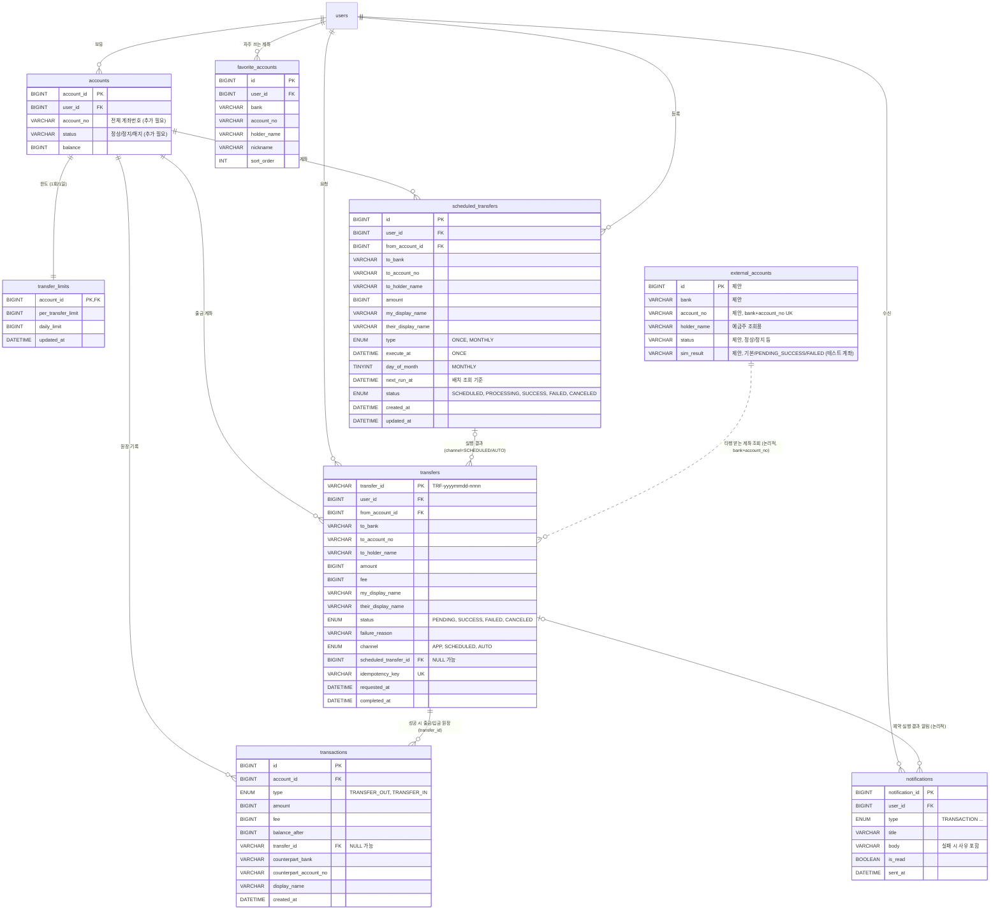

# 거래 흐름도 → ERD / 표

근거: `doc/거래_흐름도_figjam.svg`(이체 · 타행 이체 · 예약 송금 3개 흐름), 컬럼은 `doc/거래_입출금_기획서.md` 15장 기준.
`external_accounts`는 기획서에 컬럼 정의가 없어 흐름도 설명("예금주 조회", "계좌번호 자릿수 검증")에 맞춰 **제안한 컬럼**입니다.

## 1. ERD

## 2. 흐름 단계 → 테이블 매핑

### 2-1. 이체

| 단계 | 읽기/쓰기 | 테이블.컬럼 |
|---|---|---|
| 로그인 | 읽기 | `users` |
| 출금 계좌 선택 | 읽기 | `accounts` (status 정상만, `balance` 표시) |
| 받는 계좌 입력 · 상태·예금주 조회 | 읽기 | `accounts`(같은 서비스) / `external_accounts`(타행) |
| 금액 입력 | 읽기 | `accounts.balance`, `transfer_limits` |
| 표시 이름(선택) | 입력값 | `transfers.my_display_name`, `their_display_name` |
| 재확인 (보내기 / 예약하기) | 읽기 | `transfers`(최근 이체·처리중 건으로 오입력 경고). 예약하기면 3번 흐름 |
| 비밀번호 입력 | 검증 | 계좌 비밀번호 해시 (`accounts`, 추가 필요) |
| 서버 재검증·처리 | 쓰기 | `transfers` INSERT → 잔액 락(`accounts`) → `transactions` 출금/입금 → `transfers.status` 갱신 |
| SUCCESS → 완료 화면 | 읽기 | `transfers`, `transactions.balance_after` |
| FAILED → 실패 화면 | 쓰기 | `transfers.status=FAILED`, `failure_reason` (원장 기록 없음). "다시 보내기" → 금액 입력으로 |

### 2-2. 타행 이체

| 단계 | 읽기/쓰기 | 테이블.컬럼 |
|---|---|---|
| 받는 은행 선택 · 자릿수 검증 | 규칙 | 은행별 자릿수 표(기획서 11장), 코드 상수 또는 은행 마스터 |
| 예금주 조회 | 읽기 | `external_accounts` (`bank`+`account_no` → `holder_name`) |
| 이체 흐름 3~6단계 | — | 2-1과 동일 |
| 출금 원장 1건 (입금 기록 없음) | 쓰기 | `transactions` TRANSFER_OUT 1행만 (`transfers` 1건에 원장 1행) |
| 시뮬레이션 결과 | 분기 | `external_accounts.sim_result` (제안 컬럼) |

| 시뮬레이션 결과 | `transfers.status` | 원장 |
|---|---|---|
| 기본 | SUCCESS | 출금 1행 |
| 테스트 계좌 (PENDING 후 SUCCESS) | PENDING → SUCCESS | 확정 시점에 출금 1행 |
| 테스트 계좌 (FAILED) | FAILED | 없음 |

### 2-3. 예약 송금

| 단계 | 읽기/쓰기 | 테이블.컬럼 |
|---|---|---|
| 재확인 화면에서 예약하기 | — | 2-1 5단계 |
| 날짜·시각 선택 (10분 후 ~ 1년 이내) | 검증 | `scheduled_transfers.execute_at` |
| SCHEDULED (예약됨) | 쓰기 | `scheduled_transfers` INSERT (`type=ONCE`, `status=SCHEDULED`, `next_run_at`) |
| 실행 10분 전까지 → CANCELED | 쓰기 | `scheduled_transfers.status=CANCELED` |
| 실행 시각, 배치 1분마다 → PROCESSING | 쓰기 | `UPDATE ... SET status='PROCESSING' WHERE id=? AND status='SCHEDULED'` (영향 행 1일 때만 실행) |
| 잔액·계좌 상태·한도 재검증 | 읽기 | `accounts.balance`, `accounts.status`, `transfer_limits` |
| 통과 → SUCCESS + 알림 | 쓰기 | `transfers`(channel=SCHEDULED) + `transactions` + `scheduled_transfers.status=SUCCESS` + `notifications` |
| 실패 → FAILED + 사유 알림 | 쓰기 | `transfers.status=FAILED`/`failure_reason` + `scheduled_transfers.status=FAILED` + `notifications` |

## 3. 상태 전이 표

| 대상 | 현재 상태 | 조건 | 다음 상태 |
|---|---|---|---|
| `transfers` | (없음) | 요청 | PENDING 또는 바로 SUCCESS/FAILED |
| `transfers` | PENDING | 타행 시뮬레이션 완료 / 배치 확정 | SUCCESS |
| `transfers` | PENDING, 요청 | 검증 실패 | FAILED |
| `scheduled_transfers` | SCHEDULED | 실행 시각 도달 (배치 1분) | PROCESSING |
| `scheduled_transfers` | SCHEDULED | 사용자 취소 (실행 10분 전까지) | CANCELED |
| `scheduled_transfers` | PROCESSING | 재검증 통과 | SUCCESS (+ 알림) |
| `scheduled_transfers` | PROCESSING | 재검증 실패 | FAILED (+ 사유 알림) |

## 4. 흐름도에서 확인된 점 / 확인이 필요한 점

- 흐름도 2번에 "이체 흐름 3~6단계"로 표시된 부분은 1번 이체 흐름의 금액 입력~비밀번호 입력을 그대로 쓴다는 뜻이라, 별도 테이블은 필요 없습니다.
- `external_accounts`는 흐름도에만 이름이 나오고 기획서 15장에는 정의가 없습니다. 위 컬럼은 제안이므로 시드 데이터 담당과 확정이 필요합니다.
- `accounts`의 전체 계좌번호·상태·비밀번호 해시 컬럼은 옛 `docs/schema.sql`(지움)에 없었습니다. 지금 `docs/sql/02_accounts.sql`에는 전체 계좌번호(`resAccount`)·상태(`lifecycle_status`)가 있고, 비밀번호는 회원 PIN(`pin_credentials.pin_hash`)으로 둡니다(기획서 17장 체크 항목).
- 예약 송금 상태 3번(PROCESSING)은 `scheduled_transfers.status`이고, 이체 결과 상태(`transfers.status`)와 값 집합이 다릅니다. 실행 한 번마다 `transfers` 한 건이 생겨 두 상태가 짝으로 움직입니다.
