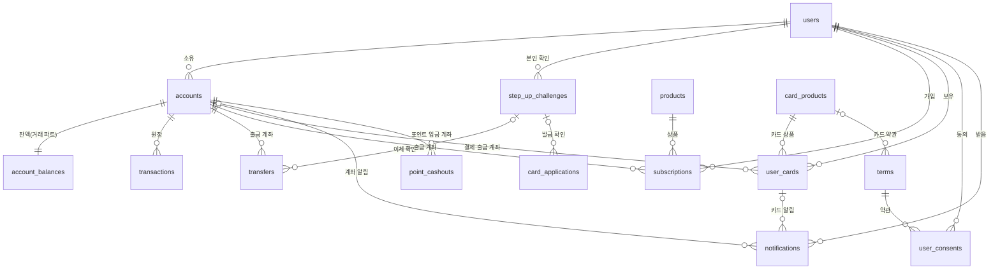
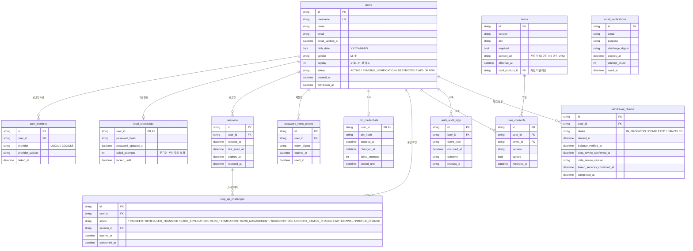
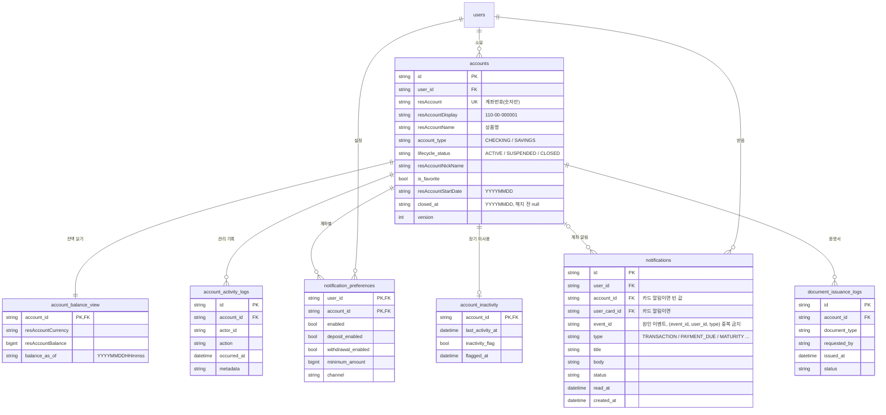
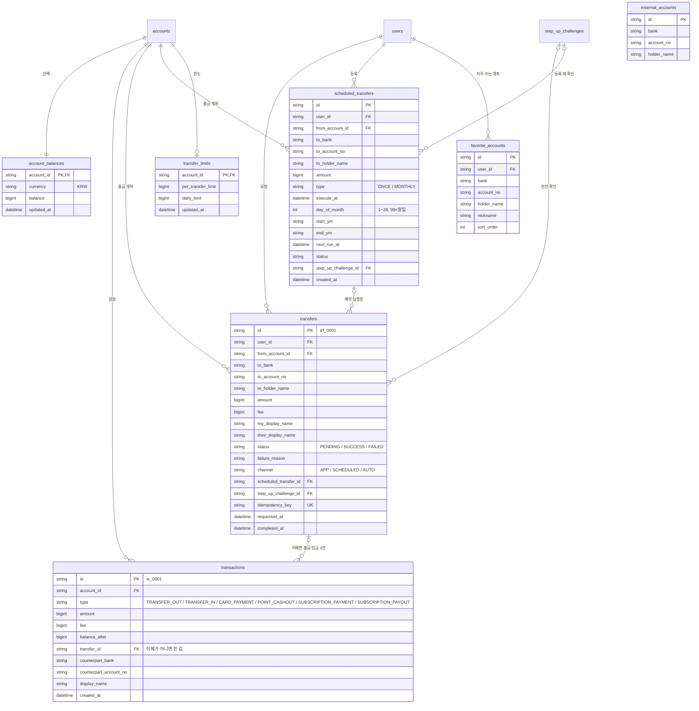
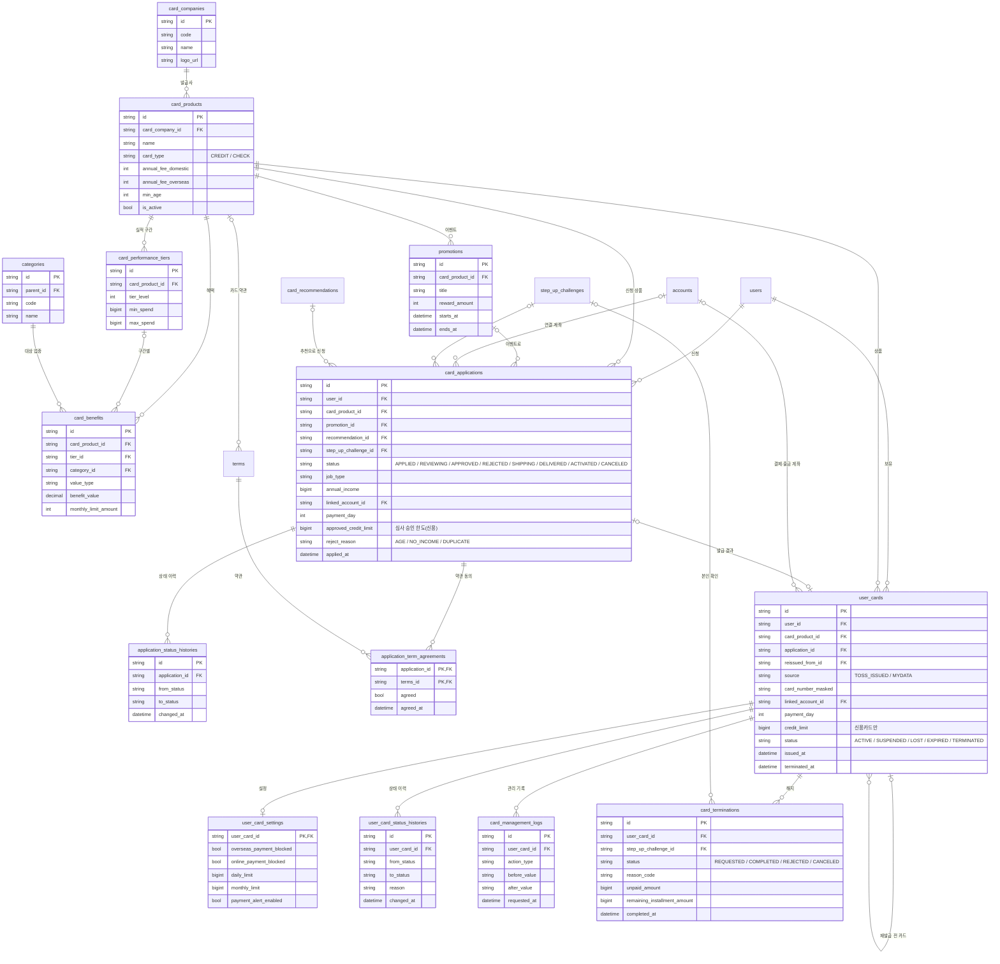

# 테이블 관계도 (ERD)

2026-11-04 · 기준: `docs/기획서.md` — Part 1 6.3·Part 2 8.4(컬럼 사전), Part 3 6장, Part 4·5(카드·거래), Part 6 C-5(이름 규칙). 카드 테이블의 칸은 팀 브랜치 `docs/schema.sql`을 C-5 규칙으로 바꾼 이름입니다.

**읽는 법**

- 테이블이 약 60개라 한 장에 그리지 않고 **파트별 그림 6장 + 전체 연결 그림 1장**으로 나눴습니다. 다른 파트 테이블은 그림 안에서 칸 없이 이름만 나옵니다.
- `PK` = 그 테이블의 고유 번호, `FK` = 다른 테이블을 가리키는 칸. 선 끝 모양: `||` 꼭 1개, `o|` 0 또는 1개, `o{` 0개 이상.
- ID는 문자열(`user_001` 등), 금액은 원 단위 정수, 시각은 `+09:00`, 우리가 만든 빈 칸은 `null`입니다(C-5). 카드 테이블과 일부 거래 테이블(`scheduled_transfers`)은 주요 칸만 적었습니다. 전체 칸은 `docs/기획서.md`의 각 Part에 있습니다.
- 그림에는 **실제 참조(FK)만** 그렸습니다. "카드 대금 → 거래 원장 기록"처럼 API로 이어지는 연결은 맨 아래 표에 있습니다.

---

## 0. 전체 연결 (파트 사이 주요 관계)

---

## 1. 회원·인증 (기획서 Part 1 6장)

`email_verifications`는 가입 전 이메일로 인증하므로 회원과 선이 없습니다.

---

## 2. 계좌 (기획서 Part 2 8장)

`account_balance_view`는 표가 아니라 **보기(view)**입니다. 원본은 거래 파트의 `account_balances`(3번 그림)입니다.

---

## 3. 거래 (기획서 Part 5 15장)

`external_accounts`는 가상 타행 예금주 조회용 시드(11장)라 다른 테이블과 선이 없습니다(계좌번호로 찾음). 칸은 11장 설명에서 정한 최소 칸입니다.

---

## 4. 예금·적금 상품 (기획서 Part 3 6장)

```mermaid
erDiagram
    products ||--o{ product_rates : "기간별 금리"
    products ||--o{ product_rules : "가입 조건"
    products ||--o{ product_documents : "RAG 문서"
    products ||--o{ subscriptions : "가입"
    users ||--o{ subscriptions : "가입자"
    accounts ||--o{ subscriptions : "출금 계좌"
    subscriptions ||--o{ subscription_payments : "적금 납입"

    products {
        string id PK "prod_001"
        string bank "두린은행"
        string name
        string type "TIME_DEPOSIT / INSTALLMENT_SAVINGS"
        string description
        string status "ON_SALE / STOPPED"
        string source_url
        string verified_at "YYYYMMDD"
    }
    product_rates {
        string id PK
        string product_id FK
        int term_min
        int term_max
        string term_unit "MONTH / DAY"
        string base_rate "연 %"
        string bonus_rate
        string effective_from "YYYYMMDD"
    }
    product_rules {
        string id PK
        string product_id FK
        bigint min_amount
        bigint max_amount
        int min_months
        int max_months
        int max_per_user
        string rules_json
    }
    subscriptions {
        string id PK "sub_001"
        string user_id FK
        string product_id FK
        string source_account_id FK
        bigint principal
        bigint monthly_amount
        string applied_rate
        string start_date "YYYYMMDD"
        string maturity_date "YYYYMMDD"
        string status "ACTIVE / MATURED / TERMINATED"
        string closed_at "YYYYMMDD, 진행 중 null"
        string idempotency_key UK "중복 가입 방지"
    }
    subscription_payments {
        string id PK
        string subscription_id FK
        bigint paid_amount
        string paid_at "YYYYMMDDHHmmss"
    }
    product_documents {
        string id PK
        string product_id FK
        string title
        string source_url
        string version_date
    }
```

---

## 5. 카드 — 상품·발급·보유 (기획서 Part 4 1-2·1-3·1-7)

---

## 6. 카드 — 이용·청구·분석·포인트 (기획서 Part 4 1-1·1-4~1-6)

```mermaid
erDiagram
    user_cards ||--o{ card_transactions : "승인 내역"
    merchants ||--o{ card_transactions : "가맹점"
    card_benefits |o--o{ card_transactions : "적용 혜택"
    categories ||--o{ merchants : "업종"
    categories |o--o{ categories : "상위 분류"
    card_companies ||--o{ billing_cycle_rules : "결제일 규칙"
    user_cards ||--o{ card_bills : "청구서"
    card_bills ||--o{ card_bill_items : "청구 항목"
    card_transactions ||--o{ card_bill_items : "할부 회차"
    users ||--o{ recurring_payments : "고정지출"
    user_cards ||--o{ recurring_payments : "결제 카드"
    merchants ||--o{ recurring_payments : "가맹점"
    user_cards ||--o{ spending_forecasts : "예측"
    user_cards ||--o{ daily_card_spending : "일별 집계"
    users ||--o{ card_recommendations : "추천"
    card_products ||--o{ card_recommendations : "추천 상품"
    card_recommendations ||--o{ card_recommendation_details : "업종별"
    categories ||--o{ card_recommendation_details : "업종"
    card_products ||--o{ card_issuance_rankings : "순위"
    users ||--o{ card_points : "포인트"
    card_companies ||--o{ card_points : "카드사별"
    card_points ||--o{ point_cashouts : "현금화"
    accounts ||--o{ point_cashouts : "입금 계좌"
    users ||--o{ mydata_consents : "연동 동의"
    card_companies ||--o{ mydata_consents : "카드사"
    mydata_consents ||--o{ mydata_sync_logs : "동기화 기록"

    card_transactions {
        string id PK
        string user_card_id FK
        string merchant_id FK
        string approval_no
        datetime transacted_at
        bigint amount
        int installment_months "0=일시불"
        string status "APPROVED / PARTIAL_CANCELED / CANCELED"
        bigint canceled_amount
        string applied_benefit_id FK
        bool is_performance_counted
    }
    merchants {
        string id PK
        string category_id FK
        string name
        string business_no
    }
    billing_cycle_rules {
        string card_company_id PK, FK
        int payment_day PK
        int start_month_offset
        int start_day
        int end_month_offset
        int end_day
    }
    card_bills {
        string id PK
        string user_card_id FK
        string billing_ym "YYYYMM"
        date usage_start
        date usage_end
        date payment_date
        bigint total_amount
        bigint paid_amount
        string status "SCHEDULED / CONFIRMED / PAID / OVERDUE"
    }
    card_bill_items {
        string id PK
        string bill_id FK
        string card_transaction_id FK
        int installment_seq
        bigint principal_amount
        bigint fee_amount "1차 무이자 0"
    }
    recurring_payments {
        string id PK
        string user_id FK
        string user_card_id FK
        string merchant_id FK
        bigint expected_amount
        int expected_day
        string detected_by "AUTO / USER"
        bool is_active
    }
    spending_forecasts {
        string id PK
        string user_card_id FK
        string billing_ym
        bigint predicted_total
        string model_type "MOVING_AVG / LINEAR / ML"
    }
    daily_card_spending {
        string user_card_id PK, FK
        date spend_date PK
        bigint total_amount
        int tx_count
    }
    card_recommendations {
        string id PK
        string user_id FK
        string card_product_id FK
        bigint net_annual_benefit
        int rank_no
    }
    card_recommendation_details {
        string recommendation_id PK, FK
        string category_id PK, FK
        bigint spend_amount
        bigint benefit_amount
    }
    card_issuance_rankings {
        string id PK
        string period_type
        date period_start
        string segment_age
        string segment_gender
        string card_product_id FK
        int rank_no
        int issue_count
    }
    card_points {
        string id PK
        string user_id FK
        string card_company_id FK
        string point_name
        bigint balance
        bigint expiring_amount
    }
    point_cashouts {
        string id PK
        string card_point_id FK
        string account_id FK
        bigint amount
        string status
        datetime completed_at
    }
    mydata_consents {
        string id PK
        string user_id FK
        string card_company_id FK
        string scope
        string status
        datetime expires_at
    }
    mydata_sync_logs {
        string id PK
        string mydata_consent_id FK
        string api_type
        string result
        datetime started_at
    }
```

---

## 그림에 없는 연결 (API로 이어짐, FK 아님)

| 어디서 | 어디로 | 무엇을 | 근거 |
|---|---|---|---|
| 카드 대금 결제·체크카드 결제 (`card_bills`, `card_transactions`) | `transactions` | `CARD_PAYMENT` 출금 기록 | Part 5 3장·Part 4 1-7 |
| 포인트 현금화 (`point_cashouts`) | `transactions` | `POINT_CASHOUT` 입금 기록 | 1-1-7 |
| 예금·적금 가입·납입 (`subscriptions`, `subscription_payments`) | `transactions` | `SUBSCRIPTION_PAYMENT` 출금 기록 | Part 3 PROD-F08 |
| 중도 해지·만기 (`subscriptions`) | `transactions` | `SUBSCRIPTION_PAYOUT` 입금 기록 | PROD-F10·F11 |
| `transactions` | `notifications` | 거래 확정 이벤트 → 입출금 알림 (`event_id`) | Part 2 10장 |
| 회원 탈퇴 점검 (`withdrawal_checks`) | 계좌·거래·카드·상품 | 남은 잔액(`account-readiness`), 처리중·예약 이체(`transfer-blockers`), 해지 안 된 카드(`card-blockers`), 진행 중 예금·적금(`subscription-blockers`) — 모두 `/internal/users/{userId}/…` | AUTH-F09 |
| 계좌 해지 점검 (`accounts`) | 거래·카드·상품 | 처리중·예약 이체, 연결된 카드(`linked-cards`), 이 계좌가 출금 계좌인 계약 — 모두 `/internal/accounts/{accountId}/…` | ACCT-F05 |
