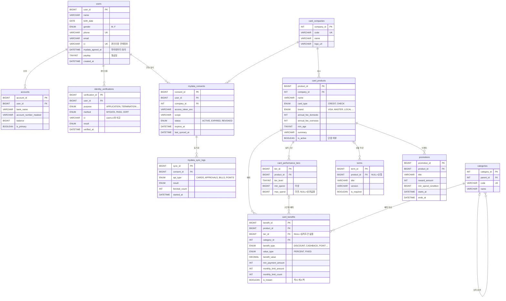
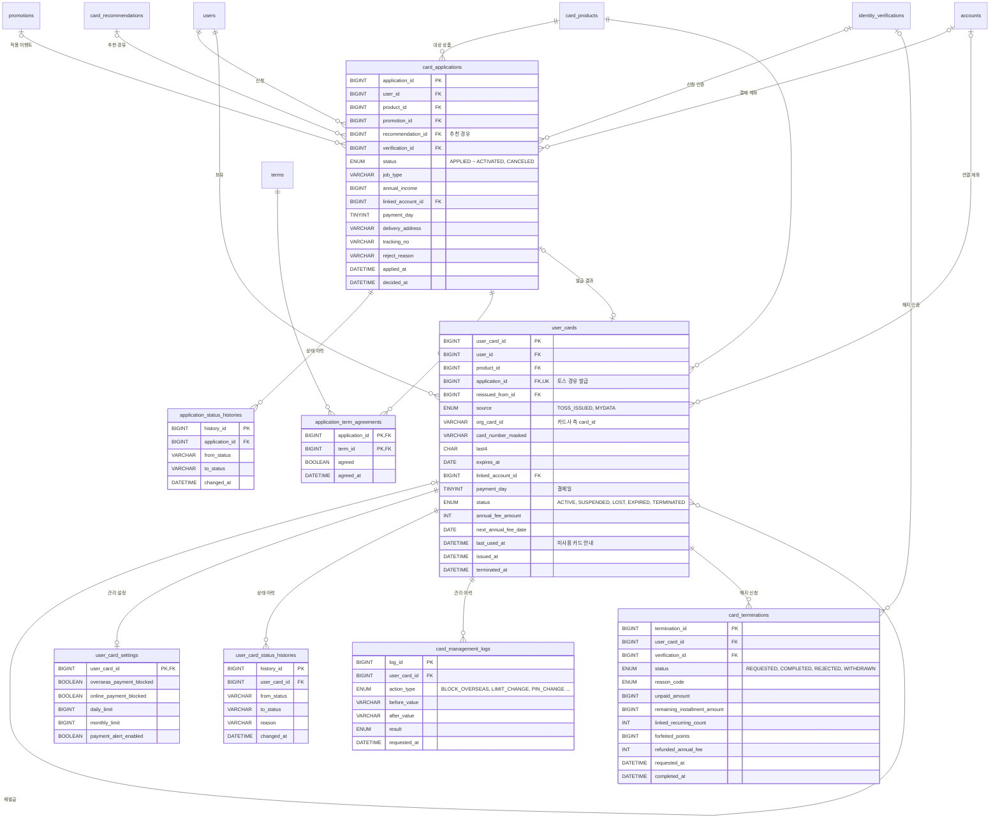
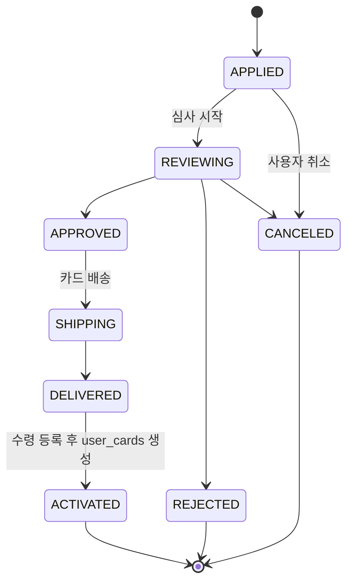
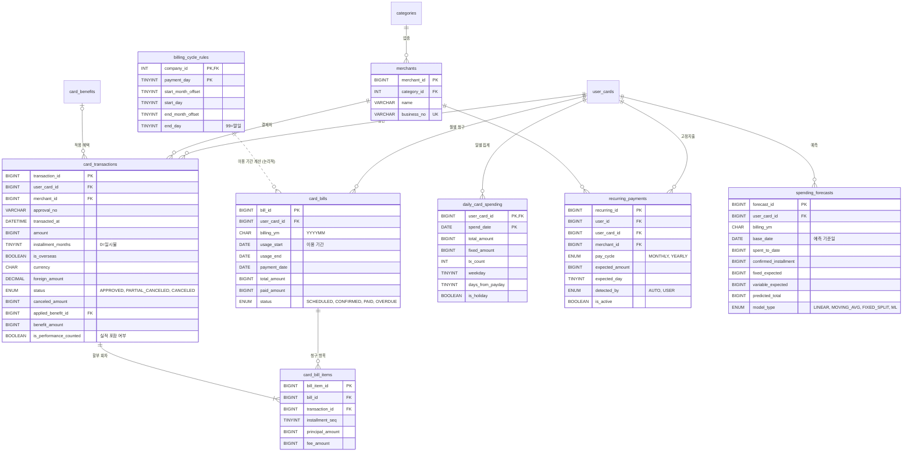
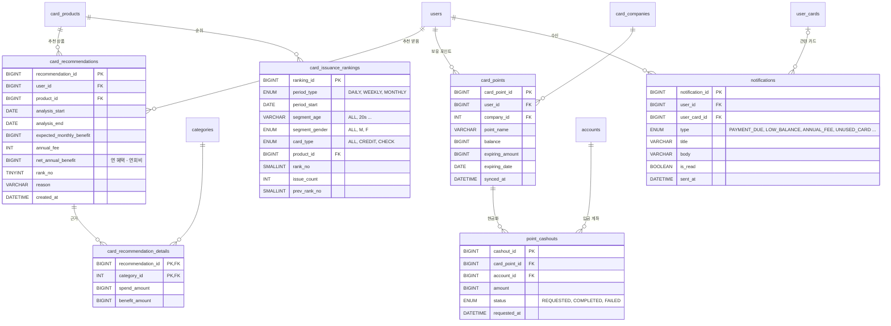

# 토스 카드 서비스 클론 - ERD

- DBMS: MySQL 8.0 / 문자셋 utf8mb4
- 전체 DDL: [schema.sql](schema.sql) (34개 테이블)
- 기능별 필요 컬럼과 기능 간 연결: [FEATURES.md](FEATURES.md)
- 금액은 원 단위 `BIGINT` 정수로 저장합니다. 외화 원금(`foreign_amount`)만 `DECIMAL`입니다.

## 0. 테이블 목록과 우선순위

| 도메인 | 테이블 | 우선순위 | 연결 기능 |
|---|---|---|---|
| 회원/계좌 | `users`, `accounts` | 필수 | 공통, 체크카드 연결 계좌 |
| | `identity_verifications` | 필수 | 발급·해지 본인 확인 |
| 마이데이터 | `mydata_consents` | 필수 | Mock 카드사 API 연동 동의·토큰 |
| | `mydata_sync_logs` | 선택 | 동기화 이력 |
| 상품/혜택 | `card_companies`, `card_products`, `categories`, `card_benefits`, `terms` | 필수 | 카드 상품 조회, 추천 계산 기준 |
| | `card_performance_tiers` | 차별화 | 전월 실적 진행률 |
| | `promotions` | 선택 | 발급 캐시백 이벤트 |
| 발급/보유/해지 | `card_applications`, `application_status_histories`, `application_term_agreements` | 필수 | 카드 발급 |
| | `user_cards`, `card_terminations` | 필수 | 카드 목록 조회, 해지 |
| | `user_card_settings`, `user_card_status_histories`, `card_management_logs` | 선택 | 일시정지, 분실신고, 결제 차단, 한도, 비밀번호 변경 |
| 이용/청구 | `merchants`, `card_transactions`, `card_bills`, `card_bill_items`, `billing_cycle_rules` | 필수 | 이용 내역, 청구 예정 금액, 결제일별 이용 기간 |
| 분석/예측 | `recurring_payments`, `spending_forecasts` | 차별화 | 고정지출 탐지, 사용 금액 예측 |
| | `daily_card_spending` | 선택 | 요일·월급일 패턴 시계열 예측 |
| 추천/순위 | `card_recommendations`, `card_recommendation_details` | 차별화 | 카드 추천 |
| | `card_issuance_rankings` | 선택 | 발급 순위 |
| 포인트/알림 | `card_points`, `point_cashouts`, `notifications` | 선택 | 포인트 현금화, 알림 |

> 일정이 빠듯하면 **필수** 테이블(19개)만으로 먼저 동작하는 버전을 만들고 나머지를 붙이세요.

---

## 1. 회원 · 카드 상품 · 혜택



## 2. 발급 신청 · 보유 카드 · 해지



**발급 상태 흐름**



## 3. 이용 내역 · 청구 · 예측



## 4. 추천 · 발급 순위 · 포인트 · 알림



---

## 5. 설계 포인트

### 5-1. 보유 카드는 하나의 테이블로 관리
- 토스에서 발급한 카드와 마이데이터로 연동한 타사 카드를 `user_cards.source`로 구분합니다. 목록 조회 화면은 하나의 쿼리로 해결됩니다.
- 토스 경유 발급이면 `application_id`로 원래 신청과 연결합니다(1:0..1).
- 분실 재발급은 기존 카드를 `LOST`로 바꾸고, 새 카드의 `reissued_from_id`가 이전 카드를 가리키게 합니다.

### 5-2. 이용 기간과 결제일 분리 (`card_bills`)
- 결제일이 14일이면 보통 전월 1일~말일 사용분이 청구됩니다. 그래서 `billing_ym`(결제월)과 `usage_start ~ usage_end`(이용 기간)를 따로 저장합니다.
- 사용 금액 예측과 전월 실적 계산은 모두 **이용 기간**을 기준으로 해야 합니다.

- 결제일별 이용 기간은 카드사마다 다르므로 `billing_cycle_rules`(카드사 + 결제일 → 이용 시작/끝)로 관리하고, 이 규칙으로 `card_bills`를 미리 `SCHEDULED` 상태로 만듭니다.

### 5-3. 할부는 청구 항목으로 나눔 (`card_bill_items`)
- 30만 원 3개월 할부는 거래 1건(`card_transactions`)과 청구 항목 3건으로 저장됩니다. 청구 항목은 이번 달, 다음 달, 다다음 달 `card_bills`에 하나씩 들어갑니다.
- 승인 시점에 미래 청구서를 `SCHEDULED` 상태로 만들어 두면, 다음 달 예측에서 "이미 확정된 할부분"(`confirmed_installment`)을 바로 합산할 수 있습니다.

### 5-4. 혜택 규칙은 데이터로 관리 (`card_benefits`)
- "편의점 10% 할인, 월 5천 원 한도, 전월 30만 원 이상"을 한 행으로 저장합니다. 혜택이 바뀌어도 코드를 고칠 필요가 없습니다.
- 추천 계산: 사용자의 카테고리별 월평균 지출 × 각 상품의 `card_benefits` → 한도 적용 → 연회비 차감 → `net_annual_benefit` 순으로 정렬합니다.
- 세금이나 상품권처럼 실적에서 제외되는 거래는 `card_transactions.is_performance_counted = FALSE`로 표시합니다.

### 5-5. 추천, 순위, 예측은 배치 스냅샷으로 저장
- `card_recommendations`, `card_issuance_rankings`, `spending_forecasts`는 원본 데이터로 계산한 **결과 테이블**입니다. 하루 1회 배치(스케줄러)로 갱신합니다.
- 화면을 열 때마다 집계 쿼리를 돌리지 않아도 되고, "지난주 대비 순위 변동"이나 "예측 정확도 비교" 같은 이력 기능도 쉽게 만들 수 있습니다.

### 5-6. 해지는 확인 정보 스냅샷과 함께 기록
- 해지 신청 시점의 미결제 금액, 남은 할부, 연결된 자동결제 수, 소멸 포인트, 연회비 환급액을 `card_terminations`에 저장합니다. 나중에 "해지 당시 무엇을 안내했는지" 확인할 수 있습니다.

---

## 6. 주요 쿼리 예시

**실적 진행률** (진행 중인 이용 기간의 실적과 다음 구간까지 남은 금액)

`:billing_ym`은 지금 진행 중인 이용 기간이 청구될 결제월입니다. 이 실적이 다음 달 혜택 구간을 결정합니다.

```sql
WITH perf AS (
  SELECT uc.user_card_id,
         uc.product_id,
         COALESCE(SUM(t.amount - t.canceled_amount), 0) AS performance
  FROM user_cards uc
  JOIN card_bills b ON b.user_card_id = uc.user_card_id
                   AND b.billing_ym   = :billing_ym
  LEFT JOIN card_transactions t ON t.user_card_id = uc.user_card_id
                               AND t.transacted_at >= b.usage_start
                               AND t.transacted_at <  b.usage_end + INTERVAL 1 DAY
                               AND t.is_performance_counted = TRUE
                               AND t.status <> 'CANCELED'
  WHERE uc.user_card_id = :user_card_id
  GROUP BY uc.user_card_id, uc.product_id
)
SELECT p.performance,
       MIN(pt.min_spend)                 AS next_tier_min,
       MIN(pt.min_spend) - p.performance AS remaining   -- NULL이면 최고 구간 달성
FROM perf p
LEFT JOIN card_performance_tiers pt ON pt.product_id = p.product_id
                                   AND pt.min_spend  > p.performance
GROUP BY p.user_card_id, p.performance;
```

**주간 발급 순위 집계** (배치에서 `card_issuance_rankings`에 INSERT)

```sql
SELECT a.product_id,
       COUNT(*)                                     AS issue_count,
       RANK() OVER (ORDER BY COUNT(*) DESC)         AS rank_no
FROM card_applications a
WHERE a.status IN ('APPROVED','SHIPPING','DELIVERED','ACTIVATED')
  AND a.applied_at >= :week_start
  AND a.applied_at <  :week_start + INTERVAL 7 DAY
GROUP BY a.product_id;
```

**사용 금액 예측 (고정지출 분리 + 선형 추정)**

```
predicted_total = spent_to_date                         -- 이용 기간 시작 ~ 기준일 일시불 사용액
                + confirmed_installment                 -- card_bill_items 중 이전 할부 회차분
                + fixed_expected                        -- 남은 기간에 예정된 recurring_payments
                + (변동지출 일평균 × 남은 일수)            -- variable_expected
```

---

## 7. 목 데이터

[scripts/generate_seed.py](../scripts/generate_seed.py)가 34개 테이블 전부를 채우는 [seed.sql](seed.sql)을 만듭니다. 표준 라이브러리만 쓰고, 같은 `--seed`면 항상 같은 데이터가 나옵니다.

```bash
py scripts/generate_seed.py                # 회원 300명 (기본값)
mysql -u root -p < docs/schema.sql
mysql -u root -p < docs/seed.sql           # 다시 실행하면 TRUNCATE 후 새로 넣음
```

**기준 시각**: 2026-11-03 09:00. 카드 이용 내역은 2026-05-01부터, 발급 신청은 2025-11-01부터 있습니다.

**규모 (기본값)**: 회원 300명, 보유 카드 약 900장, 이용 내역 약 6만 건, 파일 약 15MB. 발급 순위를 더 촘촘하게 보고 싶으면 `--users`를 늘리세요(신청 건수가 회원 수에 비례합니다).

**들어 있는 시나리오**
- **회원**: 20~65세 성인과 청소년(약 8%, 체크카드만 보유). 성인의 약 85%가 마이데이터에 동의했고, 약 75%는 월급일(`payday`)이 있어 월급 직후에 소비가 몰립니다.
- **카드 상품**: 카드사 10곳, 상품 23종(단종 1종 포함). 실제 상품을 참고한 가상 이름과 혜택입니다.
- **보유 카드**
  - 마이데이터로 연동한 타사 카드와 토스에서 발급받은 카드가 섞여 있습니다.
  - 유효기간 만료 후 갱신, 분실 후 재발급(`reissued_from_id`), 일시정지, 해지된 카드가 있습니다.
- **발급 신청**
  - 상태가 `APPLIED`부터 `ACTIVATED`까지 골고루 있고 거절과 취소도 있습니다. 상태 이력, 약관 동의, 본인인증(가끔 1회 실패 후 성공)이 함께 들어 있습니다.
  - 프로모션 기간에는 해당 카드 신청이 늘어납니다.
  - 추천을 받은 뒤 한 달 안에 그 카드를 신청한 경우 `recommendation_id`로 연결됩니다.
- **이용 내역**
  - 카테고리별 일반 결제, 정기결제(통신비, OTT, 전기요금), 고액 할부, 해외 결제(USD/JPY), 전체 취소와 부분 취소가 있습니다.
  - 혜택은 직전 이용 기간 실적으로 구간을 정한 뒤, 월 한도와 횟수 한도를 적용해 계산합니다.
- **청구**
  - 결제일 10종의 이용 기간 규칙(`billing_cycle_rules`)으로 청구서를 만듭니다.
  - 할부는 회차별 청구 항목으로 나뉘고, 3개월 초과 할부에는 수수료가 붙습니다. 청구서 상태는 `PAID`, `CONFIRMED`, `SCHEDULED`가 있고 연체(`OVERDUE`)도 일부 있습니다.
- **분석 결과**
  - 사용 금액 예측: 진행 중인 기간과 지난 두 기간의 중간 시점 예측이 있고, 두 모델(LINEAR, FIXED_SPLIT)을 비교할 수 있습니다.
  - 추천: 매월 1일 배치로 만든 상위 5개입니다.
  - 발급 순위: 주간 8주와 월간 3개월이고, 연령·성별·카드 유형별로 나뉩니다.
  - 일별 집계는 거래가 있는 날만 들어 있습니다.
- **마이데이터·알림**
  - 마이데이터는 카드사별 동의(일부 철회)와 최근 3일 동기화 이력(일부 실패)이 있습니다.
  - 포인트와 현금화 내역이 있습니다.
  - 알림은 9가지 유형이 모두 들어 있습니다.

> 이 데이터는 `user_cards.status`와 실제 거래 흐름이 맞도록 만들었습니다. 예를 들어 해지·분실 이후에는 그 카드로 거래가 없고, 해외결제를 차단한 카드나 국내 전용 카드로는 해외 결제가 없습니다.
