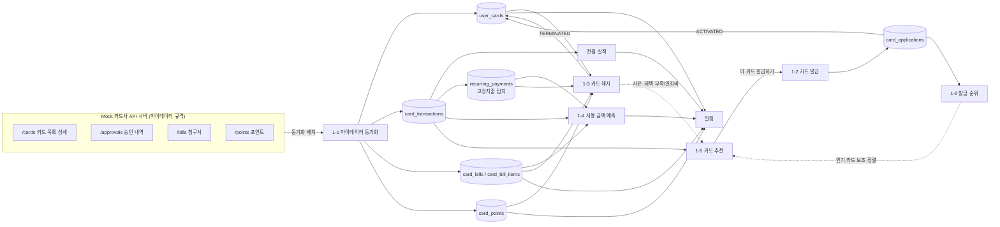

# 기능별 데이터 설계와 기능 간 연결

- 기준 스키마: [schema.sql](schema.sql) / [ERD.md](ERD.md)
- 이 문서는 **기능 → 필요한 테이블·컬럼 → 다른 기능과의 연결** 순서로 정리합니다.
- 🆕 표시는 이 문서를 쓰면서 새로 추가한 컬럼/테이블입니다. 모두 [schema.sql](schema.sql)에 반영되어 있고, 목록은 [8. 스키마 보완 내역](#8-스키마-보완-내역)에 있습니다.
- 표기: `R` = 읽기, `W` = 쓰기(INSERT/UPDATE)

---

## 0. 전체 흐름 한눈에 보기



**핵심 연결 고리 4개**

| 연결 | 무엇이 흐르나 | 연결 컬럼 |
|---|---|---|
| 발급 → 보유 | 발급 완료된 카드가 내 카드 목록에 들어감 | `user_cards.application_id` |
| 보유 → 이용/청구 | 모든 거래·청구서는 보유 카드에 매달림 | `card_transactions.user_card_id`, `card_bills.user_card_id` |
| 이용 → 예측·추천·실적 | 거래 + 가맹점 카테고리가 계산의 원재료 | `card_transactions.merchant_id → merchants.category_id` |
| 추천 → 발급 → 순위 | 추천받은 카드를 발급하면 발급 건수가 순위에 반영 | 🆕 `card_applications.recommendation_id`, `card_applications.product_id` |

---

## 공통 기반 테이블

모든 기능이 공유하는 마스터 데이터입니다. 먼저 시드 데이터를 넣어야 나머지 기능이 동작합니다.

| 테이블 | 핵심 컬럼 | 쓰는 기능 |
|---|---|---|
| `users` | `user_id`, `name`, `birth_date`, `gender`, `ci`, `mydata_agreed_at`, 🆕 `payday` | 전체. `ci`는 본인 확인(발급·해지), `birth_date`/`gender`는 순위 세그먼트, `payday`는 예측 |
| `accounts` | `account_id`, `user_id`, `bank_name`, `balance`, `is_primary` | 체크카드 연결, 결제 계좌 잔액 부족 알림, 포인트 현금화 입금 |
| `card_companies` | `company_id`, `code`, `name`, `logo_url` | 카드 목록 로고, 포인트(카드사 단위), 마이데이터 연동 대상 |
| `card_products` | `product_id`, `company_id`, `name`, `card_type`, `annual_fee_domestic`, `annual_fee_overseas`, `min_age`, `is_active` | 카드 상세, 발급, 추천 필터, 순위 |
| `categories` | `category_id`, `parent_id`, `code`, `name` | 이용 내역 분류, 혜택 대상, 추천 필터(교통·통신·쇼핑·해외) |
| `merchants` | `merchant_id`, `category_id`, `name`, `business_no` | 이용 내역, 고정지출 탐지, 추천의 카테고리별 지출 집계 |
| `card_benefits` | `product_id`, `tier_id`, `category_id`, `value_type`, `benefit_value`, `monthly_limit_amount` … | 카드 상세 혜택, 실적 진행률, 추천 계산 |
| `card_performance_tiers` | `product_id`, `tier_level`, `min_spend`, `max_spend` | 전월 실적 현황, 추천 시 달성 가능 구간 판단 |

---

## 1-1. 카드 목록 조회 (마이데이터 API)

### 1-1-0. 마이데이터 연동·동기화

```
[내 백엔드] ── 토큰 발급/갱신 ──> [Mock 카드사 API]
     │ ── GET /cards, /approvals, /bills, /points ──>
     ▼
 upsert: user_cards / card_transactions / card_bills / card_points
```

| 테이블 | 컬럼 | R/W | 용도 |
|---|---|---|---|
| 🆕 `mydata_consents` | `consent_id`, `user_id`, `company_id`, `access_token_enc`, `refresh_token_enc`, `scope`, `consented_at`, `expires_at`, `status`, `last_synced_at` | W | 카드사별 연동 동의와 토큰. 토큰은 암호화 저장 |
| 🆕 `mydata_sync_logs` (선택) | `sync_id`, `consent_id`, `api_type`, `started_at`, `finished_at`, `result`, `fetched_count`, `error_message` | W | 어떤 API를 언제 받아 왔는지, 실패 원인 추적 |
| `user_cards` | `source = 'MYDATA'`, 🆕 `org_card_id` | W | 카드사 쪽 카드 식별자로 upsert 키 |

**Mock 서버 응답 → 내 DB 매핑 (예시, 필드명은 마이데이터 표준 API 규격서로 최종 확인)**

| Mock API | 응답 필드 예시 | 내 DB 컬럼 |
|---|---|---|
| 카드 목록 | `card_id`, `card_num`(마스킹), `card_name`, `card_type` | `user_cards.org_card_id`, `card_number_masked`, `product_id`(이름으로 매칭), `card_products.card_type` |
| 카드 상세 | `annual_fee`, `issue_date`, `linked_bank_code`, `account_num` | 🆕 `user_cards.annual_fee_amount`, `issued_at`, `linked_account_id` |
| 승인 내역 | `approved_num`, `approved_dtime`, `status`, `merchant_name`, `merchant_regno`, `approved_amt`, `modified_amt`, `total_install_cnt` | `card_transactions.approval_no`, `transacted_at`, `status`, `merchant_id`(사업자번호로 매칭), `amount`, `canceled_amount`, `installment_months` |
| 청구 | `charge_month`, `charge_day`, `charge_amt`, `paid_out_date` | `card_bills.billing_ym`, `payment_date`, `total_amount`, `paid_at` |
| 포인트 | `point_name`, `remain_point_amt`, `expiring_point_amt` | 🆕 `card_points.point_name`, `balance`, `expiring_amount` |

> 중복 방지: `card_transactions`는 `UNIQUE(user_card_id, approval_no)`, `card_bills`는 `UNIQUE(user_card_id, billing_ym)`이 이미 있으므로 `INSERT ... ON DUPLICATE KEY UPDATE`로 upsert 하면 됩니다.

### 1-1-1. 내 카드 모아보기

| 테이블 | 컬럼 | 화면 요소 |
|---|---|---|
| `user_cards` | `user_card_id`, `nickname`, `last4`, `status`, `source` | 카드 리스트, 상태 배지(정지/분실) |
| `card_products` | `name`, `image_url`, `card_type` | 카드 이미지·이름·신용/체크 |
| `card_companies` | `name`, `logo_url` | 카드사 로고 |
| `card_bills` | `total_amount` (이번 결제월, `SCHEDULED`/`CONFIRMED`) | 카드별 "이번 달 낼 돈" |
| `card_transactions` | `amount`, `canceled_amount` (이용 기간 내 합계) | 실적 진행률 바 (1-1-6 쿼리 재사용) |

- 조건: `user_cards.status <> 'TERMINATED'`
- 연결: 여기서 카드를 누르면 1-1-2 상세, 상단에는 1-4 예측 합계, 하단에는 1-5 추천 배너

### 1-1-2. 카드 상세

| 테이블 | 컬럼 | 화면 요소 |
|---|---|---|
| `user_cards` | `card_number_masked`, `expires_at`, `payment_day`, `linked_account_id`, `issued_at`, 🆕 `annual_fee_amount`, 🆕 `next_annual_fee_date` | 카드 정보 |
| `accounts` | `bank_name`, `account_number_masked` | 결제/출금 계좌 |
| `card_benefits` + `categories` | `category_id`, `benefit_type`, `value_type`, `benefit_value`, `monthly_limit_amount`, `tier_id` | 혜택 목록 |
| `card_transactions` | `applied_benefit_id`, `benefit_amount` (이번 이용 기간) | 혜택별 "이번 달 받은 금액 / 한도" |
| `user_card_settings` | `overseas_payment_blocked`, `online_payment_blocked`, `daily_limit`, `monthly_limit` | 카드 관리 메뉴 (1-2 카드 관리로 이동) |

### 1-1-3. 이용 내역

| 테이블 | 컬럼 | 용도 |
|---|---|---|
| `card_transactions` | `transacted_at`, `amount`, `installment_months`, `is_overseas`, `currency`, `foreign_amount`, `status`, `canceled_amount`, `benefit_amount`, `is_performance_counted` | 리스트 본문, 취소/부분취소 표시, 실적 제외 표시 |
| `merchants` | `name` | 가맹점명 |
| `categories` | `name`, `parent_id` | 카테고리 아이콘, 카테고리 필터 |

- 필터: 기간(`transacted_at`), 카드(`user_card_id`), 카테고리, 일시불/할부(`installment_months`)
- 인덱스: `idx_transactions_card_time (user_card_id, transacted_at)` 사용
- 연결: 이 데이터가 실적(1-1-6), 고정지출 탐지, 예측(1-4), 추천(1-5)의 원재료

### 1-1-4. 청구 예정 금액 + 결제일 알림

| 테이블 | 컬럼 | 용도 |
|---|---|---|
| `card_bills` | `billing_ym`, `usage_start`, `usage_end`, `payment_date`, `total_amount`, `paid_amount`, `status` | 결제 예정 금액과 결제일 |
| `card_bill_items` | `transaction_id`, `installment_seq`, `principal_amount`, `fee_amount` | 청구서 상세 (할부 n회차 표시) |
| `accounts` | `balance` | 결제 계좌 잔액 < 청구액이면 잔액 부족 경고 |
| `user_card_settings` | `payment_alert_enabled` | 알림 수신 여부 |
| `notifications` | `type = 'PAYMENT_DUE'`, 🆕 `'LOW_BALANCE'`, `title`, `body`, `sent_at` | 결제일 D-3, D-day 알림 |

- 알림 배치: `card_bills.status IN ('SCHEDULED','CONFIRMED') AND payment_date = CURDATE() + INTERVAL 3 DAY`
- 연결: 아직 이용 기간이 끝나지 않은 청구서(`SCHEDULED`)는 1-4 예측값을 함께 보여 줌 ("현재 32만 원, 예상 41만 원")

### 1-1-5. (같은 기능) 결제 예정 금액과 결제일 알림

1-1-4와 같은 데이터를 씁니다. 화면은 "카드 전체 합산 결제 캘린더"로, `card_bills`를 `payment_date`로 묶어 보여 주면 됩니다.

### 1-1-6. 전월 실적 충족 현황

| 테이블 | 컬럼 | 용도 |
|---|---|---|
| `card_bills` | `usage_start`, `usage_end` | **실적 집계 기간** (결제월이 아니라 이용 기간 기준) |
| `card_transactions` | `amount`, `canceled_amount`, `status`, `is_performance_counted` | 실적 합계 (세금·상품권 등 제외) |
| `card_performance_tiers` | `tier_level`, `min_spend`, `max_spend` | 현재 구간, 다음 구간까지 남은 금액 |
| `card_benefits` | `tier_id` | 다음 구간 달성 시 열리는 혜택 |
| `notifications` | `type = 'PERFORMANCE'` | "5만 원만 더 쓰면 2구간" 알림 |

- 쿼리: [ERD.md 6장 실적 진행률](ERD.md#6-주요-쿼리-예시)
- 연결: 1-4 예측의 `predicted_total`과 비교하면 "이대로면 이번 달 실적 미달 예상" 알림을 미리 보낼 수 있음

### 1-1-7. 숨은 카드 포인트 조회와 현금화

| 테이블 | 컬럼 | 용도 |
|---|---|---|
| `card_points` | `user_id`, `company_id`, 🆕 `point_name`, `balance`, `expiring_amount`, `expiring_date`, `synced_at` | 카드사별 포인트 합계, 소멸 예정 |
| `point_cashouts` | `card_point_id`, `account_id`, `amount`, `status`, `requested_at`, `completed_at` | 현금화 신청과 결과 |
| `accounts` | `account_id`, `is_primary` | 입금 계좌 선택 |
| `notifications` | `type = 'POINT_EXPIRING'` | 소멸 예정 알림 |

- 흐름: 조회(마이데이터 `/points`) → 현금화 요청(Mock 서버 호출) → `point_cashouts` `REQUESTED` → 응답 후 `COMPLETED` + `card_points.balance` 차감 + `accounts.balance` 증가 (한 트랜잭션)
- 연결: 1-3 해지 시 `card_terminations.forfeited_points` 계산에 사용

### 1-1-8. 연회비 청구 알림, 안 쓰는 카드 안내

| 테이블 | 컬럼 | 용도 |
|---|---|---|
| `user_cards` | 🆕 `annual_fee_amount`, 🆕 `next_annual_fee_date`, 🆕 `last_used_at` | 연회비 금액·청구 예정일, 마지막 사용일 |
| `card_transactions` | `MAX(transacted_at)` | `last_used_at` 갱신 원천 (동기화 시 같이 업데이트) |
| `notifications` | `type = 'ANNUAL_FEE'`, 🆕 `'UNUSED_CARD'` | 연회비 D-30 알림, N개월 미사용 안내 |

- 연회비 청구일: 보통 발급월 기준으로 매년 청구 → `next_annual_fee_date = issued_at + n년`
- 안 쓰는 카드: `last_used_at < NOW() - INTERVAL 6 MONTH AND annual_fee_amount > 0`
- 연결: 안내 화면에서 **[해지하기]** → 1-3, **[대신 쓸 카드 보기]** → 1-5 추천

---

## 1-2. 카드 발급

### 단계별 데이터 변화

| 단계 | 테이블 · 컬럼 | 상태 (`card_applications.status`) |
|---|---|---|
| ① 카드 선택 | `card_products` (`is_active = TRUE`, `min_age` ≤ 사용자 나이), `promotions` | — |
| ② 본인 인증 (마이데이터) | 🆕 `identity_verifications` (`user_id`, `purpose='APPLICATION'`, `ci`, `verified_at`, `result`) → `users.ci`와 일치 확인 | — |
| ③ 약관 동의 | `terms` (`product_id` 또는 공통, `is_required`) → `application_term_agreements` (`agreed`, `agreed_at`) | — |
| ④ 신청 정보 입력 | `card_applications` (`job_type`, `annual_income`, `linked_account_id`, `payment_day`, `delivery_address`, `promotion_id`, 🆕 `recommendation_id`, 🆕 `verification_id`) | `APPLIED` |
| ⑤ 카드사 심사 | Mock 카드사 API 호출 → `decided_at`, `reject_reason` | `REVIEWING` → `APPROVED` / `REJECTED` |
| ⑥ 배송 | `tracking_no` | `SHIPPING` → `DELIVERED` |
| ⑦ 수령 후 활성화 | `user_cards` INSERT (`source='TOSS_ISSUED'`, `application_id`, `activated_at`) + `user_card_settings` 기본값 INSERT | `ACTIVATED` |

- 모든 상태 변경은 `application_status_histories`(`from_status`, `to_status`, `changed_at`)에 기록 → 배송 조회 화면의 타임라인
- 각 단계마다 `notifications.type = 'APPLICATION'` 발송

### 00뱅크 체크카드 (앱에서 바로 발급 + 배송 조회)

- 신용 심사 없음 → `job_type`, `annual_income`은 NULL, `payment_day` NULL
- `linked_account_id`가 필수 (출금 계좌)
- `APPLIED → APPROVED`를 즉시 처리하고 배송 단계로 넘어감
- 배송 조회: `card_applications.status`, `tracking_no` + `application_status_histories`

### 카드 관리

| 기능 | 테이블 · 컬럼 | 비고 |
|---|---|---|
| 분실 신고 | `user_cards.status → 'LOST'`, `user_card_status_histories` | 즉시 거래 차단 |
| 재발급 | 새 `user_cards` INSERT, `reissued_from_id` = 분실 카드 | 고정지출(`recurring_payments.user_card_id`)을 새 카드로 옮길지 안내 |
| 일시 정지 / 해제 | `user_cards.status ACTIVE ↔ SUSPENDED`, `user_card_status_histories.reason` | |
| 해외 / 온라인 결제 차단 | `user_card_settings.overseas_payment_blocked`, `online_payment_blocked` | |
| 비밀번호 변경 | **내 DB에 저장하지 않음.** Mock 카드사 API로 전달만 하고 결과는 🆕 `card_management_logs`에 기록 | PIN은 카드사 서버(Mock)에서 해시로 관리 |
| 이용 한도 설정 | `user_card_settings.daily_limit`, `monthly_limit` | 한도 초과 승인 거절은 Mock 서버 쪽 로직 |

- 상태(`status`)가 아닌 설정 변경(차단, 한도, 비밀번호)도 이력이 필요하면 🆕 `card_management_logs`(`action_type`, `before_value`, `after_value`, `result`, `requested_at`)를 둡니다.

### 다른 기능과의 연결

- **입력**: 1-5 추천 결과에서 "발급하기" → `recommendation_id`를 들고 들어옴 (추천 → 발급 전환율 측정 가능)
- **출력**: `user_cards`가 생기면 1-1 목록·이용 내역·예측 대상이 됨 / 승인된 신청 건수가 1-6 순위 집계 대상이 됨

---

## 1-3. 카드 해지

### 해지 전 확인 항목과 데이터 출처

| 확인 항목 | 계산 출처 | 저장 (`card_terminations`) |
|---|---|---|
| 본인 확인 (신청인 = 해지 요청자) | 🆕 `identity_verifications.ci`(`purpose='TERMINATION'`) = `users.ci` (카드 소유자 `user_cards.user_id`) | 🆕 `verification_id` |
| 미결제 금액 | `card_bills` 중 `status IN ('CONFIRMED','OVERDUE')`의 `total_amount - paid_amount` + 진행 중 `SCHEDULED` 금액 | `unpaid_amount` |
| 남은 할부 금액 | `card_bill_items` 중 아직 결제 안 된 청구서(`card_bills.status <> 'PAID'`)에 속한 `principal_amount` 합 | `remaining_installment_amount` |
| 자동 결제 연결 | `recurring_payments` (`user_card_id`, `is_active = TRUE`) 건수와 가맹점 목록 | `linked_recurring_count` |
| 소멸 포인트 | `card_points` (같은 `company_id`의 남은 카드가 없으면 전체 소멸) | `forfeited_points` |
| 연회비 환급액 | 🆕 `user_cards.annual_fee_amount` × (남은 일수 / 365) | `refunded_annual_fee` |

### 처리 흐름

```
해지 신청 → 본인 확인 → 확인 항목 계산·화면 안내 → 사유 선택 → 최종 확인
   │
   ▼
card_terminations INSERT (status=REQUESTED, 위 스냅샷 값, reason_code, reason_detail)
   │  Mock 카드사 해지 API 호출
   ▼
성공: card_terminations.status=COMPLETED, completed_at
      user_cards.status=TERMINATED, terminated_at
      user_card_status_histories INSERT
      recurring_payments.is_active=FALSE (해당 카드)
      notifications INSERT
실패/미결제 존재: status=REJECTED / 사용자가 취소: WITHDRAWN
```

### 다른 기능과의 연결

- **입력**: 1-1-8 안 쓰는 카드 안내에서 진입
- **읽는 데이터**: 1-1의 청구서·할부·포인트, 고정지출
- **출력**: `reason_code IN ('LOW_BENEFIT','HIGH_FEE')`면 해지 완료 화면에서 1-5 추천으로 연결 / 해지된 카드는 예측·실적 배치 대상에서 제외

---

## 1-4. 카드 사용 금액 예측

### 이용 기간과 결제일이 다를 때

**결제일(`payment_day`)이 정해지면 이용 기간이 결정됩니다.** 카드사마다 규칙이 다르므로 코드에 하드코딩하지 말고 규칙 테이블로 둡니다.

| 결제일 | 이용 기간 (예시) | 청구 결제월 |
|---|---|---|
| 1일 | 전전월 18일 ~ 전월 17일 | 당월 |
| 14일 | 전월 1일 ~ 전월 말일 | 당월 |
| 25일 | 전월 12일 ~ 당월 11일 | 당월 |

🆕 `billing_cycle_rules`

| 컬럼 | 설명 |
|---|---|
| `company_id`, `payment_day` | PK. 카드사 + 결제일 |
| `start_month_offset`, `start_day` | 이용 시작: 결제월 기준 몇 달 전(-2, -1) 며칠 |
| `end_month_offset`, `end_day` | 이용 끝 (`end_day = 99`면 말일) |

- 카드를 연동/발급하면 이 규칙으로 `card_bills`(`SCHEDULED`)를 미리 만들어 `usage_start`, `usage_end`, `payment_date`를 채웁니다.
- **예측과 실적은 항상 `usage_start ~ usage_end`로 거래를 자르고**, 결과는 `billing_ym`(결제월)에 붙입니다.

### 예측 방법별 필요 데이터

| 방법 | 필요한 컬럼 | 결과 저장 (`spending_forecasts`) |
|---|---|---|
| 지금까지 사용액 | `card_transactions.amount - canceled_amount` (이용 시작 ~ 기준일, 일시불) | `spent_to_date` |
| 확정 할부 | `card_bill_items.principal_amount + fee_amount` 중 `installment_seq > 1` 이고 해당 `bill_id` | `confirmed_installment` |
| 고정 지출 (확정값 더하기) | `recurring_payments.expected_amount`, `expected_day` (남은 기간에 결제일이 있는 것만, `last_paid_at`으로 이미 나간 건 제외) | `fixed_expected` |
| 나머지 추정 – 이동 평균 | 최근 3~6개 `card_bills`의 같은 이용 기간 변동지출 평균 | `variable_expected`, `model_type='MOVING_AVG'` |
| 나머지 추정 – 선형 | 이번 기간 변동지출 일평균 × 남은 일수 | `model_type='LINEAR'` |
| 요일·월급일 패턴 (시계열) | 일별 사용액 + 요일 + 🆕 `users.payday` 기준 경과일 + 공휴일 여부 | `model_type='ML'` |

**고정지출 탐지** (`recurring_payments` 채우기): 같은 `merchant_id`에서 3개월 이상 연속, 금액 편차 ±10% 이내, 결제일 편차 ±3일 이내면 `detected_by='AUTO'`로 등록. 사용자가 직접 추가/해제하면 `'USER'`.

**시계열 모델용 집계 테이블 (선택)**: 🆕 `daily_card_spending` (`user_card_id`, `spend_date`, `total_amount`, `fixed_amount`, `tx_count`, `weekday`, `days_from_payday`, `is_holiday`). 매일 거래를 한 번 집계해 두면 학습·예측 때 원본 거래를 다시 훑지 않아도 됩니다.

**예측 정확도 확인**: 청구서가 `CONFIRMED`되면 `card_bills.total_amount`와 같은 `billing_ym`의 `spending_forecasts.predicted_total`을 `model_type`별로 비교 → 어떤 모델이 잘 맞는지 화면/리포트로 보여 줄 수 있음.

### 다른 기능과의 연결

- **입력**: 1-1 거래·청구서·할부, 고정지출
- **출력**: 1-1-1 "이번 달 예상", 1-1-4 결제 예정 금액 옆 예상치, 1-1-6 "이대로면 실적 미달" 알림

---

## 1-5. 카드 추천

### 계산 순서와 필요 컬럼

| 단계 | 사용 데이터 | 설명 |
|---|---|---|
| ① 소비 패턴 | `card_transactions` + `merchants.category_id` (최근 3개월, `status <> 'CANCELED'`) | 카테고리별 월평균 지출. 해외 결제(`is_overseas = TRUE`)는 `OVERSEAS` 카테고리로 따로 집계 |
| ② 달성 가능 실적 구간 | 월평균 총지출 vs `card_performance_tiers.min_spend` | 총지출이 그 카드로 옮겨 온다고 가정하고 도달 가능한 최고 `tier_id` 결정 |
| ③ 혜택 적용 | `card_benefits` (`category_id`, `tier_id`가 NULL이거나 ② 이하, `value_type`, `benefit_value`, `min_payment_amount`) | 카테고리 지출 × 할인율 (또는 건당 정액 × 건수) |
| ④ 한도 적용 | `monthly_limit_amount`, `monthly_limit_count` | `MIN(계산값, 월 한도)` |
| ⑤ 순혜택 | `card_products.annual_fee_domestic` / `annual_fee_overseas` | `월 혜택 × 12 - 연회비` = `net_annual_benefit` |
| ⑥ 저장 | `card_recommendations` (`expected_monthly_benefit`, `annual_fee`, `net_annual_benefit`, `rank_no`, `reason`) + `card_recommendation_details` (`category_id`, `spend_amount`, `benefit_amount`) | 하루 1회 배치 스냅샷 |

### 필터

| 필터 | 컬럼 |
|---|---|
| 신용 / 체크 | `card_products.card_type` |
| 연회비 범위 | `card_products.annual_fee_domestic` (또는 저장된 `card_recommendations.annual_fee`) |
| 혜택 카테고리 (교통·통신·쇼핑·해외) | `card_benefits.category_id` → `categories.parent_id`로 상위 카테고리 묶기 |
| 발급 가능 여부 | `card_products.is_active = TRUE`, `min_age` ≤ 사용자 나이 |
| 이미 보유한 카드 제외 | `user_cards.product_id` (`status <> 'TERMINATED'`) |

> 필터별로 다시 계산하지 말고, 배치에서 **발급 가능한 전체 상품**에 대해 점수를 계산해 저장한 뒤 조회 시 `WHERE`로 거르면 됩니다.

### 다른 기능과의 연결

- **입력**: 1-1 이용 내역(카테고리 지출), 1-6 발급 순위(동점일 때 인기순 보조 정렬)
- **진입점**: 1-1-1 하단 배너, 1-1-8 안 쓰는 카드 안내, 1-3 해지 완료 화면
- **출력**: "발급하기" → 1-2로 `recommendation_id` 전달

---

## 1-6. 발급 순위

| 테이블 | 컬럼 | 용도 |
|---|---|---|
| `card_applications` | `product_id`, `status`, `applied_at`, `user_id` | 집계 원천. `status IN ('APPROVED','SHIPPING','DELIVERED','ACTIVATED')`만 카운트 |
| `users` | `birth_date`, `gender` | 연령대·성별 세그먼트 |
| `card_products` | `card_type`, `is_active` | 신용/체크 탭, 단종 상품 제외 |
| `card_issuance_rankings` | `period_type`, `period_start`, `segment_age`, `segment_gender`, `card_type`, `product_id`, `rank_no`, `issue_count`, `prev_rank_no` | 결과 스냅샷 |

- 집계 쿼리: [ERD.md 6장 주간 발급 순위](ERD.md#6-주요-쿼리-예시)
- `prev_rank_no`: 직전 기간 같은 세그먼트의 순위를 조인해서 채움 → "▲3" 표시
- 마이데이터로 연동된 타사 카드(`source='MYDATA'`)는 내 서비스 발급이 아니므로 집계에서 제외
- 인덱스 `idx_applications_product_applied (product_id, applied_at)` 사용

### 다른 기능과의 연결

- **입력**: 1-2 발급 신청
- **출력**: 순위 화면에서 "발급하기" → 1-2, 추천 동점 보조 정렬 → 1-5

---

## 7. 기능 × 테이블 사용표

| 테이블 | 1-1 목록·내역·청구 | 1-1 포인트·알림 | 1-2 발급·관리 | 1-3 해지 | 1-4 예측 | 1-5 추천 | 1-6 순위 |
|---|:-:|:-:|:-:|:-:|:-:|:-:|:-:|
| `users` | R | R | R | R | R | R | R |
| `accounts` | R | R/W | R | | | | |
| `card_products` / `card_companies` | R | R | R | R | | R | R |
| `card_benefits` / `card_performance_tiers` | R | | R | | | R | |
| `categories` / `merchants` | R | | | R | R | R | |
| `card_applications` (+ 이력·약관) | | | W | | | | R |
| `user_cards` | W(동기화) | R | W | W | R | R | |
| `user_card_settings` / 상태 이력 | R | R | W | W | | | |
| `card_transactions` | W(동기화) | R | | | R | R | |
| `card_bills` / `card_bill_items` | W(동기화) | R | | R | R | | |
| `recurring_payments` | | | R | W | R/W | | |
| `spending_forecasts` | R | R | | | W | | |
| `card_recommendations` (+ details) | R | | R | R | | W | |
| `card_issuance_rankings` | | | | | | R | W |
| `card_points` / `point_cashouts` | | R/W | | R | | | |
| `card_terminations` | | | | W | | | |
| `notifications` | W | W | W | W | W | | |
| 🆕 `mydata_consents` / `mydata_sync_logs` | W | W | | | | | |
| 🆕 `identity_verifications` | | | W | W | | | |
| 🆕 `billing_cycle_rules` | R | | R | | R | | |

### 배치 실행 순서 (하루 1회)

같은 데이터를 앞 단계가 만들고 뒤 단계가 읽으므로 순서가 중요합니다.

```
1. 마이데이터 동기화          → user_cards, card_transactions, card_bills, card_points
2. user_cards.last_used_at 갱신
3. 고정지출 탐지              → recurring_payments
4. 사용 금액 예측             → spending_forecasts
5. 카드 추천 계산             → card_recommendations
6. 발급 순위 집계             → card_issuance_rankings
7. 알림 생성                  → notifications (결제일, 실적, 연회비, 미사용, 포인트 소멸)
```

---

## 8. 스키마 보완 내역

위 기능을 만들기 위해 [schema.sql](schema.sql)에 추가한 항목입니다. (28개 → 34개 테이블)

| # | 대상 | 변경 | 필요한 기능 |
|---|---|---|---|
| 1 | 🆕 `mydata_consents` | 카드사별 연동 동의·토큰 | 1-1 동기화 |
| 2 | 🆕 `mydata_sync_logs` (선택) | 동기화 이력 | 1-1 동기화 디버깅 |
| 3 | 🆕 `identity_verifications` | 본인인증 결과 | 1-2 발급, 1-3 해지 본인 확인 |
| 4 | 🆕 `billing_cycle_rules` | 결제일 → 이용 기간 규칙 | 1-1 청구, 1-4 예측, 실적 |
| 5 | 🆕 `card_management_logs` (선택) | 차단·한도·비밀번호 변경 이력 | 1-2 카드 관리 |
| 6 | 🆕 `daily_card_spending` (선택) | 일별 사용액 집계 | 1-4 시계열 예측 |
| 7 | `users` | `payday` 추가 | 1-4 월급일 패턴 |
| 8 | `user_cards` | `org_card_id`, `annual_fee_amount`, `next_annual_fee_date`, `last_used_at` 추가 | 1-1 동기화, 연회비 알림, 미사용 안내, 1-3 환급액 |
| 9 | `card_applications` | `recommendation_id`, `verification_id` 추가 | 추천 → 발급 전환, 본인 확인 |
| 10 | `card_terminations` | `verification_id` 추가 | 1-3 본인 확인 |
| 11 | `card_points` | `point_name` 추가 | 1-1-7 포인트 이름 표시 |
| 12 | `notifications.type` | `UNUSED_CARD`, `LOW_BALANCE`, `CARD_STATUS` 추가 | 1-1-4, 1-1-8, 1-2 카드 관리 |


- 신규 테이블 위치: `identity_verifications`(1장 회원), `card_management_logs`(3장 카드), `billing_cycle_rules`(4장 청구), `daily_card_spending`(5장 예측), `mydata_consents`·`mydata_sync_logs`(8장 마이데이터)
- `card_applications.recommendation_id`의 FK는 `card_recommendations`가 뒤에 생성되므로 6장 끝에서 `ALTER TABLE`로 추가합니다.
