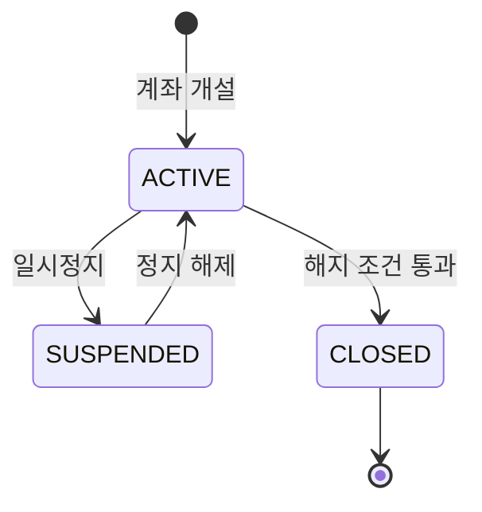
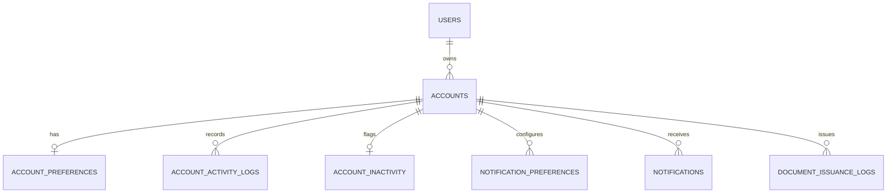
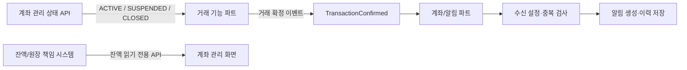

# 계좌 관리 서비스 상세 기획서

> **버전:** v3.0 · 거래 기능 분리 확정본  
> **작성일:** 2026-11-03  
> **담당 범위:** 계좌 관리(Account Management)  
> **기능 수:** 총 **13개 그룹** — 1차 MVP 6개 / 2차 확장 3개 / 3차 고도화 3개 / 공통 기능 1개  
> **문서 성격:** 기능 명세 + 사용자 시나리오 + 정책 초안 + 데이터/API 설계 + 테스트 기준  
> **중요:** 아래 수치·정책·API는 개발 협의를 위한 **제안 사항**이며, 실제 금융기관의 운영 정책을 의미하지 않는다.

---

## 0. 문서 핵심 요약

### 0.1 무엇을 만드는가?
사용자가 자신의 계좌를 **개설·조회·설정·일시정지·해지**하고, 계좌 **잔액·알림·증명서·활동 기록·휴면 상태**를 관리하는 서비스다.

### 0.2 계좌 관리와 거래 기능의 경계

| 구분 | **계좌 관리 파트(이 문서 담당)** | **거래 기능 파트(별도 담당)** |
|---|---|---|
| 계좌 개설/기본 정보 | 생성·목록·상세·유형·별명 | 제외 |
| 계좌 상태 | 정지·해제·해지 상태 변경 | 거래 처리 시 해당 상태를 검증 |
| 잔액 | 다른 시스템의 **확정 잔액을 읽기 전용으로 표시** | 거래 반영 및 잔액/원장 정합성 책임 주체와 연동 |
| 거래 내역 | **조회하지 않음** | 거래 내역 생성·조회·검색·다운로드 |
| 이체 | **실행하지 않음** | 이체·예약이체·자동이체 등 실행 |
| 입출금 알림 | 확정 이벤트 수신 → 알림 조건 확인 → 생성/발송 | 거래 확정 이벤트 제공 |
| 계좌 활동 기록 | 계좌 개설·설정·상태 변경 등 **관리 행위 기록** | 거래 행위 기록은 거래 파트에서 관리 |

**범위에서 완전히 제외하는 기능:** `거래 내역 조회`, `거래 내역 내보내기(CSV/XLSX/PDF)`, `이체 실행`, `예약이체`, `자동이체`, `이체 한도 관리`, `거래 승인/취소`.

> **주의:** “잔액 조회”와 “거래 내역 조회”는 다르다. 계좌 화면에는 현재 잔액 **숫자만** 표시하고, 개별 입출금 명세는 거래 기능 화면으로 이동시키거나 계좌 파트에서 노출하지 않는다.

### 0.3 전체 기능 지도

| ID | 단계 | 기능 | 핵심 사용자 가치 |
|---|---|---|---|
| F01 | 1차 MVP | 계좌 개설 | 새 계좌 만들기 |
| F02 | 1차 MVP | 계좌 조회 | 내가 가진 계좌 확인 |
| F03 | 1차 MVP | 잔액 조회 | 계좌별 현재 잔액 확인 |
| F04 | 1차 MVP | 계좌 설정 | 별명·즐겨찾기로 계좌 정리 |
| F05 | 1차 MVP | 계좌 상태 관리 | 일시정지·해제·해지 |
| F06 | 1차 MVP | 입출금 알림 | 거래 발생 사실 알림받기 |
| F07 | 2차 확장 | 계좌 검색·필터 | 계좌 빠르게 찾기 |
| F08 | 2차 확장 | 통합 대시보드 | 전체 계좌 규모·잔액 파악 |
| F09 | 2차 확장 | 계좌 증명서 발급 | 계좌 관련 확인 문서 받기 |
| F10 | 3차 고도화 | 계좌 활동 기록 | 계좌 설정·상태 변경 추적 |
| F11 | 3차 고도화 | 휴면 계좌 관리 | 장기 미사용 계좌 확인·복귀 |
| F12 | 3차 고도화 | 알림 고급 설정 | 계좌·거래 유형·금액별 알림 제어 |
| F13 | 공통 기능 | 계좌 유형 관리 | 입출금/저축 계좌를 구분해 관리 |

**구현상 주의:** F13의 `account_type` 필드와 F10의 **기본 감사 로그 기록**은 사용자 화면의 고도화 시점과 달리 **1차 MVP DB 설계 때부터 반영**해야 한다.

---

## 1. 목적·전제·성공 기준

### 1.1 프로젝트 목표
- 사용자가 계좌의 생성부터 해지까지 **생명주기 전체를 관리**할 수 있다.
- 계좌의 별명·즐겨찾기·상태·유형을 일관된 방식으로 조회/수정할 수 있다.
- 잔액은 거래/원장 책임 시스템에서 읽어와 **다른 파트의 데이터 소유권을 침해하지 않는다**.
- 거래가 확정되면 알림을 제공하되 **거래 자체를 계좌 파트에서 실행하지 않는다**.
- 증명서·활동 이력·휴면 관리 기능으로 운영성과 사용자 편의성을 확장한다.

### 1.2 서비스 전제
이 기획서는 우선 **학습·프로젝트용 모의 금융 서비스**에서도 구현 가능한 형태로 설계했다. 실제 금융기관 계좌와 연동하는 서비스라면 본인확인, 상품 약관, 금융 규제, 증명서 효력, 데이터 보존 정책을 별도로 검토해야 한다.

### 1.3 사용자 유형
- **일반 사용자:** 자신에게 소유권이 있는 계좌만 조회/관리.
- **운영 관리자(선택):** 감사 이력 조회, 장애 대응 및 예외 정책 처리. 일반 사용자 API와 권한을 분리.

### 1.4 완료 판단 기준
1. 계좌 개설 → 목록/상세 표시 → 별명·즐겨찾기 설정 → 일시정지/해제 → 해지 조건 검증의 기본 시나리오가 동작한다.
2. 거래 기능과 연동했을 때 잔액 표시가 실제 확정 잔액과 일치한다.
3. 거래 확정 이벤트를 두 번 받아도 알림이 중복 발송되지 않는다.
4. 해지 계좌는 활성 계좌로 잘못 표시되지 않으며, 필요한 이력은 보존된다.
5. 다른 사용자의 계좌 및 문서에 접근할 수 없다.

---

## 2. 사용자 화면 구성 및 이동 흐름

### 2.1 메뉴 구조

```text
계좌 홈
├─ 내 계좌 목록
│  ├─ 계좌 상세
│  │  ├─ 잔액 확인
│  │  ├─ 계좌 설정 (별명/즐겨찾기)
│  │  ├─ 계좌 상태 관리 (정지/해제/해지)
│  │  ├─ 계좌 증명서 발급
│  │  └─ 계좌 활동 기록
│  └─ 계좌 검색/필터
├─ 새 계좌 개설
│  └─ 계좌 유형 선택 (CHECKING/SAVINGS)
├─ 통합 대시보드
├─ 장기 미사용 계좌 안내
└─ 알림 센터
   ├─ 입출금 알림 목록
   └─ 알림 기본/고급 설정

[거래 기능] 별도 메뉴 (이 문서의 개발 범위 밖)
```

### 2.2 대표 사용자 시나리오

**시나리오 A — 계좌 개설 후 정리**  
로그인 → 계좌 홈 → `[계좌 개설]` → 계좌 유형 선택 → 개설 완료 → 목록에서 새 계좌 확인 → 별명 변경 → 즐겨찾기 등록.

**시나리오 B — 계좌 일시정지 및 재개**  
계좌 상세 → `[일시정지]` → 제한 내용 안내 → 확인/필요 인증 → 상태 `SUSPENDED` → 추후 `[정지 해제]` → 상태 `ACTIVE`.

**시나리오 C — 거래 발생 알림 수신**  
거래 파트에서 확정 → 확정 이벤트 발행 → 알림 수신자가 계좌·이벤트·설정 확인 → 앱 알림 생성 → 사용자가 알림 센터에서 확인. 개별 **거래 내역 조회**는 거래 기능이 담당한다.

**시나리오 D — 장기 미사용 계좌 정리**  
계좌 홈에서 미사용 표시 확인 → 마지막 활동일/안내 확인 → 필요 시 본인확인 → 사용 재개 안내 또는 계좌 해지 선택(해지 조건 충족 시).

---

## 3. 1차 MVP 상세 명세 (F01~F06)

### F01. 계좌 개설

**목적**  
인증된 사용자가 신규 계좌를 생성하고, 발급된 계좌번호를 보유 목록에서 확인하도록 한다.

**화면 구성**
- 제목: `새 계좌 개설`
- 계좌 유형 선택: `입출금 계좌` / `저축 계좌`
- 필수 안내 및 동의 체크
- 기본 계좌명 안내(유형별)
- `[계좌 개설]`, `[취소]` 버튼
- 결과 화면: 계좌번호, 유형, 개설일, 상태, `[내 계좌로 이동]`

**정상 흐름**
1. 로그인 상태와 계좌 개설 권한을 확인한다.
2. 사용자가 계좌 유형을 선택한다.
3. 필수 동의/입력의 유효성을 검사한다.
4. 서버가 개설 가능 여부를 검증한다.
5. 고유한 계좌 ID와 계좌번호를 발급한다.
6. 계좌 상태를 `ACTIVE`로 초기화한다.
7. 계좌 생성 결과를 저장하고 사용자에게 보여준다.
8. **잔액 초기화는 원장/잔액 책임 시스템과 연계한다.** 계좌 관리 서비스가 별도로 원장 금액을 임의 생성·변경하지 않는다.

**데이터 및 처리 규칙**
- 필수 필드: `id`, `user_id`, `account_number`, `account_type`, `lifecycle_status`, `opened_at`.
- `account_number`는 고유해야 한다. 계좌 ID와 화면상 계좌번호는 별개 값으로 관리한다.
- 한 요청이 네트워크 문제로 반복되어도 중복 계좌가 생기지 않도록 **멱등 요청 키(idempotency key)**를 고려한다.
- 1차에서 유형은 2종을 지원하되, 실제 금리·만기·저축 상품 계산은 별도 정책 합의 전까지 수행하지 않는다.

**예외/오류**
- 미로그인/권한 없음 → 개설 거부.
- 필수 동의 누락 또는 잘못된 유형 → 입력 오류 표시.
- 서버 장애/계좌번호 발급 충돌 → 중복 생성 없이 재시도 또는 실패 처리.
- 결과 응답 유실 → 다시 눌러도 같은 개설 결과를 확인할 수 있도록 설계.

**완료 기준(AC)**
- [ ] 계좌번호가 고유하게 발급된다.
- [ ] 생성된 계좌가 본인 목록에서 즉시 확인된다.
- [ ] 중복 요청으로 계좌가 2개 만들어지지 않는다.
- [ ] 다른 사용자의 계좌로 연결되지 않는다.

### F02. 계좌 조회

**목적**  
보유 계좌를 한눈에 확인하고 선택한 계좌의 기본 정보를 조회하도록 한다.

**화면 구성**
- 목록: 계좌명/별명, 계좌번호 일부, 유형, 상태, 잔액 요약, 즐겨찾기 표시.
- 상세: 계좌번호, 유형, 개설일, 상태, 잔액, 설정/상태 관리 버튼.
- `[계좌 개설]` 진입 버튼.
- 계좌가 없으면 빈 상태 안내 및 개설 버튼 표시.

**정상 흐름**
1. 서버에서 현재 로그인한 사용자의 계좌만 조회한다.
2. 기본 목록에 활성 계좌를 보여준다(정지 계좌 포함 여부는 표시 정책에 따라 결정).
3. 사용자가 계좌를 누르면 상세로 이동한다.
4. 사용자가 잔액을 요청하면 별도 잔액 조회 API에서 읽는다.
5. 해지 계좌는 기본 목록에서 분리하여 이력 형태로 제한적으로 조회한다.

**처리 규칙**
- 모든 요청에서 **계좌 소유권을 서버에서 재검증**한다. 프런트엔드에서 숨기기만 해서는 안 된다.
- 계좌번호는 화면 맥락에 따라 마스킹하고, 전체 복사는 재인증 등 정책을 적용할 수 있다.
- 상세 페이지의 상태와 목록 상태가 달라지는 경우 최신 상태로 갱신한다.

**예외/오류**
- 계좌 없음 → `찾을 수 없음` 메시지.
- 계좌 소유권 없음 → 접근 거부. 계좌 존재 여부가 과도하게 노출되지 않도록 응답 정책 통일.
- 서비스 오류 → 재시도 안내, 다른 사용자의 정보는 절대 표시하지 않음.

**완료 기준(AC)**
- [ ] 본인 계좌만 조회 가능하다.
- [ ] 목록과 상세의 계좌번호·유형·상태가 일치한다.
- [ ] 계좌가 없을 때 빈 화면이 자연스럽게 표시된다.

### F03. 잔액 조회

**목적**  
사용자가 각 계좌의 **현재 확정 잔액**을 확인하도록 한다.

**화면 구성**
- 계좌별 현재 잔액, 통화 단위, 기준/갱신 시각(필요 시).
- 로딩 및 오류 상태, 새로고침 동작.

**정상 흐름**
1. 사용자가 계좌 홈 또는 상세에서 잔액을 확인한다.
2. 계좌 관리 서버가 소유권을 확인한다.
3. 잔액/원장 책임 시스템에서 최신 조회 값을 가져온다.
4. 금액·통화·조회 기준 시각을 화면에 반영한다.

**처리 규칙**
- 계좌 관리 파트는 **읽기 전용**이다. 입금/출금 처리, 잔액 증감, 거래 원장 수정 금지.
- 서로 다른 통화는 단위 없이 단순 합산하지 않는다.
- 캐시를 사용한다면 갱신 지연/시각을 명시하고, 오래된 값을 최신 확정 잔액처럼 표시하지 않는다.
- 원장 서비스가 응답하지 않으면 이전 값을 조용히 최신 잔액으로 둔갑시키지 않고 조회 실패 또는 갱신 시각을 표시한다.

**예외/오류**
- 잔액 API 지연/실패 → `현재 잔액을 불러오지 못했어요` 및 재시도.
- 해지 계좌 → 정책이 허용하는 범위에서 보존 값만 표시하거나 제한.

**완료 기준(AC)**
- [ ] 권한 있는 계좌의 잔액만 조회된다.
- [ ] 확정된 거래 후 원장의 최신 값과 일치한다.
- [ ] 원장 오류를 숨긴 채 잘못된 금액을 표시하지 않는다.

### F04. 계좌 설정(별명·즐겨찾기)

**목적**  
사용자가 계좌를 식별하기 쉬운 이름으로 관리하고 자주 쓰는 계좌를 우선 노출한다.

**화면 구성**
- 계좌 상세의 `[별명 수정]`, `[즐겨찾기]` 버튼.
- 별명 입력 모달/폼, 저장·취소 버튼.
- 목록의 즐겨찾기 아이콘 및 정렬 옵션.

**정상 흐름**
1. 사용자가 별명 변경 또는 즐겨찾기 토글을 요청한다.
2. 본인 계좌인지 확인한다.
3. 입력 유효성을 검사한다.
4. `account_preferences`를 저장한다.
5. 목록·상세·대시보드의 표시를 일관되게 갱신한다.

**정책 초안**
- 별명 길이: **1~30자**(팀 합의로 변경 가능).
- 공백만 입력 금지, 미입력 시 기본 계좌명으로 복구.
- 즐겨찾기는 계좌별 `true/false`; 여러 계좌 즐겨찾기 허용.
- `CLOSED` 계좌에 대한 설정 변경은 불허.

**예외/오류**
- 별명이 너무 길거나 공백만 존재 → 폼 오류.
- 동시 수정 충돌 → 서버 저장 값을 다시 확인.

**완료 기준(AC)**
- [ ] 수정 결과가 새로고침 후에도 유지된다.
- [ ] 즐겨찾기 등록/해제가 즉시 반영된다.
- [ ] 타인 계좌 설정을 수정할 수 없다.

### F05. 계좌 상태 관리(일시정지·해제·해지)

**목적**  
사용자가 계좌 사용을 일시적으로 제한하거나 정상 상태로 복귀시키고, 사용하지 않을 계좌를 해지하도록 한다.

**상태 정의**

| 상태 | 의미 | 기본 허용 | 금지/주의 |
|---|---|---|---|
| `ACTIVE` | 정상 | 조회·설정·상태 변경 | 해지는 검증 필요 |
| `SUSPENDED` | 사용자/운영 정책에 따른 일시정지 | 계좌 조회, 정지 해제 | 실제 거래 차단 범위는 거래 파트와 합의 |
| `CLOSED` | 해지 완료 | 정책에 따른 제한적 이력 조회 | 재활성화 및 일반 설정 변경 불가 |

**사용자 흐름 — 일시정지**
1. 계좌 상세에서 `[일시정지]` 클릭.
2. 정지 시 제한되는 기능 안내.
3. 필요 시 본인확인.
4. 서버가 `ACTIVE`인지 확인하고 `SUSPENDED`로 변경.
5. 변경 기록 저장 및 변경 결과 표시.
6. 거래 기능이 새 상태를 검증할 수 있도록 제공.

**사용자 흐름 — 정지 해제**
1. 정지 계좌에서 `[정지 해제]` 클릭.
2. 필요 시 본인확인/해제 가능 여부 확인.
3. `SUSPENDED → ACTIVE` 상태 변경.
4. 변경 기록 저장 및 결과 안내.

**사용자 흐름 — 계좌 해지**
1. 계좌 상세 → `[계좌 해지]`.
2. 해지 불가 사유를 서버에서 검증.
3. 잔액 0, 미처리 거래 없음, 연계 제한 없음 등을 확인(프로젝트 정책 초안).
4. 최종 확인 및 필요 시 본인확인.
5. `ACTIVE → CLOSED`로 상태를 변경하고 해지 일시 기록.
6. 활성 목록에서는 제외하되 필요한 기록은 보존.

**핵심 개발 규칙**
- **해지 ≠ DB 삭제.** 필수 기록을 보존한다.
- 상태 변경 요청은 동시성 제어가 필요하다. 거래와 계좌 해지가 동시에 진행될 때 일관성이 깨지지 않도록 거래 파트와 협의한다.
- `SUSPENDED → CLOSED`를 바로 허용할지, 먼저 해제해야 하는지는 **정책 미확정**. 본 기획의 기본안은 해제 후 해지.
- 정지 중 **입금 수신 허용 여부와 출금/이체 차단 범위**는 계좌 파트가 단독 결정하지 않는다.
- 상태 변경 과정은 인증, 소유권 검증, 감사 로그가 필수.

**예외/오류**
- 이미 정지된 계좌를 다시 정지 → 현재 상태 안내 또는 멱등 처리.
- 잔액이 남은 계좌 해지 → 차단 + 이유 안내.
- 미완료 거래가 있는 계좌 해지 → 차단 + 사유 안내.
- 해지 계좌 재해지/재활성화 → 요청 거절.

**완료 기준(AC)**
- [ ] 허용된 상태 전이만 가능하다.
- [ ] 해지 제한 조건을 우회할 수 없다.
- [ ] 변경 결과가 관련 파트에 일관되게 적용된다.
- [ ] 해지 후에도 요구되는 감사 기록이 남는다.

### F06. 입출금 알림(기본)

**목적**  
거래 파트에서 입금 또는 출금이 **확정되었을 때** 사용자에게 알림을 제공한다.

**화면 구성**
- 알림 ON/OFF 기본 설정.
- 앱 내부 알림 센터(최소 구현).
- 제목, 대상 계좌(별명/마스킹), 거래 유형, 금액, 발생 시각, 읽음 상태.

**정상 흐름**
1. 거래 기능 파트가 정상 확정 후 `TransactionConfirmed` 이벤트를 발행한다.
2. 계좌/알림 파트가 이벤트를 수신한다.
3. 이벤트 ID·대상 계좌·수신자·기본 알림 설정을 확인한다.
4. 동일 이벤트의 중복 처리를 방지한다.
5. 알림 레코드를 생성하고 앱 내부 알림 센터에 표시한다.
6. 실패한 전달은 정해진 재시도 정책으로 처리한다.

**처리 규칙**
- 이벤트가 확정되기 전에는 확정 알림을 보내지 않는다.
- `event_id` 또는 `(거래ID, 대상계좌, 알림유형)`처럼 안정적인 키로 중복을 방지한다.
- 알림 실패가 거래 자체를 취소하거나 금액을 다시 반영하게 만들면 안 된다.
- 개인정보는 최소한으로 포함하고, 계좌번호는 마스킹한다.
- 수신 거부 상태에서는 알림 생성/노출 정책을 명시적으로 정의한다(기본안: 사용자 알림 미발송).

**예외/오류**
- 동일 확정 이벤트 재전송 → 중복 알림 없음.
- 존재하지 않는 계좌/사용자 → 오류 기록 및 안전한 실패 처리.
- 알림 시스템 장애 → 재시도 또는 실패 기록, 거래 원장에 영향 없음.

**완료 기준(AC)**
- [ ] 확정 이벤트로 알림이 생성된다.
- [ ] 알림 OFF 계좌/사용자에게 원치 않는 알림이 발송되지 않는다.
- [ ] 같은 이벤트로 알림이 중복 생성되지 않는다.

---

## 4. 2차 확장 상세 명세 (F07~F09)

### F07. 계좌 검색·필터

**목적:** 계좌 수가 많아도 원하는 계좌를 빠르게 찾도록 한다.

**화면 구성:** 검색창(계좌번호 일부/별명), 유형 필터, 상태 필터, 정렬 선택, 검색 결과 수.

**세부 처리**
- 검색: 계좌 별명 또는 본인 계좌번호 일부로 검색.
- 필터: `ACTIVE`, `SUSPENDED`, `CLOSED`; `CHECKING`, `SAVINGS`.
- 정렬: 즐겨찾기 우선, 최근 개설순, 별명순(선택).
- 결과 0개일 때 빈 결과 메시지와 필터 초기화 제공.
- 검색 결과는 반드시 **본인 계좌 데이터 내에서만** 반환한다.

**예외:** 특수문자/너무 긴 쿼리, 잘못된 필터 값, 대량 데이터 페이지네이션 처리.

**완료 기준:** 계좌 유형/상태별 필터가 정확하고, 검색 후 타인 계좌가 노출되지 않는다.

### F08. 계좌 통합 대시보드

**목적:** 여러 계좌의 현황을 한 화면에서 이해하도록 한다.

**화면 구성**
- 총 보유 계좌 수, 정상 계좌 수, 일시정지 계좌 수.
- 계좌별 잔액 목록 및 동일 통화의 합산 잔액.
- 계좌별 잔액 비중(막대/도넛 차트 등).
- 즐겨찾기 계좌 바로가기.

**집계 규칙 초안**
- 기본 합산은 **해지되지 않은 계좌** 기준, 정책에 따라 정지 계좌 포함 여부 명시.
- 여러 통화는 별도 합산하거나 환율 기준·시점이 존재할 경우에만 환산.
- 원장/잔액 시스템의 확정 값을 기반으로 집계한다.
- 마이너스 잔액·잔액 0 계좌의 비중 계산 등 예외를 정의한다.
- 데이터 갱신 시각을 표시해 실시간 여부를 오해하지 않게 한다.

**완료 기준:** 대시보드 합계와 대상 계좌의 잔액 합계가 동일하며, 집계 제외 기준이 명확하다.

### F09. 계좌 증명서 발급

**목적:** 사용자가 본인 계좌에 대한 기본 확인 문서를 조회하고 파일로 받을 수 있도록 한다.

**문서 종류(프로젝트 예시)**
- 통장 사본 성격의 `계좌정보 확인서`.
- `계좌개설확인서`.

**화면 및 사용자 흐름**
1. 계좌 상세 → `[증명서 발급]`.
2. 문서 종류 선택.
3. 본인 권한 및 문서 발급 가능 여부 확인.
4. 서버에서 계좌 기본 정보·발급시각을 바탕으로 문서 생성.
5. 미리보기 또는 PDF 다운로드 제공.
6. 발급 이력 기록.

**문서 필드:** 소유자명(정책상 허용 범위), 계좌번호, 유형, 서비스/기관명, 개설일, 발급일, 문서 종류, 필요 시 진위확인용 식별자.

**정책·보안**
- 프로젝트 예시 문서라면 **실제 은행이 발행한 공인 증명서로 오인되지 않도록** 표시한다.
- 문서 다운로드 URL은 인증/권한 통제하고, 영구 공개 링크를 사용하지 않는다.
- 해지 계좌 문서 발급 허용 여부는 정책으로 결정한다.
- 발급 요청/발급 완료/실패 로그를 남긴다.

**완료 기준:** 본인 계좌에서만 지정 문서를 내려받을 수 있고, 파일의 계좌 정보가 실제 DB 정보와 일치한다.

---

## 5. 3차 고도화 상세 명세 (F10~F12)

### F10. 계좌 활동 기록

**목적:** 사용자가 계좌 관련 설정과 상태가 언제 어떻게 바뀌었는지 확인할 수 있도록 한다.

**거래 기능과 구분**
- 포함: 계좌 개설, 별명 변경, 즐겨찾기 등록/해제, 알림 설정, 일시정지/해제, 해지, 증명서 발급 이벤트 등.
- 제외: 입금·출금·이체 건별 거래 내역(거래 기능 파트 담당).

**활동 기록 예시**

| 시각 | 활동 | 변경 요약 |
|---|---|---|
| 2026-11-03 10:00 | 계좌 개설 | 입출금 계좌 생성 |
| 2026-11-03 10:05 | 별명 변경 | 기본 이름 → 생활비 계좌 |
| 2026-11-03 11:10 | 즐겨찾기 변경 | 즐겨찾기 등록 |
| 2026-11-03 12:00 | 일시정지 | ACTIVE → SUSPENDED |

**처리 규칙**
- `account_activity_logs`에 변경 유형, 계좌 ID, 처리 주체, 시각, 변경 전/후 요약 저장.
- 비밀번호, 인증 토큰, 주민등록번호 등 민감 정보를 활동 로그에 기록하지 않는다.
- **감사 로그 기록 자체는 1차 MVP부터 수행**하고, 사용자 조회 화면을 F10에서 공개한다.
- 일반 사용자는 본인 계좌 이력만 열람할 수 있다.
- 로그의 임의 수정·삭제 권한을 제한한다.

**완료 기준:** 상태/설정 변경이 누락 없이 기록되고, 거래 내역과 혼동되지 않는다.

### F11. 휴면 계좌 관리

**목적:** 장기 미사용 상태를 사용자에게 안내하고 관리 행동을 유도한다.

**개념 구분**
- `lifecycle_status`: `ACTIVE`/`SUSPENDED`/`CLOSED` — 실제 계좌 생명주기 상태.
- `inactivity_flag`: `true`/`false` — 장기 미사용 표시.
- **장기 미사용 표시 ≠ 자동으로 일시정지 처리.** 실제 법적 의미의 ‘휴면예금’으로 단정하지 않는다.

**정상 흐름**
1. 정의된 활동 데이터를 기준으로 마지막 활동일을 집계한다.
2. 정책상 기준 기간을 넘으면 `inactivity_flag=true`로 표시한다.
3. 계좌 홈 또는 알림에서 장기 미사용 안내를 표시한다.
4. 사용자가 안내를 확인하고 재사용/해지 등 후속 행동을 선택한다.
5. 재사용 조건 충족 시 플래그를 해제하거나 확인 절차를 진행한다.

**중요한 파트 연동**
- “미사용” 기준이 마지막 **거래 확정일**인지, 마지막 **계좌 로그인/조회일**인지 팀에서 먼저 결정해야 한다.
- 거래 일자를 사용한다면 거래 기능 파트가 `last_transaction_at` 같은 **요약 메타데이터**를 제공하게 하고, 계좌 파트가 거래 내역 목록을 직접 조회·소유하지 않도록 한다.
- 예시 기준 기간(예: 12개월)은 **제안값**일 뿐 확정 정책이 아니다.

**완료 기준:** 장기 미사용 표시가 일시정지/해지와 충돌하지 않고, 기준일 변경 시 일관되게 계산된다.

### F12. 알림 고급 설정

**목적:** 불필요한 알림을 줄이면서 필요한 입출금 알림만 받도록 한다.

**세부 설정**
- 계좌별 ON/OFF.
- 거래 유형별 ON/OFF: 입금 / 출금.
- 최소 금액 기준: 예를 들어 `10,000원 이상`(예시는 정책 확정 전 샘플).
- 알림 수신 이력 및 읽음/안읽음 표시.
- 수신 채널(앱 내 알림 / 이메일 / 푸시): 프로젝트 구현 환경에 맞춰 단계적으로 선택.

**평가 흐름**
1. 확정 이벤트 수신.
2. 수신 대상 사용자/계좌 확인.
3. 계좌 알림 사용 여부 확인.
4. 입금/출금 유형 필터 확인.
5. 금액 기준 충족 확인.
6. 알림 생성 → 중복 제거 → 발송 → 이력 저장.

**예외/운영 정책**
- 금액 기준은 통화별 관리 또는 통화 정책 필요.
- 동일 이벤트의 재전송·재처리로 중복 발송 금지.
- 채널별 전송 실패는 개별 상태로 기록.
- 설정 변경 직후 발생한 이벤트의 적용 시점은 정책으로 정의.

**완료 기준:** 각 계좌의 조건에 맞는 알림만 생성되고, 사용자에게 이력이 일관되게 보인다.

---

## 6. 공통 기능 상세 명세 (F13)

### F13. 계좌 유형 관리

**목적:** 계좌 개설 시 유형을 구분하고, 유형에 따라 표시·제약 조건을 확장할 수 있는 구조를 제공한다.

| 내부 코드 | 화면 표기 | 기본 용도 | 1차 구현 범위 |
|---|---|---|---|
| `CHECKING` | 입출금 계좌 | 일상적 자금 관리 | 유형 선택, 목록/상세 표시, 상태 정책 연결 |
| `SAVINGS` | 저축 계좌 | 목적성 자금 보관 | 유형 선택, 목록/상세 표시, 상태 정책 연결 |

**설계 원칙**
- `accounts.account_type`은 **1차 MVP부터 필수값**으로 저장.
- 개설 후 유형 변경을 기본적으로 제한(필요 시 신규 계좌 개설).
- 계좌 개설 가능 조건, 해지 조건, 거래 가능 조건 등은 나중에 유형별 정책 객체/설정으로 확장 가능하게 설계.
- 저축 계좌의 이율·만기·이자 계산·출금 제한 등은 **상품 정책 합의 전에는 구현 범위에서 제외**.
- `CHECKING/SAVINGS`는 프로젝트 내부 코드이며 실제 상품 분류와 1:1로 일치한다고 가정하지 않는다.

**완료 기준:** 두 유형의 계좌가 정확히 생성되고, 화면·검색·대시보드에서 구분되며, 잘못된 유형값은 거절된다.

---

## 7. 상태 전이 및 정책 설계

### 7.1 상태 전이 다이어그램



- 기본 정책상 `SUSPENDED → CLOSED`는 바로 허용하지 않는다. **정지 해제 후 해지**하도록 안내(변경 가능).
- `CLOSED → ACTIVE` 재활성화는 지원하지 않는다.
- `inactivity_flag`는 위 상태와 **별도 속성**이다.

### 7.2 상태별 기능 접근표 (초안)

| 기능 | ACTIVE | SUSPENDED | CLOSED |
|---|---|---|---|
| 계좌 목록/상세 조회 | 허용 | 허용 | 별도 이력에서 제한적 허용 |
| 잔액 조회 | 허용 | 허용 | 보존 정책에 따름 |
| 별명·즐겨찾기 변경 | 허용 | 별도 정책 확정 | 불허 |
| 입출금 알림 설정 | 허용 | 허용 가능 | 불허 |
| 증명서 발급 | 허용 | 정책 확인 | 정책 확인 |
| 일시정지 | 가능 | 불가 | 불가 |
| 정지 해제 | 불가 | 가능 | 불가 |
| 계좌 해지 | 조건부 가능 | 우선 정지 해제 | 불가 |
| 거래 실행 | **거래 파트에서 최종 판단** | **거래 파트와 차단 범위 합의** | 거래 파트에서 금지 |

### 7.3 계좌 해지 전 체크리스트
- [ ] 사용자 인증 및 계좌 소유권 확인.
- [ ] 해지 대상 상태 확인.
- [ ] 원장/잔액 책임 시스템에서 잔액 0 확인.
- [ ] 거래 기능 파트에서 미완료 거래/예약된 거래 여부 확인(필요한 조건 정의).
- [ ] 상품별 제한·연계 서비스 여부 확인.
- [ ] 사용자 최종 확인.
- [ ] 해지 상태 변경·감사 로그 저장·후속 파트 통보.

> 잔액과 미완료 거래 검증의 **시점/동시성 보장**을 설계해야 한다. 단순히 프런트엔드에서 확인 메시지만 띄우는 것으로는 안전하지 않다.

---

## 8. 데이터 모델(논리 설계)

### 8.1 엔터티 정의

| 테이블/모델 | 주요 필드(예시) | 소유·용도 |
|---|---|---|
| `accounts` | `id`, `user_id`, `account_number`, `account_type`, `lifecycle_status`, `opened_at`, `closed_at`, `version` | 계좌 기본 정보, 상태 |
| `account_preferences` | `account_id`, `user_id`, `nickname`, `is_favorite`, `updated_at` | 별명·즐겨찾기 |
| `account_balance_view` *(조회 모델)* | `account_id`, `currency`, `balance`, `as_of` | 타 시스템 잔액의 읽기 전용 표현 |
| `account_activity_logs` | `id`, `account_id`, `actor_id`, `action`, `occurred_at`, `metadata` | 계좌 관리 행위 기록 |
| `notification_preferences` | `user_id`, `account_id`, `enabled`, `deposit_enabled`, `withdrawal_enabled`, `minimum_amount`, `channel` | 알림 설정 |
| `notifications` | `id`, `user_id`, `account_id`, `event_id`, `type`, `status`, `read_at`, `created_at` | 알림 이력·중복 방지 |
| `account_inactivity` | `account_id`, `last_activity_at`, `inactivity_flag`, `flagged_at` | 장기 미사용 표시 |
| `document_issuance_logs` | `id`, `account_id`, `document_type`, `requested_by`, `issued_at`, `status` | 문서 발급 감사 |

**별도 파트 소유 데이터:** `transactions`, `transfer_requests`, 거래 원장 항목, 거래 내역 다운로드 파일 등. 계좌 파트의 DB 모델에 넣지 않는다.

### 8.2 관계 개요



> `USERS`는 인증/회원 파트의 외부 참조 모델로 가정한다. 위 ERD는 이해용이며 실제 FK 구성은 서비스 분리 방식에 따라 달라진다.

### 8.3 제약·인덱스·개인정보
- `accounts.account_number`에 유니크 제약.
- `accounts(user_id, lifecycle_status)` 조회 인덱스 검토.
- `account_preferences(account_id, user_id)` 고유 조합 검토.
- `notifications(event_id, user_id, account_id, type)` 중복 방지 제약 검토.
- 금액은 부동소수점 `float` 사용을 지양하고 정수 최소화폐단위 또는 정확한 `decimal`을 사용.
- 생성·수정·해지 시각은 표준 타임존 기준으로 저장하고 표시 시 사용자 시간대로 변환.
- 계좌번호·소유자 정보·문서 파일·활동 기록은 접근 제어·마스킹·로그 최소화 적용.

---

## 9. API 초안

> REST API는 **협의용 예시**다. 프레임워크/팀 공통 규칙에 맞춰 변경할 수 있다. 모든 개인 계좌 관련 API에는 인증 및 소유권 검증이 필요하다.

| 구분 | Method | 경로 예시 | 목적 |
|---|---|---|---|
| F01 | `POST` | `/accounts` | 계좌 개설 |
| F02 | `GET` | `/accounts` | 내 계좌 목록 |
| F02 | `GET` | `/accounts/{accountId}` | 계좌 상세 |
| F03 | `GET` | `/accounts/{accountId}/balance` | 잔액 읽기 전용 조회 |
| F04 | `PATCH` | `/accounts/{accountId}/preferences` | 별명·즐겨찾기 변경 |
| F05 | `POST` | `/accounts/{accountId}/suspend` | 일시정지 |
| F05 | `POST` | `/accounts/{accountId}/resume` | 정지 해제 |
| F05 | `POST` | `/accounts/{accountId}/close` | 계좌 해지 |
| F06 | `GET` | `/notifications` | 내 알림 목록 |
| F06/F12 | `GET` | `/accounts/{accountId}/notification-settings` | 알림 설정 조회 |
| F06/F12 | `PATCH` | `/accounts/{accountId}/notification-settings` | 알림 설정 수정 |
| F07 | `GET` | `/accounts?query=&status=&type=` | 계좌 검색·필터 |
| F08 | `GET` | `/account-dashboard/summary` | 통합 대시보드 |
| F09 | `POST` | `/accounts/{accountId}/documents` | 계좌 문서 발급 |
| F10 | `GET` | `/accounts/{accountId}/activities` | 계좌 활동 기록 |
| F11 | `GET` | `/accounts/inactive` | 장기 미사용 계좌 |

**주의:** `/accounts/inactive`와 `/accounts/{accountId}` 같은 경로를 함께 쓸 때는 라우팅 우선순위나 경로 설계로 충돌 방지. 예를 들어 `/account-dashboard/inactive` 또는 `/accounts?inactive=true`로 통일하는 방법도 있다.

### 9.1 요청·응답 샘플 — 계좌 개설

```http
POST /accounts
Idempotency-Key: example-unique-request-key
Content-Type: application/json
```

```json
{
  "account_type": "CHECKING",
  "consents": ["required_terms"]
}
```

```json
{
  "account_id": "acc_example_001",
  "account_number_masked": "123-***-7890",
  "account_type": "CHECKING",
  "lifecycle_status": "ACTIVE",
  "opened_at": "2026-11-03T07:00:00Z"
}
```

*위 ID·계좌번호·날짜는 형식 설명용 가상 값이다.*

### 9.2 요청·응답 샘플 — 잔액 조회

```json
{
  "account_id": "acc_example_001",
  "currency": "KRW",
  "balance": "1250000",
  "as_of": "2026-11-03T07:05:00Z",
  "source": "ledger-service"
}
```

- `balance`는 안전한 직렬화를 위해 문자열로 표현한 예시다(팀 API 규격에 따라 결정).
- 계좌 파트의 잔액 수정 API는 만들지 않는다.

### 9.3 오류 코드 설계 예시

| 오류 코드(안) | 상황 | 사용자 메시지 예시 |
|---|---|---|
| `ACCOUNT_NOT_FOUND` | 계좌 조회 실패 | 계좌를 찾을 수 없어요. |
| `ACCOUNT_ACCESS_DENIED` | 소유권/권한 없음 | 접근 권한이 없어요. |
| `INVALID_ACCOUNT_TYPE` | 잘못된 계좌 유형 | 계좌 유형을 다시 선택해 주세요. |
| `INVALID_STATUS_TRANSITION` | 허용되지 않는 상태 변경 | 현재 상태에서는 변경할 수 없어요. |
| `ACCOUNT_CLOSE_NOT_ALLOWED` | 잔액/미완료 거래 등 해지 제한 | 계좌 해지 조건을 확인해 주세요. |
| `BALANCE_UNAVAILABLE` | 잔액 원본 조회 실패 | 잔액을 불러오지 못했어요. 잠시 후 다시 시도해 주세요. |
| `DOCUMENT_ISSUANCE_FAILED` | 문서 생성 실패 | 증명서를 발급하지 못했어요. 다시 시도해 주세요. |

---

## 10. 거래 기능 파트 연동 계약

### 10.1 연동 구조



**중요:** 이벤트 수신으로 알림을 생성하는 것과, 잔액을 정확하게 조회하는 것은 **별도의 연동**이다. 거래 확정 이벤트에 잔액을 포함하더라도 최종 잔액 원본은 책임 시스템에서 정해야 한다.

### 10.2 이벤트 구조 예시

```json
{
  "event_id": "evt_example_001",
  "event_type": "TransactionConfirmed",
  "transaction_id": "txn_example_001",
  "account_id": "acc_example_001",
  "transaction_type": "DEPOSIT",
  "amount": "50000",
  "currency": "KRW",
  "confirmed_at": "2026-11-03T07:10:00Z"
}
```

- 필수 협의 항목: **이벤트 발행 시점, 거래 유형 코드, 계좌 ID 식별 방식, 재시도 방식, 중복 처리 키, 이벤트 순서 보장 범위, 실패 처리**.
- 하나의 이체에서 출금 계좌와 입금 계좌가 각각 영향을 받으면 각 계좌에 알림을 어떤 이벤트 단위로 보낼지 협의한다.
- 이벤트에는 알림 생성에 불필요한 개인식별정보를 넣지 않는다.

### 10.3 파트별 책임 체크리스트

**계좌 관리 파트 제공**
- [ ] 계좌 ID 및 상태 조회 계약.
- [ ] 계좌 상태 변경 결과/이벤트 제공 방식.
- [ ] 본인 계좌 조회 및 잔액 읽기 전용 화면.
- [ ] 알림 설정·생성·조회 기능.

**거래/원장 책임 파트 제공**
- [ ] 거래 확정 이벤트 규격.
- [ ] 계좌별 확정 잔액 조회 계약.
- [ ] 해지 전 미완료 거래 확인 계약.
- [ ] 거래 실행 시 계좌 상태 검증 및 동시성 처리 정책.

**공동 합의 필요**
- [ ] 정지 중 입금/출금 허용 범위.
- [ ] 해지 직전 거래 발생 경쟁 상태 처리.
- [ ] 이벤트 재전달·중복·역순 처리.
- [ ] 잔액 정합성 보장 수준과 재조회 방식.

---

## 11. 비기능 요구사항 및 보안

| 영역 | 요구사항 | 검증 예시 |
|---|---|---|
| 인증·인가 | 모든 계좌 API에 로그인/소유권 검증 | 다른 사용자 계좌 ID 요청 차단 |
| 데이터 무결성 | 계좌번호 고유, 상태 전이 검증, 중복 요청 대응 | 같은 개설 요청 재전송 테스트 |
| 잔액 정확성 | 원본 시스템 기반 읽기 전용 | 확정 후 조회 값 비교 |
| 알림 신뢰성 | 중복 알림 방지, 전송 실패 재시도 | 동일 이벤트 2회 전달 |
| 감사 가능성 | 중요 상태 변경·발급 행위 기록 | 변경 주체·시각 조회 |
| 개인정보 | 계좌번호 마스킹, 민감정보 로그 차단 | 로그·응답 점검 |
| UX | 로딩/오류/빈 상태 명시, 상태 명칭 표기 | 네트워크 오류·빈 계좌 테스트 |
| 접근성 | 색상만으로 상태 구별하지 않음 | 상태 배지의 텍스트 검증 |

**실제 금융 서비스 적용 시 추가 검토:** 본인확인, 접근 통제, 금융거래 기록 보존, 개인정보 처리, 실효성 있는 증명서 발급, 금융상품별 제한 정책 등. 이 문서만으로 실제 금융기관 수준의 보안·규정 준수가 충족되는 것은 아니다.

---

## 12. 개발 우선순위·의존성

### 12.1 단계별 구축 계획

| 단계 | 구현 항목 | 사전 의존성 | 완료 산출물 |
|---|---|---|---|
| **공통 설계** | 계좌 유형·상태, 권한, DB, 파트 간 API/이벤트 계약 | 회원/인증 파트와 사용자 ID 합의 | 데이터·API 명세 초안 |
| **1차 MVP** | F01~F06 | 인증, 계좌 저장소, 잔액 조회 계약, 확정 이벤트 | 기본 계좌 관리 흐름 |
| **2차 확장** | F07~F09 | 계좌 데이터 조회·문서 파일 생성 | 편의 화면·증명서 |
| **3차 고도화** | F10~F12 | 감사 로그, 활동 요약 데이터, 알림 설정 | 사용자 이력·휴면·고급 알림 |
| **유형별 검증** | F13의 정책 및 테스트 보강 | 개설부터 유형값 저장 | CHECKING/SAVINGS 분기 검증 |

### 12.2 추천 개발 작업 단위
1. `accounts` 테이블/계좌 생성·조회 API.
2. `account_preferences` 및 상태 변경 API.
3. 계좌 목록·상세·설정 UI.
4. 잔액/원장 서비스의 조회 API 연결.
5. 거래 확정 이벤트 수신 및 기본 알림.
6. 검색·필터·통합 집계.
7. 문서 생성·다운로드 및 발급 기록.
8. 사용자 활동 이력 화면(감사 로그는 초기부터 기록).
9. 장기 미사용 계산·표시.
10. 고급 알림 규칙과 유형별 테스트.

> 구현 순서는 의존성 중심의 제안이다. 화면 개발과 백엔드 작업은 팀 상황에 따라 병렬 진행할 수 있다.

---

## 13. 테스트 시나리오 (QA 체크리스트)

### 13.1 계좌 개설/조회/잔액
- [ ] 계좌 유형을 지정하여 신규 계좌를 생성할 수 있다.
- [ ] 동일 개설 요청 재시도 시 중복 계좌가 생기지 않는다.
- [ ] 로그인한 사용자에게 자기 계좌만 보인다.
- [ ] 다른 사용자의 계좌 ID로 조회/수정이 거부된다.
- [ ] 계좌 목록·상세에 유형·상태·별명이 일관되게 노출된다.
- [ ] 잔액 원본 오류 시 잘못된 숫자를 최신 잔액처럼 표시하지 않는다.

### 13.2 계좌 설정·상태·해지
- [ ] 별명 등록·변경·초기화가 정상 동작한다.
- [ ] 즐겨찾기 등록·해제 후 순서/표시가 갱신된다.
- [ ] `ACTIVE → SUSPENDED → ACTIVE`가 정상 동작한다.
- [ ] `CLOSED → ACTIVE` 등 금지된 상태 전이는 실패한다.
- [ ] 잔액이 남거나 미완료 거래가 있으면 해지할 수 없다.
- [ ] 해지 완료 후 DB 행 삭제 없이 상태와 감사 기록이 보존된다.
- [ ] 거래 기능은 정지·해지 상태를 거래 전에 확인한다(통합 테스트).

### 13.3 알림·확장·휴면
- [ ] 확정 이벤트 수신 시 조건에 맞는 알림이 생성된다.
- [ ] 동일 이벤트 재수신 시 알림이 중복되지 않는다.
- [ ] 기본 알림 OFF 설정이 적용된다.
- [ ] 계좌별/금액별 알림 기준이 정확하게 적용된다.
- [ ] 검색·필터 결과에 타인 계좌가 섞이지 않는다.
- [ ] 대시보드 합계가 동일 통화의 대상 계좌 잔액 합계와 일치한다.
- [ ] 증명서 파일과 발급 로그가 올바르게 생성된다.
- [ ] 계좌 활동 기록에 거래 내역이 섞이지 않는다.
- [ ] 장기 미사용 플래그가 일시정지·해지 상태와 혼동되지 않는다.
- [ ] CHECKING/SAVINGS 유형에 따라 화면·정책이 올바르게 구분된다.

---

## 14. 개발 착수 전 의사결정 목록

| 결정 항목 | 선택지/질문 | 권장 기본안(미확정) |
|---|---|---|
| 서비스 성격 | 모의 금융 서비스 / 실서비스 연동 | 모의 서비스 가정으로 먼저 구현 |
| 사용자 식별 | 회원 파트의 `user_id` 규격은? | 인증 파트 발급 ID 사용 |
| 계좌 개설 수량 | 사용자별 최대 계좌 수 제한? | 초기에는 별도 제한 없이 정책 정의만 |
| 계좌 유형 | CHECKING/SAVINGS 이외 확장? | 우선 2종 |
| 정지 상태의 거래 | 입금·출금 각각 허용? | 거래 파트와 합의 전 미확정 |
| 해지 조건 | 잔액·미완료 거래·연계 상품 처리? | 잔액 0/미완료 없음 기본안 |
| 잔액 원본 | 어느 서비스가 최종 원본인가? | 원장/잔액 책임 서비스 명시 필요 |
| 활동 기록 범위 | 사용자에게 어떤 항목 노출? | 설정·상태 변경 중심 |
| 장기 미사용 기준 | 거래일/로그인일 등 무엇을 기준으로? | 마지막 확정 거래일 활용 제안, 미확정 |
| 휴면 기간 | 몇 개월 미사용 시 표시? | 팀에서 정해야 함 |
| 알림 채널 | 앱 내부/푸시/이메일 | 앱 내부 우선 |
| 증명서 효력 | 프로젝트 예시/실제 기관 문서 | 프로젝트 예시 문서 |
| 보존·삭제 정책 | 해지 후 얼마 동안 어떤 기록 보존? | 실서비스 적용 시 별도 확정 |

---

## 15. 최종 범위 선언

**계좌 관리 파트의 13개 기능 그룹을 다음과 같이 확정한다.**

- **1차 MVP(6):** 계좌 개설 / 계좌 조회 / 잔액 조회 / 계좌 설정 / 계좌 상태 관리 / 입출금 알림.
- **2차 확장(3):** 계좌 검색·필터 / 계좌 통합 대시보드 / 계좌 증명서 발급.
- **3차 고도화(3):** 계좌 활동 기록 / 휴면 계좌 관리 / 알림 고급 설정.
- **공통 기능(1):** 계좌 유형 관리.

**계좌 관리 파트에서 하지 않는 작업**은 거래 내역 조회·내보내기, 이체 실행 및 거래 원장 수정이다. 다만 거래 기능 파트와 **계좌 상태, 잔액 조회, 거래 확정 이벤트, 해지 전 검증**은 반드시 연동한다.

---

### 부록 A. 기능별 빠른 검토 표

| ID | 사용자 화면 | 핵심 DB/외부 연동 | 우선 확인할 예외 |
|---|---|---|---|
| F01 | 계좌 개설 | `accounts`, 인증/원장 초기화 | 중복 요청 |
| F02 | 목록·상세 | `accounts` | 타인 계좌 접근 |
| F03 | 잔액 카드 | 잔액 원본 조회 API | 응답 실패/지연 |
| F04 | 계좌 설정 | `account_preferences` | 잘못된 별명 |
| F05 | 상태 관리 | `accounts`, 감사 로그, 거래 파트 | 잔액/미완료 거래 |
| F06 | 알림 센터 | 확정 이벤트, `notifications` | 중복 이벤트 |
| F07 | 검색 화면 | `accounts` 검색 | 잘못된 필터/권한 |
| F08 | 계좌 홈 대시보드 | 잔액 원본/집계 | 다중 통화 |
| F09 | 증명서 발급 | PDF 생성, 발급 로그 | 무권한 다운로드 |
| F10 | 활동 기록 | `account_activity_logs` | 민감정보 노출 |
| F11 | 휴면 안내 | `account_inactivity`, 마지막 활동 요약 | 정지와 혼동 |
| F12 | 알림 고급 설정 | `notification_preferences` | 기준 금액/중복 발송 |
| F13 | 유형 선택 | `accounts.account_type` | 미지원 유형 입력 |

### 부록 B. 문서/흐름도 연결 시 주의
- 흐름도 화살표 `계좌 개설 → 조회 → 잔액 → 설정 → 상태 관리 → 알림`은 **기능을 훑는 표시 순서**이지, 모든 사용자가 그 순서를 반드시 거쳐야 한다는 뜻은 아니다.
- 2차/3차 확장 기능은 1차 MVP 위에서 발전하지만, 개별 사용 시나리오에 따라 독립 실행된다.
- 계좌 유형은 13번으로 표기되더라도 **개설 화면과 DB 모델에서는 처음부터 적용**한다.

*끝. 이 문서는 팀 협의를 위한 상세 기획서이며 실제 금융서비스의 업무 규정·보안·규제 적합성을 보증하지 않는다.*
