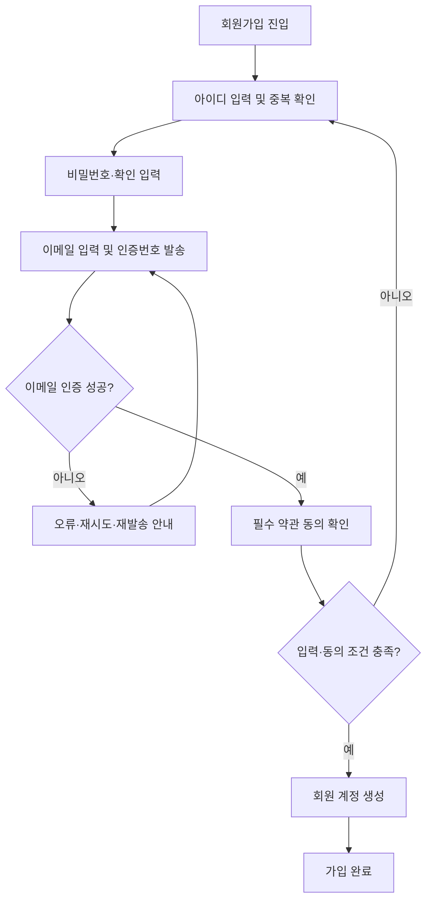
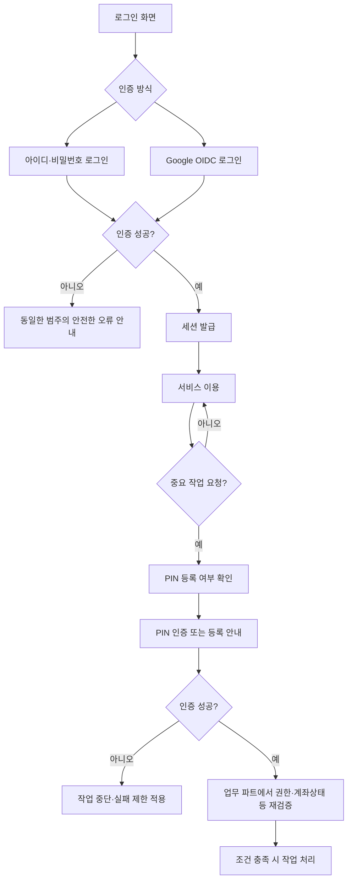
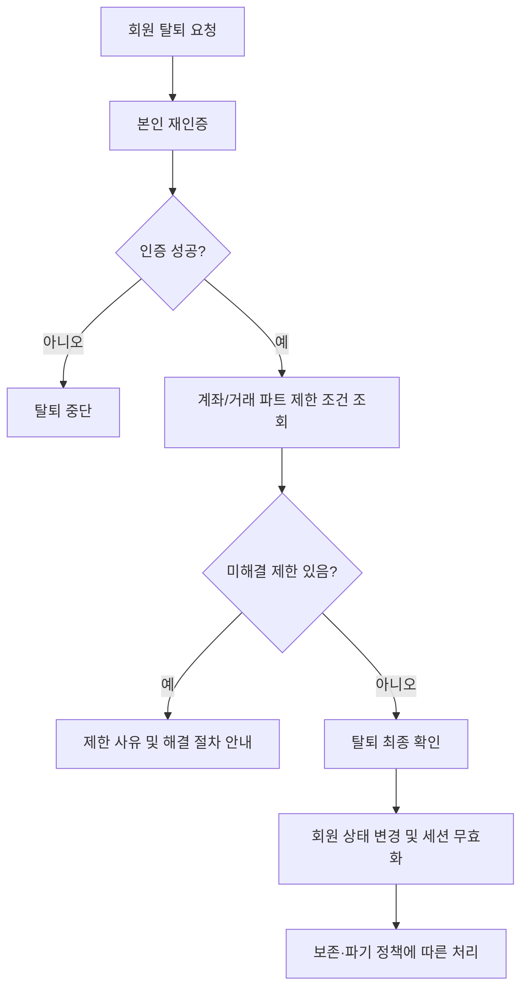
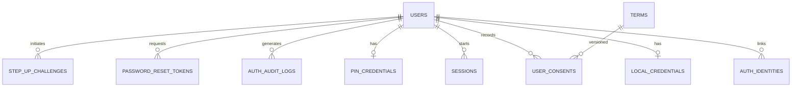
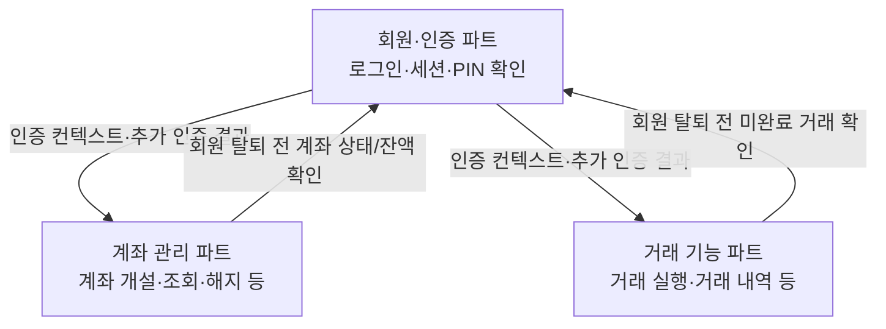

# 회원가입 · 로그인 · 간편 인증 서비스 상세 기획서

> **문서 버전:** v1.0  
> **작성일:** 2026-11-03  
> **담당 영역:** 회원·인증(Auth / Identity) 파트  
> **기능 범위:** 확정된 **13개 기능 항목** — 1차 6개 / 2차 4개 / 3차 3개  
> **서비스 가정:** 모의 금융 서비스를 위한 웹·앱 회원·인증 시스템  
> **상태:** **기능 범위 확정**, 세부 수치·인증 방식·운영 정책은 개발 전 최종 합의 필요

---

## 0. 문서 읽는 법

- **[확정]** 사용자가 확정한 기능 범위 또는 기능 간 책임 분리.
- **[설계 권고]** 안전하고 일관된 구현을 위한 권장 동작. 개발 단계에서 팀이 구체화할 수 있음.
- **[협의 필요]** 아직 확정되지 않은 값이나 정책. 문서에 제시된 예시는 확정 스펙이 아님.
- API 주소·DB 테이블·상태값·에러코드·시도 횟수 등은 **기술 설계 초안**이며 실제 구현 명세와 구분한다.
- **중요:** 이 문서는 금융기관이 요구하는 실서비스 인증·신원확인·규제 준수를 충족한다고 주장하지 않는다. **모의 금융 서비스**의 교육·개발용 설계다.

## 1. 프로젝트 개요

### 1.1 목적
회원이 계정을 만들고 안전하게 로그인한 뒤, 개인정보를 관리하고, 모의 금융 서비스 내 중요 작업을 수행하기 전에 필요한 재인증(PIN 포함)을 받을 수 있도록 공통 인증 기능을 제공한다.

### 1.2 범위와 책임

| 구분 | 회원·인증 파트 책임 | 타 파트 책임 |
|---|---|---|
| 회원 계정 | 생성·식별·프로필 수정·탈퇴 요청 및 계정 상태 관리 | 계좌/거래 등 도메인 데이터 소유 |
| 로그인 | 비밀번호 인증, Google OIDC 로그인, 세션 발급·만료·폐기 | 발급된 인증 컨텍스트를 검증하고 권한 적용 |
| 이메일 인증 | 인증번호 발급·검증·만료/재발송 관리 | 메일 발송 인프라와의 연동(공통 인프라) |
| PIN | 등록·인증·변경·재설정, 실패 제어, 인증 결과 제공 | 중요 작업의 수행 여부 결정·자체 권한 검사 |
| 회원 탈퇴 | 탈퇴 절차 시작·최종 상태 반영 | 계좌 잔액·해지 여부·처리 중 거래 등 제한 조건 반환 |
| 약관 | 동의 항목·버전·시각 기록 | 실제 서비스/상품별 추가 약관 내용 제공(해당 시) |

**범위 제외:** 계좌 개설·상태·잔액, 거래 실행·내역, 실제 계좌 이체, 금융상품/이자 처리, 실제 금융기관 실명확인(KYC), 공인 전자서명·실제 은행 수준의 거래 승인.

### 1.3 핵심 원칙
1. **로그인 인증과 작업별 인증을 구분**한다. PIN은 일반 로그인 비밀번호를 대체하지 않는다.
2. **인증 성공과 업무 실행을 구분**한다. PIN 확인이 성공해도 계좌·거래 파트의 소유권/상태/한도 검증을 생략할 수 없다.
3. **사용자 식별의 기준은 내부 `user_id`**이다. 아이디·이메일·Google 계정 정보는 인증 수단 또는 연락처다.
4. 인증 자격 증명(비밀번호·PIN·인증번호·토큰)은 **평문으로 저장하거나 로그에 남기지 않는다**.
5. 계정 삭제 요청과 각종 데이터의 즉시 삭제는 같은 개념이 아니다. 보존/파기 규칙을 별도로 적용한다.

---

## 2. 최종 기능 목록 — 총 13개

| 단계 | ID | 기능 | 주요 동작 | 포함 여부 |
|---|---|---|---|---|
| **1차 회원가입·로그인** | F01 | 회원가입 | 아이디·비밀번호·비밀번호 확인·이메일 입력 | 확정 |
| | F02 | 아이디 중복 확인 | 가입 전 아이디 사용 가능 여부 확인 | 확정 |
| | F03 | 이메일 인증 | 인증번호 발송·확인 | 확정 |
| | F04 | 구글 소셜 로그인 | Google OAuth 2.0 + OIDC 기반 로그인 | 확정 |
| | F05 | 로그인 / 로그아웃 | 일반 로그인, 세션 발급·만료·폐기 | 확정 |
| | F06 | 아이디 찾기 / 비밀번호 재설정 | 이메일 기반 계정 복구 | 확정 |
| **2차 회원 정보 관리** | F07 | 내 정보 조회 및 수정 | 기본 프로필 조회·수정 | 확정 |
| | F08 | 비밀번호 변경 | 로그인된 회원의 비밀번호 변경 | 확정 |
| | F09 | 회원 탈퇴 | 탈퇴 요청·재인증·제한 조건 검증·처리 | 확정 |
| | F10 | 약관 동의 및 관리 | 필수/선택 약관, 동의 기록·변경 | 확정 |
| **3차 간편 인증** | F11 | PIN 등록 | 6자리 간편 비밀번호 설정 | 확정 |
| | F12 | PIN 인증 | 중요 작업 전 6자리 PIN 확인 | 확정 |
| | F13 | PIN 변경 및 재설정 | 기존 PIN 변경, 분실 시 별도 인증 후 재설정 | 확정 |

> **정책 구분:** 기능 항목 13개는 변경하지 않는다. 세션 관리, 실패 횟수 제한, 계정 잠금, 감사 로그 등은 새로운 사용자 기능을 추가하는 것이 아니라 관련 기능의 **필수/권고 처리 규칙**으로 포함한다.

---

## 3. 주요 사용자 흐름

### 3.1 일반 회원가입



### 3.2 로그인 및 중요 작업



### 3.3 회원 탈퇴



---

## 4. 기능별 상세 명세

### F01. 회원가입

**목적:** 로컬 계정(아이디+비밀번호)을 생성하고 서비스 이용 자격을 준비한다.

**화면/입력**
- 아이디: 필수, 중복 여부 확인 가능.
- 비밀번호: 필수, 입력값 숨김 기본, 표시 토글 선택.
- 비밀번호 확인: 필수, 비밀번호와 일치 여부 확인.
- 이메일: 필수, 인증 완료 필요.
- 약관: 필수/선택 구분, 필수 항목 동의 필요.
- 가입 완료 버튼: 유효성 조건을 충족했을 때만 제출 가능하도록 안내.

**정상 처리 흐름**
1. 아이디 입력 → F02 중복 확인.
2. 비밀번호 및 확인값 검증.
3. 이메일 입력 → F03 인증 완료.
4. 최신 필수 약관 동의 여부 확인.
5. 서버에서 모든 값을 **다시 검증**하고 계정 생성.
6. 내부 `user_id` 발급, 인증수단 `LOCAL_PASSWORD` 연결, 회원 상태 활성화.
7. 가입 완료 화면 표시. 자동 로그인 여부는 **[협의 필요]**.

**주요 규칙**
- [설계 권고] 아이디 허용 문자·길이·대소문자 처리 기준은 서버와 화면에서 동일하게 적용한다.
- [설계 권고] 비밀번호는 긴 암호구를 허용하고, 취약/유출 비밀번호 사용을 제한할 수 있다. 비밀번호를 평문 저장·이메일 발송하지 않는다.
- [설계 권고] 가입 직전 중복 검사를 다시 수행하며, DB 고유 제약으로 경합 상황의 중복 생성까지 방지한다.
- [설계 권고] 회원가입 요청에도 속도 제한 및 중복 요청 방지를 적용한다.
- [협의 필요] 이메일의 계정 간 중복 허용 여부, 미인증 가입 초안의 만료/삭제 시간.

**예외/오류**
- 이미 사용 중인 아이디, 인증되지 않은 이메일, 비밀번호 불일치, 필수 약관 미동의.
- 인증번호 만료 또는 시도 제한, 이메일 중복 정책 위반.
- 같은 가입 요청의 중복 제출, 서버·메일 서비스 장애.

**완료 기준(AC)**
- [ ] 모든 필수 입력·인증·동의를 완료한 회원만 가입 성공.
- [ ] 중복 아이디가 동시 요청에도 생성되지 않음.
- [ ] 비밀번호 원문이 DB/로그/응답에 노출되지 않음.
- [ ] 가입된 회원은 내부 `user_id`로 고유 식별됨.

### F02. 아이디 중복 확인

**목적:** 가입 희망 아이디의 사용 가능 여부를 즉시 안내한다.

**정상 흐름:** 아이디 입력 → 형식 검증 → 중복 확인 요청 → 사용 가능/불가 결과 표시.

**규칙·예외**
- [설계 권고] 입력값 수정 시 기존 중복 확인 결과를 무효화한다.
- [설계 권고] 클라이언트의 '사용 가능' 표시는 확정 예약이 아니다. **최종 가입 시 DB 고유 제약으로 재검증**한다.
- [설계 권고] 대량 조회/무차별 탐색 방지를 위한 속도 제한을 적용한다.
- 오류 시 '확인 실패, 다시 시도'를 안내하고 가입을 진행하지 않는다.

**완료 기준(AC)**
- [ ] 사용 가능/중복/형식 오류가 구분됨.
- [ ] 확인 후 아이디 변경 시 재확인 필요.
- [ ] 중복 검사 성공 직후 다른 사용자가 가입해도 중복 계정 생성 없음.

### F03. 이메일 인증

**목적:** 회원이 제출한 이메일 주소의 수신 가능성과 소유 통제 여부를 확인한다.

**정상 흐름**
1. 이메일 입력 → 인증번호 발송 요청.
2. 서버가 짧은 만료 시간을 가진 일회용 인증번호 생성·보관(원문 비노출) 후 발송.
3. 사용자 인증번호 입력 → 서버가 유효기간·시도 횟수·일치 여부 검증.
4. 성공 시 **해당 이메일·가입 흐름에 한정된 인증 완료 상태**로 변경.
5. 인증 완료 후 이메일이 변경되면 다시 인증.

**필수 처리 규칙**
- [설계 권고] 인증번호 만료, 재발송 간격, 일/시간 단위 발송 제한, 검증 시도 제한을 함께 둔다.
- [설계 권고] 새 인증번호 발송 시 직전 코드 무효화 및 코드 1회 사용을 기본으로 한다.
- [설계 권고] 인증번호를 로그에 남기지 않고 저장 시에도 안전하게 보호한다.
- [협의 필요] 예시 정책: 5분 만료 / 60초 재발송 대기 / 연속 오류 제한. **확정 수치가 아님**.

**예외/오류:** 이메일 형식 오류, 발송 장애, 코드 불일치·만료·재사용, 재발송 제한, 인증 대상 이메일 변경.

**완료 기준(AC)**
- [ ] 올바른 코드와 유효한 시간/대상에서만 인증 성공.
- [ ] 만료·재사용 코드는 실패.
- [ ] 발송·검증 제한이 서버에서도 적용.

### F04. 구글 소셜 로그인 (Google OIDC)

**목적:** Google 계정을 이용해 로그인 또는 신규 소셜 계정을 생성한다.

**기술 범위**
- [확정] Google 소셜 로그인 지원.
- [설계 권고] **OAuth 2.0 Authorization Code Flow + OpenID Connect(OIDC)** 기반으로 사용자 인증을 구현하고, 클라이언트 유형에 맞게 **PKCE**를 적용한다.
- [설계 권고] 서버는 발급자(`iss`), 대상(`aud`), 만료(`exp`), 요청 연계 값(`state`, 필요 시 `nonce`) 등 관련 검증을 수행한다. 계정 식별에는 Google의 안정적인 `sub` 식별자를 사용한다.

**정상 흐름**
1. 'Google로 계속하기' 버튼 선택.
2. Google 인증 및 사용자 동의 후 콜백 처리.
3. 인증 응답/토큰 검증.
4. `(provider, provider_subject)`로 기존 인증수단 조회.
5. 기존 연결 계정이면 로그인, 신규라면 필요한 약관 확인 후 내부 회원 생성/연결.
6. 서비스 세션 발급.

**계정 연결 정책**
- [설계 권고] Google 이메일이 로컬 계정 이메일과 같더라도 **이메일 문자열 일치만으로 자동 병합하지 않는다**.
- [설계 권고] 기존 계정에 Google 로그인을 연결하려면 해당 **기존 계정으로 먼저 인증**하고 연결 의사를 재확인한다.
- [협의 필요] 신규 소셜 가입 시 별도 아이디 부여 방식, 필수 약관 동의 화면, 로컬 비밀번호 추가 기능(초기 범위 밖).
- Google로만 가입한 사용자에게 '기존 비밀번호 변경'을 그대로 제공하지 않는다.

**예외/오류:** Google 인증 취소, 토큰 검증 실패, 이미 다른 회원에 연결된 Google 계정, 동의 미완료, 세션 생성 실패.

**완료 기준(AC)**
- [ ] 유효한 Google 인증 결과만 로그인 성공.
- [ ] 동일 Google 계정으로 중복 회원 생성되지 않음.
- [ ] 같은 이메일의 별도 계정을 임의로 자동 병합하지 않음.

### F05. 로그인 / 로그아웃

**목적:** 로컬 회원의 인증 및 서비스 세션 유지·종료를 제공한다.

**로그인 정상 흐름**
1. 아이디·비밀번호 입력.
2. 사용자 상태 확인 및 저장된 비밀번호 해시 검증.
3. 실패 횟수·위험 신호 등 정책 확인.
4. 성공 시 세션 생성, 클라이언트에 필요한 세션 식별자/토큰 전달.
5. 회원 전용 페이지로 이동.

**로그아웃 정상 흐름:** 로그아웃 요청 → 서버 세션/갱신 수단 무효화 → 클라이언트 인증 상태 제거 → 로그인 화면 이동.

**세션 및 보안 규칙**
- [설계 권고] 웹에서는 `HttpOnly`, `Secure`, 적절한 `SameSite` 쿠키와 CSRF 방어 등 세션 형태에 맞는 보호 적용.
- [설계 권고] 세션 만료(유휴/최대), 재인증이 필요한 중요 작업, 비밀번호 변경 시 세션 처리 정책을 명확히 정의.
- [설계 권고] 로그인 실패에 속도 제한과 점진적 보호 조치를 적용한다. 과도한 영구 잠금으로 정상 사용자가 피해를 보지 않도록 설계.
- [설계 권고] 계정 존재 여부가 무분별하게 드러나지 않도록 오류 메시지를 설계한다.
- [협의 필요] '로그인 유지' 기능, 다중 기기 로그인, 모든 기기 로그아웃(향후 확장 후보).

**예외/오류:** 자격 증명 불일치, 휴면/탈퇴/차단 계정, 시도 제한, 서버/세션 저장소 장애, 만료된 세션.

**완료 기준(AC)**
- [ ] 잘못된 비밀번호로 세션 생성되지 않음.
- [ ] 로그아웃 후 기존 세션으로 보호 API 접근 불가.
- [ ] 세션 만료 후 보호 기능 접근 시 재로그인 안내.

### F06. 아이디 찾기 / 비밀번호 재설정

**목적:** 로그인 정보를 잊은 회원이 이메일 등 등록 수단으로 계정을 복구하도록 지원한다.

**아이디 찾기 흐름**
1. 등록 이메일 입력 및 이메일 확인 절차 진행.
2. 인증 성공 시 아이디 일부 마스킹 또는 안전한 복구 안내 제공.
3. 정보가 일치하지 않아도 계정 존재를 쉽게 열거할 수 없도록 초기 안내를 설계.

**비밀번호 재설정 흐름**
1. 등록 이메일 입력 → 일회용 재설정 링크/토큰 발송.
2. 유효기간·사용 여부 검증 후 새 비밀번호 입력.
3. 서버에서 비밀번호 정책 확인 → 새 해시 저장 → 토큰 폐기.
4. 재설정 사실 알림, 기존 세션/갱신 토큰 처리(권고: 관련 기존 인증 세션 무효화).

**규칙·예외**
- 비밀번호 원문 조회·전송 기능은 제공하지 않는다.
- 일회용 토큰 재사용·만료·무작위 대입을 방지한다.
- 재설정 요청 속도 제한 및 계정 존재 여부 노출 방지 필요.
- [설계 권고] Google 전용 계정은 비밀번호가 없을 수 있으므로 Google 로그인 안내 또는 별도 '로컬 비밀번호 설정' 정책을 적용한다. 로컬 비밀번호 설정 자체는 **초기 범위에 미포함**.

**완료 기준(AC)**
- [ ] 유효한 일회용 수단을 통해서만 비밀번호 변경 성공.
- [ ] 이전 비밀번호로 로그인 불가.
- [ ] 만료·기사용 토큰 재사용 불가.

### F07. 내 정보 조회 및 수정

**목적:** 로그인한 회원이 자신의 기본 정보를 조회하고 허용된 항목을 수정한다.

**화면 항목 예시**
- 내부 회원 ID(일반 사용자에게 숨김), 로그인 아이디, 이메일 및 인증 상태, 가입일, 연결된 로그인 방식.
- 수정 가능: 이메일 등 허용된 프로필 필드. 수정 불가 항목과 사유는 UI에서 구분.

**정상 흐름:** 마이페이지 → 정보 조회 → 수정 항목 편집 → 서버 검증 → 저장 → 변경 완료 표시.

**규칙·예외**
- 이메일 변경 시 **새 이메일 재인증**, 필요하면 현재 로그인 수단 재인증을 요구한다.
- [설계 권고] 수정 전후 변경 기록과 통지(특히 이메일 변경)를 남긴다.
- 민감정보 변경은 유효한 세션과 본인 재확인을 요구한다.
- [협의 필요] 표시 이름, 휴대전화, 프로필 사진 등은 현재 13개 확정 범위의 **필수 필드가 아님**.

**완료 기준(AC)**
- [ ] 본인 프로필만 조회·변경 가능.
- [ ] 이메일을 인증하지 않고 변경 완료 상태로 처리하지 않음.

### F08. 비밀번호 변경

**목적:** 로컬 로그인 사용자가 인증된 상태에서 자신의 비밀번호를 안전하게 변경한다.

**화면/입력:** 현재 비밀번호, 새 비밀번호, 새 비밀번호 확인.

**정상 흐름:** 회원 설정 → 현재 비밀번호 검증 → 새 비밀번호 정책 확인 → 해시 교체 → 변경 결과 안내 및 세션 갱신 정책 적용.

**규칙·예외**
- [설계 권고] 현재 비밀번호를 검증하고, 중요 재인증 요구 상황에서는 추가 검증을 적용한다.
- 새 비밀번호 확인 일치, 허용 문자/길이, 유출/취약 비밀번호 제한 등 정책 적용.
- 안전한 비밀번호 해시(예: 적절히 설정한 Argon2id 또는 운영 환경의 검증된 대안) 사용.
- Google 전용 계정에 로컬 비밀번호가 없다면 변경 대상이 아니며 별도 안내한다.
- 변경 완료 후 중요 세션 무효화/재로그인 방침은 명시적으로 결정한다.

**완료 기준(AC)**
- [ ] 현재 비밀번호가 틀리면 변경 불가.
- [ ] 기존 비밀번호로는 로그인 불가.
- [ ] 서버·로그에 평문 비밀번호가 남지 않음.

### F09. 회원 탈퇴

**목적:** 회원이 서비스 이용을 종료할 수 있도록 하되, 계좌·거래 파트의 무결성을 훼손하지 않는다.

**정상 흐름**
1. 마이페이지 → 회원 탈퇴 선택.
2. 계정 재인증 및 영향 안내 확인.
3. 계좌 관리/거래 파트에 **해지되지 않은 계좌, 잔액, 진행 중 거래, 보존 대상 기록** 확인 요청.
4. 탈퇴 가능한 조건이면 최종 확인.
5. 계정 상태를 탈퇴 처리하고 로그인 세션 무효화.
6. 연동된 인증정보·개인정보에 보존/파기 정책을 적용하고 결과 안내.

**핵심 원칙**
- **회원 탈퇴 ≠ 계좌 해지 ≠ 모든 DB 행 즉시 삭제**.
- **[설계 권고]** 계좌 소유권/미완료 거래 등 도메인 검증을 **인증 파트가 임의로 추측하지 않고** 담당 파트에 조회한다.
- [협의 필요] 탈퇴가 불가한 조건, 유예 기간, 재가입 가능 여부, 계정 재활성화 허용 여부, 데이터 보존 기간.
- [설계 권고] 서비스 정책상 보존이 필요한 기록과 즉시 삭제 가능한 정보의 처리를 구분한다.

**예외/오류:** 계좌 잔액 남음, 미해지 계좌 존재, 처리 중 거래, 연동 파트 응답 실패, 재인증 실패.

**완료 기준(AC)**
- [ ] 제한 조건이 있으면 탈퇴되지 않고 구체적 해결 안내 제공.
- [ ] 탈퇴 처리 후 신규 보호 API 접근 차단.
- [ ] 보존 대상 기록이 무단 삭제되지 않음.

### F10. 약관 동의 및 관리

**목적:** 회원이 필수 약관에 동의하고, 선택 약관에 대한 의사를 관리하도록 한다.

**구성**
- 필수 약관: 이용약관 등 서비스 운영상 필요한 동의 항목.
- 선택 약관: 해당되는 경우 선택 동의 항목. 동의하지 않아도 기본 가입을 막지 않음.
- 각 약관은 `terms_id`, 버전, 제목, 필수 여부, 효력/게시 정보로 관리.

**정상 흐름**
1. 가입·소셜 가입 시 적용 약관 내용 제공.
2. 항목별 동의 입력(전체 동의는 편의 기능일 뿐 필수/선택 구분 유지).
3. 서버가 필수 동의 충족 여부 검증.
4. `user_id`, 약관 버전, 동의/철회 여부, 일시를 기록.
5. 추후 마이페이지에서 열람 및 허용된 선택 동의 변경.

**규칙·예외**
- [설계 권고] '모두 동의' 선택 시에도 개별 상태를 저장한다.
- 선택 동의 철회는 기본 회원 상태를 불필요하게 막지 않는다.
- [협의 필요] 약관 개정 시 재동의 조건/적용 시점은 법률·서비스 정책 검토 대상.

**완료 기준(AC)**
- [ ] 필수 약관 미동의 상태에서는 가입 완료 불가.
- [ ] 어떤 버전에 언제 동의했는지 확인 가능.
- [ ] 선택 동의 변경 이력이 유지됨.

### F11. PIN 등록 (6자리)

**목적:** 로그인 비밀번호와 분리된 **모의 금융 서비스 중요 작업 확인용** 간편 인증 수단을 설정한다.

**화면/입력:** PIN 6자리 입력 → 동일 PIN 재입력 → 등록 완료.

**정상 흐름**
1. 로그인된 회원이 PIN 등록 시작.
2. [설계 권고] 최근 인증 상태 확인 또는 로그인 수단 재인증.
3. 6자리 숫자 PIN 입력 및 재입력 일치 확인.
4. 서버에서 PIN 등록 정책 검사, 안전한 저장 처리.
5. 등록 완료 및 사용자 안내.

**보안 규칙**
- PIN은 로그인 비밀번호와 **별도 인증 수단**으로 취급한다.
- 서버가 직접 PIN을 검증한다면 사용자별 솔트를 활용한 적절한 비밀번호 해시 등 안전한 저장을 적용하고, **엄격한 온라인 시도 제한**을 설정한다. 단순 SHA-256 단독 저장 등은 권장하지 않는다.
- 연속 숫자·반복 숫자 등 지나치게 추측하기 쉬운 PIN 제한은 **[설계 권고]**이며 구체 규칙은 협의한다.
- PIN 평문은 DB/로그에 저장하지 않으며, 입력값 UI 노출 최소화.
- PIN 단독으로 강한 금융거래 인증을 충족한다고 가정하지 않는다.

**예외/오류:** 재입력 불일치, 등록된 PIN 존재, 인증 세션 만료, 위험 PIN 정책 위반.

**완료 기준(AC)**
- [ ] 6자리 형식과 확인 입력이 일치해야 등록.
- [ ] PIN 원문 저장·응답·로그 노출 없음.
- [ ] PIN 없이 중요 작업 접근 시 등록/대체 인증 안내.

### F12. PIN 인증

**목적:** 중요 작업을 요청하는 회원에 대해 추가 확인 절차를 제공한다.

**적용 후보(연동 설계)**
- 계좌 해지, 중요한 계좌 상태 변경, 모의 금융거래 요청 등.
- **중요 작업 지정 및 거래 허용 여부 판단은 각 업무 파트가 소유**한다.

**정상 흐름**
1. 계좌/거래 파트가 해당 작업에서 PIN 확인 필요 여부 판단.
2. 회원·인증 파트가 PIN 입력 화면/검증 API 제공.
3. 서버는 최근 인증·계정 상태·실패 제한·PIN 일치 여부 확인.
4. 성공 시 요청된 사용자·작업에 범위를 제한한 단기 인증 결과를 제공하거나 서버 간 검증 API로 확인.
5. 업무 파트가 **권한·잔액·계좌 상태·정책 등을 별도로 재검증**하고 실제 작업 처리.

**필수 규칙**
- [설계 권고] 온라인 추측 공격에 대비한 시도 횟수 제한·지연·재인증·잠금 정책.
- [설계 권고] 성공 결과의 유효시간을 짧게 하고 사용자, 세션, 작업 종류, 필요 시 특정 요청과 연계.
- 인증 성공 결과를 다른 사용자나 다른 작업에 재사용하지 못하게 처리.
- **PIN 인증 성공은 이체/계좌 변경 성공을 의미하지 않는다.**
- [협의 필요] 5회 실패 제한 등 구체 수치는 서비스 위협 모델/UX를 보고 확정.

**예외/오류:** PIN 오류, 미등록, 시도 제한, 세션 만료, 인증 결과 재사용/변조, 서버 장애.

**완료 기준(AC)**
- [ ] 올바른 PIN과 유효한 세션·정책 하에서만 성공.
- [ ] 반복 오입력에 서버 측 제한 적용.
- [ ] PIN 성공만으로 업무 파트의 권한 검증을 우회하지 못함.

### F13. PIN 변경 및 재설정

**목적:** 사용자가 알고 있는 PIN을 변경하거나 분실한 경우 본인 확인을 거쳐 새 PIN을 설정한다.

**일반 변경 흐름**
1. 로그인 후 'PIN 변경' 진입.
2. 기존 PIN 인증.
3. 새 6자리 PIN 입력 및 재입력.
4. 새 PIN 안전하게 저장, 이전 PIN 무효화.
5. 기존 유효한 PIN 인증 결과를 무효화하고 변경 완료 알림.

**분실 재설정 흐름**
1. 'PIN을 잊으셨나요?' 선택.
2. **PIN 자체가 아닌 다른 신뢰할 수 있는 인증 수단**으로 재인증(예: 최근 비밀번호 로그인 또는 Google 재인증, 추가 정책에 따른 이메일 확인).
3. 계정 상태·시도 제한 확인 후 새 PIN 설정.
4. 기존 PIN·인증 결과 무효화, 재설정 사실 알림.

**규칙·예외**
- 기존 PIN을 모른다는 이유로 인증 없이 새 PIN을 발급하지 않는다.
- 재설정은 민감 작업이므로 별도 속도 제한 및 감사 기록 필요.
- 소셜 전용 회원은 해당 로그인 수단의 재인증 경로를 사용.
- [협의 필요] 재설정 시 이메일 확인 병행 여부, 변경 후 쿨다운 기간.

**완료 기준(AC)**
- [ ] 정상 변경에는 기존 PIN 검증이 필요.
- [ ] PIN 분실 재설정에는 독립적 재인증이 필요.
- [ ] 변경·재설정 후 이전 PIN과 기존 PIN 인증 결과 사용 불가.

---

## 5. 화면 구성 및 UX 명세

| 화면 ID | 화면명 | 핵심 구성 | 연결 기능 |
|---|---|---|---|
| UI01 | 회원가입 | 아이디·중복확인, 비밀번호/확인, 이메일/인증번호, 약관, 가입 버튼 | F01~F03, F10 |
| UI02 | 로그인 | 아이디·비밀번호 입력, Google 로그인, 아이디 찾기·비밀번호 재설정 | F04~F06 |
| UI03 | 아이디 찾기 | 이메일 입력 및 인증, 결과 안내 | F06 |
| UI04 | 비밀번호 재설정 | 인증 링크 결과, 새 비밀번호/확인, 완료 | F06 |
| UI05 | 내 정보 | 이메일/아이디/연결 방식 조회, 수정 버튼 | F07 |
| UI06 | 비밀번호 변경 | 현재/새/확인 비밀번호 | F08 |
| UI07 | 회원 탈퇴 | 본인 재인증, 제한 사유, 최종 확인 | F09 |
| UI08 | 약관 관리 | 약관 목록·버전·선택 동의 상태 | F10 |
| UI09 | PIN 등록 | 6자리 입력·재입력, 등록 결과 | F11 |
| UI10 | PIN 인증 | 6자리 입력, 실패/제한 안내 | F12 |
| UI11 | PIN 변경·재설정 | 기존 PIN 또는 별도 재인증, 새 PIN 설정 | F13 |

### 5.1 공통 화면 원칙
- 입력 중 상태, 로딩, 완료, 실패를 명확히 구분한다.
- 비밀번호·PIN 입력은 기본 마스킹, 접근성(키보드/스크린리더/오류 안내) 고려.
- 인증번호 재발송 시 남은 대기시간을 표시하되, 서버의 실제 제한이 기준이다.
- 민감한 계정 복구 화면은 계정 존재 여부를 쉽게 추측할 수 없는 문구로 구성한다.
- 회원 탈퇴와 PIN 재설정에는 실수 방지를 위한 재확인 단계를 둔다.

---

## 6. 데이터 모델 초안

> 논리 모델이며 DB의 실제 테이블 구조와 1:1로 고정되지 않는다. `auth_identities`, `local_credentials` 등을 분리하면 Google 전용 계정과 로컬 계정을 모두 관리하기 쉽다.

| 엔터티 | 주요 필드 예시 | 설명 |
|---|---|---|
| `users` | `id`, `username`, `email`, `email_verified_at`, `status`, `created_at`, `withdrawn_at` | 회원 기본 정보 및 상태 |
| `auth_identities` | `id`, `user_id`, `provider`, `provider_subject`, `linked_at` | LOCAL/GOOGLE 로그인 수단 연결 |
| `local_credentials` | `user_id`, `password_hash`, `password_updated_at` | 로컬 비밀번호 해시 |
| `email_verifications` | `id`, `email`, `purpose`, `challenge_digest`, `expires_at`, `attempt_count`, `used_at` | 이메일 인증번호·상태·제한 |
| `password_reset_tokens` | `id`, `user_id`, `token_digest`, `expires_at`, `used_at` | 비밀번호 재설정용 일회용 수단 |
| `sessions` | `id`, `user_id`, `created_at`, `last_seen_at`, `expires_at`, `revoked_at` | 로그인 세션 관리(세션 방식에 따라 다름) |
| `terms` | `id`, `version`, `title`, `required`, `effective_at` | 약관 버전 관리 |
| `user_consents` | `id`, `user_id`, `terms_id`, `version`, `agreed`, `recorded_at` | 회원별 약관 동의/철회 이력 |
| `pin_credentials` | `user_id`, `pin_hash`, `enabled_at`, `changed_at`, `failed_attempts`, `locked_until` | PIN 저장·실패 제한 |
| `auth_audit_logs` | `id`, `user_id`, `event_type`, `occurred_at`, `outcome`, `request_id` | 회원·인증 관련 감사 기록 |
| `step_up_challenges` *(선택)* | `id`, `user_id`, `action`, `session_id`, `expires_at`, `consumed_at` | 작업 한정 추가 인증 상태 |

### 6.1 권고 제약 및 인덱스
- `users.username`에는 서비스 정의에 따른 정규화 및 고유 제약.
- `auth_identities(provider, provider_subject)` 고유 제약.
- `users.email`의 고유성은 이메일 중복·계정 연결 정책을 확정한 뒤 결정.
- 재설정 토큰·인증번호·PIN 등 원문을 DB에 보관하지 않도록 구성.
- 이벤트·변경 기록은 최소한의 데이터만 저장하고, 불필요한 민감정보 저장 금지.

### 6.2 논리적 관계도



---

## 7. API 설계 초안

> **예시 API** — 인증 방식, CSRF 보호, 요청/응답 스키마, URL 경로 및 권한은 팀 공통 규약을 따른다. 브라우저와 서버 간 토큰 전달/보관 방식이 정해지기 전까지 확정 경로로 간주하지 않는다.

| Method | Endpoint 예시 | 용도 | 관련 기능 |
|---|---|---|---|
| `POST` | `/auth/register` | 로컬 회원가입 | F01 |
| `GET` | `/auth/usernames/availability?username=...` | 아이디 중복 확인 | F02 |
| `POST` | `/auth/email-verifications` | 인증번호 발송 | F03 |
| `POST` | `/auth/email-verifications/confirm` | 인증번호 확인 | F03 |
| `GET` | `/auth/google/start` | Google OIDC 시작 | F04 |
| `GET` | `/auth/google/callback` | Google OIDC 콜백 처리 | F04 |
| `POST` | `/auth/login` | 로컬 로그인 | F05 |
| `POST` | `/auth/logout` | 로그아웃 | F05 |
| `POST` | `/auth/username-recovery` | 아이디 찾기 시작 | F06 |
| `POST` | `/auth/password-resets` | 재설정 요청 | F06 |
| `POST` | `/auth/password-resets/confirm` | 재설정 완료 | F06 |
| `GET` | `/users/me` | 내 정보 조회 | F07 |
| `PATCH` | `/users/me` | 내 정보 수정 | F07 |
| `POST` | `/users/me/password/change` | 비밀번호 변경 | F08 |
| `POST` | `/users/me/withdraw` | 회원 탈퇴 | F09 |
| `GET` | `/terms` | 적용 약관 목록 조회 | F10 |
| `GET` | `/users/me/consents` | 내 동의 이력 조회 | F10 |
| `PATCH` | `/users/me/consents` | 선택 동의 변경 | F10 |
| `POST` | `/auth/pin/enroll` | PIN 등록 | F11 |
| `POST` | `/auth/pin/verify` | PIN 확인 | F12 |
| `POST` | `/auth/pin/change` | PIN 변경 | F13 |
| `POST` | `/auth/pin/reset/start` | PIN 재설정 시작 | F13 |
| `POST` | `/auth/pin/reset/confirm` | 재인증 확인 및 PIN 재설정 | F13 |

### 7.1 응답 형식 예시

**성공:**

```json
{
  "success": true,
  "data": {
    "user_id": "example-user-id",
    "status": "ACTIVE"
  }
}
```

**오류:**

```json
{
  "success": false,
  "error": {
    "code": "EMAIL_VERIFICATION_EXPIRED",
    "message": "인증 시간이 만료되었습니다. 다시 요청해 주세요."
  }
}
```

> 코드는 예시이며 실제 계정 복구·로그인 API에서는 **보안상 상세 오류 노출을 제한**할 수 있다.

### 7.2 예상 인증 상태

| 상태 예시 | 뜻 | 사용 예 |
|---|---|---|
| `ACTIVE` | 사용 가능한 회원 | 정상 로그인·서비스 이용 |
| `PENDING_VERIFICATION` | 가입 절차 진행 또는 이메일 확인 전 | 인증 완료 전 가입 흐름 |
| `RESTRICTED` | 정책에 의해 일부 인증·작업 제한 | 이상 시도·보호 조치 |
| `WITHDRAWN` | 탈퇴 처리된 회원 | 로그인 차단·기록 보존 정책 적용 |

상태 목록은 **서버 구현 초안**이며, `PENDING_VERIFICATION`을 실제 계정으로 생성할지 '임시 가입 요청'으로 관리할지는 팀에서 선택한다.

---

## 8. 보안 및 비기능 요구사항

### 8.1 기본 보안 요구사항
1. **비밀번호:** 평문·복호화 가능한 방식으로 저장 금지. 안전한 전용 해시와 운영 환경에 맞는 파라미터 적용.
2. **PIN:** 비밀번호와 독립 저장, 6자리 숫자라는 낮은 조합 수를 고려한 강한 온라인 추측 방지.
3. **이메일 인증:** 만료·일회용·횟수 제한·재발송 제한. 인증번호 원문 로깅 금지.
4. **OIDC:** 검증된 라이브러리 사용, 인증 요청·콜백 연계 및 토큰 검증, 안전한 계정 연결 절차.
5. **세션:** 만료·무효화·탈취 방어, HTTPS, 웹 환경의 적절한 쿠키 및 CSRF 방어.
6. **인가:** 보호 API마다 인증뿐 아니라 **본인 소유 리소스 여부** 검증. `user_id`는 클라이언트 임의 입력보다 인증 컨텍스트에서 추출.
7. **감사:** 로그인 성공/실패, 비밀번호·PIN 변경, 계정 연결, 탈퇴 등 주요 행위의 결과와 시각 기록(자격 증명 원문 제외).
8. **개인정보:** 필요한 최소 정보만 수집, 마스킹·접근 통제·보존/파기 정책 적용.
9. **오남용 방지:** 로그인·가입·인증번호·복구·PIN 검증 API의 속도 제한 및 이상 요청 대응.
10. **실패 분리:** 메일 발송 장애가 회원 정보 무결성에 영향을 주지 않도록 처리.

### 8.2 PIN에 대한 중요한 한계
- 서버가 숫자 6자리 PIN만 확인하는 설계는 단독으로 충분한 고신뢰 거래 인증을 제공하지 않는다.
- PIN 등록·복구에는 독립적인 재인증이 필요하다.
- 높은 위험의 작업은 로그인 상태, 최근 재인증, 작업 범위 제한, 서버 측 인가·거래 정책 검증을 조합해야 한다.
- 생체인증·패스키·기기 바인딩·FIDO2 등은 **현재 확정된 13개 기능 범위 밖**이다.

### 8.3 품질·UX
- 서버가 실패/성공 상태를 명료하게 반환하고, 화면은 사용자가 취할 다음 행동을 안내한다.
- 장애 시 사용자 계정·세션·PIN이 부분적으로만 갱신되지 않도록 일관성 보장.
- 유휴 상태 만료, 새로고침, 다른 기기 로그인, 네트워크 재시도 등 경계 상황 처리.
- 접근성: 라벨, 키보드 조작, 오류 위치 안내, 비밀번호 표시 토글의 상태 알림 등.

---

## 9. 계좌 관리·거래 기능과 연동

### 9.1 공통 인증 관계



### 9.2 파트 간 합의해야 할 계약

| 주제 | 인증 파트 제공 | 계좌·거래 파트가 해야 할 일 |
|---|---|---|
| 회원 식별 | 신뢰 가능한 내부 `user_id` | 요청 데이터의 소유권 확인 |
| 로그인 상태 | 유효한 세션/토큰 및 인증 정보 | 각 보호 API에서 인증 검증 |
| PIN 추가 인증 | 성공/실패 및 작업 제한된 확인 결과 | 해당 작업 재검증 후 처리 여부 결정 |
| 탈퇴 전 조건 | 탈퇴 사전 점검 요청 및 결과 처리 | 계좌/거래 미해결 제한 조회 |
| 탈퇴 완료 | 계정 상태 변경·세션 무효화 이벤트 | 보존·파기·연결 관계 정리 수행 |

### 9.3 인증과 업무 처리의 경계 예시

**모의 금융거래 요청:** 로그인 확인 → 필요 시 PIN 확인 → **거래 파트**가 잔액·한도·계좌 상태 검증 → 거래 처리 → 결과 반환.  
**계좌 해지 요청:** 로그인 확인 → 필요 시 PIN 확인 → **계좌 관리 파트**가 해지 조건 검증 → 해지 처리.  
**회원 탈퇴 요청:** 로그인·재인증 → **계좌·거래 파트** 제한 확인 → 회원 상태 변경·세션 폐기.

---

## 10. 개발 단계 및 우선순위

| 순서 | 구현 단위 | 핵심 산출물 | 완료 기준 |
|---|---|---|---|
| 0 | 공통 설계 | 회원 식별자·인증 방식·약관·데이터/세션 정책 | 상태·권한·연동 계약 합의 |
| 1 | **1차** F01~F06 | 가입, 아이디 중복, 이메일 인증, Google OIDC, 로그인, 계정 복구 | 정상 가입·로그인·로그아웃·복구 시나리오 통과 |
| 2 | **2차** F07~F10 | 프로필, 비밀번호 변경, 탈퇴, 약관 관리 | 변경 권한 및 계좌 연동 검증 통과 |
| 3 | **3차** F11~F13 | PIN 등록·인증·변경·재설정 | 중요 작업 PIN 연동·실패 제한 테스트 통과 |
| 4 | 통합 검증 | 회원·계좌·거래 E2E 테스트 | 보안·예외·계약 테스트 통과 |

**구현 주의:** 2차의 약관 관리 화면과 별개로 **필수 약관 동의 수집은 1차 가입 기능에서 처음부터 동작**해야 한다. 3차 PIN을 도입하기 전까지 중요 작업의 본인 확인은 로그인 비밀번호/OIDC 재인증 등으로 대체할지 정책을 정해야 한다.

---

## 11. QA / 수용 테스트 체크리스트

### 1차
- [ ] 아이디 중복 확인 후 아이디가 변경되면 재확인이 필요하다.
- [ ] 동시에 동일 아이디로 가입해도 중복 계정이 생성되지 않는다.
- [ ] 이메일 인증번호가 만료되거나 재사용되면 인증 실패한다.
- [ ] 인증번호 발송·검증 횟수 제한이 서버에서 적용된다.
- [ ] 필수 약관에 동의하지 않으면 가입이 완료되지 않는다.
- [ ] 비밀번호 원문이 DB·로그·응답에 포함되지 않는다.
- [ ] Google 로그인 성공 시 해당 Google `sub`와 올바른 내부 회원이 연결된다.
- [ ] 같은 이메일만으로 로컬 계정과 Google 계정이 자동 병합되지 않는다.
- [ ] 로그인 실패 시 세션이 생성되지 않는다.
- [ ] 로그아웃·세션 만료 후 보호 API 접근이 거부된다.
- [ ] 비밀번호 재설정 토큰은 만료·사용 후 재사용되지 않는다.
- [ ] Google 전용 계정의 비밀번호 재설정/변경 경로가 혼란 없이 안내된다.

### 2차
- [ ] 로그인한 사용자는 다른 회원의 프로필을 조회/수정할 수 없다.
- [ ] 이메일 변경은 새 이메일 인증 이후에만 완료된다.
- [ ] 비밀번호 변경 후 이전 비밀번호 사용이 불가능하다.
- [ ] 탈퇴 제한 조건(계좌/미완료 거래 등)이 있으면 탈퇴가 중단된다.
- [ ] 탈퇴 완료 후 기존 세션으로 보호 API 접근이 불가능하다.
- [ ] 약관 동의 이력에 버전·시각이 남는다.
- [ ] 선택 약관 동의를 철회해도 불필요하게 기본 계정 이용이 막히지 않는다.

### 3차
- [ ] PIN은 숫자 6자리와 일치 확인을 거쳐 등록된다.
- [ ] PIN 원문이 저장·응답·로그에 남지 않는다.
- [ ] PIN 여러 차례 실패 시 서버 제한이 적용된다.
- [ ] PIN 인증 성공 결과를 다른 회원·다른 중요 작업에 재사용할 수 없다.
- [ ] PIN 변경에 기존 PIN 확인이 필요하다.
- [ ] PIN 분실 재설정에 독립적인 재인증이 필요하다.
- [ ] 변경/재설정 후 이전 PIN과 기존 인증 결과가 무효화된다.
- [ ] PIN 인증 성공만으로 계좌·거래 파트의 권한/업무 검증을 우회할 수 없다.

### 통합
- [ ] 계좌 개설/해지, 거래 처리 등 보호 기능에서 올바른 회원만 접근한다.
- [ ] 회원 탈퇴 전 계좌 잔액/해지 및 미처리 거래 상태 조회가 동작한다.
- [ ] 탈퇴·비밀번호 변경·PIN 변경 이벤트가 각 파트의 캐시/세션 정책과 모순되지 않는다.

---

## 12. 개발 착수 전 결정할 정책 (미확정)

| 항목 | 결정할 내용 | 권고 방향 |
|---|---|---|
| 아이디 형식 | 길이·허용 문자·대소문자/정규화 | 한 가지 규칙으로 서버·화면 일치 |
| 이메일 중복 | 이메일 하나당 계정 수·소셜 계정 연결 방법 | 자동 병합 금지, 명시적 연결 |
| 비밀번호 정책 | 길이·약한/유출 비밀번호 검사 | 긴 암호구 허용, 안전한 해시 |
| 이메일 인증 | 유효시간·재발송 간격·시도 제한 | 짧은 만료, 서버 제한 적용 |
| 세션 | 유지 기간·다중 기기·일괄 로그아웃 | 로그아웃 시 확실한 무효화 |
| Google 가입 | 신규 소셜 회원 약관/아이디/이메일 처리 | `sub` 기반 계정 식별 |
| 회원 탈퇴 | 계좌 잔액·계좌 상태·미완료 거래·보존 규칙 | 파트별 API로 제한 확인 |
| PIN 범위 | 어떤 중요 작업에 PIN 요구할지 | 작업 소유 파트가 결정 |
| PIN 보호 | 연속 오류 제한·차단 시간·재설정 수단 | 강한 속도 제한, 독립 재인증 |
| PIN 3차 전 | 중요 작업 대체 재인증 | 비밀번호 또는 Google 재인증 등 |
| 기록 보존 | 로그·약관 동의·탈퇴 후 데이터 보존 | 실제 서비스 성격·규정 검토 후 확정 |

---

## 13. 최종 요약

- **확정 기능:** 총 **13개** — 1차 6개 / 2차 4개 / 3차 3개.
- **기능 추가 없이 강화한 요구사항:** 이메일 인증 만료·재발송·시도 제한, Google OIDC 계정 연결, 세션 무효화, 이메일 변경 재인증, 탈퇴 시 계좌·거래 상태 확인, PIN 실패 제한과 독립적 재설정.
- **인증 파트의 역할:** 회원 신원 및 로그인 상태 확인, 추가 인증 결과 제공.
- **계좌·거래 파트의 역할:** 계좌·거래 데이터 소유 및 각 업무의 최종 권한·조건 검증.
- **유의:** 이 기획서는 **모의 금융 서비스 범위의 기능 명세**이며, 금융기관 실서비스 수준의 보안·법적 적합성을 보증하지 않는다.
