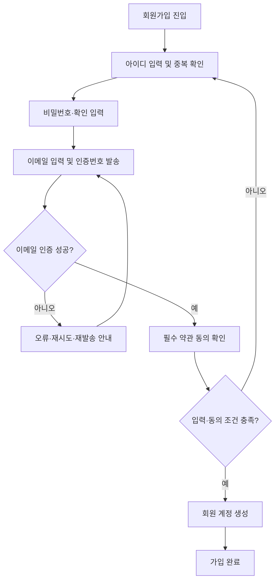
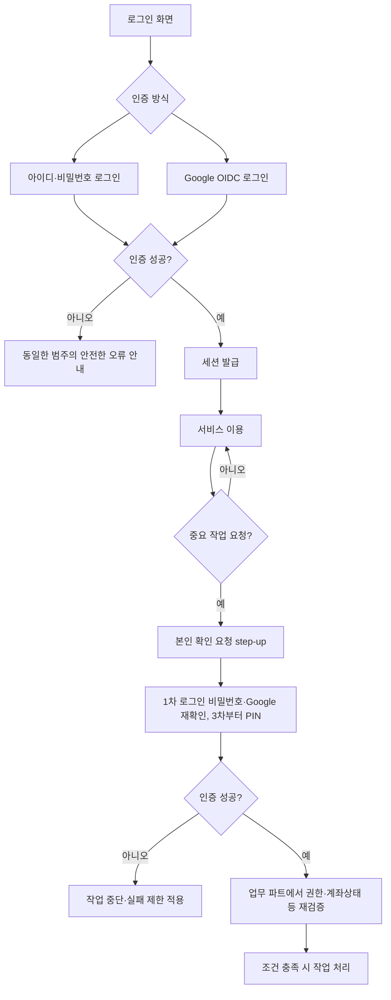
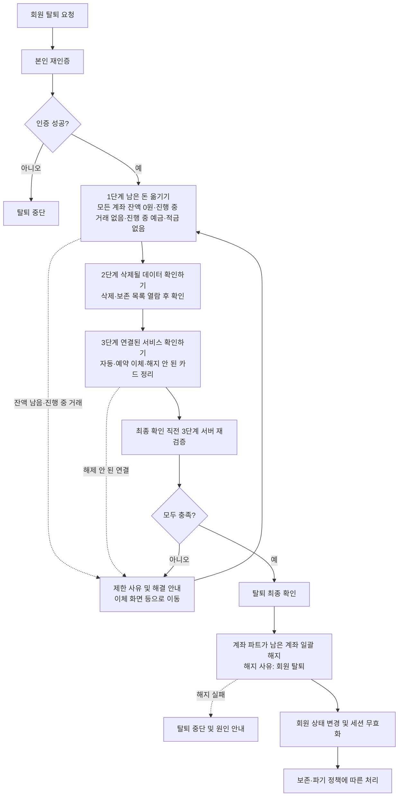
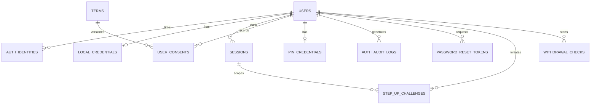
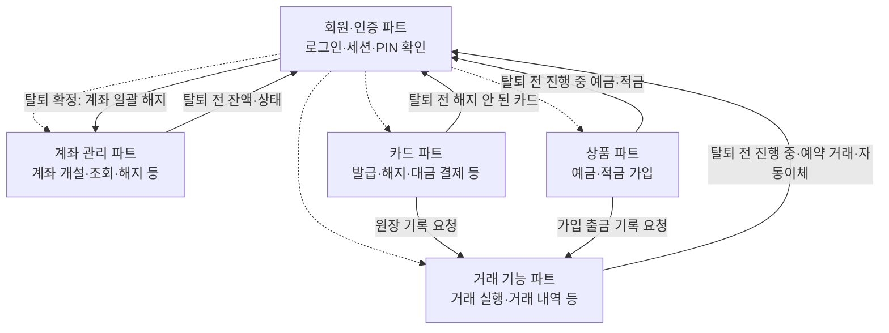
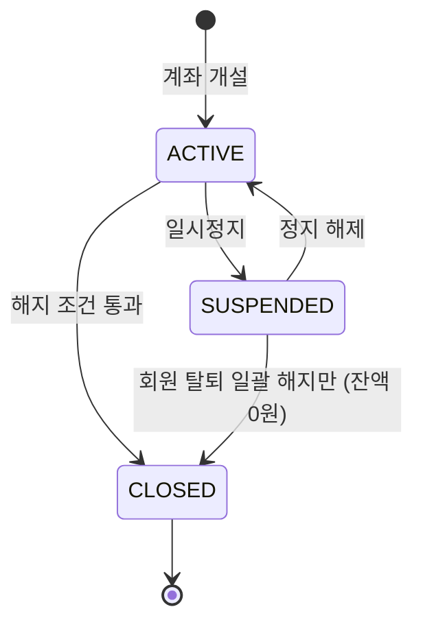
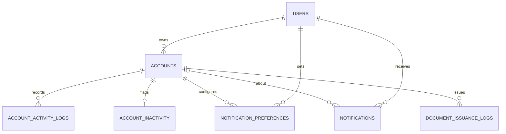
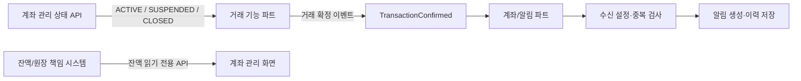
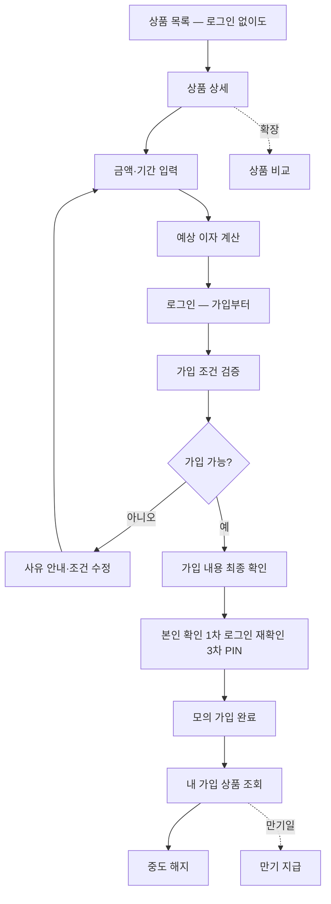
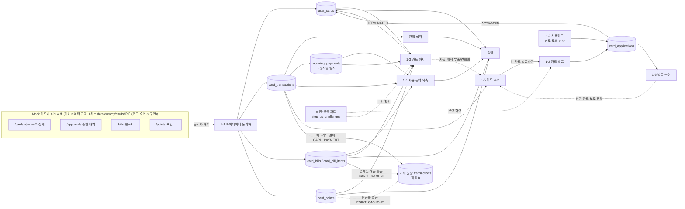

# 은행 모바일 웹서비스 통합 기획서

> **구성:** 회원·인증(Part 1) · 계좌(Part 2) · 예금·적금 상품(Part 3) · 카드(Part 4) · 거래(Part 5) · 카드·거래 연결과 공통 규칙(Part 6) — 이 파일 하나  
> **합친 날짜:** 2026-11-03(Part 1·2) · 2026-11-05(Part 3~6)  
> **합친 방법:** 두 원본을 합친 뒤 변경 이력대로 고쳤다. 합칠 때 바꾼 것은 ① 제목 단계를 한 단계씩 낮춤 ② 겹치는 기능 번호(둘 다 F01~F13)를 `AUTH-F01`~`AUTH-F13`(회원·인증), `ACCT-F01`~`ACCT-F13`(계좌 관리)으로 구분 ③ "이 문서"를 "이 파트"로 고침, 이 세 가지뿐이다.  
> **2026-11-05 합친 방법:** `docs/은행_상품_기획안.md` → Part 3, `docs/거래_카드기능_기획서.md`의 파트 A·B·C → Part 4·5·6. 바꾼 것은 ① 제목 단계를 한 단계씩 낮춤 ② 다른 파일을 가리키던 곳을 이 파일의 Part 번호로 바꿈(예: "회원·계좌 기획 8.4" → "Part 2 8.4", "거래·카드 기획서 C-5" → "Part 6 C-5") 두 가지뿐이고 내용은 바꾸지 않았다. 각 Part 안의 절 번호("N장", "1-N", "C-N")는 그 Part 안의 번호다. 변경 이력 속 파일 이름은 합치기 전 이름 그대로다.  
> **원본:** `docs/_원본/` (회원가입_로그인_인증_기획서.md v1.0 · 계좌기능_기획서.md v3.0). 카드·거래 원본은 팀 브랜치(`Yellow`)의 `docs/FEATURES.md`·`doc/거래_입출금_기획서.md`  
> **변경 이력(1):** 2026-11-03 — 회원 탈퇴(`AUTH-F09`)에 **탈퇴 전 필수 3단계**(① 남은 돈 옮기기 ② 삭제될 데이터 확인하기 ③ 연결된 서비스 확인하기)를 추가했다. 고친 곳: Part 1 의 3.3 · AUTH-F09 · 5(UI07) · 6 · 7 · 9 · 11 · 12 · 13, Part 2 의 9 · 10.3 · 14.  
> **변경 이력(2):** 2026-11-03 — 실제 서비스·법령 조사(`docs/domain-rules.md`)를 반영해 ① 해지 안 된 카드는 탈퇴를 **차단** ② 회원 기본 정보는 **유예 기간 뒤 파기**, 보존은 법령 근거가 있는 기록으로 한정 ③ 잔액 0원으로 남은 계좌는 탈퇴 확정 때 **일괄 해지**를 기본안으로 바꿨다.  
> **변경 이력(3):** 2026-11-03 — 클론 대상이 토스이므로 탈퇴 규칙을 토스 기준으로 맞췄다(`docs/domain-rules.md` 4절): 자동이체·카드 **차단 확정**, 탈퇴 후 **유예 1개월**, 일시정지 계좌는 **잔액 0원이면 탈퇴 때 정지 해제 없이 해지**, 잔액이 있으면 정지 해제 후 이체.  
> **변경 이력(4):** 2026-11-03 — 탈퇴 관련 "협의 필요" 5개 중 4개를 기본안으로 확정했다(외부 계좌 이체는 거래 파트 몫, 보존 5년 고정, 탈퇴 철회 없음·재가입 가능, 점검~확정 사이 잠금 없음). 남은 것은 계좌 파트의 예외 해지 수용 1개.  
> **변경 이력(5):** 2026-11-04 — 계좌 필드를 더미 데이터(CODEF 응답 이름)에 맞췄다. `account_number`→`resAccount`, `opened_at`→`resAccountStartDate`, `nickname`→`resAccountNickName`, `currency`→`resAccountCurrency`, `balance`→`resAccountBalance`, `as_of`→`balance_as_of`. 또 ① `account_preferences` 테이블을 없애고 별명·즐겨찾기를 `accounts` 로 합쳤으며(더미가 그렇게 돼 있음) ② 더미에만 있던 `resAccountDisplay`·`resAccountName`·`resAccountStatus`·`resAccountEndDate` 를 `accounts` 에 넣고 ③ 날짜를 더미 형식(`YYYYMMDD`)으로 맞췄다(고친 곳: Part 2 의 3(ACCT-F04)·계좌 개설 규칙·8·9·12).  
> **변경 이력(6):** 2026-11-04 — 컬럼마다 뜻·값을 적은 **컬럼 사전**을 추가했다(Part 1 의 6.3, Part 2 의 8.4). 값 목록이 기획서에 없는 컬럼은 "값 목록 미정"으로 표시했다.  
> **변경 이력(7):** 2026-11-04 — 상품 기획안(`docs/은행_상품_기획안.md`)과 맞췄다. ① 예금·적금 가입은 새 계좌가 아니라 상품 파트의 가입 계약(`subscriptions`)으로 관리하고, `SAVINGS` 는 **저축예금(입출금이 자유로운 저축 통장)** 으로 뜻을 좁혔다 ② 탈퇴 ①단계에 진행 중인 예금·적금을 차단 조건으로 넣었다 ③ 진행 중인 가입 상품에 연결된 계좌는 해지를 막는다 ④ 상품 파트 연동 항목을 추가했다(고친 곳: Part 1 의 AUTH-F09, Part 2 의 ACCT-F01·ACCT-F05·ACCT-F13·8.4·10.3).  
> **변경 이력(8):** 2026-11-04 — 거래·카드 기획서(`docs/거래_카드기능_기획서.md`)와 맞췄다. ① 카드 해지·탈퇴 차단은 `CARD-F09`, 거래 쪽 점검은 거래 파트의 `transfer-blockers` API로 연결 ② 별도 파트 데이터 이름을 `transactions`·`transfers`·`scheduled_transfers`로 ③ 거래 확정 이벤트의 `transaction_type`은 거래 기획 3장의 값(`TRANSFER_IN` 등) ④ `notifications`에 `title`·`body` 추가, 계좌·거래·카드가 같이 씀 ⑤ `terms`에 카드 상품 약관용 `card_product_id` 추가 ⑥ `step_up_challenges.action` 값 목록 ⑦ 연동 그림에 카드 파트 추가. 공통 이름 규칙은 거래·카드 기획서 C-5.  
> **변경 이력(9):** 2026-11-04 — ① 카드 결제·출금 계좌로 연결된 계좌는 **카드의 결제 계좌를 다른 계좌로 바꾸거나 카드를 해지한 뒤에만 해지**(`ACCT-F05`) ② 탈퇴 때 거래·카드 데이터도 같은 보존 규칙(금융거래 기록 5년 보존, 나머지 즉시 삭제)으로 분류 ③ 상품 API 경로를 `/users/me/subscriptions`로.  
> **변경 이력(10):** 2026-11-04 — 회원 정보에 생년월일(`birth_date`)·성별(`gender`)·월급일(`payday`)을 추가했다. 생년월일·성별은 가입 때 필수(카드 발급 나이 검사·발급 순위 통계), 월급일은 선택(카드 사용 금액 예측). 거래·카드 기획서의 요청을 받아들인 것이다.  
> **변경 이력(11):** 2026-11-04 — 세 기획서 대조 후 정리: 본인 확인(`step_up_challenges`)을 필수로 바꾸고 발급 API(`POST /auth/step-up`)와 "3차 PIN 전에는 로그인 재확인" 확정, 회원 상태별 허용 동작 표(7.3) 추가, 정지 계좌는 입출금 모두 막음으로 확정, 카드 점검 내부 API 연결, 탈퇴 점검 계좌 API를 `/internal/...`로, 연동 그림·계약표에 상품 파트 추가, 알림 타입 2개·`event_id` 뜻 넓힘, 이벤트 시각 +09:00.  
> **변경 이력(12):** 2026-11-04 — 상품 기획안에 예금·적금 중도 해지(`PROD-F10`)·만기 처리(`PROD-F11`)가 2차로 들어가, 탈퇴·계좌 해지 막힘을 풀 방법이 생겼다. 거래 유형 목록에 `SUBSCRIPTION_PAYOUT` 추가.  
> **변경 이력(13):** 2026-11-04 — 두 번째 대조 반영: 본인 확인(`POST /auth/step-up`)을 **1차**에 넣고 흐름도·9.3을 PIN 전용에서 바꿈, 상품 파트 내부 점검 API(`subscription-blockers`) 연결, 정지 계좌 입출금 차단을 확정 문구로, 7.3 정리 동작에 중도 해지·정지 해제·카드 결제 계좌 바꾸기·밀린 카드 대금 결제·자동이체/예약 취소 추가, `step_up_challenges.action`에 `ACCOUNT_STATUS_CHANGE`, 알림에 `user_card_id`, 우리가 만든 빈 날짜 칸은 `null`.  
> **변경 이력(14):** 2026-11-04 — 계좌 표에서 `resAccountStatus`(`lifecycle_status`와 같은 내용이라 저장하지 않고 응답 때 만듦)와 `resAccountEndDate`(예금·적금이 상품 파트로 가서 계좌에는 만기가 없음)를 뺐다. 더미에서도 같은 칸과 겹치던 칸을 지웠다.  
> **변경 이력(16):** 2026-11-05 — DB 대조 반영: `terms`에 약관 본문 위치 `content_url`(필수) 추가 — 팀 브랜치 `schema.sql`에 있던 칸. 약관 동의 화면과 챗봇 RAG가 같은 본문을 읽는다.  
> **변경 이력(15):** 2026-11-04 — 세 번째 꼼꼼한 대조 반영: 탈퇴·생년월일/성별 수정에도 본인 확인(`WITHDRAWAL`·`PROFILE_CHANGE`), 본인 확인의 로그인 비밀번호 실패는 `local_credentials`에 세고 5회면 잠금(`STEP_UP_LOCKED`), PIN은 3차부터 `POST /auth/step-up` 안에서 확인(`/auth/pin/verify` 안 씀), 탈퇴 일괄 해지(`close-for-withdrawal`)에서만 잔액 0원 일시정지 계좌를 바로 해지하는 예외 **확정**, 계좌 해지 막힘 사유 코드 4개, 알림 중복 방지 키 `(event_id, user_id, type)`, 장기 미사용 계좌 API를 `GET /accounts?inactive=true`로, 가입 입력에 이름(실명) 추가, `PENDING_VERIFICATION`은 실제 계정으로 확정, 관계도·QA 항목 보강.  
> **아직 안 한 것:** 두 파트 사이의 중복·충돌 정리(예: 절 번호 `0`~`13` 이 파트마다 따로 있음, 데이터 모델·연동 절이 파트마다 따로 있음). 내용 합의는 별도 작업이다.

## 목차

| 파트 | 내용 | 기능 ID |
|---|---|---|
| Part 1 | 회원가입 · 로그인 · 간편 인증 (PIN) | `AUTH-F01` ~ `AUTH-F13` |
| Part 2 | 계좌 관리 (개설·조회·잔액·상태·알림·증명서·휴면) | `ACCT-F01` ~ `ACCT-F13` |
| Part 3 | 은행 상품 (예금·적금 탐색·가입) | `PROD-F01` ~ `PROD-F11` |
| Part 4 | 카드 (파트 A — 카드 담당 팀원 작성) | `CARD-F01` ~ `CARD-F16` |
| Part 5 | 거래 (파트 B — 이체·거래내역) | `TRX-F01` ~ `TRX-F14` |
| Part 6 | 카드·거래 연결과 공통 규칙 (파트 C — 이름·형식 규칙 C-5 포함) | — |

---

## Part 1. 회원가입 · 로그인 · 간편 인증 서비스 상세 기획서

> **문서 버전:** v1.0  
> **작성일:** 2026-11-03  
> **담당 영역:** 회원·인증(Auth / Identity) 파트  
> **기능 범위:** 확정된 **13개 기능 항목** — 1차 6개 / 2차 4개 / 3차 3개  
> **서비스 가정:** 모의 금융 서비스를 위한 웹·앱 회원·인증 시스템  
> **상태:** **기능 범위 확정**, 세부 수치·인증 방식·운영 정책은 개발 전 최종 합의 필요

---

### 0. 문서 읽는 법

- **[확정]** 사용자가 확정한 기능 범위 또는 기능 간 책임 분리.
- **[설계 권고]** 안전하고 일관된 구현을 위한 권장 동작. 개발 단계에서 팀이 구체화할 수 있음.
- **[협의 필요]** 아직 확정되지 않은 값이나 정책. 문서에 제시된 예시는 확정 스펙이 아님.
- API 주소·DB 테이블·상태값·에러코드·시도 횟수 등은 **기술 설계 초안**이며 실제 구현 명세와 구분한다.
- **중요:** 이 파트는 금융기관이 요구하는 실서비스 인증·신원확인·규제 준수를 충족한다고 주장하지 않는다. **모의 금융 서비스**의 교육·개발용 설계다.

### 1. 프로젝트 개요

#### 1.1 목적
회원이 계정을 만들고 안전하게 로그인한 뒤, 개인정보를 관리하고, 모의 금융 서비스 내 중요 작업을 수행하기 전에 필요한 재인증(PIN 포함)을 받을 수 있도록 공통 인증 기능을 제공한다.

#### 1.2 범위와 책임

| 구분 | 회원·인증 파트 책임 | 타 파트 책임 |
|---|---|---|
| 회원 계정 | 생성·식별·프로필 수정·탈퇴 요청 및 계정 상태 관리 | 계좌/거래 등 도메인 데이터 소유 |
| 로그인 | 비밀번호 인증, Google OIDC 로그인, 세션 발급·만료·폐기 | 발급된 인증 컨텍스트를 검증하고 권한 적용 |
| 이메일 인증 | 인증번호 발급·검증·만료/재발송 관리 | 메일 발송 인프라와의 연동(공통 인프라) |
| PIN | 등록·인증·변경·재설정, 실패 제어, 인증 결과 제공 | 중요 작업의 수행 여부 결정·자체 권한 검사 |
| 회원 탈퇴 | 탈퇴 절차 시작·전 3단계 점검 진행·최종 상태 반영 | 계좌 잔액·해지 여부·처리 중 거래·자동/예약 이체 등 제한 조건 반환 |
| 약관 | 동의 항목·버전·시각 기록 | 실제 서비스/상품별 추가 약관 내용 제공(해당 시) |

**범위 제외:** 계좌 개설·상태·잔액, 거래 실행·내역, 실제 계좌 이체, 금융상품/이자 처리, 실제 금융기관 실명확인(KYC), 공인 전자서명·실제 은행 수준의 거래 승인.

#### 1.3 핵심 원칙
1. **로그인 인증과 작업별 인증을 구분**한다. PIN은 일반 로그인 비밀번호를 대체하지 않는다.
2. **인증 성공과 업무 실행을 구분**한다. PIN 확인이 성공해도 계좌·거래 파트의 소유권/상태/한도 검증을 생략할 수 없다.
3. **사용자 식별의 기준은 내부 `user_id`**이다. 아이디·이메일·Google 계정 정보는 인증 수단 또는 연락처다.
4. 인증 자격 증명(비밀번호·PIN·인증번호·토큰)은 **평문으로 저장하거나 로그에 남기지 않는다**.
5. 계정 삭제 요청과 각종 데이터의 즉시 삭제는 같은 개념이 아니다. 보존/파기 규칙을 별도로 적용한다.

---

### 2. 최종 기능 목록 — 총 13개

| 단계 | ID | 기능 | 주요 동작 | 포함 여부 |
|---|---|---|---|---|
| **1차 회원가입·로그인** | AUTH-F01 | 회원가입 | 아이디·비밀번호·비밀번호 확인·이메일 입력 | 확정 |
| | AUTH-F02 | 아이디 중복 확인 | 가입 전 아이디 사용 가능 여부 확인 | 확정 |
| | AUTH-F03 | 이메일 인증 | 인증번호 발송·확인 | 확정 |
| | AUTH-F04 | 구글 소셜 로그인 | Google OAuth 2.0 + OIDC 기반 로그인 | 확정 |
| | AUTH-F05 | 로그인 / 로그아웃 | 일반 로그인, 세션 발급·만료·폐기 | 확정 |
| | AUTH-F06 | 아이디 찾기 / 비밀번호 재설정 | 이메일 기반 계정 복구 | 확정 |
| **2차 회원 정보 관리** | AUTH-F07 | 내 정보 조회 및 수정 | 기본 프로필 조회·수정 | 확정 |
| | AUTH-F08 | 비밀번호 변경 | 로그인된 회원의 비밀번호 변경 | 확정 |
| | AUTH-F09 | 회원 탈퇴 | 탈퇴 요청·재인증·**탈퇴 전 3단계 점검(남은 돈 옮기기 · 삭제될 데이터 확인 · 연결된 서비스 확인)**·처리 | 확정 |
| | AUTH-F10 | 약관 동의 및 관리 | 필수/선택 약관, 동의 기록·변경 | 확정 |
| **3차 간편 인증** | AUTH-F11 | PIN 등록 | 6자리 간편 비밀번호 설정 | 확정 |
| | AUTH-F12 | PIN 인증 | 중요 작업 전 6자리 PIN 확인 | 확정 |
| | AUTH-F13 | PIN 변경 및 재설정 | 기존 PIN 변경, 분실 시 별도 인증 후 재설정 | 확정 |

> **정책 구분:** 기능 항목 13개는 변경하지 않는다. 세션 관리, 실패 횟수 제한, 계정 잠금, 감사 로그 등은 새로운 사용자 기능을 추가하는 것이 아니라 관련 기능의 **필수/권고 처리 규칙**으로 포함한다.

---

### 3. 주요 사용자 흐름

#### 3.1 일반 회원가입



#### 3.2 로그인 및 중요 작업



#### 3.3 회원 탈퇴



---

### 4. 기능별 상세 명세

#### AUTH-F01. 회원가입

**목적:** 로컬 계정(아이디+비밀번호)을 생성하고 서비스 이용 자격을 준비한다.

**화면/입력**
- 아이디: 필수, 중복 여부 확인 가능.
- 비밀번호: 필수, 입력값 숨김 기본, 표시 토글 선택.
- 비밀번호 확인: 필수, 비밀번호와 일치 여부 확인.
- 이메일: 필수, 인증 완료 필요.
- 이름(실명): 필수. `users.name` 에 저장하고 계좌 예금주 이름으로 쓴다.
- 생년월일: 필수, 날짜 선택. 미래 날짜는 막는다.
- 성별: 필수, `남성`/`여성` 중 선택.
- 월급일: 선택, 1~31일 중 선택. 비워 두고 나중에 내 정보(AUTH-F07)에서 넣을 수 있다.
- 약관: 필수/선택 구분, 필수 항목 동의 필요.
- 가입 완료 버튼: 유효성 조건을 충족했을 때만 제출 가능하도록 안내.

**정상 처리 흐름**
1. 아이디 입력 → AUTH-F02 중복 확인.
2. 비밀번호 및 확인값 검증.
3. 이메일 입력 → AUTH-F03 인증 완료.
4. 최신 필수 약관 동의 여부 확인.
5. 서버에서 모든 값을 **다시 검증**하고 계정 생성.
6. 내부 `user_id` 발급, 인증수단 `LOCAL`(`auth_identities.provider`) 연결, 회원 상태 활성화.
7. 가입 완료 화면 표시. 자동 로그인 여부는 **[협의 필요]**.

**주요 규칙**
- [설계 권고] 아이디 허용 문자·길이·대소문자 처리 기준은 서버와 화면에서 동일하게 적용한다.
- [설계 권고] 비밀번호는 긴 암호구를 허용하고, 취약/유출 비밀번호 사용을 제한할 수 있다. 비밀번호를 평문 저장·이메일 발송하지 않는다.
- [설계 권고] 가입 직전 중복 검사를 다시 수행하며, DB 고유 제약으로 경합 상황의 중복 생성까지 방지한다.
- [설계 권고] 회원가입 요청에도 속도 제한 및 중복 요청 방지를 적용한다.
- [협의 필요] 이메일의 계정 간 중복 허용 여부, 미인증 가입 초안의 만료/삭제 시간.
- [기본안] 생년월일·성별은 카드 발급 나이 검사와 발급 순위 통계(Part 4 1-6·1-7), 월급일은 카드 사용 금액 예측(1-4)에만 쓴다. 이 목적을 가입 화면에 적는다(필요한 만큼만 수집).

**예외/오류**
- 이미 사용 중인 아이디, 인증되지 않은 이메일, 비밀번호 불일치, 필수 약관 미동의.
- 인증번호 만료 또는 시도 제한, 이메일 중복 정책 위반.
- 같은 가입 요청의 중복 제출, 서버·메일 서비스 장애.

**완료 기준(AC)**
- [ ] 모든 필수 입력·인증·동의를 완료한 회원만 가입 성공.
- [ ] 중복 아이디가 동시 요청에도 생성되지 않음.
- [ ] 비밀번호 원문이 DB/로그/응답에 노출되지 않음.
- [ ] 가입된 회원은 내부 `user_id`로 고유 식별됨.

#### AUTH-F02. 아이디 중복 확인

**목적:** 가입 희망 아이디의 사용 가능 여부를 즉시 안내한다.

**정상 흐름:** 아이디 입력 → 형식 검증 → 중복 확인 요청 → 사용 가능/불가 결과 표시.

**규칙·예외**
- [설계 권고] 입력값 수정 시 기존 중복 확인 결과를 무효화한다.
- [설계 권고] 클라이언트의 '사용 가능' 표시는 확정 예약이 아니다. **최종 가입 시 DB 고유 제약으로 재검증**한다.
- [설계 권고] 대량 조회/무차별 탐색 방지를 위한 속도 제한을 적용한다.
- 오류 시 '확인 실패, 다시 시도'를 안내하고 가입을 진행하지 않는다.

**완료 기준(AC)**
- [ ] 사용 가능/중복/형식 오류가 구분됨.
- [ ] 확인 후 아이디 변경 시 재확인 필요.
- [ ] 중복 검사 성공 직후 다른 사용자가 가입해도 중복 계정 생성 없음.

#### AUTH-F03. 이메일 인증

**목적:** 회원이 제출한 이메일 주소의 수신 가능성과 소유 통제 여부를 확인한다.

**정상 흐름**
1. 이메일 입력 → 인증번호 발송 요청.
2. 서버가 짧은 만료 시간을 가진 일회용 인증번호 생성·보관(원문 비노출) 후 발송.
3. 사용자 인증번호 입력 → 서버가 유효기간·시도 횟수·일치 여부 검증.
4. 성공 시 **해당 이메일·가입 흐름에 한정된 인증 완료 상태**로 변경.
5. 인증 완료 후 이메일이 변경되면 다시 인증.

**필수 처리 규칙**
- [설계 권고] 인증번호 만료, 재발송 간격, 일/시간 단위 발송 제한, 검증 시도 제한을 함께 둔다.
- [설계 권고] 새 인증번호 발송 시 직전 코드 무효화 및 코드 1회 사용을 기본으로 한다.
- [설계 권고] 인증번호를 로그에 남기지 않고 저장 시에도 안전하게 보호한다.
- [협의 필요] 예시 정책: 5분 만료 / 60초 재발송 대기 / 연속 오류 제한. **확정 수치가 아님**.

**예외/오류:** 이메일 형식 오류, 발송 장애, 코드 불일치·만료·재사용, 재발송 제한, 인증 대상 이메일 변경.

**완료 기준(AC)**
- [ ] 올바른 코드와 유효한 시간/대상에서만 인증 성공.
- [ ] 만료·재사용 코드는 실패.
- [ ] 발송·검증 제한이 서버에서도 적용.

#### AUTH-F04. 구글 소셜 로그인 (Google OIDC)

**목적:** Google 계정을 이용해 로그인 또는 신규 소셜 계정을 생성한다.

**기술 범위**
- [확정] Google 소셜 로그인 지원.
- [설계 권고] **OAuth 2.0 Authorization Code Flow + OpenID Connect(OIDC)** 기반으로 사용자 인증을 구현하고, 클라이언트 유형에 맞게 **PKCE**를 적용한다.
- [설계 권고] 서버는 발급자(`iss`), 대상(`aud`), 만료(`exp`), 요청 연계 값(`state`, 필요 시 `nonce`) 등 관련 검증을 수행한다. 계정 식별에는 Google의 안정적인 `sub` 식별자를 사용한다.

**정상 흐름**
1. 'Google로 계속하기' 버튼 선택.
2. Google 인증 및 사용자 동의 후 콜백 처리.
3. 인증 응답/토큰 검증.
4. `(provider, provider_subject)`로 기존 인증수단 조회.
5. 기존 연결 계정이면 로그인, 신규라면 필요한 약관 확인과 **추가 정보 입력(이름(실명)·생년월일·성별 필수, 월급일 선택 — AUTH-F01과 같은 규칙)** 후 내부 회원 생성/연결.
6. 서비스 세션 발급.

**계정 연결 정책**
- [설계 권고] Google 이메일이 로컬 계정 이메일과 같더라도 **이메일 문자열 일치만으로 자동 병합하지 않는다**.
- [설계 권고] 기존 계정에 Google 로그인을 연결하려면 해당 **기존 계정으로 먼저 인증**하고 연결 의사를 재확인한다.
- [협의 필요] 신규 소셜 가입 시 별도 아이디 부여 방식, 필수 약관 동의 화면, 로컬 비밀번호 추가 기능(초기 범위 밖).
- Google로만 가입한 사용자에게 '기존 비밀번호 변경'을 그대로 제공하지 않는다.

**예외/오류:** Google 인증 취소, 토큰 검증 실패, 이미 다른 회원에 연결된 Google 계정, 동의 미완료, 세션 생성 실패.

**완료 기준(AC)**
- [ ] 유효한 Google 인증 결과만 로그인 성공.
- [ ] 동일 Google 계정으로 중복 회원 생성되지 않음.
- [ ] 같은 이메일의 별도 계정을 임의로 자동 병합하지 않음.

#### AUTH-F05. 로그인 / 로그아웃

**목적:** 로컬 회원의 인증 및 서비스 세션 유지·종료를 제공한다.

**로그인 정상 흐름**
1. 아이디·비밀번호 입력.
2. 사용자 상태 확인 및 저장된 비밀번호 해시 검증.
3. 실패 횟수·위험 신호 등 정책 확인.
4. 성공 시 세션 생성, 클라이언트에 필요한 세션 식별자/토큰 전달.
5. 회원 전용 페이지로 이동.

**로그아웃 정상 흐름:** 로그아웃 요청 → 서버 세션/갱신 수단 무효화 → 클라이언트 인증 상태 제거 → 로그인 화면 이동.

**세션 및 보안 규칙**
- [설계 권고] 웹에서는 `HttpOnly`, `Secure`, 적절한 `SameSite` 쿠키와 CSRF 방어 등 세션 형태에 맞는 보호 적용.
- [설계 권고] 세션 만료(유휴/최대), 재인증이 필요한 중요 작업, 비밀번호 변경 시 세션 처리 정책을 명확히 정의.
- [설계 권고] 로그인 실패에 속도 제한과 점진적 보호 조치를 적용한다. 과도한 영구 잠금으로 정상 사용자가 피해를 보지 않도록 설계.
- [설계 권고] 계정 존재 여부가 무분별하게 드러나지 않도록 오류 메시지를 설계한다.
- [협의 필요] '로그인 유지' 기능, 다중 기기 로그인, 모든 기기 로그아웃(향후 확장 후보).

**예외/오류:** 자격 증명 불일치, `WITHDRAWN` 회원, `PENDING_VERIFICATION`(가입 마무리 화면만), 시도 제한, 서버/세션 저장소 장애, 만료된 세션.

**완료 기준(AC)**
- [ ] 잘못된 비밀번호로 세션 생성되지 않음.
- [ ] 로그아웃 후 기존 세션으로 보호 API 접근 불가.
- [ ] 세션 만료 후 보호 기능 접근 시 재로그인 안내.

#### AUTH-F06. 아이디 찾기 / 비밀번호 재설정

**목적:** 로그인 정보를 잊은 회원이 이메일 등 등록 수단으로 계정을 복구하도록 지원한다.

**아이디 찾기 흐름**
1. 등록 이메일 입력 및 이메일 확인 절차 진행.
2. 인증 성공 시 아이디 일부 마스킹 또는 안전한 복구 안내 제공.
3. 정보가 일치하지 않아도 계정 존재를 쉽게 열거할 수 없도록 초기 안내를 설계.

**비밀번호 재설정 흐름**
1. 등록 이메일 입력 → 일회용 재설정 링크/토큰 발송.
2. 유효기간·사용 여부 검증 후 새 비밀번호 입력.
3. 서버에서 비밀번호 정책 확인 → 새 해시 저장 → 토큰 폐기.
4. 재설정 사실 알림, 기존 세션/갱신 토큰 처리(권고: 관련 기존 인증 세션 무효화).

**규칙·예외**
- 비밀번호 원문 조회·전송 기능은 제공하지 않는다.
- 일회용 토큰 재사용·만료·무작위 대입을 방지한다.
- 재설정 요청 속도 제한 및 계정 존재 여부 노출 방지 필요.
- [설계 권고] Google 전용 계정은 비밀번호가 없을 수 있으므로 Google 로그인 안내 또는 별도 '로컬 비밀번호 설정' 정책을 적용한다. 로컬 비밀번호 설정 자체는 **초기 범위에 미포함**.

**완료 기준(AC)**
- [ ] 유효한 일회용 수단을 통해서만 비밀번호 변경 성공.
- [ ] 이전 비밀번호로 로그인 불가.
- [ ] 만료·기사용 토큰 재사용 불가.

#### AUTH-F07. 내 정보 조회 및 수정

**목적:** 로그인한 회원이 자신의 기본 정보를 조회하고 허용된 항목을 수정한다.

**화면 항목 예시**
- 내부 회원 ID(일반 사용자에게 숨김), 로그인 아이디, 이메일 및 인증 상태, 가입일, 연결된 로그인 방식.
- 수정 가능: 이메일 등 허용된 프로필 필드, 월급일(언제든), 생년월일·성별(본인 확인 후 — `PATCH /users/me` 요청에 `step_up_challenge_id`, `action = 'PROFILE_CHANGE'`). 수정 불가 항목과 사유는 UI에서 구분.

**정상 흐름:** 마이페이지 → 정보 조회 → 수정 항목 편집 → 서버 검증 → 저장 → 변경 완료 표시.

**규칙·예외**
- 이메일 변경 시 **새 이메일 재인증**, 필요하면 현재 로그인 수단 재인증을 요구한다.
- [설계 권고] 수정 전후 변경 기록과 통지(특히 이메일 변경)를 남긴다.
- 민감정보 변경은 유효한 세션과 본인 재확인을 요구한다.
- [협의 필요] 표시 이름, 휴대전화, 프로필 사진 등은 현재 13개 확정 범위의 **필수 필드가 아님**.

**완료 기준(AC)**
- [ ] 본인 프로필만 조회·변경 가능.
- [ ] 이메일을 인증하지 않고 변경 완료 상태로 처리하지 않음.

#### AUTH-F08. 비밀번호 변경

**목적:** 로컬 로그인 사용자가 인증된 상태에서 자신의 비밀번호를 안전하게 변경한다.

**화면/입력:** 현재 비밀번호, 새 비밀번호, 새 비밀번호 확인.

**정상 흐름:** 회원 설정 → 현재 비밀번호 검증 → 새 비밀번호 정책 확인 → 해시 교체 → 변경 결과 안내 및 세션 갱신 정책 적용.

**규칙·예외**
- [설계 권고] 현재 비밀번호를 검증하고, 중요 재인증 요구 상황에서는 추가 검증을 적용한다.
- 새 비밀번호 확인 일치, 허용 문자/길이, 유출/취약 비밀번호 제한 등 정책 적용.
- 안전한 비밀번호 해시(예: 적절히 설정한 Argon2id 또는 운영 환경의 검증된 대안) 사용.
- Google 전용 계정에 로컬 비밀번호가 없다면 변경 대상이 아니며 별도 안내한다.
- 변경 완료 후 중요 세션 무효화/재로그인 방침은 명시적으로 결정한다.

**완료 기준(AC)**
- [ ] 현재 비밀번호가 틀리면 변경 불가.
- [ ] 기존 비밀번호로는 로그인 불가.
- [ ] 서버·로그에 평문 비밀번호가 남지 않음.

#### AUTH-F09. 회원 탈퇴

**목적:** 회원이 서비스 이용을 종료할 수 있도록 하되, 계좌·거래 파트의 무결성을 훼손하지 않는다.

**탈퇴 가능 조건 — 필수 3단계 (세 단계를 모두 완료해야만 탈퇴할 수 있다)**

| 단계 | 사용자가 하는 일 | 완료 조건 (서버가 판단) | 정보를 주는 파트 |
|---|---|---|---|
| ① 남은 돈 옮기기 | 잔액이 남은 계좌를 확인하고, 거래 파트의 이체 기능으로 다른 곳에 옮긴다 | 내 **모든 계좌의 확정 잔액이 0원**이고 **처리중(`PENDING`) 이체가 없고** **진행 중인 예금·적금 가입이 없다**. 예약·자동이체는 ③에서 본다 | 계좌 관리(계좌별 잔액·상태) · 거래(처리중 이체) · 상품(가입 계약) |
| ② 삭제될 데이터 확인하기 | 탈퇴하면 삭제·유예 후 파기·보존될 데이터 목록을 읽고 "확인했습니다"를 선택한다 | 목록이 사용자에게 표시되었고, **확인 시각과 목록 버전이 기록**되었다 | 회원·인증이 각 파트의 데이터 분류를 모아 표시 |
| ③ 연결된 서비스 확인하기 | 탈퇴하면 끊어질 연결(로그인 연결·알림·자동/예약 이체·카드 등)을 보고, 막는 항목은 먼저 정리한다 | **차단 항목(활성·일시정지 자동이체, 실행 대기 예약이체, 해지 안 된 카드)이 0개**이고, 나머지 안내 항목을 사용자가 확인했다 | 회원·인증(로그인 연결) · 계좌(알림) · 거래(자동/예약 이체 — Part 5 `transfer-blockers`) · 카드(해지 안 된 카드 — `CARD-F09`) |

**정상 흐름**
1. 마이페이지 → 회원 탈퇴 선택 → 본인 확인(`POST /auth/step-up`, `action = 'WITHDRAWAL'`) 및 영향 안내 확인. 본인 확인 번호는 짧게 유효하고 한 번만 쓰므로, 최종 확인 때 다시 본인 확인을 받아 그 `step_up_challenge_id` 를 `POST /users/me/withdraw` 에 넣는다.
2. 점검 화면에 ①②③의 상태(미완료/완료)를 표시한다. 순서대로 안내하되 이전 단계로 돌아갈 수 있다.
3. **① 남은 돈 옮기기:** 잔액이 남은 계좌의 목록과 잔액을 보여 주고 거래 파트의 이체 화면으로 이동시킨다. 돌아오면 서버가 잔액을 다시 조회한다.
4. **② 삭제될 데이터 확인하기:** 아래 분류 목록을 보여 주고 사용자의 확인을 받는다.
5. **③ 연결된 서비스 확인하기:** 아래 연결 목록을 보여 주고, 차단 항목은 해당 화면으로 이동시켜 정리하게 한다.
6. 세 단계가 모두 완료되면 "탈퇴 최종 확인"을 열어 준다.
7. 최종 확인 요청이 오면 서버가 ①②③을 **다시 검증**한다. 화면의 "완료" 표시를 믿지 않는다. 하나라도 미충족이면 탈퇴를 중단하고 해당 단계로 안내한다.
8. 모두 충족하면 계좌 파트가 잔액 0원인 **남은 계좌를 모두 해지(`CLOSED`)** 한다(해지 사유: 회원 탈퇴). 하나라도 해지에 실패하면 탈퇴를 중단하고 회원 상태는 바꾸지 않는다.
9. 계정 상태를 `WITHDRAWN` 으로 바꾸고 로그인 세션을 무효화한다.
10. 연동된 인증정보·개인정보에 보존/파기 정책을 적용하고 결과를 안내한다.

**① 남은 돈 옮기기 — 규칙**
- 잔액 조회는 계좌 파트의 읽기 전용 잔액 조회(`ACCT-F03`)를 재사용한다. 통화가 다르면 합산하지 않고 통화별로 보여 준다.
- **이체는 이 파트도 계좌 파트도 실행하지 않는다.** 거래 파트 기능으로 이동시키기만 한다(계좌 파트의 범위 제외 항목과 같은 원칙).
- 완료 여부는 서버 조회 결과로만 정한다. 사용자가 "옮겼다"고 눌러도 완료가 되지 않는다.
- 해지(`CLOSED`) 계좌는 잔액 0원일 때만 해지되므로 점검 대상에 포함하되 항상 충족으로 본다.
- **[기본안·토스 기준]** 일시정지(`SUSPENDED`) 계좌에 **잔액이 있으면** 정지를 먼저 해제한 뒤 이체한다(정지 중에는 출금이 막히므로). 점검 화면에서 정지 해제 화면으로 이동시킨다.
- **[기본안·토스 기준]** 옮길 곳은 사용자가 고르는 **본인 명의 계좌**다(토스의 휴면계좌 화면도 "잔액을 옮길 계좌"를 고르게 한다). 점검 화면은 토스처럼 "옮길 계좌 선택 → 이체"를 한 화면에서 끝낼 수 있게 한다.
- **[기본안]** 이체 대상 범위와 외부 계좌 이체의 시뮬레이션 방식은 **거래 파트가 정한다**. 탈퇴 점검은 거래 파트의 이체 기능으로 이동시키기만 한다.
- **[기본안]** 만기·해지 전인 **예금·적금 가입(`subscriptions`)이 하나라도 있으면 ①은 미완료**다. 예금·적금에 든 돈도 "남은 돈"이기 때문이다. 점검 화면은 가입 상품 목록(상품 파트 `GET /internal/users/{userId}/subscription-blockers`)을 보여 주고 "만기 후 또는 중도 해지 후 탈퇴할 수 있다"고 안내한다. 중도 해지(`PROD-F10`)와 만기 처리(`PROD-F11`)는 상품 파트 2차 기능이다. 중도 해지하면 원금이 출금 계좌로 돌아오므로 그 돈도 ①에서 옮겨야 한다.

**② 삭제될 데이터 확인하기 — 분류 목록 (초안)**

| 분류 | 해당 데이터 예시 | 소유 파트 |
|---|---|---|
| 즉시 삭제 | 로그인 세션, 이메일 인증번호 기록, 비밀번호 재설정 토큰, PIN 정보, 추가 인증 상태, 로컬 비밀번호 해시, 계좌 별명·즐겨찾기, 알림 설정, 알림 이력 · 자주 쓰는 계좌, 최근 보낸 계좌 숨김 설정 · 카드 설정(해외·온라인 차단, 이용 한도), 카드 별명, 카드 추천·사용 금액 예측·고정지출 탐지 결과, 카드 포인트 잔액, 마이데이터 연동 토큰·동기화 기록 | 회원·인증 / 계좌 / 거래 / 카드 |
| 유예 기간 뒤 파기 | 회원 기본 정보(아이디·이메일·생년월일·성별·월급일 등), 로그인 수단 연결 정보 — 부정 재가입 방지·결제취소 확인처럼 정당한 목적이 있을 때만 짧게 둔다 | 회원·인증 |
| 보존 (법령 근거가 있는 것만, 다른 정보와 분리해 보관) | 인증 감사 기록(로그인 등 접속기록), 계좌·거래 기록, 계좌 활동 기록, 문서 발급 기록 · 이체 요청·결과, 예약 송금·자동이체 신청 기록 · 카드 발급 신청·심사·해지 기록, 카드 이용(승인) 내역, 청구서·납부 기록, 카드 상태·설정 변경 이력, 포인트 현금화 기록 · 예금·적금 가입 계약·납입 기록 | 회원·인증 / 계좌 / 거래 / 카드 / 상품 |
| 보존 여부 확인 필요 | 약관 동의 이력 | 회원·인증 |

- 위 분류는 **[설계 권고] 초안**이다. 근거는 `docs/domain-rules.md` 에 있다: 개인정보 보호법 제21조(필요 없어지면 지체 없이 파기, 다른 법령상 보존 의무가 있으면 예외이며 분리 보관), 전자금융거래법과 시행령 제12조(전자금융거래기록은 최대 5년 안에서 종류별로 5년/1년 보존), 토스의 탈퇴 후 1개월 유예 사례.
- **보존은 법령 근거가 있는 기록으로만** 하고, 보존하는 기록은 다른 개인정보와 분리해 저장한다. 회원 기본 정보를 근거 없이 오래 두지 않는다.
- **[기본안·토스 기준]** 유예 기간은 **탈퇴 후 1개월**이다(토스 개인정보처리방침: 탈퇴 후 1개월 동안 부정거래·자금세탁 방지, 결제취소 환급 확인 목적으로 이용). 금융거래 기록 보존은 **5년**을 기본으로 한다.
- **[기본안]** 거래·카드·상품 데이터도 같은 기준이다. 돈이 오갔거나 거래 조건을 바꾼 기록(전자금융거래법 시행령 제12조의 "거래 신청·조건 변경", "거래 기록")은 보존, 편의 설정과 계산 결과는 즉시 삭제다. 카드 기록에만 적용되는 법령(신용정보법·여신전문금융업법)은 아직 확인하지 않았다(`docs/domain-rules.md`).
- **[기본안]** 모의 서비스의 보존 기간은 **5년으로 고정**한다. 실서비스로 가려면 전자금융거래법 시행령 현행본 등 관련 규정을 확인해야 한다(조문은 2015년 개정 표시까지만 확인함).
- 확인 방식: 사용자가 목록을 펼쳐 본 뒤 "삭제·보존 내용을 확인했습니다"를 선택한다. 서버는 확인 시각과 목록 버전을 저장한다. 목록 버전이 바뀌면 이전 확인은 무효가 된다.
- 목록은 데이터의 **종류**를 알리는 것이며, 거래 내용 같은 개인 정보 자체를 이 화면에 펼쳐 보이지 않는다.
- **[기본안·토스 기준]** 목록 화면에 "탈퇴하면 기존 거래기록은 삭제되고 다시 가입해도 확인할 수 없다. 다만 금융거래정보는 관련 법에 따라 일정 기간(토스는 5년) 보관한다"는 안내를 함께 보여 준다. 탈퇴하면 필수 동의를 포함한 모든 동의가 자동으로 철회된다는 점도 안내한다.
- **[기본안]** 탈퇴 철회(복구)는 지원하지 않는다. 재가입은 가능하다.

**③ 연결된 서비스 확인하기 — 연결 목록 (초안)**

| 연결된 서비스 | 탈퇴하면 | 처리 |
|---|---|---|
| Google 로그인 연결 | 연결이 해제된다 | 안내 후 확인 |
| 입출금 알림 | 알림 설정이 삭제되고 발송이 중단된다 | 안내 후 확인 |
| 자동이체 · 예약이체 | 탈퇴 뒤에 실행될 수 있어 위험하다 | **차단** — 해제/취소 후에만 진행 |
| 체크카드 · 신용카드 | 연결 계좌가 사라져 쓸 수 없게 된다 | **차단** — 카드를 해지한 뒤에만 진행(토스·카카오페이도 카드 해지가 먼저). 카드 해지는 `CARD-F09`(Part 4 1-3). 마이데이터로 연동만 한 타사 카드는 막지 않고 연동 해제만 안내 |

- 차단 항목이 하나라도 있으면 ③은 미완료이고, 해당 서비스 화면으로 이동하는 안내를 보여 준다.
- 안내 항목은 사용자가 목록을 확인하면 완료로 본다.
- **[확정·토스 기준]** 자동·예약 이체는 **차단**한다. 토스는 "등록된 자동이체를 모두 삭제"해야 탈퇴할 수 있다. 카카오페이처럼 탈퇴 때 자동으로 취소하는 방식도 있지만 토스를 따른다. 자동이체 해지는 토스처럼 앱 안의 해당 화면에서 직접 하게 이동시킨다.

**핵심 원칙**
- **회원 탈퇴 ≠ 계좌 해지 ≠ 모든 DB 행 즉시 삭제**. 탈퇴 확정 때 계좌 파트가 해지를 수행하더라도 해지 조건 검증과 실행은 계좌 파트의 책임이다.
- **[설계 권고]** 계좌 소유권/미완료 거래 등 도메인 검증을 **인증 파트가 임의로 추측하지 않고** 담당 파트에 조회한다.
- **[설계 권고]** 점검 결과는 짧게만 유지하고 **최종 확인 직전에 반드시 다시 검증**한다. 화면에서 확인 메시지를 띄우는 것만으로는 안전하지 않다(계좌 파트 7.3 의 "시점/동시성 보장" 원칙과 같다).
- **[설계 권고]** 연동 파트가 응답하지 못하면 "충족"으로 보지 않고 탈퇴를 중단한다.
- **[기본안]** 재가입은 가능하고, 탈퇴한 계정을 되살리는 재활성화는 없다. 탈퇴가 막히는 경우는 위 ①②③, 연동 파트 응답 실패, 남은 계좌 일괄 해지 실패, 사용자가 풀 수 없는 정지(아래)뿐이다. 유예 기간(1개월)과 보존 기간(5년)은 ②의 설명을 따른다.
- **[기본안]** 점검~확정 사이에 입금이나 신규 계좌 개설이 생겨도 따로 잠그지 않는다. 최종 확인 때 서버가 ①②③을 다시 검사하므로 그때 걸러져 탈퇴가 중단된다.
- **[기본안]** 잔액 0원으로 남은 계좌는 최종 확인 뒤 계좌 파트가 **모두 해지**하고, 그다음 회원 상태를 바꾼다. 해지 사유 "회원 탈퇴"를 계좌 활동 기록에 남긴다. 하나라도 실패하면 회원 상태를 바꾸지 않는다. (토스증권은 잔액을 비워야 계좌 해지, 카카오뱅크는 비공식 자료상 모든 계좌 해지 후 탈퇴 — `docs/domain-rules.md`)
- **[확정·토스 기준]** 일시정지(`SUSPENDED`) 계좌는 계좌 파트 7.1 에서 바로 해지가 안 되지만, **잔액이 0원이면 탈퇴 일괄 해지에서만 예외로 정지 해제 없이 바로 해지**한다. 이 예외는 시스템 경로 `POST /internal/users/{userId}/accounts/close-for-withdrawal` 에서만 쓴다(계좌 파트 ACCT-F05·7.1·7.2). 토스는 압류 등 출금제한 사고신고가 등록된 계좌만 해지를 막고, 거래중지(휴면) 계좌는 앱에서 해지할 수 있다(`docs/domain-rules.md` 4절). 잔액이 있으면 위 ①의 규칙대로 정지를 먼저 해제한다.
- **[설계 권고]** 나중에 관리자 정지·압류처럼 사용자가 풀 수 없는 정지 상태가 생기면, 탈퇴 일괄 해지에서 반드시 **제외하고 탈퇴를 막는다**(토스 약관과 같은 원칙).
- [설계 권고] 서비스 정책상 보존이 필요한 기록과 즉시 삭제 가능한 정보의 처리를 구분한다.

**예외/오류:** 계좌 잔액 남음, 처리중 이체, 진행 중인 예금·적금, 활성 자동/예약 이체, 단계 확인 누락, 확인 이후 삭제 목록 버전 변경, 점검~확정 사이 잔액 변동, 해지 안 된 카드, 남은 계좌 일괄 해지 실패, 연동 파트 응답 실패, 사용자가 풀 수 없는 정지, 본인 확인 실패·잠금(`STEP_UP_LOCKED`).

**완료 기준(AC)**
- [ ] ① 잔액이 0원이 아닌 계좌가 하나라도 있으면 탈퇴되지 않고, 계좌별 잔액과 이체 안내가 표시된다.
- [ ] ① 처리중(`PENDING`) 이체가 있으면 탈퇴되지 않는다.
- [ ] ① 만기·해지 전인 예금·적금 가입이 있으면 탈퇴되지 않고 가입 상품 목록이 안내된다.
- [ ] ② 삭제될 데이터 확인(확인 시각·목록 버전 기록) 없이는 최종 확인 단계가 열리지 않는다.
- [ ] ③ 활성 자동/예약 이체가 남아 있으면 탈퇴되지 않고 해당 화면으로 안내된다.
- [ ] ③ 해지되지 않은 카드(우리 서비스에서 발급한 카드)가 있으면 탈퇴되지 않는다(`CARD-F09`).
- [ ] 탈퇴 확정 때 남은 계좌가 모두 해지(`CLOSED`)되고 해지 사유가 기록된다. 하나라도 실패하면 회원 상태는 바뀌지 않는다.
- [ ] 잔액이 있는 일시정지 계좌는 정지를 풀고 옮기기 전에는 탈퇴되지 않고, 잔액 0원 일시정지 계좌는 정지 해제 없이 탈퇴 때 해지된다.
- [ ] 탈퇴 후 1개월 유예 동안만 최소 정보가 남고, 그 뒤 "유예 후 파기" 분류 데이터가 삭제된다.
- [ ] 세 단계가 화면에서 모두 완료로 보여도, 최종 확인 때 서버가 다시 검증하여 하나라도 미충족이면 탈퇴되지 않는다.
- [ ] 연동 파트가 응답하지 못하면 탈퇴가 진행되지 않는다.
- [ ] 제한 조건이 있으면 탈퇴되지 않고 구체적 해결 안내 제공.
- [ ] 탈퇴 처리 후 신규 보호 API 접근 차단.
- [ ] 보존 대상 기록이 무단 삭제되지 않음.

#### AUTH-F10. 약관 동의 및 관리

**목적:** 회원이 필수 약관에 동의하고, 선택 약관에 대한 의사를 관리하도록 한다.

**구성**
- 필수 약관: 이용약관 등 서비스 운영상 필요한 동의 항목.
- 선택 약관: 해당되는 경우 선택 동의 항목. 동의하지 않아도 기본 가입을 막지 않음.
- 각 약관은 `terms_id`, 버전, 제목, 필수 여부, 효력/게시 정보로 관리.

**정상 흐름**
1. 가입·소셜 가입 시 적용 약관 내용 제공.
2. 항목별 동의 입력(전체 동의는 편의 기능일 뿐 필수/선택 구분 유지).
3. 서버가 필수 동의 충족 여부 검증.
4. `user_id`, 약관 버전, 동의/철회 여부, 일시를 기록.
5. 추후 마이페이지에서 열람 및 허용된 선택 동의 변경.

**규칙·예외**
- [설계 권고] '모두 동의' 선택 시에도 개별 상태를 저장한다.
- 선택 동의 철회는 기본 회원 상태를 불필요하게 막지 않는다.
- [협의 필요] 약관 개정 시 재동의 조건/적용 시점은 법률·서비스 정책 검토 대상.

**완료 기준(AC)**
- [ ] 필수 약관 미동의 상태에서는 가입 완료 불가.
- [ ] 어떤 버전에 언제 동의했는지 확인 가능.
- [ ] 선택 동의 변경 이력이 유지됨.

#### AUTH-F11. PIN 등록 (6자리)

**목적:** 로그인 비밀번호와 분리된 **모의 금융 서비스 중요 작업 확인용** 간편 인증 수단을 설정한다.

**화면/입력:** PIN 6자리 입력 → 동일 PIN 재입력 → 등록 완료.

**정상 흐름**
1. 로그인된 회원이 PIN 등록 시작.
2. [설계 권고] 최근 인증 상태 확인 또는 로그인 수단 재인증.
3. 6자리 숫자 PIN 입력 및 재입력 일치 확인.
4. 서버에서 PIN 등록 정책 검사, 안전한 저장 처리.
5. 등록 완료 및 사용자 안내.

**보안 규칙**
- PIN은 로그인 비밀번호와 **별도 인증 수단**으로 취급한다.
- 서버가 직접 PIN을 검증한다면 사용자별 솔트를 활용한 적절한 비밀번호 해시 등 안전한 저장을 적용하고, **엄격한 온라인 시도 제한**을 설정한다. 단순 SHA-256 단독 저장 등은 권장하지 않는다.
- 연속 숫자·반복 숫자 등 지나치게 추측하기 쉬운 PIN 제한은 **[설계 권고]**이며 구체 규칙은 협의한다.
- PIN 평문은 DB/로그에 저장하지 않으며, 입력값 UI 노출 최소화.
- PIN 단독으로 강한 금융거래 인증을 충족한다고 가정하지 않는다.

**예외/오류:** 재입력 불일치, 등록된 PIN 존재, 인증 세션 만료, 위험 PIN 정책 위반.

**완료 기준(AC)**
- [ ] 6자리 형식과 확인 입력이 일치해야 등록.
- [ ] PIN 원문 저장·응답·로그 노출 없음.
- [ ] PIN 없이 중요 작업 접근 시 등록/대체 인증 안내.

#### AUTH-F12. PIN 인증

**목적:** 중요 작업을 요청하는 회원에 대해 추가 확인 절차를 제공한다.

**적용 후보(연동 설계)**
- 계좌 해지, 중요한 계좌 상태 변경, 모의 금융거래 요청 등.
- **중요 작업 지정 및 거래 허용 여부 판단은 각 업무 파트가 소유**한다.

**정상 흐름**
1. 계좌/거래 파트가 해당 작업에서 본인 확인 필요 여부와 `action` 을 정한다.
2. 회원·인증 파트가 PIN 입력 화면을 보여 주고, **3차부터 `POST /auth/step-up` 안에서 PIN을 확인**한다(별도 PIN 확인 API는 없음).
3. 서버는 계정 상태·실패 제한(`pin_credentials`)·PIN 일치 여부를 확인한다.
4. 성공하면 결과는 언제나 `step_up_challenge_id`(그 사용자·세션·`action` 한정, 짧게 유효, 한 번만 사용)다. 업무 파트는 요청에 받은 이 번호를 검증한다.
5. 업무 파트가 **권한·잔액·계좌 상태·정책 등을 별도로 재검증**하고 실제 작업 처리.

**필수 규칙**
- [설계 권고] 온라인 추측 공격에 대비한 시도 횟수 제한·지연·재인증·잠금 정책.
- [설계 권고] 성공 결과의 유효시간을 짧게 하고 사용자, 세션, 작업 종류, 필요 시 특정 요청과 연계.
- 인증 성공 결과를 다른 사용자나 다른 작업에 재사용하지 못하게 처리.
- **PIN 인증 성공은 이체/계좌 변경 성공을 의미하지 않는다.**
- [기본안] 로그인과 같은 잠금 규칙(연속 5회 실패하면 잠금, `STEP_UP_LOCKED`). PIN 실패는 `pin_credentials.failed_attempts`·`locked_until` 에 센다.

**예외/오류:** PIN 오류, 미등록, 시도 제한, 세션 만료, 인증 결과 재사용/변조, 서버 장애.

**완료 기준(AC)**
- [ ] 올바른 PIN과 유효한 세션·정책 하에서만 성공.
- [ ] 반복 오입력에 서버 측 제한 적용.
- [ ] PIN 성공만으로 업무 파트의 권한 검증을 우회하지 못함.

#### AUTH-F13. PIN 변경 및 재설정

**목적:** 사용자가 알고 있는 PIN을 변경하거나 분실한 경우 본인 확인을 거쳐 새 PIN을 설정한다.

**일반 변경 흐름**
1. 로그인 후 'PIN 변경' 진입.
2. 기존 PIN 인증.
3. 새 6자리 PIN 입력 및 재입력.
4. 새 PIN 안전하게 저장, 이전 PIN 무효화.
5. 기존 유효한 PIN 인증 결과를 무효화하고 변경 완료 알림.

**분실 재설정 흐름**
1. 'PIN을 잊으셨나요?' 선택.
2. **PIN 자체가 아닌 다른 신뢰할 수 있는 인증 수단**으로 재인증(예: 최근 비밀번호 로그인 또는 Google 재인증, 추가 정책에 따른 이메일 확인).
3. 계정 상태·시도 제한 확인 후 새 PIN 설정.
4. 기존 PIN·인증 결과 무효화, 재설정 사실 알림.

**규칙·예외**
- 기존 PIN을 모른다는 이유로 인증 없이 새 PIN을 발급하지 않는다.
- 재설정은 민감 작업이므로 별도 속도 제한 및 감사 기록 필요.
- 소셜 전용 회원은 해당 로그인 수단의 재인증 경로를 사용.
- [협의 필요] 재설정 시 이메일 확인 병행 여부, 변경 후 쿨다운 기간.

**완료 기준(AC)**
- [ ] 정상 변경에는 기존 PIN 검증이 필요.
- [ ] PIN 분실 재설정에는 독립적 재인증이 필요.
- [ ] 변경·재설정 후 이전 PIN과 기존 PIN 인증 결과 사용 불가.

---

### 5. 화면 구성 및 UX 명세

| 화면 ID | 화면명 | 핵심 구성 | 연결 기능 |
|---|---|---|---|
| UI01 | 회원가입 | 아이디·중복확인, 비밀번호/확인, 이메일/인증번호, 이름(실명)·생년월일·성별·월급일(선택), 약관, 가입 버튼 | AUTH-F01~AUTH-F03, AUTH-F10 |
| UI02 | 로그인 | 아이디·비밀번호 입력, Google 로그인, 아이디 찾기·비밀번호 재설정 | AUTH-F04~AUTH-F06 |
| UI03 | 아이디 찾기 | 이메일 입력 및 인증, 결과 안내 | AUTH-F06 |
| UI04 | 비밀번호 재설정 | 인증 링크 결과, 새 비밀번호/확인, 완료 | AUTH-F06 |
| UI05 | 내 정보 | 이메일/아이디/연결 방식 조회, 수정 버튼 | AUTH-F07 |
| UI06 | 비밀번호 변경 | 현재/새/확인 비밀번호 | AUTH-F08 |
| UI07 | 회원 탈퇴 | 본인 재인증, **탈퇴 전 3단계 점검(남은 돈 옮기기 · 삭제될 데이터 확인 · 연결된 서비스 확인)**, 제한 사유, 최종 확인 | AUTH-F09 |
| UI08 | 약관 관리 | 약관 목록·버전·선택 동의 상태 | AUTH-F10 |
| UI09 | PIN 등록 | 6자리 입력·재입력, 등록 결과 | AUTH-F11 |
| UI10 | PIN 인증 | 6자리 입력, 실패/제한 안내 | AUTH-F12 |
| UI11 | PIN 변경·재설정 | 기존 PIN 또는 별도 재인증, 새 PIN 설정 | AUTH-F13 |

#### 5.1 공통 화면 원칙
- 입력 중 상태, 로딩, 완료, 실패를 명확히 구분한다.
- 비밀번호·PIN 입력은 기본 마스킹, 접근성(키보드/스크린리더/오류 안내) 고려.
- 인증번호 재발송 시 남은 대기시간을 표시하되, 서버의 실제 제한이 기준이다.
- 민감한 계정 복구 화면은 계정 존재 여부를 쉽게 추측할 수 없는 문구로 구성한다.
- 회원 탈퇴와 PIN 재설정에는 실수 방지를 위한 재확인 단계를 둔다.

---

### 6. 데이터 모델 초안

> 논리 모델이며 DB의 실제 테이블 구조와 1:1로 고정되지 않는다. `auth_identities`, `local_credentials` 등을 분리하면 Google 전용 계정과 로컬 계정을 모두 관리하기 쉽다.

| 엔터티 | 주요 필드 예시 | 설명 |
|---|---|---|
| `users` | `id`, `username`, `name`, `email`, `email_verified_at`, `birth_date`, `gender`, `payday`, `status`, `created_at`, `withdrawn_at` | 회원 기본 정보 및 상태 |
| `auth_identities` | `id`, `user_id`, `provider`, `provider_subject`, `linked_at` | LOCAL/GOOGLE 로그인 수단 연결 |
| `local_credentials` | `user_id`, `password_hash`, `password_updated_at`, `failed_attempts`, `locked_until` | 로컬 비밀번호 해시. 본인 확인(step-up) 비밀번호 재확인 실패도 여기서 센다 |
| `email_verifications` | `id`, `email`, `purpose`, `challenge_digest`, `expires_at`, `attempt_count`, `used_at` | 이메일 인증번호·상태·제한 |
| `password_reset_tokens` | `id`, `user_id`, `token_digest`, `expires_at`, `used_at` | 비밀번호 재설정용 일회용 수단 |
| `sessions` | `id`, `user_id`, `created_at`, `last_seen_at`, `expires_at`, `revoked_at` | 로그인 세션 관리(세션 방식에 따라 다름) |
| `terms` | `id`, `version`, `title`, `required`, `content_url`, `effective_at`, `card_product_id` | 약관 버전 관리. 본문은 `content_url`이 가리키는 곳에 둔다 |
| `user_consents` | `id`, `user_id`, `terms_id`, `version`, `agreed`, `recorded_at` | 회원별 약관 동의/철회 이력 |
| `pin_credentials` | `user_id`, `pin_hash`, `enabled_at`, `changed_at`, `failed_attempts`, `locked_until` | PIN 저장·실패 제한 |
| `auth_audit_logs` | `id`, `user_id`, `event_type`, `occurred_at`, `outcome`, `request_id` | 회원·인증 관련 감사 기록 |
| `step_up_challenges` | `id`, `user_id`, `action`, `session_id`, `expires_at`, `consumed_at` | 작업 한정 추가 인증 상태. 이체·카드·상품 가입이 모두 이 결과를 씀 |
| `withdrawal_checks` | `id`, `user_id`, `status`, `started_at`, `balance_verified_at`, `data_review_confirmed_at`, `data_review_version`, `linked_services_confirmed_at`, `completed_at` | 탈퇴 전 3단계 점검 진행 기록. `balance_verified_at` 은 **서버가 잔액 0원을 마지막으로 확인한 시각**이며 사용자의 주장이 아니다. `status` 예: `IN_PROGRESS` / `COMPLETED` / `CANCELED` |

#### 6.1 권고 제약 및 인덱스
- `users.username`에는 서비스 정의에 따른 정규화 및 고유 제약.
- `auth_identities(provider, provider_subject)` 고유 제약.
- `users.email`의 고유성은 이메일 중복·계정 연결 정책을 확정한 뒤 결정.
- 재설정 토큰·인증번호·PIN 등 원문을 DB에 보관하지 않도록 구성.
- 이벤트·변경 기록은 최소한의 데이터만 저장하고, 불필요한 민감정보 저장 금지.

#### 6.2 논리적 관계도



#### 6.3 컬럼 사전

> 기획서에 컬럼별 설명이 따로 없어서 위 표·본문·이름에서 읽은 뜻이다. "값 목록 미정"은 기획서에 값이 정의돼 있지 않다는 뜻이며 개발 전에 정해야 한다.

##### `users` — 회원 기본 정보

| 컬럼 | 뜻 | 비고 |
|---|---|---|
| `id` | 회원 고유 번호 | 더미: `user_001` |
| `username` | 로그인 아이디 | 고유, 정규화 규칙 필요 |
| `name` | 실명 | 더미와 맞추려고 추가 |
| `email` | 이메일 | 고유 여부는 중복 정책 확정 뒤 결정 |
| `email_verified_at` | 이메일 인증을 끝낸 시각 | 비어 있으면 인증 전 |
| `birth_date` | 생년월일 | `YYYY-MM-DD`, 가입 때 필수. 카드 발급 나이 검사·발급 순위 연령대 |
| `gender` | 성별 | `M` / `F`, 가입 때 필수. 카드 발급 순위 통계 |
| `payday` | 월급일 | 1~31, 선택(빈 값 가능). 카드 사용 금액 예측 |
| `status` | 회원 상태 | `ACTIVE` / `PENDING_VERIFICATION` / `RESTRICTED` / `WITHDRAWN` |
| `created_at` | 가입 시각 |  |
| `withdrawn_at` | 탈퇴 시각 | 탈퇴 전에는 비어 있음 |

##### `auth_identities` — 로그인 수단 연결

| 컬럼 | 뜻 | 비고 |
|---|---|---|
| `id` | 연결 고유 번호 |  |
| `user_id` | 어느 회원의 수단인지 | `users.id` |
| `provider` | 로그인 방식 | `LOCAL` / `GOOGLE` |
| `provider_subject` | 그 방식 안에서의 회원 식별값(구글 고유 ID 등) | `(provider, provider_subject)` 고유 |
| `linked_at` | 연결한 시각 |  |

##### `local_credentials` — 로컬 비밀번호

| 컬럼 | 뜻 | 비고 |
|---|---|---|
| `user_id` | 회원 |  |
| `password_hash` | 비밀번호를 해시한 값 | 원문 저장 금지 |
| `password_updated_at` | 마지막 변경 시각 |  |
| `failed_attempts` | 본인 확인(1차 로그인 비밀번호 재확인) 연속 실패 횟수 | 성공하면 0. Google 재인증 실패는 우리가 세지 않음 |
| `locked_until` | 이 시각까지 본인 확인 잠김 | 로그인과 같은 규칙(예: 5회 실패). 잠기면 `STEP_UP_LOCKED` |

##### `email_verifications` — 이메일 인증번호

| 컬럼 | 뜻 | 비고 |
|---|---|---|
| `id` | 인증 요청 고유 번호 |  |
| `email` | 인증할 이메일 |  |
| `purpose` | 인증 목적(가입, 비밀번호 재설정 등) | 값 목록 미정 |
| `challenge_digest` | 인증번호의 해시 | 원문 저장 금지 |
| `expires_at` | 만료 시각 |  |
| `attempt_count` | 틀린 횟수 | 횟수 제한용 |
| `used_at` | 사용한 시각 | 일회용 처리 |

##### `password_reset_tokens` — 비밀번호 재설정 토큰

| 컬럼 | 뜻 | 비고 |
|---|---|---|
| `id` | 토큰 고유 번호 |  |
| `user_id` | 회원 |  |
| `token_digest` | 토큰의 해시 | 원문 저장 금지 |
| `expires_at` | 만료 시각 |  |
| `used_at` | 사용한 시각 | 일회용 |

##### `sessions` — 로그인 세션

| 컬럼 | 뜻 | 비고 |
|---|---|---|
| `id` | 세션 고유 번호 |  |
| `user_id` | 회원 |  |
| `created_at` | 로그인한 시각 |  |
| `last_seen_at` | 마지막 활동 시각 | 유휴 만료 판단 |
| `expires_at` | 만료 시각 |  |
| `revoked_at` | 강제로 끊은 시각 | 로그아웃·탈퇴 때 |

##### `terms` — 약관

| 컬럼 | 뜻 | 비고 |
|---|---|---|
| `id` | 약관 고유 번호 |  |
| `version` | 약관 버전 |  |
| `title` | 약관 제목 |  |
| `required` | 필수 약관인지 | 선택 약관은 `false` (팀 `schema.sql` 이름은 `is_required`) |
| `content_url` | 약관 본문 위치 | 필수. 우리 서비스에 맞게 고친 본문 파일(예: `docs/terms/<약관>.md`) 경로나 URL. 약관 동의 화면과 챗봇 RAG가 같은 본문을 읽는다. 원본 PDF가 아니라 고친 본문을 가리킨다 |
| `effective_at` | 적용 시작 시각 |  |
| `card_product_id` | 카드 상품 약관이면 그 카드 상품 | 공통 약관은 빈 값. Part 4 1-2 |

##### `user_consents` — 회원별 동의 이력

| 컬럼 | 뜻 | 비고 |
|---|---|---|
| `id` | 이력 고유 번호 |  |
| `user_id` | 회원 |  |
| `terms_id` | 어느 약관인지 | `terms.id` |
| `version` | 동의한 약관 버전 |  |
| `agreed` | 동의(`true`) 또는 철회(`false`) |  |
| `recorded_at` | 기록 시각 | 이력으로 쌓음 |

##### `pin_credentials` — 간편 PIN

| 컬럼 | 뜻 | 비고 |
|---|---|---|
| `user_id` | 회원 |  |
| `pin_hash` | PIN의 해시 | 비밀번호와 따로 저장 |
| `enabled_at` | PIN 등록 시각 |  |
| `changed_at` | 마지막 변경 시각 |  |
| `failed_attempts` | PIN 연속 실패 횟수 | 3차 본인 확인의 PIN 실패만 |
| `locked_until` | 이 시각까지 잠김 | 실패가 많을 때. 잠기면 `STEP_UP_LOCKED` |

##### `auth_audit_logs` — 인증 감사 기록

| 컬럼 | 뜻 | 비고 |
|---|---|---|
| `id` | 기록 고유 번호 |  |
| `user_id` | 회원 |  |
| `event_type` | 무슨 일인지(로그인, 비밀번호 변경, 탈퇴 등) | 값 목록 미정 |
| `occurred_at` | 발생 시각 |  |
| `outcome` | 성공/실패 |  |
| `request_id` | 요청 추적 번호 |  |

##### `step_up_challenges` — 작업별 추가 인증

| 컬럼 | 뜻 | 비고 |
|---|---|---|
| `id` | 고유 번호 |  |
| `user_id` | 회원 |  |
| `action` | 어떤 작업을 위한 인증인지 | `TRANSFER` / `SCHEDULED_TRANSFER` / `CARD_APPLICATION` / `CARD_TERMINATION` / `CARD_MANAGEMENT` / `SUBSCRIPTION` / `ACCOUNT_STATUS_CHANGE` / `WITHDRAWAL`(회원 탈퇴) / `PROFILE_CHANGE`(생년월일·성별 수정) (Part 6 C-5) |
| `session_id` | 어느 세션에서 한 인증인지 | `sessions.id` |
| `expires_at` | 인증 유효 만료 시각 |  |
| `consumed_at` | 사용 완료 시각 |  |

##### `withdrawal_checks` — 탈퇴 전 3단계 점검

| 컬럼 | 뜻 | 비고 |
|---|---|---|
| `id` | 점검 고유 번호 |  |
| `user_id` | 회원 |  |
| `status` | 진행 상태 | `IN_PROGRESS` / `COMPLETED` / `CANCELED` |
| `started_at` | 점검 시작 시각 |  |
| `balance_verified_at` | **서버가** 잔액 0원을 마지막으로 확인한 시각 | ① 단계, 사용자 주장이 아님 |
| `data_review_confirmed_at` | 삭제될 데이터를 확인했다고 누른 시각 | ② 단계 |
| `data_review_version` | 그때 보여 준 안내문의 버전 | 안내가 바뀌면 다시 확인 |
| `linked_services_confirmed_at` | 연결된 서비스를 확인한 시각 | ③ 단계 |
| `completed_at` | 탈퇴 완료 시각 |  |

---

### 7. API 설계 초안

> **예시 API** — 인증 방식, CSRF 보호, 요청/응답 스키마, URL 경로 및 권한은 팀 공통 규약을 따른다. 브라우저와 서버 간 토큰 전달/보관 방식이 정해지기 전까지 확정 경로로 간주하지 않는다.

| Method | Endpoint 예시 | 용도 | 관련 기능 |
|---|---|---|---|
| `POST` | `/auth/register` | 로컬 회원가입 | AUTH-F01 |
| `GET` | `/auth/usernames/availability?username=...` | 아이디 중복 확인 | AUTH-F02 |
| `POST` | `/auth/email-verifications` | 인증번호 발송 | AUTH-F03 |
| `POST` | `/auth/email-verifications/confirm` | 인증번호 확인 | AUTH-F03 |
| `GET` | `/auth/google/start` | Google OIDC 시작 | AUTH-F04 |
| `GET` | `/auth/google/callback` | Google OIDC 콜백 처리 | AUTH-F04 |
| `POST` | `/auth/login` | 로컬 로그인 | AUTH-F05 |
| `POST` | `/auth/logout` | 로그아웃 | AUTH-F05 |
| `POST` | `/auth/username-recovery` | 아이디 찾기 시작 | AUTH-F06 |
| `POST` | `/auth/password-resets` | 재설정 요청 | AUTH-F06 |
| `POST` | `/auth/password-resets/confirm` | 재설정 완료 | AUTH-F06 |
| `GET` | `/users/me` | 내 정보 조회 | AUTH-F07 |
| `PATCH` | `/users/me` | 내 정보 수정 — 생년월일·성별을 바꿀 때는 요청에 `step_up_challenge_id`(`action = 'PROFILE_CHANGE'`) 필수 | AUTH-F07 |
| `POST` | `/users/me/password/change` | 비밀번호 변경 | AUTH-F08 |
| `GET` | `/users/me/withdrawal-checks` | 탈퇴 전 3단계 점검 상태와 미충족 사유 조회 | AUTH-F09 |
| `POST` | `/users/me/withdrawal-checks/data-review` | 삭제될 데이터 확인 기록(② 단계) | AUTH-F09 |
| `POST` | `/users/me/withdrawal-checks/linked-services` | 연결된 서비스 확인 기록(③ 단계) | AUTH-F09 |
| `POST` | `/users/me/withdraw` | 회원 탈퇴 — 요청에 `step_up_challenge_id`(`action = 'WITHDRAWAL'`) 필수. 요청 시 ①②③을 서버가 다시 검증하고, 하나라도 미충족이면 거부 | AUTH-F09 |
| `GET` | `/terms` | 적용 약관 목록 조회 | AUTH-F10 |
| `GET` | `/users/me/consents` | 내 동의 이력 조회 | AUTH-F10 |
| `PATCH` | `/users/me/consents` | 선택 동의 변경 | AUTH-F10 |
| `POST` | `/auth/pin/enroll` | PIN 등록 | AUTH-F11 |
| `POST` | `/auth/pin/change` | PIN 변경 | AUTH-F13 |
| `POST` | `/auth/pin/reset/start` | PIN 재설정 시작 | AUTH-F13 |
| `POST` | `/auth/pin/reset/confirm` | 재인증 확인 및 PIN 재설정 | AUTH-F13 |
| `POST` | `/auth/step-up` | 중요 작업 전 본인 확인 — 요청에 `action`, 1차는 로그인 비밀번호(Google 회원은 Google 재인증), 3차부터 PIN. 성공하면 언제나 `step_up_challenge_id`(짧게 유효, 한 번만 사용, 그 `action`에만)를 돌려준다. PIN 확인도 이 API 안에서 한다(별도 `/auth/pin/verify` 없음). 연속 실패로 잠기면 `STEP_UP_LOCKED`(비밀번호 실패는 `local_credentials`, PIN 실패는 `pin_credentials`에 셈) | 1차 (3차부터 PIN도, AUTH-F12) |

#### 7.1 응답 형식 예시

**성공:**

```json
{
  "success": true,
  "data": {
    "user_id": "example-user-id",
    "status": "ACTIVE"
  }
}
```

**오류:**

```json
{
  "success": false,
  "error": {
    "code": "EMAIL_VERIFICATION_EXPIRED",
    "message": "인증 시간이 만료되었습니다. 다시 요청해 주세요."
  }
}
```

> 코드는 예시이며 실제 계정 복구·로그인 API에서는 **보안상 상세 오류 노출을 제한**할 수 있다.

#### 7.2 예상 인증 상태

| 상태 예시 | 뜻 | 사용 예 |
|---|---|---|
| `ACTIVE` | 사용 가능한 회원 | 정상 로그인·서비스 이용 |
| `PENDING_VERIFICATION` | 가입 절차 진행 또는 이메일 확인 전 | 인증 완료 전 가입 흐름 |
| `RESTRICTED` | 정책에 의해 일부 인증·작업 제한 | 이상 시도·보호 조치 |
| `WITHDRAWN` | 탈퇴 처리된 회원 | 로그인 차단·기록 보존 정책 적용 |

상태 목록은 **서버 구현 초안**이다. **[확정]** `PENDING_VERIFICATION`은 실제 계정(`users` 행)으로 만든다. 더미 `user_028`이 이 상태다(계좌 없음).

#### 7.3 회원 상태별 허용 동작 **[기본안]**

| 상태 | 로그인·조회 | 새로 시작하는 금융 작업(계좌 개설, 이체, 카드 발급, 예금·적금 가입) | 정리 동작(본인 명의 계좌로 옮기기, 계좌 정지 해제, 카드 결제 계좌 바꾸기, 밀린 카드 대금 결제, 카드 해지, 자동이체·예약 송금 취소, 예금·적금 중도 해지, 계좌 해지, 회원 탈퇴) |
|---|---|---|---|
| `ACTIVE` | 가능 | 가능 | 가능 |
| `PENDING_VERIFICATION` | 가입 마무리 화면만 | 불가 | 가입 취소만 (계좌·카드가 없음) |
| `RESTRICTED` | 가능 | **불가** | **가능** — 돈은 본인 명의 계좌로만 옮길 수 있다 |
| `WITHDRAWN` | 불가 | 불가 | 불가 |

- `RESTRICTED`도 탈퇴할 수 있어야 하므로 정리 동작은 막지 않는다. 각 파트는 위 표대로 회원 상태를 확인한다(Part 5 4장·Part 4 1-2).

---

### 8. 보안 및 비기능 요구사항

#### 8.1 기본 보안 요구사항
1. **비밀번호:** 평문·복호화 가능한 방식으로 저장 금지. 안전한 전용 해시와 운영 환경에 맞는 파라미터 적용.
2. **PIN:** 비밀번호와 독립 저장, 6자리 숫자라는 낮은 조합 수를 고려한 강한 온라인 추측 방지.
3. **이메일 인증:** 만료·일회용·횟수 제한·재발송 제한. 인증번호 원문 로깅 금지.
4. **OIDC:** 검증된 라이브러리 사용, 인증 요청·콜백 연계 및 토큰 검증, 안전한 계정 연결 절차.
5. **세션:** 만료·무효화·탈취 방어, HTTPS, 웹 환경의 적절한 쿠키 및 CSRF 방어.
6. **인가:** 보호 API마다 인증뿐 아니라 **본인 소유 리소스 여부** 검증. `user_id`는 클라이언트 임의 입력보다 인증 컨텍스트에서 추출.
7. **감사:** 로그인 성공/실패, 비밀번호·PIN 변경, 계정 연결, 탈퇴 등 주요 행위의 결과와 시각 기록(자격 증명 원문 제외).
8. **개인정보:** 필요한 최소 정보만 수집, 마스킹·접근 통제·보존/파기 정책 적용.
9. **오남용 방지:** 로그인·가입·인증번호·복구·PIN 검증 API의 속도 제한 및 이상 요청 대응.
10. **실패 분리:** 메일 발송 장애가 회원 정보 무결성에 영향을 주지 않도록 처리.

#### 8.2 PIN에 대한 중요한 한계
- 서버가 숫자 6자리 PIN만 확인하는 설계는 단독으로 충분한 고신뢰 거래 인증을 제공하지 않는다.
- PIN 등록·복구에는 독립적인 재인증이 필요하다.
- 높은 위험의 작업은 로그인 상태, 최근 재인증, 작업 범위 제한, 서버 측 인가·거래 정책 검증을 조합해야 한다.
- 생체인증·패스키·기기 바인딩·FIDO2 등은 **현재 확정된 13개 기능 범위 밖**이다.

#### 8.3 품질·UX
- 서버가 실패/성공 상태를 명료하게 반환하고, 화면은 사용자가 취할 다음 행동을 안내한다.
- 장애 시 사용자 계정·세션·PIN이 부분적으로만 갱신되지 않도록 일관성 보장.
- 유휴 상태 만료, 새로고침, 다른 기기 로그인, 네트워크 재시도 등 경계 상황 처리.
- 접근성: 라벨, 키보드 조작, 오류 위치 안내, 비밀번호 표시 토글의 상태 알림 등.

---

### 9. 계좌 관리·거래 기능과 연동

#### 9.1 공통 인증 관계



점선은 회원·인증 파트가 각 파트에 주는 **인증 결과**(로그인 회원, 본인 확인 `step_up_challenge_id`)다.

#### 9.2 파트 간 합의해야 할 계약

| 주제 | 인증 파트 제공 | 계좌·거래 파트가 해야 할 일 |
|---|---|---|
| 회원 식별 | 신뢰 가능한 내부 `user_id` | 요청 데이터의 소유권 확인 |
| 로그인 상태 | 유효한 세션/토큰 및 인증 정보 | 각 보호 API에서 인증 검증 |
| 본인 확인 | `step_up_challenge_id`(1차 로그인 재확인·3차 PIN) — 작업(`action`) 한정, 짧게 유효, 한 번만 사용 | 해당 작업 재검증 후 처리 여부 결정 |
| 탈퇴 전 조건 | 3단계 점검 요청(최종 확인 직전 재검증 포함)·결과 처리 | 계좌 파트: 계좌별 잔액·상태 / 거래 파트: 진행 중·예약 거래, 자동/예약 이체 목록(`GET /internal/users/{userId}/transfer-blockers`) / 카드 파트: 해지 안 된 카드 목록(`GET /internal/users/{userId}/card-blockers`) / 상품 파트: 진행 중인 예금·적금(`GET /internal/users/{userId}/subscription-blockers`). 미해결 항목은 **이유 코드와 이동할 화면**을 함께 반환 |
| 삭제될 데이터 | 삭제될 데이터 목록 취합·사용자 확인 기록 | 각 파트가 자기 데이터의 삭제/유예 후 파기/보존 분류를 제공 |
| 탈퇴 완료 | 계정 상태 변경·세션 무효화 이벤트 | 남은 계좌 일괄 해지(해지 사유 "회원 탈퇴", 계좌별 결과 반환), 보존·파기·연결 관계 정리 수행. 일시정지 계좌는 잔액 0원일 때만 탈퇴 처리(`close-for-withdrawal`)에서 예외 해지(확정) |

#### 9.3 인증과 업무 처리의 경계 예시

**모의 금융거래 요청:** 로그인 확인 → 본인 확인(`POST /auth/step-up` — 1차 로그인 재확인, 3차부터 PIN) → **거래 파트**가 잔액·한도·계좌 상태 검증 → 거래 처리 → 결과 반환.  
**계좌 해지 요청:** 로그인 확인 → 본인 확인(`action = 'ACCOUNT_STATUS_CHANGE'`) → **계좌 관리 파트**가 해지 조건 검증 → 해지 처리.  
**회원 탈퇴 요청:** 로그인·본인 확인(`action = 'WITHDRAWAL'`) → 탈퇴 전 3단계(① 남은 돈 옮기기: **계좌·거래·상품 파트**가 잔액·처리중 이체·진행 중 예금·적금 확인 → ② 삭제될 데이터 확인 → ③ 연결된 서비스 확인) → 최종 확인 직전 3단계 **재검증** → **계좌 파트가 남은 계좌 일괄 해지** → 회원 상태 변경·세션 폐기.

---

### 10. 개발 단계 및 우선순위

| 순서 | 구현 단위 | 핵심 산출물 | 완료 기준 |
|---|---|---|---|
| 0 | 공통 설계 | 회원 식별자·인증 방식·약관·데이터/세션 정책 | 상태·권한·연동 계약 합의 |
| 1 | **1차** AUTH-F01~AUTH-F06 + 본인 확인(`POST /auth/step-up`) | 가입, 아이디 중복, 이메일 인증, Google OIDC, 로그인, 계정 복구, 중요 작업 전 로그인 재확인(`step_up_challenges`) | 정상 가입·로그인·로그아웃·복구 시나리오 통과, 1차 이체·카드 발급·계좌 해지가 본인 확인 번호를 받음 |
| 2 | **2차** AUTH-F07~AUTH-F10 | 프로필, 비밀번호 변경, 탈퇴, 약관 관리 | 변경 권한 및 계좌 연동 검증 통과 |
| 3 | **3차** AUTH-F11~AUTH-F13 | PIN 등록·인증·변경·재설정 (본인 확인 수단에 PIN 추가) | 중요 작업 PIN 연동·실패 제한 테스트 통과 |
| 4 | 통합 검증 | 회원·계좌·거래 E2E 테스트 | 보안·예외·계약 테스트 통과 |

**구현 주의:** 2차의 약관 관리 화면과 별개로 **필수 약관 동의 수집은 1차 가입 기능에서 처음부터 동작**해야 한다. **[확정]** 3차 PIN을 도입하기 전까지 중요 작업의 본인 확인은 로그인 비밀번호 재확인(Google 회원은 Google 재인증)으로 대신한다(`POST /auth/step-up`). Part 3~6도 이 방식을 쓴다.

---

### 11. QA / 수용 테스트 체크리스트

#### 1차
- [ ] 아이디 중복 확인 후 아이디가 변경되면 재확인이 필요하다.
- [ ] 동시에 동일 아이디로 가입해도 중복 계정이 생성되지 않는다.
- [ ] 이메일 인증번호가 만료되거나 재사용되면 인증 실패한다.
- [ ] 인증번호 발송·검증 횟수 제한이 서버에서 적용된다.
- [ ] 필수 약관에 동의하지 않으면 가입이 완료되지 않는다.
- [ ] 비밀번호 원문이 DB·로그·응답에 포함되지 않는다.
- [ ] Google 로그인 성공 시 해당 Google `sub`와 올바른 내부 회원이 연결된다.
- [ ] 같은 이메일만으로 로컬 계정과 Google 계정이 자동 병합되지 않는다.
- [ ] 로그인 실패 시 세션이 생성되지 않는다.
- [ ] 로그아웃·세션 만료 후 보호 API 접근이 거부된다.
- [ ] 비밀번호 재설정 토큰은 만료·사용 후 재사용되지 않는다.
- [ ] Google 전용 계정의 비밀번호 재설정/변경 경로가 혼란 없이 안내된다.
- [ ] 본인 확인 번호(`step_up_challenge_id`)는 한 번만, 받은 `action`에만, 짧은 시간 안에만 쓸 수 있다.
- [ ] 이미 쓴 번호를 다시 쓰거나 다른 `action`에 쓰면 거부된다.
- [ ] 본인 확인 비밀번호를 연속으로 틀리면 잠기고 `STEP_UP_LOCKED`가 돌아온다.

#### 2차
- [ ] 로그인한 사용자는 다른 회원의 프로필을 조회/수정할 수 없다.
- [ ] 이메일 변경은 새 이메일 인증 이후에만 완료된다.
- [ ] 비밀번호 변경 후 이전 비밀번호 사용이 불가능하다.
- [ ] 탈퇴 제한 조건(계좌/미완료 거래 등)이 있으면 탈퇴가 중단된다.
- [ ] 잔액이 남은 계좌가 있으면 탈퇴가 중단되고, 계좌별 잔액과 이체 안내가 보인다.
- [ ] 삭제될 데이터 확인을 하지 않으면 탈퇴 최종 확인이 열리지 않는다.
- [ ] 활성 자동/예약 이체가 있으면 연결된 서비스 확인 단계가 완료되지 않는다.
- [ ] 세 단계가 모두 완료된 뒤 입금으로 잔액이 생기면, 최종 확인에서 탈퇴가 중단된다.
- [ ] 연동 파트가 응답하지 않으면 탈퇴가 중단된다(충족으로 처리되지 않음).
- [ ] 해지되지 않은 카드(우리 서비스에서 발급한 카드)가 있으면 탈퇴가 중단된다(`CARD-F09`).
- [ ] 만기·해지 전인 예금·적금 가입이 있으면 탈퇴가 중단되고 가입 상품 목록이 보인다.
- [ ] 탈퇴 확정 때 남은 계좌가 모두 해지되고, 하나라도 실패하면 회원 상태가 바뀌지 않는다.
- [ ] 잔액 0원 일시정지 계좌는 탈퇴 때 정지 해제 없이 해지되고, 잔액 있는 일시정지 계좌는 탈퇴가 중단된다.
- [ ] 탈퇴 후 "즉시 삭제" 분류 데이터가 남아 있지 않고, "보존" 분류 데이터는 다른 개인정보와 분리되어 있다.
- [ ] 탈퇴 완료 후 기존 세션으로 보호 API 접근이 불가능하다.
- [ ] 약관 동의 이력에 버전·시각이 남는다.
- [ ] 선택 약관 동의를 철회해도 불필요하게 기본 계정 이용이 막히지 않는다.

#### 3차
- [ ] PIN은 숫자 6자리와 일치 확인을 거쳐 등록된다.
- [ ] PIN 원문이 저장·응답·로그에 남지 않는다.
- [ ] PIN 여러 차례 실패 시 서버 제한이 적용된다.
- [ ] PIN 인증 성공 결과를 다른 회원·다른 중요 작업에 재사용할 수 없다.
- [ ] PIN 변경에 기존 PIN 확인이 필요하다.
- [ ] PIN 분실 재설정에 독립적인 재인증이 필요하다.
- [ ] 변경/재설정 후 이전 PIN과 기존 인증 결과가 무효화된다.
- [ ] PIN 인증 성공만으로 계좌·거래 파트의 권한/업무 검증을 우회할 수 없다.

#### 통합
- [ ] 계좌 개설/해지, 거래 처리 등 보호 기능에서 올바른 회원만 접근한다.
- [ ] 회원 탈퇴 전 계좌 잔액/해지 및 미처리 거래·자동/예약 이체 상태 조회가 동작한다.
- [ ] 회원 탈퇴 전 해지 안 된 카드(`card-blockers`)와 진행 중 예금·적금(`subscription-blockers`) 조회가 동작한다.
- [ ] 카드 결제 계좌나 진행 중 예금·적금의 출금 계좌로 쓰이는 계좌는 해지가 거부된다(`LINKED_CARD`·`LINKED_SUBSCRIPTION`).
- [ ] 탈퇴·비밀번호 변경·PIN 변경 이벤트가 각 파트의 캐시/세션 정책과 모순되지 않는다.

---

### 12. 개발 착수 전 결정할 정책 (확정된 줄은 표시)

| 항목 | 결정할 내용 | 권고 방향 |
|---|---|---|
| 아이디 형식 | 길이·허용 문자·대소문자/정규화 | 한 가지 규칙으로 서버·화면 일치 |
| 이메일 중복 | 이메일 하나당 계정 수·소셜 계정 연결 방법 | 자동 병합 금지, 명시적 연결 |
| 비밀번호 정책 | 길이·약한/유출 비밀번호 검사 | 긴 암호구 허용, 안전한 해시 |
| 이메일 인증 | 유효시간·재발송 간격·시도 제한 | 짧은 만료, 서버 제한 적용 |
| 세션 | 유지 기간·다중 기기·일괄 로그아웃 | 로그아웃 시 확실한 무효화 |
| Google 가입 | 신규 소셜 회원 약관/아이디/이메일 처리 | `sub` 기반 계정 식별 |
| 회원 탈퇴 | 카드 해지 기능(`CARD-F09`) · 일시정지 계좌 예외 해지 | **확정(토스 기준)**: 카드·자동이체 차단, 유예 1개월, 남은 계좌 일괄 해지, 잔액 0원 일시정지 계좌는 `close-for-withdrawal`에서만 예외 해지, 최종 확인 직전 재검증 |
| PIN 범위 | 어떤 중요 작업에 PIN 요구할지 | 작업 소유 파트가 결정 |
| PIN 보호 | 연속 오류 제한·차단 시간·재설정 수단 | 강한 속도 제한, 독립 재인증 |
| PIN 3차 전 | 중요 작업 대체 재인증 | **확정**: 로그인 비밀번호 재확인(Google 회원은 Google 재인증), `POST /auth/step-up`(9.3, 10 구현 주의) |
| 기록 보존 | 로그·약관 동의·탈퇴 후 데이터 보존 | 모의 서비스 5년 고정, 탈퇴 후 1개월 유예 (AUTH-F09 ②) |

---

### 13. 최종 요약

- **확정 기능:** 총 **13개** — 1차 6개 / 2차 4개 / 3차 3개.
- **기능 추가 없이 강화한 요구사항:** 이메일 인증 만료·재발송·시도 제한, Google OIDC 계정 연결, 세션 무효화, 이메일 변경 재인증, 탈퇴 시 계좌·거래 상태 확인과 탈퇴 전 3단계 점검(남은 돈 옮기기·삭제될 데이터 확인·연결된 서비스 확인), PIN 실패 제한과 독립적 재설정.
- **인증 파트의 역할:** 회원 신원 및 로그인 상태 확인, 추가 인증 결과 제공.
- **계좌·거래 파트의 역할:** 계좌·거래 데이터 소유 및 각 업무의 최종 권한·조건 검증.
- **유의:** 이 기획서는 **모의 금융 서비스 범위의 기능 명세**이며, 금융기관 실서비스 수준의 보안·법적 적합성을 보증하지 않는다.

---

## Part 2. 계좌 관리 서비스 상세 기획서

> **버전:** v3.0 · 거래 기능 분리 확정본  
> **작성일:** 2026-11-03  
> **담당 범위:** 계좌 관리(Account Management)  
> **기능 수:** 총 **13개 그룹** — 1차 MVP 6개 / 2차 확장 3개 / 3차 고도화 3개 / 공통 기능 1개  
> **문서 성격:** 기능 명세 + 사용자 시나리오 + 정책 초안 + 데이터/API 설계 + 테스트 기준  
> **중요:** 아래 수치·정책·API는 개발 협의를 위한 **제안 사항**이며, 실제 금융기관의 운영 정책을 의미하지 않는다.

---

### 0. 문서 핵심 요약

#### 0.1 무엇을 만드는가?
사용자가 자신의 계좌를 **개설·조회·설정·일시정지·해지**하고, 계좌 **잔액·알림·증명서·활동 기록·휴면 상태**를 관리하는 서비스다.

#### 0.2 계좌 관리와 거래 기능의 경계

| 구분 | **계좌 관리 파트(이 파트 담당)** | **거래 기능 파트(별도 담당)** |
|---|---|---|
| 계좌 개설/기본 정보 | 생성·목록·상세·유형·별명 | 제외 |
| 계좌 상태 | 정지·해제·해지 상태 변경 | 거래 처리 시 해당 상태를 검증 |
| 잔액 | 다른 시스템의 **확정 잔액을 읽기 전용으로 표시** | 거래 반영 및 잔액/원장 정합성 책임 주체와 연동 |
| 거래 내역 | **조회하지 않음** | 거래 내역 생성·조회·검색·다운로드 |
| 이체 | **실행하지 않음** | 이체·예약이체·자동이체 등 실행 |
| 입출금 알림 | 확정 이벤트 수신 → 알림 조건 확인 → 생성/발송 | 거래 확정 이벤트 제공 |
| 계좌 활동 기록 | 계좌 개설·설정·상태 변경 등 **관리 행위 기록** | 거래 행위 기록은 거래 파트에서 관리 |

**범위에서 완전히 제외하는 기능:** `거래 내역 조회`, `거래 내역 내보내기(CSV/XLSX/PDF)`, `이체 실행`, `예약이체`, `자동이체`, `이체 한도 관리`, `거래 승인/취소`.

> **주의:** “잔액 조회”와 “거래 내역 조회”는 다르다. 계좌 화면에는 현재 잔액 **숫자만** 표시하고, 개별 입출금 명세는 거래 기능 화면으로 이동시키거나 계좌 파트에서 노출하지 않는다.

#### 0.3 전체 기능 지도

| ID | 단계 | 기능 | 핵심 사용자 가치 |
|---|---|---|---|
| ACCT-F01 | 1차 MVP | 계좌 개설 | 새 계좌 만들기 |
| ACCT-F02 | 1차 MVP | 계좌 조회 | 내가 가진 계좌 확인 |
| ACCT-F03 | 1차 MVP | 잔액 조회 | 계좌별 현재 잔액 확인 |
| ACCT-F04 | 1차 MVP | 계좌 설정 | 별명·즐겨찾기로 계좌 정리 |
| ACCT-F05 | 1차 MVP | 계좌 상태 관리 | 일시정지·해제·해지 |
| ACCT-F06 | 1차 MVP | 입출금 알림 | 거래 발생 사실 알림받기 |
| ACCT-F07 | 2차 확장 | 계좌 검색·필터 | 계좌 빠르게 찾기 |
| ACCT-F08 | 2차 확장 | 통합 대시보드 | 전체 계좌 규모·잔액 파악 |
| ACCT-F09 | 2차 확장 | 계좌 증명서 발급 | 계좌 관련 확인 문서 받기 |
| ACCT-F10 | 3차 고도화 | 계좌 활동 기록 | 계좌 설정·상태 변경 추적 |
| ACCT-F11 | 3차 고도화 | 휴면 계좌 관리 | 장기 미사용 계좌 확인·복귀 |
| ACCT-F12 | 3차 고도화 | 알림 고급 설정 | 계좌·거래 유형·금액별 알림 제어 |
| ACCT-F13 | 공통 기능 | 계좌 유형 관리 | 입출금/저축예금을 구분해 관리 (예금·적금은 상품 파트) |

**구현상 주의:** ACCT-F13의 `account_type` 필드와 ACCT-F10의 **기본 감사 로그 기록**은 사용자 화면의 고도화 시점과 달리 **1차 MVP DB 설계 때부터 반영**해야 한다.

---

### 1. 목적·전제·성공 기준

#### 1.1 프로젝트 목표
- 사용자가 계좌의 생성부터 해지까지 **생명주기 전체를 관리**할 수 있다.
- 계좌의 별명·즐겨찾기·상태·유형을 일관된 방식으로 조회/수정할 수 있다.
- 잔액은 거래/원장 책임 시스템에서 읽어와 **다른 파트의 데이터 소유권을 침해하지 않는다**.
- 거래가 확정되면 알림을 제공하되 **거래 자체를 계좌 파트에서 실행하지 않는다**.
- 증명서·활동 이력·휴면 관리 기능으로 운영성과 사용자 편의성을 확장한다.

#### 1.2 서비스 전제
이 기획서는 우선 **학습·프로젝트용 모의 금융 서비스**에서도 구현 가능한 형태로 설계했다. 실제 금융기관 계좌와 연동하는 서비스라면 본인확인, 상품 약관, 금융 규제, 증명서 효력, 데이터 보존 정책을 별도로 검토해야 한다.

#### 1.3 사용자 유형
- **일반 사용자:** 자신에게 소유권이 있는 계좌만 조회/관리.
- **운영 관리자(선택):** 감사 이력 조회, 장애 대응 및 예외 정책 처리. 일반 사용자 API와 권한을 분리.

#### 1.4 완료 판단 기준
1. 계좌 개설 → 목록/상세 표시 → 별명·즐겨찾기 설정 → 일시정지/해제 → 해지 조건 검증의 기본 시나리오가 동작한다.
2. 거래 기능과 연동했을 때 잔액 표시가 실제 확정 잔액과 일치한다.
3. 거래 확정 이벤트를 두 번 받아도 알림이 중복 발송되지 않는다.
4. 해지 계좌는 활성 계좌로 잘못 표시되지 않으며, 필요한 이력은 보존된다.
5. 다른 사용자의 계좌 및 문서에 접근할 수 없다.

---

### 2. 사용자 화면 구성 및 이동 흐름

#### 2.1 메뉴 구조

```text
계좌 홈
├─ 내 계좌 목록
│  ├─ 계좌 상세
│  │  ├─ 잔액 확인
│  │  ├─ 계좌 설정 (별명/즐겨찾기)
│  │  ├─ 계좌 상태 관리 (정지/해제/해지)
│  │  ├─ 계좌 증명서 발급
│  │  └─ 계좌 활동 기록
│  └─ 계좌 검색/필터
├─ 새 계좌 개설
│  └─ 계좌 유형 선택 (CHECKING/SAVINGS)
├─ 통합 대시보드
├─ 장기 미사용 계좌 안내
└─ 알림 센터
   ├─ 입출금 알림 목록
   └─ 알림 기본/고급 설정

[거래 기능] 별도 메뉴 (이 파트의 개발 범위 밖)
```

#### 2.2 대표 사용자 시나리오

**시나리오 A — 계좌 개설 후 정리**  
로그인 → 계좌 홈 → `[계좌 개설]` → 계좌 유형 선택 → 개설 완료 → 목록에서 새 계좌 확인 → 별명 변경 → 즐겨찾기 등록.

**시나리오 B — 계좌 일시정지 및 재개**  
계좌 상세 → `[일시정지]` → 제한 내용 안내 → 확인/필요 인증 → 상태 `SUSPENDED` → 추후 `[정지 해제]` → 상태 `ACTIVE`.

**시나리오 C — 거래 발생 알림 수신**  
거래 파트에서 확정 → 확정 이벤트 발행 → 알림 수신자가 계좌·이벤트·설정 확인 → 앱 알림 생성 → 사용자가 알림 센터에서 확인. 개별 **거래 내역 조회**는 거래 기능이 담당한다.

**시나리오 D — 장기 미사용 계좌 정리**  
계좌 홈에서 미사용 표시 확인 → 마지막 활동일/안내 확인 → 필요 시 본인확인 → 사용 재개 안내 또는 계좌 해지 선택(해지 조건 충족 시).

---

### 3. 1차 MVP 상세 명세 (ACCT-F01~ACCT-F06)

#### ACCT-F01. 계좌 개설

**목적**  
인증된 사용자가 신규 계좌를 생성하고, 발급된 계좌번호를 보유 목록에서 확인하도록 한다.

**화면 구성**
- 제목: `새 계좌 개설`
- 계좌 유형 선택: `입출금 계좌` / `저축예금`
- 예금·적금 상품은 여기서 만들지 않는다. `[예금·적금 상품 보기]` 링크로 상품 화면(`/products`, Part 3)으로 보낸다.
- 필수 안내 및 동의 체크
- 기본 계좌명 안내(유형별)
- `[계좌 개설]`, `[취소]` 버튼
- 결과 화면: 계좌번호, 유형, 개설일, 상태, `[내 계좌로 이동]`

**정상 흐름**
1. 로그인 상태와 계좌 개설 권한을 확인한다.
2. 사용자가 계좌 유형을 선택한다.
3. 필수 동의/입력의 유효성을 검사한다.
4. 서버가 개설 가능 여부를 검증한다.
5. 고유한 계좌 ID와 계좌번호를 발급한다.
6. 계좌 상태를 `ACTIVE`로 초기화한다.
7. 계좌 생성 결과를 저장하고 사용자에게 보여준다.
8. **잔액 초기화는 원장/잔액 책임 시스템과 연계한다.** 계좌 관리 서비스가 별도로 원장 금액을 임의 생성·변경하지 않는다.

**데이터 및 처리 규칙**
- 필수 필드: `id`, `user_id`, `resAccount`, `account_type`, `lifecycle_status`, `resAccountStartDate`.
- `resAccount`(계좌번호)는 고유해야 한다. 계좌 ID와 화면상 계좌번호는 별개 값으로 관리한다.
- 한 요청이 네트워크 문제로 반복되어도 중복 계좌가 생기지 않도록 **멱등 요청 키(idempotency key)**를 고려한다.
- 1차에서 유형은 2종(입출금·저축예금)을 지원한다. 금리·만기·이자 계산이 있는 **예금·적금은 상품 파트의 가입 계약(`subscriptions`)으로 관리**하며 `accounts` 에 계좌로 만들지 않는다(Part 3).

**예외/오류**
- 미로그인/권한 없음 → 개설 거부.
- 필수 동의 누락 또는 잘못된 유형 → 입력 오류 표시.
- 서버 장애/계좌번호 발급 충돌 → 중복 생성 없이 재시도 또는 실패 처리.
- 결과 응답 유실 → 다시 눌러도 같은 개설 결과를 확인할 수 있도록 설계.

**완료 기준(AC)**
- [ ] 계좌번호가 고유하게 발급된다.
- [ ] 생성된 계좌가 본인 목록에서 즉시 확인된다.
- [ ] 중복 요청으로 계좌가 2개 만들어지지 않는다.
- [ ] 다른 사용자의 계좌로 연결되지 않는다.

#### ACCT-F02. 계좌 조회

**목적**  
보유 계좌를 한눈에 확인하고 선택한 계좌의 기본 정보를 조회하도록 한다.

**화면 구성**
- 목록: 계좌명/별명, 계좌번호 일부, 유형, 상태, 잔액 요약, 즐겨찾기 표시.
- 상세: 계좌번호, 유형, 개설일, 상태, 잔액, 설정/상태 관리 버튼.
- `[계좌 개설]` 진입 버튼.
- 계좌가 없으면 빈 상태 안내 및 개설 버튼 표시.

**정상 흐름**
1. 서버에서 현재 로그인한 사용자의 계좌만 조회한다.
2. 기본 목록에 활성 계좌를 보여준다(정지 계좌 포함 여부는 표시 정책에 따라 결정).
3. 사용자가 계좌를 누르면 상세로 이동한다.
4. 사용자가 잔액을 요청하면 별도 잔액 조회 API에서 읽는다.
5. 해지 계좌는 기본 목록에서 분리하여 이력 형태로 제한적으로 조회한다.

**처리 규칙**
- 모든 요청에서 **계좌 소유권을 서버에서 재검증**한다. 프런트엔드에서 숨기기만 해서는 안 된다.
- 계좌번호는 화면 맥락에 따라 마스킹하고, 전체 복사는 재인증 등 정책을 적용할 수 있다.
- 상세 페이지의 상태와 목록 상태가 달라지는 경우 최신 상태로 갱신한다.

**예외/오류**
- 계좌 없음 → `찾을 수 없음` 메시지.
- 계좌 소유권 없음 → 접근 거부. 계좌 존재 여부가 과도하게 노출되지 않도록 응답 정책 통일.
- 서비스 오류 → 재시도 안내, 다른 사용자의 정보는 절대 표시하지 않음.

**완료 기준(AC)**
- [ ] 본인 계좌만 조회 가능하다.
- [ ] 목록과 상세의 계좌번호·유형·상태가 일치한다.
- [ ] 계좌가 없을 때 빈 화면이 자연스럽게 표시된다.

#### ACCT-F03. 잔액 조회

**목적**  
사용자가 각 계좌의 **현재 확정 잔액**을 확인하도록 한다.

**화면 구성**
- 계좌별 현재 잔액, 통화 단위, 기준/갱신 시각(필요 시).
- 로딩 및 오류 상태, 새로고침 동작.

**정상 흐름**
1. 사용자가 계좌 홈 또는 상세에서 잔액을 확인한다.
2. 계좌 관리 서버가 소유권을 확인한다.
3. 잔액/원장 책임 시스템에서 최신 조회 값을 가져온다.
4. 금액·통화·조회 기준 시각을 화면에 반영한다.

**처리 규칙**
- 계좌 관리 파트는 **읽기 전용**이다. 입금/출금 처리, 잔액 증감, 거래 원장 수정 금지.
- 서로 다른 통화는 단위 없이 단순 합산하지 않는다.
- 캐시를 사용한다면 갱신 지연/시각을 명시하고, 오래된 값을 최신 확정 잔액처럼 표시하지 않는다.
- 원장 서비스가 응답하지 않으면 이전 값을 조용히 최신 잔액으로 둔갑시키지 않고 조회 실패 또는 갱신 시각을 표시한다.

**예외/오류**
- 잔액 API 지연/실패 → `현재 잔액을 불러오지 못했어요` 및 재시도.
- 해지 계좌 → 정책이 허용하는 범위에서 보존 값만 표시하거나 제한.

**완료 기준(AC)**
- [ ] 권한 있는 계좌의 잔액만 조회된다.
- [ ] 확정된 거래 후 원장의 최신 값과 일치한다.
- [ ] 원장 오류를 숨긴 채 잘못된 금액을 표시하지 않는다.

#### ACCT-F04. 계좌 설정(별명·즐겨찾기)

**목적**  
사용자가 계좌를 식별하기 쉬운 이름으로 관리하고 자주 쓰는 계좌를 우선 노출한다.

**화면 구성**
- 계좌 상세의 `[별명 수정]`, `[즐겨찾기]` 버튼.
- 별명 입력 모달/폼, 저장·취소 버튼.
- 목록의 즐겨찾기 아이콘 및 정렬 옵션.

**정상 흐름**
1. 사용자가 별명 변경 또는 즐겨찾기 토글을 요청한다.
2. 본인 계좌인지 확인한다.
3. 입력 유효성을 검사한다.
4. `accounts`의 `resAccountNickName`·`is_favorite`을 저장한다.
5. 목록·상세·대시보드의 표시를 일관되게 갱신한다.

**정책 초안**
- 별명 길이: **1~30자**(팀 합의로 변경 가능).
- 공백만 입력 금지, 미입력 시 기본 계좌명으로 복구.
- 즐겨찾기는 계좌별 `true/false`; 여러 계좌 즐겨찾기 허용.
- `CLOSED` 계좌에 대한 설정 변경은 불허.

**예외/오류**
- 별명이 너무 길거나 공백만 존재 → 폼 오류.
- 동시 수정 충돌 → 서버 저장 값을 다시 확인.

**완료 기준(AC)**
- [ ] 수정 결과가 새로고침 후에도 유지된다.
- [ ] 즐겨찾기 등록/해제가 즉시 반영된다.
- [ ] 타인 계좌 설정을 수정할 수 없다.

#### ACCT-F05. 계좌 상태 관리(일시정지·해제·해지)

**목적**  
사용자가 계좌 사용을 일시적으로 제한하거나 정상 상태로 복귀시키고, 사용하지 않을 계좌를 해지하도록 한다.

**상태 정의**

| 상태 | 의미 | 기본 허용 | 금지/주의 |
|---|---|---|---|
| `ACTIVE` | 정상 | 조회·설정·상태 변경 | 해지는 검증 필요 |
| `SUSPENDED` | 사용자/운영 정책에 따른 일시정지 | 계좌 조회, 정지 해제 | **입금·출금 모두 차단**(확정, 10.3) |
| `CLOSED` | 해지 완료 | 정책에 따른 제한적 이력 조회 | 재활성화 및 일반 설정 변경 불가 |

**사용자 흐름 — 일시정지**
1. 계좌 상세에서 `[일시정지]` 클릭.
2. 정지 시 제한되는 기능 안내.
3. 본인 확인(`POST /auth/step-up`, `action = 'ACCOUNT_STATUS_CHANGE'`).
4. 서버가 `ACTIVE`인지 확인하고 `SUSPENDED`로 변경.
5. 변경 기록 저장 및 변경 결과 표시.
6. 거래 기능이 새 상태를 검증할 수 있도록 제공.

**사용자 흐름 — 정지 해제**
1. 정지 계좌에서 `[정지 해제]` 클릭.
2. 본인 확인(`POST /auth/step-up`, `action = 'ACCOUNT_STATUS_CHANGE'`) 및 해제 가능 여부 확인.
3. `SUSPENDED → ACTIVE` 상태 변경.
4. 변경 기록 저장 및 결과 안내.

**사용자 흐름 — 계좌 해지**
1. 계좌 상세 → `[계좌 해지]`.
2. 해지 불가 사유를 서버에서 검증.
3. 잔액 0, 미처리 거래 없음, 연계 제한 없음 등을 확인(프로젝트 정책 초안). **만기·해지 전인 예금·적금 가입의 출금 계좌(`subscriptions.source_account_id`)로 쓰이는 계좌는 해지할 수 없다.** **해지 안 된 카드(우리 서비스에서 발급한 카드)의 결제·출금 계좌(`user_cards.linked_account_id`)로 쓰이는 계좌도 해지할 수 없다** — 화면은 연결된 카드 목록과 **[카드 결제 계좌 바꾸기]**(카드 파트 `CARD-F08`)·**[카드 해지]**(`CARD-F09`)로 보내고, 바꾼 뒤 다시 해지한다. 마이데이터로 연동만 한 타사 카드는 막지 않고 안내만 한다.
4. 최종 확인 및 본인 확인(`POST /auth/step-up`, `action = 'ACCOUNT_STATUS_CHANGE'`).
5. `ACTIVE → CLOSED`로 상태를 변경하고 해지일(`closed_at`) 기록.
6. 활성 목록에서는 제외하되 필요한 기록은 보존.

**핵심 개발 규칙**
- **해지 ≠ DB 삭제.** 필수 기록을 보존한다.
- 상태 변경 요청은 동시성 제어가 필요하다. 거래와 계좌 해지가 동시에 진행될 때 일관성이 깨지지 않도록 거래 파트와 협의한다.
- **[확정]** 사용자가 직접 해지할 때 `SUSPENDED → CLOSED`는 바로 허용하지 않는다. 먼저 정지 해제 후 해지한다.
- **[확정] 예외:** 회원 탈퇴 일괄 해지에서는 **잔액 0원인 `SUSPENDED` 계좌를 정지 해제 없이 바로 `CLOSED`** 로 바꾼다. 이 예외는 시스템 경로 `POST /internal/users/{userId}/accounts/close-for-withdrawal`(회원·인증 파트만 호출)에서만 쓰고, 사용자 API `POST /accounts/{accountId}/close` 에는 없다. 해지의 다른 조건(처리중 이체·진행 중 예금·적금·연결 카드 없음)은 똑같이 검사한다(AUTH-F09).
- 정지 중에는 **입금·출금 모두 막는다**(거래 파트와 확정, 10.3·Part 5 4장).
- 상태 변경 과정은 인증, 소유권 검증, 감사 로그가 필수.

**예외/오류**
- 이미 정지된 계좌를 다시 정지 → 현재 상태 안내 또는 멱등 처리.
- 해지가 막히면 오류 코드 `ACCOUNT_CLOSE_NOT_ALLOWED` 와 아래 사유 코드를 함께 돌려준다(9.3).
- 잔액이 남은 계좌 해지 → 차단 + 이유 안내. 사유 `BALANCE_REMAINING`.
- 처리중 이체·예약 이체·자동이체(활성·일시정지)가 있는 계좌 해지 → 차단 + 사유 안내. 사유 `PENDING_TRANSFER`(거래 파트 `transfer-blockers`와 같은 기준).
- 진행 중인 예금·적금에 연결된 계좌 해지 → 차단 + 연결된 상품 안내(만기 `PROD-F11` 또는 중도 해지 `PROD-F10` 후 다시 시도). 사유 `LINKED_SUBSCRIPTION`.
- 카드 결제·출금 계좌로 연결된 계좌 해지 → 차단 + 연결된 카드 안내(결제 계좌를 다른 계좌로 바꾸거나 카드 해지 후 다시 시도). 사유 `LINKED_CARD`.
- 해지 계좌 재해지/재활성화 → 요청 거절.

**완료 기준(AC)**
- [ ] 허용된 상태 전이만 가능하다.
- [ ] 해지 제한 조건을 우회할 수 없다.
- [ ] 카드 결제 계좌로 연결된 계좌는 결제 계좌를 바꾸거나 카드를 해지하기 전에는 해지되지 않는다.
- [ ] 변경 결과가 관련 파트에 일관되게 적용된다.
- [ ] 해지 후에도 요구되는 감사 기록이 남는다.

#### ACCT-F06. 입출금 알림(기본)

**목적**  
거래 파트에서 입금 또는 출금이 **확정되었을 때** 사용자에게 알림을 제공한다.

**화면 구성**
- 알림 ON/OFF 기본 설정.
- 앱 내부 알림 센터(최소 구현).
- 제목, 대상 계좌(별명/마스킹), 거래 유형, 금액, 발생 시각, 읽음 상태.

**정상 흐름**
1. 거래 기능 파트가 정상 확정 후 `TransactionConfirmed` 이벤트를 발행한다.
2. 계좌/알림 파트가 이벤트를 수신한다.
3. 이벤트 ID·대상 계좌·수신자·기본 알림 설정을 확인한다.
4. 동일 이벤트의 중복 처리를 방지한다.
5. 알림 레코드를 생성하고 앱 내부 알림 센터에 표시한다.
6. 실패한 전달은 정해진 재시도 정책으로 처리한다.

**처리 규칙**
- 이벤트가 확정되기 전에는 확정 알림을 보내지 않는다.
- `(event_id, user_id, type)` 고유 키로 중복을 방지한다(8.3).
- 알림 실패가 거래 자체를 취소하거나 금액을 다시 반영하게 만들면 안 된다.
- 개인정보는 최소한으로 포함하고, 계좌번호는 마스킹한다.
- 수신 거부 상태에서는 알림 생성/노출 정책을 명시적으로 정의한다(기본안: 사용자 알림 미발송).

**예외/오류**
- 동일 확정 이벤트 재전송 → 중복 알림 없음.
- 존재하지 않는 계좌/사용자 → 오류 기록 및 안전한 실패 처리.
- 알림 시스템 장애 → 재시도 또는 실패 기록, 거래 원장에 영향 없음.

**완료 기준(AC)**
- [ ] 확정 이벤트로 알림이 생성된다.
- [ ] 알림 OFF 계좌/사용자에게 원치 않는 알림이 발송되지 않는다.
- [ ] 같은 이벤트로 알림이 중복 생성되지 않는다.

---

### 4. 2차 확장 상세 명세 (ACCT-F07~ACCT-F09)

#### ACCT-F07. 계좌 검색·필터

**목적:** 계좌 수가 많아도 원하는 계좌를 빠르게 찾도록 한다.

**화면 구성:** 검색창(계좌번호 일부/별명), 유형 필터, 상태 필터, 정렬 선택, 검색 결과 수.

**세부 처리**
- 검색: 계좌 별명 또는 본인 계좌번호 일부로 검색.
- 필터: `ACTIVE`, `SUSPENDED`, `CLOSED`; `CHECKING`, `SAVINGS`.
- 정렬: 즐겨찾기 우선, 최근 개설순, 별명순(선택).
- 결과 0개일 때 빈 결과 메시지와 필터 초기화 제공.
- 검색 결과는 반드시 **본인 계좌 데이터 내에서만** 반환한다.

**예외:** 특수문자/너무 긴 쿼리, 잘못된 필터 값, 대량 데이터 페이지네이션 처리.

**완료 기준:** 계좌 유형/상태별 필터가 정확하고, 검색 후 타인 계좌가 노출되지 않는다.

#### ACCT-F08. 계좌 통합 대시보드

**목적:** 여러 계좌의 현황을 한 화면에서 이해하도록 한다.

**화면 구성**
- 총 보유 계좌 수, 정상 계좌 수, 일시정지 계좌 수.
- 계좌별 잔액 목록 및 동일 통화의 합산 잔액.
- 계좌별 잔액 비중(막대/도넛 차트 등).
- 즐겨찾기 계좌 바로가기.

**집계 규칙 초안**
- 기본 합산은 **해지되지 않은 계좌** 기준, 정책에 따라 정지 계좌 포함 여부 명시.
- 여러 통화는 별도 합산하거나 환율 기준·시점이 존재할 경우에만 환산.
- 원장/잔액 시스템의 확정 값을 기반으로 집계한다.
- 마이너스 잔액·잔액 0 계좌의 비중 계산 등 예외를 정의한다.
- 데이터 갱신 시각을 표시해 실시간 여부를 오해하지 않게 한다.

**완료 기준:** 대시보드 합계와 대상 계좌의 잔액 합계가 동일하며, 집계 제외 기준이 명확하다.

#### ACCT-F09. 계좌 증명서 발급

**목적:** 사용자가 본인 계좌에 대한 기본 확인 문서를 조회하고 파일로 받을 수 있도록 한다.

**문서 종류(프로젝트 예시)**
- 통장 사본 성격의 `계좌정보 확인서`.
- `계좌개설확인서`.

**화면 및 사용자 흐름**
1. 계좌 상세 → `[증명서 발급]`.
2. 문서 종류 선택.
3. 본인 권한 및 문서 발급 가능 여부 확인.
4. 서버에서 계좌 기본 정보·발급시각을 바탕으로 문서 생성.
5. 미리보기 또는 PDF 다운로드 제공.
6. 발급 이력 기록.

**문서 필드:** 소유자명(정책상 허용 범위), 계좌번호, 유형, 서비스/기관명, 개설일, 발급일, 문서 종류, 필요 시 진위확인용 식별자.

**정책·보안**
- 프로젝트 예시 문서라면 **실제 은행이 발행한 공인 증명서로 오인되지 않도록** 표시한다.
- 문서 다운로드 URL은 인증/권한 통제하고, 영구 공개 링크를 사용하지 않는다.
- 해지 계좌 문서 발급 허용 여부는 정책으로 결정한다.
- 발급 요청/발급 완료/실패 로그를 남긴다.

**완료 기준:** 본인 계좌에서만 지정 문서를 내려받을 수 있고, 파일의 계좌 정보가 실제 DB 정보와 일치한다.

---

### 5. 3차 고도화 상세 명세 (ACCT-F10~ACCT-F12)

#### ACCT-F10. 계좌 활동 기록

**목적:** 사용자가 계좌 관련 설정과 상태가 언제 어떻게 바뀌었는지 확인할 수 있도록 한다.

**거래 기능과 구분**
- 포함: 계좌 개설, 별명 변경, 즐겨찾기 등록/해제, 알림 설정, 일시정지/해제, 해지, 증명서 발급 이벤트 등.
- 제외: 입금·출금·이체 건별 거래 내역(거래 기능 파트 담당).

**활동 기록 예시**

| 시각 | 활동 | 변경 요약 |
|---|---|---|
| 2026-11-03 10:00 | 계좌 개설 | 입출금 계좌 생성 |
| 2026-11-03 10:05 | 별명 변경 | 기본 이름 → 생활비 계좌 |
| 2026-11-03 11:10 | 즐겨찾기 변경 | 즐겨찾기 등록 |
| 2026-11-03 12:00 | 일시정지 | ACTIVE → SUSPENDED |

**처리 규칙**
- `account_activity_logs`에 변경 유형, 계좌 ID, 처리 주체, 시각, 변경 전/후 요약 저장.
- 비밀번호, 인증 토큰, 주민등록번호 등 민감 정보를 활동 로그에 기록하지 않는다.
- **감사 로그 기록 자체는 1차 MVP부터 수행**하고, 사용자 조회 화면을 ACCT-F10에서 공개한다.
- 일반 사용자는 본인 계좌 이력만 열람할 수 있다.
- 로그의 임의 수정·삭제 권한을 제한한다.

**완료 기준:** 상태/설정 변경이 누락 없이 기록되고, 거래 내역과 혼동되지 않는다.

#### ACCT-F11. 휴면 계좌 관리

**목적:** 장기 미사용 상태를 사용자에게 안내하고 관리 행동을 유도한다.

**개념 구분**
- `lifecycle_status`: `ACTIVE`/`SUSPENDED`/`CLOSED` — 실제 계좌 생명주기 상태.
- `inactivity_flag`: `true`/`false` — 장기 미사용 표시.
- **장기 미사용 표시 ≠ 자동으로 일시정지 처리.** 실제 법적 의미의 ‘휴면예금’으로 단정하지 않는다.

**정상 흐름**
1. 정의된 활동 데이터를 기준으로 마지막 활동일을 집계한다.
2. 정책상 기준 기간을 넘으면 `inactivity_flag=true`로 표시한다.
3. 계좌 홈 또는 알림에서 장기 미사용 안내를 표시한다.
4. 사용자가 안내를 확인하고 재사용/해지 등 후속 행동을 선택한다.
5. 재사용 조건 충족 시 플래그를 해제하거나 확인 절차를 진행한다.

**중요한 파트 연동**
- “미사용” 기준이 마지막 **거래 확정일**인지, 마지막 **계좌 로그인/조회일**인지 팀에서 먼저 결정해야 한다.
- 거래 일자를 사용한다면 거래 기능 파트가 `last_transaction_at` 같은 **요약 메타데이터**를 제공하게 하고, 계좌 파트가 거래 내역 목록을 직접 조회·소유하지 않도록 한다.
- 예시 기준 기간(예: 12개월)은 **제안값**일 뿐 확정 정책이 아니다.

**완료 기준:** 장기 미사용 표시가 일시정지/해지와 충돌하지 않고, 기준일 변경 시 일관되게 계산된다.

#### ACCT-F12. 알림 고급 설정

**목적:** 불필요한 알림을 줄이면서 필요한 입출금 알림만 받도록 한다.

**세부 설정**
- 계좌별 ON/OFF.
- 거래 유형별 ON/OFF: 입금 / 출금.
- 최소 금액 기준: 예를 들어 `10,000원 이상`(예시는 정책 확정 전 샘플).
- 알림 수신 이력 및 읽음/안읽음 표시.
- 수신 채널(앱 내 알림 / 이메일 / 푸시): 프로젝트 구현 환경에 맞춰 단계적으로 선택.

**평가 흐름**
1. 확정 이벤트 수신.
2. 수신 대상 사용자/계좌 확인.
3. 계좌 알림 사용 여부 확인.
4. 입금/출금 유형 필터 확인.
5. 금액 기준 충족 확인.
6. 알림 생성 → 중복 제거 → 발송 → 이력 저장.

**예외/운영 정책**
- 금액 기준은 통화별 관리 또는 통화 정책 필요.
- 동일 이벤트의 재전송·재처리로 중복 발송 금지.
- 채널별 전송 실패는 개별 상태로 기록.
- 설정 변경 직후 발생한 이벤트의 적용 시점은 정책으로 정의.

**완료 기준:** 각 계좌의 조건에 맞는 알림만 생성되고, 사용자에게 이력이 일관되게 보인다.

---

### 6. 공통 기능 상세 명세 (ACCT-F13)

#### ACCT-F13. 계좌 유형 관리

**목적:** 계좌 개설 시 유형을 구분하고, 유형에 따라 표시·제약 조건을 확장할 수 있는 구조를 제공한다.

| 내부 코드 | 화면 표기 | 기본 용도 | 1차 구현 범위 |
|---|---|---|---|
| `CHECKING` | 입출금 계좌 | 일상적 자금 관리 | 유형 선택, 목록/상세 표시, 상태 정책 연결 |
| `SAVINGS` | 저축예금 | 입출금이 자유로운 저축 통장(만기 없음) | 유형 선택, 목록/상세 표시, 상태 정책 연결 |

**설계 원칙**
- `accounts.account_type`은 **1차 MVP부터 필수값**으로 저장.
- 개설 후 유형 변경을 기본적으로 제한(필요 시 신규 계좌 개설).
- 계좌 개설 가능 조건, 해지 조건, 거래 가능 조건 등은 나중에 유형별 정책 객체/설정으로 확장 가능하게 설계.
- **예금·적금(만기·이율·이자 계산이 있는 상품)은 계좌 유형이 아니다.** 상품 파트의 가입 계약(`subscriptions`)으로 관리한다(Part 3). 상품 쪽 유형 코드는 `TIME_DEPOSIT`(정기예금) / `INSTALLMENT_SAVINGS`(적금)로, 계좌의 `SAVINGS` 와 이름이 겹치지 않게 한다.
- 저축예금(`SAVINGS`)의 이율 표시·이자 계산은 1차 범위에서 제외.
- `CHECKING/SAVINGS`는 프로젝트 내부 코드이며 실제 상품 분류와 1:1로 일치한다고 가정하지 않는다.

**완료 기준:** 두 유형의 계좌가 정확히 생성되고, 화면·검색·대시보드에서 구분되며, 잘못된 유형값은 거절된다.

---

### 7. 상태 전이 및 정책 설계

#### 7.1 상태 전이 다이어그램



- **[확정]** 사용자가 직접 해지할 때 `SUSPENDED → CLOSED`는 바로 허용하지 않는다. **정지 해제 후 해지**하도록 안내.
- **[확정] 예외:** 회원 탈퇴 일괄 해지(`POST /internal/users/{userId}/accounts/close-for-withdrawal`)에서만 잔액 0원 `SUSPENDED` 계좌를 바로 `CLOSED` 로 바꾼다(ACCT-F05, AUTH-F09).
- `CLOSED → ACTIVE` 재활성화는 지원하지 않는다.
- `inactivity_flag`는 위 상태와 **별도 속성**이다.

#### 7.2 상태별 기능 접근표 (초안)

| 기능 | ACTIVE | SUSPENDED | CLOSED |
|---|---|---|---|
| 계좌 목록/상세 조회 | 허용 | 허용 | 별도 이력에서 제한적 허용 |
| 잔액 조회 | 허용 | 허용 | 보존 정책에 따름 |
| 별명·즐겨찾기 변경 | 허용 | 별도 정책 확정 | 불허 |
| 입출금 알림 설정 | 허용 | 허용 가능 | 불허 |
| 증명서 발급 | 허용 | 정책 확인 | 정책 확인 |
| 일시정지 | 가능 | 불가 | 불가 |
| 정지 해제 | 불가 | 가능 | 불가 |
| 계좌 해지 | 조건부 가능 | 우선 정지 해제 (예외: 회원 탈퇴 일괄 해지에서는 잔액 0원이면 바로 해지, 확정) | 불가 |
| 거래 실행 | **거래 파트에서 최종 판단** | **입금·출금 모두 차단**(확정) | 거래 파트에서 금지 |

#### 7.3 계좌 해지 전 체크리스트
- [ ] 사용자 인증 및 계좌 소유권 확인.
- [ ] 해지 대상 상태 확인.
- [ ] 원장/잔액 책임 시스템에서 잔액 0 확인.
- [ ] 거래 기능 파트에서 미완료 거래/예약된 거래 여부 확인(필요한 조건 정의).
- [ ] 상품별 제한·연계 서비스 여부 확인.
- [ ] 사용자 최종 확인.
- [ ] 해지 상태 변경·감사 로그 저장·후속 파트 통보.

> 잔액과 미완료 거래 검증의 **시점/동시성 보장**을 설계해야 한다. 단순히 프런트엔드에서 확인 메시지만 띄우는 것으로는 안전하지 않다.

---

### 8. 데이터 모델(논리 설계)

#### 8.1 엔터티 정의

| 테이블/모델 | 주요 필드(예시) | 소유·용도 |
|---|---|---|
| `accounts` | `id`, `user_id`, `resAccount`, `resAccountDisplay`, `resAccountName`, `account_type`, `lifecycle_status`, `resAccountNickName`, `is_favorite`, `resAccountStartDate`, `closed_at`, `version` | 계좌 기본 정보, 상태, 별명·즐겨찾기. `resAccountDisplay`=하이픈 넣은 표시용 번호, `resAccountName`=상품명. 화면용 상태 글자(정상/일시정지/해지, CODEF 이름 `resAccountStatus`)는 저장하지 않고 API 응답 때 `lifecycle_status`에서 만든다. 만기일 칸은 없다(만기가 있는 예금·적금은 상품 파트 `subscriptions`) |
| `account_balance_view` *(조회 모델)* | `account_id`, `resAccountCurrency`, `resAccountBalance`, `balance_as_of` | 타 시스템 잔액의 읽기 전용 표현. 원본은 거래 파트 `account_balances`(Part 5 15장) |
| `account_activity_logs` | `id`, `account_id`, `actor_id`, `action`, `occurred_at`, `metadata` | 계좌 관리 행위 기록 |
| `notification_preferences` | `user_id`, `account_id`, `enabled`, `deposit_enabled`, `withdrawal_enabled`, `minimum_amount`, `channel` | 알림 설정 |
| `notifications` | `id`, `user_id`, `account_id`, `user_card_id`, `event_id`, `type`, `title`, `body`, `status`, `read_at`, `created_at` | 알림 이력·중복 방지 |
| `account_inactivity` | `account_id`, `last_activity_at`, `inactivity_flag`, `flagged_at` | 장기 미사용 표시 |
| `document_issuance_logs` | `id`, `account_id`, `document_type`, `requested_by`, `issued_at`, `status` | 문서 발급 감사 |

**별도 파트 소유 데이터:** `transactions`(원장), `transfers`, `scheduled_transfers`, `favorite_accounts`, `transfer_limits`(거래 파트), 카드 테이블 전부(카드 파트), 거래 원장 항목, 거래 내역 다운로드 파일 등. 계좌 파트의 DB 모델에 넣지 않는다.

#### 8.2 관계 개요



> `USERS`는 인증/회원 파트의 외부 참조 모델로 가정한다. 위 ERD는 이해용이며 실제 FK 구성은 서비스 분리 방식에 따라 달라진다.

#### 8.3 제약·인덱스·개인정보
- `accounts.resAccount`에 유니크 제약.
- `accounts(user_id, lifecycle_status)` 조회 인덱스 검토.
- `notifications(event_id, user_id, type)` 고유 제약으로 중복 방지(카드 알림은 `account_id` 가 비어 있으므로 키에 넣지 않는다).
- 금액은 부동소수점 `float` 사용을 지양하고 정수 최소화폐단위 또는 정확한 `decimal`을 사용.
- 생성·수정 시각은 표준 타임존 기준으로 저장하고 표시 시 사용자 시간대로 변환.
- **예외(더미 데이터와 맞춤):** `resAccountStartDate`·`closed_at` 은 `YYYYMMDD`, `balance_as_of` 는 `YYYYMMDDHHmmss`(한국 시간) 문자열이다. 시간대 변환이 필요한 실제 서비스라면 시각 타입으로 바꾸고 응답에서 변환한다.
- 계좌번호·소유자 정보·문서 파일·활동 기록은 접근 제어·마스킹·로그 최소화 적용.

#### 8.4 컬럼 사전

> 기획서에 컬럼별 설명이 따로 없어서 위 표·본문·이름에서 읽은 뜻이다. "값 목록 미정"은 기획서에 값이 정의돼 있지 않다는 뜻이며 개발 전에 정해야 한다.

##### `accounts` — 계좌

| 컬럼 | 뜻 | 비고 |
|---|---|---|
| `id` | 계좌 고유 번호 | `acc_005`(보류한 대출 자리)와 `acc_003`·`008`·`024`~`027`(자유적금 → `subscriptions` 로 옮김)은 비어 있음, 재사용 금지(`AGENTS.md`) |
| `user_id` | 소유 회원 | 본인 것만 접근 |
| `resAccount` | 계좌번호(숫자만) | 고유 |
| `resAccountDisplay` | 하이픈 넣은 표시용 번호 | `110-00-000001` |
| `resAccountName` | 상품명 | `입출금통장` |
| `account_type` | 계좌 유형 | `CHECKING`(입출금) / `SAVINGS`(저축예금). 예금·적금은 여기 없음(상품 파트 `subscriptions`) |
| `lifecycle_status` | 계좌 상태 | `ACTIVE` / `SUSPENDED` / `CLOSED`. 화면 글자(정상/일시정지/해지, 응답 이름 `resAccountStatus`)는 저장하지 않고 응답 때 만든다 |
| `resAccountNickName` | 별명 |  |
| `is_favorite` | 즐겨찾기 여부 |  |
| `resAccountStartDate` | 개설일 | `YYYYMMDD` |
| `closed_at` | 해지일 | 해지 전에는 `null`(CODEF에서 온 `res…` 칸만 빈 문자열) |
| `version` | 동시 수정 방지용 번호 | 더미에는 없음 |

> 더미 `accounts.json`에는 잔액 칸(`resAccountCurrency`·`resAccountBalance`·`balance_as_of`)도 같이 들어 있다. 앱은 이 값을 거래 파트의 `account_balances`로 옮기고 계좌 파트는 `account_balance_view`로 읽는다.

##### `account_balance_view` *(조회 전용)* — 잔액

| 컬럼 | 뜻 | 비고 |
|---|---|---|
| `account_id` | 계좌 |  |
| `resAccountCurrency` | 통화 | `KRW` |
| `resAccountBalance` | 잔액 | 정수 최소 단위나 decimal, 문자열로 응답 |
| `balance_as_of` | 이 잔액의 기준 시각 | `YYYYMMDDHHmmss` |

##### `account_activity_logs` — 계좌 관리 행위 기록

| 컬럼 | 뜻 | 비고 |
|---|---|---|
| `id` | 기록 고유 번호 |  |
| `account_id` | 계좌 |  |
| `actor_id` | 누가 했는지 | 회원 또는 시스템 |
| `action` | 무슨 행위인지(개설, 정지, 해지 등) | 값 목록 미정 |
| `occurred_at` | 발생 시각 |  |
| `metadata` | 부가 정보 | 탈퇴 해지 사유("회원 탈퇴")를 여기에 둘 수 있음 |

##### `notification_preferences` — 알림 설정

| 컬럼 | 뜻 | 비고 |
|---|---|---|
| `user_id` | 회원 |  |
| `account_id` | 계좌 |  |
| `enabled` | 알림 전체 켜기/끄기 |  |
| `deposit_enabled` | 입금 알림 |  |
| `withdrawal_enabled` | 출금 알림 |  |
| `minimum_amount` | 이 금액 이상일 때만 알림 |  |
| `channel` | 알림 전달 방식 | 값 목록 미정 |

##### `notifications` — 알림 이력

| 컬럼 | 뜻 | 비고 |
|---|---|---|
| `id` | 알림 고유 번호 |  |
| `user_id` | 받는 회원 |  |
| `account_id` | 계좌 | 카드 알림이면 빈 값 |
| `user_card_id` | 카드 | 카드 알림일 때만(카드 파트 `user_cards.id`) |
| `event_id` | 알림을 만든 원인 이벤트 번호(거래 확정, 예약 실행 결과, 카드 청구, 만기 등) | 중복 방지. 원인마다 고유. `(event_id, user_id, type)` 고유 |
| `type` | 알림 종류 | `TRANSACTION` / `PAYMENT_DUE` / `LOW_BALANCE` / `OVERDUE` / `PERFORMANCE` / `POINT_EXPIRING` / `ANNUAL_FEE` / `UNUSED_CARD` / `APPLICATION` / `CARD_STATUS` / `INACTIVE_ACCOUNT` / `MATURITY` (Part 6 C-5) |
| `title` | 알림 제목 | 카드 파트 요청으로 추가 |
| `body` | 알림 본문 | 카드 파트 요청으로 추가 |
| `status` | 알림 상태 | 값 목록 미정 |
| `read_at` | 읽은 시각 | 비어 있으면 안 읽음 |
| `created_at` | 생성 시각 |  |

##### `account_inactivity` — 장기 미사용

| 컬럼 | 뜻 | 비고 |
|---|---|---|
| `account_id` | 계좌 |  |
| `last_activity_at` | 마지막으로 쓴 시각 |  |
| `inactivity_flag` | 장기 미사용 표시 | `lifecycle_status` 와 별개 |
| `flagged_at` | 표시한 시각 |  |

##### `document_issuance_logs` — 문서 발급 기록

| 컬럼 | 뜻 | 비고 |
|---|---|---|
| `id` | 기록 고유 번호 |  |
| `account_id` | 계좌 |  |
| `document_type` | 문서 종류(예: 계좌 증명서) | 값 목록 미정 |
| `requested_by` | 요청한 사람 |  |
| `issued_at` | 발급 시각 |  |
| `status` | 발급 결과 | 값 목록 미정 |

---

### 9. API 초안

> REST API는 **협의용 예시**다. 프레임워크/팀 공통 규칙에 맞춰 변경할 수 있다. 모든 개인 계좌 관련 API에는 인증 및 소유권 검증이 필요하다.

| 구분 | Method | 경로 예시 | 목적 |
|---|---|---|---|
| ACCT-F01 | `POST` | `/accounts` | 계좌 개설 |
| ACCT-F02 | `GET` | `/accounts` | 내 계좌 목록 |
| ACCT-F02 | `GET` | `/accounts/{accountId}` | 계좌 상세 |
| ACCT-F03 | `GET` | `/accounts/{accountId}/balance` | 잔액 읽기 전용 조회 |
| ACCT-F04 | `PATCH` | `/accounts/{accountId}/preferences` | 별명·즐겨찾기 변경 (이름만 남은 경로 — 별명·즐겨찾기는 `accounts` 칸) |
| ACCT-F05 | `POST` | `/accounts/{accountId}/suspend` | 일시정지 (요청에 `step_up_challenge_id` 필수) |
| ACCT-F05 | `POST` | `/accounts/{accountId}/resume` | 정지 해제 (요청에 `step_up_challenge_id` 필수) |
| ACCT-F05 | `POST` | `/accounts/{accountId}/close` | 계좌 해지 (요청에 `step_up_challenge_id` 필수) |
| ACCT-F06 | `GET` | `/notifications` | 내 알림 목록 |
| ACCT-F06/ACCT-F12 | `GET` | `/accounts/{accountId}/notification-settings` | 알림 설정 조회 |
| ACCT-F06/ACCT-F12 | `PATCH` | `/accounts/{accountId}/notification-settings` | 알림 설정 수정 |
| ACCT-F07 | `GET` | `/accounts?query=&status=&type=` | 계좌 검색·필터 |
| ACCT-F08 | `GET` | `/account-dashboard/summary` | 통합 대시보드 |
| ACCT-F09 | `POST` | `/accounts/{accountId}/documents` | 계좌 문서 발급 |
| ACCT-F10 | `GET` | `/accounts/{accountId}/activities` | 계좌 활동 기록 |
| ACCT-F11 | `GET` | `/accounts?inactive=true` | 장기 미사용 계좌 |
| AUTH-F09 연동 | `GET` | `/internal/users/{userId}/account-readiness` | 회원 탈퇴 전 점검용: 계좌별 잔액·상태 읽기 전용 조회(회원·인증 파트만 호출, `/accounts/{accountId}`와 경로가 겹치지 않게 `/internal` 아래에 둠) |
| AUTH-F09 연동 | `POST` | `/internal/users/{userId}/accounts/close-for-withdrawal` | 회원 탈퇴 확정 시 남은 계좌 일괄 해지(회원·인증 파트만 호출, 일반 사용자 호출 불가, 계좌별 결과 반환). 잔액 0원 `SUSPENDED` 계좌를 정지 해제 없이 해지하는 예외는 이 경로에서만 쓴다(확정) |

**주의:** 장기 미사용 계좌는 `/accounts/{accountId}` 와 겹치지 않게 별도 경로 대신 쿼리(`GET /accounts?inactive=true`)로 둔다.

#### 9.1 요청·응답 샘플 — 계좌 개설

```http
POST /accounts
Idempotency-Key: example-unique-request-key
Content-Type: application/json
```

```json
{
  "account_type": "CHECKING",
  "consents": ["required_terms"]
}
```

```json
{
  "account_id": "acc_example_001",
  "resAccountDisplay": "110-00-000001",
  "account_type": "CHECKING",
  "lifecycle_status": "ACTIVE",
  "resAccountStartDate": "20261103"
}
```

*위 ID·계좌번호·날짜는 형식 설명용 가상 값이다.*

#### 9.2 요청·응답 샘플 — 잔액 조회

```json
{
  "account_id": "acc_example_001",
  "resAccountCurrency": "KRW",
  "resAccountBalance": "1250000",
  "balance_as_of": "20261103070500",
  "source": "ledger-service"
}
```

- `resAccountBalance`는 안전한 직렬화를 위해 문자열로 표현한 예시다(팀 API 규격에 따라 결정).
- 계좌 파트의 잔액 수정 API는 만들지 않는다.

#### 9.3 오류 코드 설계 예시

| 오류 코드(안) | 상황 | 사용자 메시지 예시 |
|---|---|---|
| `ACCOUNT_NOT_FOUND` | 계좌 조회 실패 | 계좌를 찾을 수 없어요. |
| `ACCOUNT_ACCESS_DENIED` | 소유권/권한 없음 | 접근 권한이 없어요. |
| `INVALID_ACCOUNT_TYPE` | 잘못된 계좌 유형 | 계좌 유형을 다시 선택해 주세요. |
| `INVALID_STATUS_TRANSITION` | 허용되지 않는 상태 변경 | 현재 상태에서는 변경할 수 없어요. |
| `ACCOUNT_CLOSE_NOT_ALLOWED` | 해지 제한. 사유 코드를 함께 돌려준다: `BALANCE_REMAINING`(잔액 남음) / `PENDING_TRANSFER`(처리중·예약 이체·자동이체) / `LINKED_SUBSCRIPTION`(진행 중 예금·적금의 출금 계좌) / `LINKED_CARD`(해지 안 된 카드의 결제 계좌) | 계좌 해지 조건을 확인해 주세요. |
| `BALANCE_UNAVAILABLE` | 잔액 원본 조회 실패 | 잔액을 불러오지 못했어요. 잠시 후 다시 시도해 주세요. |
| `DOCUMENT_ISSUANCE_FAILED` | 문서 생성 실패 | 증명서를 발급하지 못했어요. 다시 시도해 주세요. |

---

### 10. 거래 기능 파트 연동 계약

#### 10.1 연동 구조



**중요:** 이벤트 수신으로 알림을 생성하는 것과, 잔액을 정확하게 조회하는 것은 **별도의 연동**이다. 거래 확정 이벤트에 잔액을 포함하더라도 최종 잔액 원본은 책임 시스템에서 정해야 한다.

#### 10.2 이벤트 구조 예시

```json
{
  "event_id": "evt_example_001",
  "event_type": "TransactionConfirmed",
  "transaction_id": "txn_example_001",
  "account_id": "acc_example_001",
  "transaction_type": "TRANSFER_IN",
  "amount": "50000",
  "currency": "KRW",
  "confirmed_at": "2026-11-03T16:10:00+09:00"
}
```

- `transaction_type` 값은 Part 5 3장의 `type`(`TRANSFER_OUT`·`TRANSFER_IN`·`CARD_PAYMENT`·`POINT_CASHOUT`·`SUBSCRIPTION_PAYMENT`·`SUBSCRIPTION_PAYOUT`)을 그대로 쓴다.
- 필수 협의 항목: **이벤트 발행 시점, 거래 유형 코드, 계좌 ID 식별 방식, 재시도 방식, 중복 처리 키, 이벤트 순서 보장 범위, 실패 처리**.
- 하나의 이체에서 출금 계좌와 입금 계좌가 각각 영향을 받으면 각 계좌에 알림을 어떤 이벤트 단위로 보낼지 협의한다.
- 이벤트에는 알림 생성에 불필요한 개인식별정보를 넣지 않는다.

#### 10.3 파트별 책임 체크리스트

**계좌 관리 파트 제공**
- [ ] 계좌 ID 및 상태 조회 계약.
- [ ] 계좌 상태 변경 결과/이벤트 제공 방식.
- [ ] 본인 계좌 조회 및 잔액 읽기 전용 화면.
- [ ] 알림 설정·생성·조회 기능.
- [ ] 회원 탈퇴 전 점검용 계좌별 잔액·상태 조회(`AUTH-F09` 의 ① 단계).
- [ ] 회원 탈퇴 확정 시 남은 계좌 일괄 해지(해지 사유 기록, 계좌별 결과 반환).
- [ ] 상품 가입 검증용 계좌 조회: 출금 계좌가 본인 것이고 `ACTIVE` 이며 `CHECKING` 인지(상품 파트 `PROD-F07`).

**상품 파트 제공** (Part 3)
- [ ] 사용자별 진행 중인 가입 계약 조회(`AUTH-F09` ① 단계, `GET /internal/users/{userId}/subscription-blockers`).
- [ ] 이 계좌를 출금 계좌로 쓰는 진행 중 계약 목록(계좌 해지 차단 판단, `GET /internal/accounts/{accountId}/subscription-blockers`).

**거래/원장 책임 파트 제공**
- [ ] 거래 확정 이벤트 규격.
- [ ] 계좌별 확정 잔액 조회 계약.
- [ ] 해지 전 미완료 거래 확인 계약(`GET /internal/accounts/{accountId}/transfer-blockers`).
- [ ] 거래 실행 시 계좌 상태 검증 및 동시성 처리 정책.
- [ ] 회원 탈퇴 전 점검용 진행 중·예약 거래, 자동/예약 이체 목록(`AUTH-F09` 의 ①③ 단계, `GET /internal/users/{userId}/transfer-blockers`).
- [ ] 상품 가입 출금을 **거래로 기록**(계좌 파트는 잔액을 직접 바꾸지 않는다). 가입 계약 생성과 출금 거래는 함께 성공하거나 함께 실패한다.

**카드 파트 제공** (Part 4(파트 A))
- [ ] 회원별 해지 안 된 카드 목록(`AUTH-F09` ③, `GET /internal/users/{userId}/card-blockers`).
- [ ] 계좌별 연결된 카드 목록(`GET /internal/accounts/{accountId}/linked-cards`) — 계좌 해지 전 점검(`ACCT-F05`).
- [ ] 카드 결제·출금 계좌 바꾸기(`CARD-F08`).
- [ ] 카드 대금·체크카드 결제·포인트 입금은 거래 파트 원장으로만 기록(잔액을 직접 바꾸지 않는다).

**공동 합의 필요**
- [x] 정지 중 입금/출금 허용 범위 — **입금·출금 모두 막는다**(거래는 `ACTIVE` 계좌끼리만, Part 5 4장). 탈퇴 때 잔액이 있으면 정지 해제 후 옮긴다(AUTH-F09 ①).
- [ ] 해지 직전 거래 발생 경쟁 상태 처리.
- [ ] 이벤트 재전달·중복·역순 처리.
- [ ] 잔액 정합성 보장 수준과 재조회 방식.
- [x] 탈퇴 때 일괄 해지에서 잔액 0원 일시정지 계좌를 예외로 해지하는 것 — **확정**(`close-for-withdrawal` 경로만, ACCT-F05). 점검~확정 사이의 변동은 잠금 없이 최종 재검증으로 처리한다.

---

### 11. 비기능 요구사항 및 보안

| 영역 | 요구사항 | 검증 예시 |
|---|---|---|
| 인증·인가 | 모든 계좌 API에 로그인/소유권 검증 | 다른 사용자 계좌 ID 요청 차단 |
| 데이터 무결성 | 계좌번호 고유, 상태 전이 검증, 중복 요청 대응 | 같은 개설 요청 재전송 테스트 |
| 잔액 정확성 | 원본 시스템 기반 읽기 전용 | 확정 후 조회 값 비교 |
| 알림 신뢰성 | 중복 알림 방지, 전송 실패 재시도 | 동일 이벤트 2회 전달 |
| 감사 가능성 | 중요 상태 변경·발급 행위 기록 | 변경 주체·시각 조회 |
| 개인정보 | 계좌번호 마스킹, 민감정보 로그 차단 | 로그·응답 점검 |
| UX | 로딩/오류/빈 상태 명시, 상태 명칭 표기 | 네트워크 오류·빈 계좌 테스트 |
| 접근성 | 색상만으로 상태 구별하지 않음 | 상태 배지의 텍스트 검증 |

**실제 금융 서비스 적용 시 추가 검토:** 본인확인, 접근 통제, 금융거래 기록 보존, 개인정보 처리, 실효성 있는 증명서 발급, 금융상품별 제한 정책 등. 이 파트만으로 실제 금융기관 수준의 보안·규정 준수가 충족되는 것은 아니다.

---

### 12. 개발 우선순위·의존성

#### 12.1 단계별 구축 계획

| 단계 | 구현 항목 | 사전 의존성 | 완료 산출물 |
|---|---|---|---|
| **공통 설계** | 계좌 유형·상태, 권한, DB, 파트 간 API/이벤트 계약 | 회원/인증 파트와 사용자 ID 합의 | 데이터·API 명세 초안 |
| **1차 MVP** | ACCT-F01~ACCT-F06 | 인증, 계좌 저장소, 잔액 조회 계약, 확정 이벤트 | 기본 계좌 관리 흐름 |
| **2차 확장** | ACCT-F07~ACCT-F09 | 계좌 데이터 조회·문서 파일 생성 | 편의 화면·증명서 |
| **3차 고도화** | ACCT-F10~ACCT-F12 | 감사 로그, 활동 요약 데이터, 알림 설정 | 사용자 이력·휴면·고급 알림 |
| **유형별 검증** | ACCT-F13의 정책 및 테스트 보강 | 개설부터 유형값 저장 | CHECKING/SAVINGS 분기 검증 |

#### 12.2 추천 개발 작업 단위
1. `accounts` 테이블/계좌 생성·조회 API.
2. 별명·즐겨찾기(`accounts`) 및 상태 변경 API.
3. 계좌 목록·상세·설정 UI.
4. 잔액/원장 서비스의 조회 API 연결.
5. 거래 확정 이벤트 수신 및 기본 알림.
6. 검색·필터·통합 집계.
7. 문서 생성·다운로드 및 발급 기록.
8. 사용자 활동 이력 화면(감사 로그는 초기부터 기록).
9. 장기 미사용 계산·표시.
10. 고급 알림 규칙과 유형별 테스트.

> 구현 순서는 의존성 중심의 제안이다. 화면 개발과 백엔드 작업은 팀 상황에 따라 병렬 진행할 수 있다.

---

### 13. 테스트 시나리오 (QA 체크리스트)

#### 13.1 계좌 개설/조회/잔액
- [ ] 계좌 유형을 지정하여 신규 계좌를 생성할 수 있다.
- [ ] 동일 개설 요청 재시도 시 중복 계좌가 생기지 않는다.
- [ ] 로그인한 사용자에게 자기 계좌만 보인다.
- [ ] 다른 사용자의 계좌 ID로 조회/수정이 거부된다.
- [ ] 계좌 목록·상세에 유형·상태·별명이 일관되게 노출된다.
- [ ] 잔액 원본 오류 시 잘못된 숫자를 최신 잔액처럼 표시하지 않는다.

#### 13.2 계좌 설정·상태·해지
- [ ] 별명 등록·변경·초기화가 정상 동작한다.
- [ ] 즐겨찾기 등록·해제 후 순서/표시가 갱신된다.
- [ ] `ACTIVE → SUSPENDED → ACTIVE`가 정상 동작한다.
- [ ] `CLOSED → ACTIVE` 등 금지된 상태 전이는 실패한다.
- [ ] 잔액이 남거나 미완료 거래가 있으면 해지할 수 없다(`BALANCE_REMAINING`·`PENDING_TRANSFER`).
- [ ] 해지 안 된 카드의 결제 계좌는 결제 계좌를 바꾸거나 카드를 해지하기 전에는 해지할 수 없다(`LINKED_CARD`).
- [ ] 진행 중 예금·적금의 출금 계좌는 만기·중도 해지 전에는 해지할 수 없다(`LINKED_SUBSCRIPTION`).
- [ ] 사용자 해지 API로는 `SUSPENDED` 계좌를 바로 해지할 수 없고, 회원 탈퇴 일괄 해지(`close-for-withdrawal`)에서만 잔액 0원 `SUSPENDED` 계좌가 바로 해지된다.
- [ ] 해지 완료 후 DB 행 삭제 없이 상태와 감사 기록이 보존된다.
- [ ] 거래 기능은 정지·해지 상태를 거래 전에 확인한다(통합 테스트).

#### 13.3 알림·확장·휴면
- [ ] 확정 이벤트 수신 시 조건에 맞는 알림이 생성된다.
- [ ] 동일 이벤트 재수신 시 알림이 중복되지 않는다.
- [ ] 기본 알림 OFF 설정이 적용된다.
- [ ] 계좌별/금액별 알림 기준이 정확하게 적용된다.
- [ ] 검색·필터 결과에 타인 계좌가 섞이지 않는다.
- [ ] 대시보드 합계가 동일 통화의 대상 계좌 잔액 합계와 일치한다.
- [ ] 증명서 파일과 발급 로그가 올바르게 생성된다.
- [ ] 계좌 활동 기록에 거래 내역이 섞이지 않는다.
- [ ] 장기 미사용 플래그가 일시정지·해지 상태와 혼동되지 않는다.
- [ ] CHECKING/SAVINGS 유형에 따라 화면·정책이 올바르게 구분된다.

---

### 14. 개발 착수 전 의사결정 목록

| 결정 항목 | 선택지/질문 | 권장 기본안(확정된 줄은 **확정** 표시) |
|---|---|---|
| 서비스 성격 | 모의 금융 서비스 / 실서비스 연동 | 모의 서비스 가정으로 먼저 구현 |
| 사용자 식별 | 회원 파트의 `user_id` 규격은? | 인증 파트 발급 ID 사용 |
| 계좌 개설 수량 | 사용자별 최대 계좌 수 제한? | 초기에는 별도 제한 없이 정책 정의만 |
| 계좌 유형 | CHECKING/SAVINGS 이외 확장? | 우선 2종 |
| 정지 상태의 거래 | 입금·출금 각각 허용? | **확정**: 입금·출금 모두 차단(10.3) |
| 해지 조건 | 잔액·미완료 거래·연계 상품 처리? | 잔액 0 · 처리중 이체/예약 없음 · 진행 중 예금·적금 출금 계좌 아님 · 연결 카드 없음 (ACCT-F05) |
| 회원 탈퇴 연동 | 탈퇴 확정 때 잔액 0원 계좌를 일괄 해지할 때, 일시정지 계좌의 해지 경로와 남은 잔액은? | **확정**: 탈퇴 확정 때 계좌 파트가 일괄 해지. 일시정지 계좌는 잔액 0원일 때만 `close-for-withdrawal`에서 예외 해지, 잔액이 있으면 정지 해제 후 이체(토스 기준) |
| 잔액 원본 | 어느 서비스가 최종 원본인가? | 원장/잔액 책임 서비스 명시 필요 |
| 활동 기록 범위 | 사용자에게 어떤 항목 노출? | 설정·상태 변경 중심 |
| 장기 미사용 기준 | 거래일/로그인일 등 무엇을 기준으로? | 마지막 확정 거래일 활용 제안, 미확정 |
| 휴면 기간 | 몇 개월 미사용 시 표시? | 팀에서 정해야 함 |
| 알림 채널 | 앱 내부/푸시/이메일 | 앱 내부 우선 |
| 증명서 효력 | 프로젝트 예시/실제 기관 문서 | 프로젝트 예시 문서 |
| 보존·삭제 정책 | 해지 후 얼마 동안 어떤 기록 보존? | 모의 서비스 5년 고정, 탈퇴 후 1개월 유예 (AUTH-F09 ②) |

---

### 15. 최종 범위 선언

**계좌 관리 파트의 13개 기능 그룹을 다음과 같이 확정한다.**

- **1차 MVP(6):** 계좌 개설 / 계좌 조회 / 잔액 조회 / 계좌 설정 / 계좌 상태 관리 / 입출금 알림.
- **2차 확장(3):** 계좌 검색·필터 / 계좌 통합 대시보드 / 계좌 증명서 발급.
- **3차 고도화(3):** 계좌 활동 기록 / 휴면 계좌 관리 / 알림 고급 설정.
- **공통 기능(1):** 계좌 유형 관리.

**계좌 관리 파트에서 하지 않는 작업**은 거래 내역 조회·내보내기, 이체 실행 및 거래 원장 수정이다. 다만 거래 기능 파트와 **계좌 상태, 잔액 조회, 거래 확정 이벤트, 해지 전 검증**은 반드시 연동한다.

---

#### 부록 A. 기능별 빠른 검토 표

| ID | 사용자 화면 | 핵심 DB/외부 연동 | 우선 확인할 예외 |
|---|---|---|---|
| ACCT-F01 | 계좌 개설 | `accounts`, 인증/원장 초기화 | 중복 요청 |
| ACCT-F02 | 목록·상세 | `accounts` | 타인 계좌 접근 |
| ACCT-F03 | 잔액 카드 | 잔액 원본 조회 API | 응답 실패/지연 |
| ACCT-F04 | 계좌 설정 | `accounts` | 잘못된 별명 |
| ACCT-F05 | 상태 관리 | `accounts`, 감사 로그, 거래 파트 | 잔액/미완료 거래 |
| ACCT-F06 | 알림 센터 | 확정 이벤트, `notifications` | 중복 이벤트 |
| ACCT-F07 | 검색 화면 | `accounts` 검색 | 잘못된 필터/권한 |
| ACCT-F08 | 계좌 홈 대시보드 | 잔액 원본/집계 | 다중 통화 |
| ACCT-F09 | 증명서 발급 | PDF 생성, 발급 로그 | 무권한 다운로드 |
| ACCT-F10 | 활동 기록 | `account_activity_logs` | 민감정보 노출 |
| ACCT-F11 | 휴면 안내 | `account_inactivity`, 마지막 활동 요약 | 정지와 혼동 |
| ACCT-F12 | 알림 고급 설정 | `notification_preferences` | 기준 금액/중복 발송 |
| ACCT-F13 | 유형 선택 | `accounts.account_type` | 미지원 유형 입력 |

#### 부록 B. 문서/흐름도 연결 시 주의
- 흐름도 화살표 `계좌 개설 → 조회 → 잔액 → 설정 → 상태 관리 → 알림`은 **기능을 훑는 표시 순서**이지, 모든 사용자가 그 순서를 반드시 거쳐야 한다는 뜻은 아니다.
- 2차/3차 확장 기능은 1차 MVP 위에서 발전하지만, 개별 사용 시나리오에 따라 독립 실행된다.
- 계좌 유형은 13번으로 표기되더라도 **개설 화면과 DB 모델에서는 처음부터 적용**한다.

*끝. 이 파트는 팀 협의를 위한 상세 기획서이며 실제 금융서비스의 업무 규정·보안·규제 적합성을 보증하지 않는다.*

---

---

## Part 3. 예금·적금 상품 기능 기획

> **버전:** v1.0 · **조사 기준일:** 2026-11-04  
> **참고 서비스:** 토스뱅크(화면·흐름) / 우리은행(상품 데이터 — 더미에서는 **"두린은행"**)  
> **목적:** 모바일 은행 웹앱에서 예금·적금 상품을 탐색하고, 조건을 확인해 모의 가입하며, 자연어와 RAG로 관련 기능을 이용하도록 구현한다.  
> **변경 이력:** 2026-11-04 — 회원·계좌 통합 기획서(`docs/회원_계좌기능_기획서.md`)와 맞췄다. 기능 번호 `P-xx`→`PROD-Fxx`, 상품 유형 코드 `DEPOSIT/SAVINGS`→`TIME_DEPOSIT/INSTALLMENT_SAVINGS`(계좌 유형 `SAVINGS`=저축예금과 겹치지 않게), 기존 `accounts` 필드명을 계좌 기획서 이름으로, 잔액 차감을 거래 파트의 출금 거래로, 가입 검증에 출금 계좌 상태·유형 확인, 만기 처리 범위를 명시했다.  
> **변경 이력(2):** 2026-11-04 — 거래·카드 기획서(`docs/거래_카드기능_기획서.md`)와 맞췄다. 본인 확인은 회원·인증 파트 `step_up_challenges`(`action = 'SUBSCRIPTION'`), 가입 출금 거래 유형은 `SUBSCRIPTION_PAYMENT`. API 경로에서 `/api` 앞부분을 빼고 다른 파트와 같은 모양(`/products`, `/users/me/subscriptions`)으로 맞춤. 공통 이름 규칙은 그 문서 C-5.  
> **변경 이력(3):** 2026-11-04 — 더미 상품을 두린은행(원본 우리은행) 30개로 바꾼 결정(`docs/domain-rules.md` 5-1)을 문서 전체에 반영. 가입 계약이 끝날 수 있게 **중도 해지(`PROD-F10`)·만기 처리(`PROD-F11`)를 2차에 추가**(이전에는 끝낼 방법이 없어 탈퇴·계좌 해지가 영원히 막혔음), 돌려주는 돈은 거래 유형 `SUBSCRIPTION_PAYOUT`. 상품·계약 상태 값 목록, `product_rates.term_unit`, `subscriptions.closed_at` 추가.  
> **변경 이력(4):** 2026-11-04 — 다른 파트가 부르는 내부 점검 API(`subscription-blockers`) 추가(계좌 해지 점검은 1차부터, 회원 탈퇴 점검은 2차부터 필요), 가입 검증에 회원 상태 확인 추가. 1차에는 사용자가 가입·해지를 못 하므로 더미 계약의 출금 계좌는 2차(PROD-F10·F11)부터 풀린다.  
> **변경 이력(5):** 2026-11-04 — 만기일 규칙(가입일과 같은 날짜의 N개월 뒤, 없으면 그 달 말일), 중도해지 불가 상품의 해지 거절(`EARLY_TERMINATION_NOT_ALLOWED`), 맞는 금리 구간이 없을 때 계산·가입 거절(`RATE_NOT_FOUND`), 임시 모의 이자 규칙(단리·세전·월 단위), 중도 해지 허용 회원 상태(`ACTIVE`·`RESTRICTED`), 가입 중복 방지 키(`idempotency_key`)와 가입 상세 API 추가. 은행이 하나뿐이라 은행 필터를 빼고, 2절 우리은행 두 상품의 "재확인 필요" 표시를 확인 완료로 고쳤다. 흐름도에 중도 해지·만기 갈래 추가.  
> **주의:** 교육용 클론코딩으로 실제 금융거래, 실명확인, 은행 API 연동을 구현하지 않는다. 표기 금리와 조건은 조사 시점의 참고값이며, **은행별 상품 데이터와 프로젝트 내 기능 설계는 별개**이다.

### 1. 프로젝트 범위와 설계 원칙

- **기준 UI:** 토스뱅크의 단순한 상품 탐색·가입 흐름, 우리은행의 상세 상품 정보·비교 항목을 벤치마킹한다.
- **상품 범위:** 두린은행(원본: 우리은행) **정기예금 11개 + 적금 19개, 총 30개**를 더미 데이터(`data/dummy/products/products.json`)로 쓴다. 상품별 출처는 `docs/domain-rules.md` 5-1. 토스뱅크 상품은 아래 2절의 조사 기록으로만 남기고 더미에는 넣지 않는다(사용자 결정, 2026-11-04).
- **핵심 구현:** 상품 목록/상세, 검색·필터, 금리·가입 조건 안내, 예상 이자, 가입 조건 검증, 모의 가입, 가입 상품 조회.
- **AI 요구:** 구현한 모든 기능에 대해 자연어로 직접 처리하거나 해당 화면 링크를 안내한다. 대화 맥락을 이어가며 정보 부족 시 질문한다. 이전 미니 프로젝트 RAG를 통합한다.
- **모듈 구분:** 회원·인증은 회원 기능, 결제 원천 계좌와 잔액 및 거래 이력은 계좌 기능, 상품 메타데이터·상품 가입 계약은 본 모듈이 담당한다.
- **안전:** 실제 은행 계정·돈·API에 연결하지 않는다. 가입 확정 및 잔액 변경은 서버 검증 후 **모의 거래**로 처리한다.

### 2. 벤치마크 대상 상품 (공식 안내 기반)

> 아래 4개는 처음 조사한 **참고 기록**이다. 실제 더미는 우리은행 상품 30개를 "두린은행" 이름으로 옮긴 것이고(위 1절), 금리·조건은 `products.json`과 `docs/domain-rules.md` 5-1이 기준이다.

| 은행 | 참고 상품 | 확인 가능한 주요 조건 | 확인 근거 / 주의 |
|---|---|---|---|
| 토스뱅크 | **원하는 날 만기되는 정기예금** | 1~36개월, 100만~10억 원(만 원 단위), 기간별 연 **1.8~3.8%**(세전) | 공식 상품 안내의 금리 기준일 **2026-10-20**. 12개월 이상 24개월 미만은 연 3.8%; 모든 기간에 3.8%가 적용되는 것은 아님. |
| 토스뱅크 | **자유적금** | 3~36개월, 월 납입 한도 300만 원(자동이체 포함), **12~23개월 기본금리 연 3.25%**(세전) | 공식 공지상 **2026-10-27 신규·재예치분부터** 적용. 우대금리 별도이며 기본금리 3.25%를 전 기간에 적용하지 말 것. |
| 우리은행 | **WON플러스 예금** | 12개월 기본금리 **연 3.60%**(세전) | 우리은행 공식 상품목록의 **2026-11-04 조회 기준**. 가입 금액·기간별 금리는 **2026-11-04 확인, 더미 반영**(`docs/domain-rules.md` 5-1). |
| 우리은행 | **WON 적금** | 12개월, 월 최대 50만 원, 실명의 개인·1인 1계좌 | 공식 상품 상세에서 가입 조건 확인. 금리는 **2026-11-04 확인, 더미 반영**(`docs/domain-rules.md` 5-1). |

**벤치마크 확인 링크**

1. [토스뱅크 원하는 날 만기되는 정기예금](https://www.tossbank.com/product-service/savings/dday-deposit)
2. [토스뱅크 자유적금](https://www.tossbank.com/product-service/savings/savings-freedom)
3. [토스뱅크 자유적금 금리 변경 공지 (2026-10-26)](https://www.tossbank.com/notice/867)
4. [우리은행 예금·적금 상품목록](https://spot.wooribank.com/pot/Dream?withyou=PODEP0001)
5. [우리은행 WON 적금 상품 상세](https://spot.wooribank.com/pot/Dream?PRD_CD=P010002353&PRD_YN=Y&cc=c011240%3Ac009166%3Bc012263%3Ac012399&withyou=PODEP0001)

> **데이터 운영 규칙:** 실제 금리는 수시로 바뀐다. 상품별로 `source_url`, `verified_at`(확인일), `effective_from`(적용 시작일)를 저장하고, 미확인 값은 추정해 채우지 않는다. 화면에는 세전/세후 및 기본/우대/최고금리를 구분한다. 과제에서는 확인 날짜가 명시된 **고정 시드 데이터**로 구현하면 충분하다.

### 3. 단계별 기능 범위

#### 1차 — 상품 탐색 및 안내 (필수)

| ID | 기능 | 동작 / 완료 기준 |
|---|---|---|
| PROD-F01 | 상품 목록 | 판매 중(`ON_SALE`)인 예금·적금 30개 표시; 유형·상품명 표시(은행은 두린은행 하나) |
| PROD-F02 | 상품 상세 | 설명, 기본/우대금리, 기간, 납입 한도, 가입 대상, 유의사항 표시. 중도해지 불가 상품(`rules_json.early_termination = "중도해지 불가"`, 예: 더미 `prod_012`·`prod_013`)은 상세·가입 화면에 "중도 해지할 수 없는 상품"이라고 표시 |
| PROD-F03 | 검색·필터·정렬 | 상품명 검색, 예금/적금 필터, 비교 가능한 기준에 따른 금리 정렬 |
| PROD-F04 | 가입 조건 안내 | 필요한 계좌, 가입 대상, 최소·최대 금액, 가입 기간 및 1인당 제한 안내 |

#### 2차 — 계산 및 모의 가입 (필수)

| ID | 기능 | 동작 / 완료 기준 |
|---|---|---|
| PROD-F05 | 금액·기간 선택 | 예금: 예치금/만기일; 적금: 월 납입액/개월 수 입력. **만기일 = 가입일과 같은 날짜의 N개월 뒤**(그 달에 같은 날이 없으면 그 달 말일. 예: 1월 31일 가입 1개월 → 2월 말일) |
| PROD-F06 | 예상 이자 계산 | 상품 유형·기간별 금리 규칙 적용; 계산 가정과 세전 결과 표시. 고른 기간에 맞는 `product_rates` 행이 없으면 계산하지 않고 오류(`RATE_NOT_FOUND`) — 가입도 같은 이유로 거절. 지금 더미에서 `prod_010`·`prod_014`·`prod_031`·`prod_032`는 금리표가 비어 있다(`docs/domain-rules.md` 5-1). **[모의 규칙]**(9장 회의에서 정할 때까지 임시): 단리·세전·월 단위. 예금 이자 = 원금 × 연이율 × 개월 수 / 12(원 단위 내림). 적금 이자 = 납입 회차마다 (납입액 × 연이율 × 남은 개월 / 12)를 더한 값(원 단위 내림) |
| PROD-F07 | 가입 조건 검증 | 로그인, 회원 상태 `ACTIVE`만(Part 1 7.3), 가입 자격(`rules_json`의 가입 대상 글은 화면 안내용이며 코드로 판정하지 않는다 — 모의), 연결 계좌(**본인 소유 · `ACTIVE` · `CHECKING`**), 잔액, 금액·기간 범위, 중복 제한 확인 |
| PROD-F08 | 모의 가입 | 최종 요약·사용자 확인 → 본인 확인(회원·인증 `step_up_challenges`, `action = 'SUBSCRIPTION'` — PIN 연동 전에는 로그인 재확인) → 계약 생성 + 거래 파트 출금 거래 기록(`type = 'SUBSCRIPTION_PAYMENT'`) |
| PROD-F09 | 가입 상품 조회 | 본인 가입 상품, 계약 금리, 원금, 만기일, 상태 표시 |
| PROD-F10 | 중도 해지 | 회원 상태 `ACTIVE`·`RESTRICTED` 허용(정리 동작, Part 1 7.3). 중도해지 불가 상품(`rules_json.early_termination = "중도해지 불가"`, 표지어음·CD 등)은 오류(`EARLY_TERMINATION_NOT_ALLOWED`)로 거절 → 본인 확인(`action = 'SUBSCRIPTION'`) → 원금을 출금 계좌로 돌려줌(**모의 규칙: 중도 해지 이자는 0원**, 실제 중도해지 이율은 3차) → 거래 파트 입금 기록(`type = 'SUBSCRIPTION_PAYOUT'`) + 계약 `TERMINATED`, `closed_at`. 둘은 함께 성공하거나 함께 실패 |
| PROD-F11 | 만기 처리 | 하루 1회 배치: `maturity_date`(가입일과 같은 날짜의 N개월 뒤, 그 달에 같은 날이 없으면 그 달 말일 — PROD-F05)가 오늘 이전인 `ACTIVE` 계약 → 원금 + 이자(가입 금리 `applied_rate`, PROD-F06과 같은 계산 — 지금은 [모의 규칙]) 입금(`SUBSCRIPTION_PAYOUT`) + 계약 `MATURED`, `closed_at` + 알림(`MATURITY`) |

#### 3차 — 확장 (선택)

- **상품 비교:** 최대 2~3개 상품의 기간·기본/우대금리·한도·가입 조건을 비교.
- **조건 기반 추천:** 저축 목적·기간·납입 가능 금액으로 조건에 맞는 상품을 우선 보여주기.
- **적금 납입 내역:** 계좌 파트와 협의 후 구현. (만기 알림은 2차 PROD-F11에 포함)
- **우대금리 충족 판정 및 실제 중도해지 이율:** 실제 상품 규정을 충분히 구조화한 뒤에만 구현(2차 중도 해지는 이자 0원).

**초기 제외:** 만기 수령 계좌를 따로 지정하기(만기·해지 금액은 늘 출금 계좌로 돌려줌), 자동 재예치, 실제 금융거래, 외부 은행 계좌 개설, 실시간 금리 연동, 정교한 세금/비과세 판정, 대출 심사 및 복잡한 중도해지 정산.

### 4. 화면과 사용자 이용 흐름

#### 화면 구성

| 화면 | 주요 UI 요소 | 예시 경로 (제안) |
|---|---|---|
| 상품 목록 | 예금/적금 탭, 검색창, 상품 카드 | `/products` |
| 상품 상세 | 금리표, 가입 조건, 설명·유의사항(중도해지 불가 표시), 가입 버튼 | `/products/{productId}` |
| 예상 이자 | 금액/기간 입력, 금리, 이자, 예상 만기 수령액 | `/products/{productId}/estimate` |
| 가입 확인 | 검증 결과, 최종 요약, 사용자 확정 | `/products/{productId}/subscribe` |
| 내 가입 상품 | 가입 목록·상태·만기일·상세, [중도 해지] | `/my/savings` |
| 상품 비교(확장) | 선택 상품 나란히 비교 | `/products/compare` |

#### 주요 흐름: 일반 UI



- **예금:** 연결 입출금 계좌에서 예치금만큼 **거래 파트가 출금 거래를 기록**하고, 상품 가입 계약을 생성한다. 계좌 파트는 잔액을 직접 바꾸지 않는다(Part 2 ACCT-F01·9.2).
- **적금:** 초기 납입액이 있다면 해당 금액만 차감; 이후 월 납입·자동이체는 별도 구현 범위로 명시. 구현하지 않은 미래 납입액을 미리 차감하지 않는다.
- 동일한 가입 요청의 중복 제출을 방지하고, 출금 거래 기록과 계약 생성은 **함께 성공하거나 함께 실패**한다(같은 DB라면 하나의 트랜잭션).
- **중도 해지·만기:** 돌려줄 돈은 가입 때의 출금 계좌(`source_account_id`)로 보낸다. 그 계좌가 일시정지(`SUSPENDED`)면 입금이 막히므로 중도 해지는 거절하고 "출금 계좌 정지를 해제해 주세요"라고 안내한다. 만기 배치는 그 계약을 건너뛰고 알림만 보낸 뒤 정지가 풀리면 다음 배치에서 처리한다. 출금 계좌는 진행 중인 계약이 있으면 해지할 수 없으므로(Part 2 ACCT-F05) `CLOSED`가 될 일은 없다.
- PIN(회원·인증 `AUTH-F11`~`AUTH-F13`, 3차 예정)은 가입 확인 단계의 **선택적 연결 지점**으로 둔다. PIN이 생기기 전에는 로그인 재확인(비밀번호 또는 Google 재인증)으로 대신한다.

### 5. AI 자연어 입력과 RAG

| 사용자 발화 | 의도 | 처리 담당 | 부족한 정보 / 후속 처리 |
|---|---|---|---|
| "적금 상품 보여줘" | 상품 목록 | DB 조회 Tool | 적금 필터 결과 또는 화면 링크 |
| "금리 높은 순으로 정렬해줘" | 정렬 | DB 조회 Tool | 기본/최고금리 중 어느 기준인지 필요하면 확인 |
| "이 상품 가입 조건이 뭐야?" | 상세 질의 | 구조화된 DB + RAG | 직전 상품 참조, 문서 근거 표시 |
| "매달 20만 원씩 1년 넣으면?" | 예상 이자 | 계산 Tool | 상품 미지정 시 상품 선택 질문 |
| "그걸로 가입해줘" | 가입 요청 | 조건 검증 + 확인 단계 + 가입 Tool | 연결 계좌·금액·기간 누락 시 추가 질문; 확정 전 실행 금지 |
| "내 가입한 적금 보여줘" | 가입 내역 | 본인 데이터 조회 Tool | 인증된 사용자 범위 내 결과 |

#### 추천 처리 구조

1. **LLM / LangGraph:** 요청 의도 분류, 상품명·금액·기간 추출, 이전 대화의 상품 유지, 부족한 값 추가 질문.
2. **DB Tool:** 상품 목록, 기간별 금리, 가입 조건, 가입 이력 조회.
3. **계산·검증 Tool:** 이자 계산, 가입 가능 여부, 잔액·본인 소유 계좌 검증.
4. **RAG Retriever:** 상품설명서·약관·FAQ 등 비정형 문서를 찾아 근거와 함께 설명.
5. **확인 / 실행:** 가입은 사용자에게 요약하고 명시적 확인을 받은 뒤 백엔드에서 처리.
6. **링크 안내:** 직접 실행하지 않는 기능이라도 구현된 화면 주소를 반환하여 이동 가능하게 한다.

**중요:** LLM/RAG 출력은 금리나 자격 판정의 최종 근거가 아니다. 정확한 수치·가입 자격·잔액 변경은 **구조화된 DB와 서버 로직**으로 판단한다. 문서 근거가 없으면 '확인할 수 없음'으로 응답한다.

### 6. DB 설계 초안

> 테이블명과 필드는 논의용 초안이다. 회원·계좌 기능 팀의 실제 스키마가 확정되면 그 규격을 따른다.

| 테이블 | 핵심 컬럼(예시) | 관계 / 역할 |
|---|---|---|
| `users` (기존) | `id`, `email` | 인증된 사용자. 회원 기능에서 관리 |
| `accounts` (기존) | `id`, `user_id`, `account_type`, `lifecycle_status` (잔액은 `account_balance_view.resAccountBalance`, 읽기 전용) | 가입 시 돈이 나갈 **모의 입출금 계좌**(`CHECKING` · `ACTIVE` 만). 계좌 파트 소유 |
| `products` | `id`, `bank`, `name`, `type`, `description`, `status`, `source_url`, `verified_at` | 상품 마스터. `bank`: 더미는 `두린은행`. `type`: `TIME_DEPOSIT`(정기예금) / `INSTALLMENT_SAVINGS`(적금). `status`: `ON_SALE`(판매 중) / `STOPPED`(판매 중지 — 목록에서 빼고 새 가입 막음, 기존 계약은 그대로) |
| `product_rates` | `id`, `product_id`, `term_min`, `term_max`, `term_unit`, `base_rate`, `bonus_rate`, `effective_from` | 기간·조건별 금리. `term_unit`: `MONTH` / `DAY`. `term_min`·`term_max`는 양 끝 포함(더미 `meta.term_rule`) |
| `product_rules` | `id`, `product_id`, `min_amount`, `max_amount`, `min_months`, `max_months`, `max_per_user`, `rules_json` | 가입 대상·기간·금액·중복 제한 |
| `subscriptions` | `id`, `user_id`, `product_id`, `source_account_id`, `principal`, `monthly_amount`, `applied_rate`, `start_date`, `maturity_date`, `status`, `closed_at`, `idempotency_key`(UNIQUE) | 모의 가입 계약 및 **가입 시 확정된 적용 금리** 스냅샷. `principal`: 예금은 예치금, 적금은 지금까지 납입한 누계(더미 값도 누계). `monthly_amount`: 적금의 월 납입액. **자유적금은 납입액이 매번 달라 비워 둘 수 있다**(`null`, 더미 자유적금 6건이 그렇다). 예금은 `null`. `maturity_date`: 가입일과 같은 날짜의 N개월 뒤(그 달에 같은 날이 없으면 그 달 말일). `idempotency_key`: 같은 가입 요청을 두 번 받아도 계약이 하나만 생기게 하는 키(`POST /subscriptions`의 `Idempotency-Key` 헤더 값. 더미는 `seed-<계약 id>`). `status`: `ACTIVE`(진행 중) / `MATURED`(만기 지급 완료) / `TERMINATED`(중도 해지). `closed_at`: 만기·해지일(`YYYYMMDD`, 진행 중이면 `null`). 날짜 칸은 더미와 같이 `YYYYMMDD` |
| `subscription_payments` (확장) | `id`, `subscription_id`, `paid_amount`, `paid_at` | 적금 회차별 납입 기록. 납입 기능 미구현 시 생략 가능 |
| `product_documents` (선택) | `id`, `product_id`, `title`, `source_url`, `version_date` | RAG 문서 메타데이터(벡터 저장소 별도 가능) |

**관계:** `users` 1:N `subscriptions`, `products` 1:N `product_rates` / `product_rules` / `subscriptions`, `accounts` 1:N `subscriptions`(원천 계좌 참조).

**데이터 정확성:** 금리는 시기에 따라 바뀌므로 기존 가입 계약은 가입 당시 적용 금리(`applied_rate`)를 유지한다. 상품 금리를 나중에 수정해도 이미 가입한 계약 금리가 소급 변경되면 안 된다.

### 7. API 초안 (서버와 AI Tool 공통 활용)

| 방식 / 경로 | 목적 | 인증 |
|---|---|---|
| `GET /products` | 상품 목록·검색·필터·정렬 | 선택 |
| `GET /products/{productId}` | 상품 상세·조건·금리 조회 | 선택 |
| `POST /products/{productId}/estimate` | 입력값 기준 예상 이자 계산 | 선택 |
| `POST /products/{productId}/validate` | 가입 조건·계좌 소유권·잔액 검증 | 필요 |
| `POST /subscriptions` | 사용자 확인 후 모의 가입 확정. 헤더 `Idempotency-Key` 필수(같은 키로 다시 오면 새 계약 없이 처음 결과를 돌려줌) | 필요 |
| `POST /subscriptions/{subscriptionId}/terminate` | 중도 해지(본인 확인 필요) | 필요 |
| `GET /users/me/subscriptions` | 본인의 가입 계약 조회 | 필요 |
| `GET /users/me/subscriptions/{subscriptionId}` | 본인 가입 계약 상세 | 필요 |
| `POST /agent/chat` | 자연어 요청·문맥 처리·화면 링크 안내 | 기능에 따라 필요 |
| `GET /internal/users/{userId}/subscription-blockers` | 회원 탈퇴 전 점검: 진행 중(`ACTIVE`) 계약 목록 — 회원·인증 파트만 호출, **2차**(탈퇴 AUTH-F09가 2차) | 내부 |
| `GET /internal/accounts/{accountId}/subscription-blockers` | 계좌 해지 전 점검: 이 계좌를 출금 계좌로 쓰는 진행 중 계약 — 계좌 파트만 호출, **1차** | 내부 |

1차에는 사용자가 가입·중도 해지를 할 수 없어서(가입은 2차) 더미 계약 10건의 출금 계좌는 1차 동안 해지할 수 없다. 2차의 중도 해지·만기 처리(PROD-F10·F11)가 생기면 풀린다.

API 응답은 공통적으로 `success`, `data`, `error_code`, `message` 등의 형식을 팀에서 합의한다. 특히 실패 사유는 AI가 지어내지 않고 백엔드 오류코드로 전달한다.

### 8. 검증 및 실패 시나리오

| 테스트 | 기대 결과 |
|---|---|
| 정상 상품 조회 | 판매 중인 30개 상품과 기준일 표시 |
| 기간별 금리 경계(예: 12개월) | 정확한 구간의 금리 적용 |
| 최소 가입금액 미만 입력 | 가입 거절 및 유효 범위 안내 |
| 적금 월 한도 초과 | 가입 거절 및 한도 안내 |
| 로그인하지 않고 가입 시도 | 로그인 요구; 계약 생성 안 됨 |
| 타인의 계좌를 연결해 가입 시도 | 서버에서 거부 |
| 잔액 부족 / 중복 가입 | 이유 표시, DB 변화 없음 |
| 가입 버튼 연속 클릭 | 같은 요청으로 중복 계약·중복 차감 방지 |
| "그 상품 가입" 후 상품 미지정 | 임의 상품 선택 금지, 추가 질문 |
| RAG 근거 문서 없음 | 추정 답변 대신 자료 부족 안내 |
| 가입 성공 | 계약·잔액·거래 기록 정합성 확인 |
| 일시정지·해지 계좌나 저축예금(`SAVINGS`)을 출금 계좌로 가입 시도 | 가입 거절 및 사용 가능한 입출금 계좌 안내 |
| 가입 중인 상품이 있는 회원의 탈퇴 / 연결 계좌 해지 | 탈퇴·해지 차단(Part 1·2 AUTH-F09·ACCT-F05) |
| 중도 해지 | 원금만 출금 계좌로 입금, 계약 `TERMINATED` — 그 뒤 탈퇴·계좌 해지 점검을 통과 |
| 출금 계좌가 일시정지인 계약의 중도 해지(더미 `sub_005`, 계좌 `acc_011`) | 해지 거절 + 정지 해제 안내, DB 변화 없음 |
| 만기일이 지난 계약 | 배치가 원금+이자 입금, `MATURED` + 만기 알림 |
| 중도해지 불가 상품(더미 `prod_012`·`prod_013`) 계약의 중도 해지 | `EARLY_TERMINATION_NOT_ALLOWED`로 거절, DB 변화 없음 |
| 금리 구간이 없는 기간으로 계산·가입(예: 금리표가 빈 `prod_010`) | `RATE_NOT_FOUND`로 거절, 계약·출금 없음 |
| 월말 가입의 만기일(예: 1월 31일 가입 1개월) | 만기일이 그 달 말일(2월 28일 또는 29일) |

> 만기·판매 중지(`STOPPED`) 시험용 더미는 아직 없다: 더미 계약 중 만기가 지난 것이 없고(가장 빠른 만기 `20270110`), `STOPPED` 상품도 없다. 만기 테스트는 시험에서 "오늘" 날짜를 바꿔 돌리고, `STOPPED`는 시험 안에서 상품 상태를 바꿔 확인한다.

### 9. 구현 순서 및 협업 시 결정 사항

**개발 권장 순서**

1. 상품 시드 데이터 확정 — **완료**: 두린은행 30개(`products.json`, 출처 `docs/domain-rules.md` 5-1).
2. 기존 `users` / `accounts`와 연동할 필드·인증 방식을 합의.
3. 상품 목록·상세·필터 UI + 조회 API 완성.
4. 이자 계산·가입 조건 검증 로직과 단위 테스트 작성.
5. 모의 가입·조회·중도 해지·만기 처리 구현(데이터 트랜잭션·오류처리 포함).
6. 자연어 Tool / 화면 링크 / 대화 맥락 및 RAG 연결.
7. 실패 시나리오 기록, README와 회고 작성.

**회의에서 반드시 정할 것**

- ~~토스뱅크와 우리은행을 한 앱 안에 비교형으로 넣을지~~ → **결정**: 상품은 두린은행(원본 우리은행) 한 은행, 화면·흐름은 토스 방식(2026-11-04).
- 공통 DB 구조와 API 응답 형식, `user_id` / `account_id` 연결 방식.
- 적금 월 납입까지 실제로 시뮬레이션할지, **가입과 첫 납입만** 구현할지.
- 예상 이자 계산의 기준(일수 계산, 단리·복리, 세금 적용 여부, 우대금리 가정). 정할 때까지는 PROD-F06의 **[모의 규칙]**(단리·세전·월 단위)으로 구현한다.
- ~~가입 확인과 PIN 인증의 담당~~ → **결정**: 본인 확인은 회원·인증 파트 `step_up_challenges`(1차 로그인 재확인, 3차 PIN). 계약 상태 전이는 `ACTIVE → MATURED / TERMINATED`.
- RAG에 넣을 상품설명서/약관/FAQ의 범위와 버전 관리 방식.

### 10. 제출물 체크

- [ ] 기획 자료: 기능 목록, 화면 흐름, DB 구조, API·AI 처리 범위
- [ ] 실행 코드: UI, 서버, DB, AI/RAG 기능
- [ ] README: 실행 방법, 구현 기능, 자연어 요청 예시, 정상·실패 시나리오 결과
- [ ] 회고: 배운 점, 어려움과 해결, 남은 한계 및 개선 계획

---

#### 최종 결론

**필수 목표(1·2차)는 두린은행 예금·적금 30개를 대상으로 `상품 조회 → 상세 확인 → 이자 계산 → 조건 검증 → 모의 가입 → 내 상품 조회 → 중도 해지·만기`를 완성하는 것.** (1차는 조회·안내까지, 가입부터는 2차) AI 에이전트는 이 흐름을 자연어로 지원하고, RAG는 상품 설명·약관·FAQ를 근거 있게 답변하는 데 사용한다. 상품 비교 및 추천은 3차 확장 기능으로 둔다.

> 이 문서는 실제 서비스의 금융상품 공시자료가 아니라 **교육용 개발 기획안**이다. 상품 조건은 구현 직전 각 은행 공식 페이지에서 재검증하고, 확인하지 못한 상세 조건은 임의로 단정하지 않는다.

*Part 3 끝.*

---

## Part 4. 카드 — 파트 A. 카드 기능별 데이터 설계와 기능 간 연결

2026-11-04 통합 · 원본: `docs/FEATURES.md`(카드 기능별 데이터 설계), `doc/거래_입출금_기획서.md`(거래 기획서) — 원본과 `schema.sql`·`ERD.md`·`seed.sql`·`codef_api.xlsx`·`docs/dummy/codef_transfer_results.json`은 팀 브랜치(`Yellow`)에만 있고 이 브랜치에는 없습니다.

**변경 이력**

- 2026-11-05 (Serin 브랜치) DB 대조 반영: `terms.content_url`(약관 본문 위치) 유지, 이름 바꾸기 목록(3장 #15)에 `is_required` → `required`·카드 해지 취소 상태 `WITHDRAWN` → `CANCELED` 추가, 더미 거래구분 → 원장 `type` 대응표(C-2)와 `transfer_id` NULL 조건(15장). 더미의 ATM 출금 1건은 이체로, 적금 납입 1건은 거래구분 `적금납입`으로 바꿈.
- 2026-11-04 (Serin 브랜치) 카드 신청 취소는 배송 시작 전(`APPLIED`·`REVIEWING`·`APPROVED`)까지만. 배송 중·배송 완료는 받은 뒤 해지로 안내(실제 카드사 방식, `docs/domain-rules.md` 6장). 신용카드 14일 청약철회는 BACKLOG.
- 2026-11-04 (Serin 브랜치) 세 번째 대조 반영: 1차 카드 발급·해지는 모의 카드사 서버 없이 우리 서버 상태만 바꾸고 배송은 시연용 "배송 완료" 버튼으로 진행(카드사 API 호출은 2차), 카드 해지는 `CONFIRMED`/`OVERDUE` 청구서만 막고 이번 기간 `SCHEDULED` 사용액은 해지 뒤에도 청구, `card_applications.approved_credit_limit` 추가, 신청 취소 상태 `CANCELED` 추가, 배치 3개(청구 기간 마감·결제일 대금 출금·카드 만료) 추가, 이체 상태는 3종(`CANCELED`는 예약에만), 본인 확인 `action`에 `WITHDRAWAL`·`PROFILE_CHANGE` 추가, 타행 이체는 2차로 확정, 1차 이체 예시를 우리 서비스 계좌(`두린은행`)로, 한도 초과 오류 `CREDIT_LIMIT_EXCEEDED`, `CARD_STATUS` 알림 발송 위치, 탈퇴 때 타사 카드 연동 해제·부모 삭제 시 NULL 처리, MySQL 전용 SQL 표시, 테이블 수 33개.
- 2026-11-04 (Serin 브랜치) 회원·계좌(`docs/회원_계좌기능_기획서.md`)·상품(`docs/은행_상품_기획안.md`) 기획서에 맞춤: 계좌·회원 컬럼 이름 통일, 이체 본인 확인(1차 로그인 재확인 → 3차 PIN, 계좌 비밀번호 없음), 잔액은 거래 원장으로만 변경, 거래 유형 확정(카드 출금·포인트 입금·예금·적금 납입), 신용카드 절(1-7) 추가, 기능 번호(`CARD-Fxx`·`TRX-Fxx`)와 카드 단계 구분 추가, 더미 데이터 대응표(C-2) 추가, 중복 절(1-1-5)을 1-1-4에 합침.
- 2026-11-04 (Serin 브랜치) 이름을 공통 이름 규칙(C-5, 회원·계좌 기획 방식)에 맞춤: 기본 키는 `id`, 참조는 `<테이블>_id`, ID는 문자열, API 요청·응답은 snake_case. 이름이 겹치던 `product_id`(카드 상품 ↔ 은행 상품)·`transaction_id`(카드 승인 ↔ 거래 원장)를 `card_product_id`·`card_transaction_id`로, 카드사 참조를 `card_company_id`로 바꿈. 본인인증 테이블(`identity_verifications`·`ci`)은 회원·인증 파트의 `step_up_challenges`로, 약관은 회원·인증 파트의 `terms`로 합침. `notifications`는 계좌 파트 테이블 하나로 합침. 회원 탈퇴·계좌 해지 전 점검에 필요한 카드·거래 제공 항목 추가. 흐름도에 신용카드·거래 원장·본인 확인 연결 추가.
- 2026-11-04 (Serin 브랜치) 카드 결제·출금 계좌 바꾸기 추가(계좌 해지 전에 필요), 회원 탈퇴 때 거래·카드 데이터 분류(C-6) 추가, 상품 API 경로에서 `/api` 앞부분 제거.
- 2026-11-04 (Serin 브랜치) 회원·계좌 기획 `users`에 `birth_date`·`gender`·`payday`가 들어가 [협의 필요]를 풀었음.
- 2026-11-04 (Serin 브랜치) 더미에서 같은 내용이 겹치던 칸 삭제(승인·청구의 카드 번호·이름, 청구 `resFullAmt`, 거래 묶음의 계좌번호·마지막 거래일), 계좌 `resAccountStatus`·`resAccountEndDate` 삭제 — C-2 대응표 반영.
- 2026-11-04 (Serin 브랜치) 두 번째 대조 반영: 카드 해지 1차 이유 바로잡음(신용카드 해지는 대금 결제가 생기는 2차부터 사실상 가능), 잔액 위치는 확정이라 락 방식만 남김(C-1 #5), C-5 날짜 예외·빈 값(`null`) 규칙 보강, 예약 송금에 `step_up_challenge_id` 칸, 본인 확인 `action` 값 정리.
- 2026-11-04 (Serin 브랜치) 상품 기획안의 중도 해지·만기 지급용 거래 유형 `SUBSCRIPTION_PAYOUT` 추가.
- 2026-11-04 (Serin 브랜치) 세 기획서 대조 후 정리: 잔액은 거래 파트의 `account_balances`에 있고 락도 거기에 검(14·15장), API 금액은 문자열·시각은 +09:00(C-5), 카드 결제 계좌 바꾸기·카드 해지를 1차로, 카드 점검용 내부 API 추가(1-3), 회원 상태별 허용 동작(`RESTRICTED`는 정리 동작만), 이체 ID `trf_…`, 오류 코드 `STEP_UP_LOCKED`, 경로 `/transfer-targets/recent`, 해지 취소 상태 `CANCELED`, 알림 타입 2개 추가, 더미 대응표 보강.

두 기획서(카드 `docs/FEATURES.md`, 거래 `doc/거래_입출금_기획서.md`)를 합친 뒤, 위 변경 이력대로 다른 파트와 맞췄습니다. 이 머리말은 Part 4·5·6에 함께 해당합니다.

| Part | 내용 | 원본 |
| --- | --- | --- |
| Part 4 (파트 A. 카드) | 마이데이터 카드 목록·발급·해지·사용 금액 예측·추천·발급 순위 | `docs/FEATURES.md` |
| Part 5 (파트 B. 거래) | 이체·송금·예약 송금·입출금 내역·CODEF 연동 | `doc/거래_입출금_기획서.md` |
| Part 6 (파트 C. 파트 간 연결) | 카드↔거래 연결 지점, 공통 미결정 사항, 이름·형식 규칙 | 신규 정리 |

**읽는 방법**

- 각 파트 안의 "N장", "1-N" 같은 번호 표기는 **그 파트 안의 번호**입니다. 예: 파트 B의 "9장"은 파트 B의 9장(이체 상태와 실패 사유)입니다.
- 파트 A의 🆕는 스키마에 새로 추가한 컬럼·테이블 표시이고, 기준 스키마는 팀 브랜치의 `docs/schema.sql` / `docs/ERD.md`입니다(이 브랜치에는 없음). 회원·계좌 테이블 이름은 컬럼 사전(Part 1 6.3·Part 2 8.4)을 따릅니다.
- 파트 A의 `R`은 읽기, `W`는 쓰기(INSERT/UPDATE)입니다.
- 파트 B의 `- [ ]`는 팀 협의로 확정할 항목입니다.
- 근거 자료: Part 1·2(원본 `docs/_원본/계좌기능_기획서.md`), Part 3, 팀 브랜치의 `codef_api.xlsx`·`docs/dummy/codef_transfer_results.json`, 이 브랜치의 `data/dummy/`(C-2 대응표)

**함께 볼 자료**

- 더미 데이터: `data/dummy/cards/` 의 `cards.json` · `card_approvals.json` · `card_billing.json` (보유카드 · 승인내역 · 청구내역)
- CODEF 카드 상품 목록: `data/codef/codef_products.csv`

---


**기능 번호와 단계** (단계는 제안 — 카드 담당과 확정)

1차는 모의 카드사 서버 없이 `data/dummy/cards/` 더미를 읽어 화면을 만들고, 마이데이터 동기화는 2차에 붙입니다. 1차 카드 발급·해지도 카드사 API를 부르지 않고 우리 서버의 상태만 바꿉니다(1-2·1-3). 모의 카드사 API 호출은 마이데이터와 함께 2차입니다.

| 기능 번호 | 기능 | 절 | 단계 |
| --- | --- | --- | --- |
| CARD-F01 | 내 카드 모아보기 | 1-1-1 | 1차 |
| CARD-F02 | 카드 상세 | 1-1-2 | 1차 |
| CARD-F03 | 이용 내역 | 1-1-3 | 1차 |
| CARD-F04 | 청구 예정 금액·결제일 알림(결제 캘린더 포함) | 1-1-4 | 1차 |
| CARD-F05 | 체크카드 발급·배송 조회 | 1-2 | 1차 |
| CARD-F09 | 카드 해지 | 1-3 | 1차 (계좌 해지가 1차라서 같이 필요. 확정·연체 청구서(`CONFIRMED`/`OVERDUE`)가 있으면 해지가 거절되므로 **신용카드 해지는 대금 결제(CARD-F07)가 생기는 2차부터** 사실상 가능 — 1차에 신용카드 결제 계좌를 비우려면 CARD-F08 결제 계좌 바꾸기를 씀) |
| CARD-F06 | 신용카드 발급(모의 심사)·한도 | 1-7 | 2차 |
| CARD-F07 | 신용카드 대금 결제(결제일 출금) | 1-7 | 2차 |
| CARD-F08 | 카드 관리 — 결제 계좌 바꾸기는 1차(계좌 해지 전에 필요), 분실·정지·차단·이용 한도는 2차 | 1-2 | 1차 / 2차 |
| CARD-F10 | 마이데이터 연동·동기화 | 1-1-0 | 2차 |
| CARD-F11 | 전월 실적 충족 현황 | 1-1-6 | 2차 |
| CARD-F12 | 포인트 조회·현금화 | 1-1-7 | 3차 |
| CARD-F13 | 연회비 알림·안 쓰는 카드 안내 | 1-1-8 | 3차 |
| CARD-F14 | 사용 금액 예측(이동 평균·선형 먼저, 시계열 모델은 마지막) | 1-4 | 3차 |
| CARD-F15 | 카드 추천 | 1-5 | 3차 |
| CARD-F16 | 발급 순위 | 1-6 | 3차 |

### 0. 전체 흐름 한눈에 보기



**핵심 연결 고리 4개**

| 연결 | 무엇이 흐르나 | 연결 컬럼 |
|---|---|---|
| 발급 → 보유 | 발급 완료된 카드가 내 카드 목록에 들어감 | `user_cards.application_id` |
| 보유 → 이용/청구 | 모든 거래·청구서는 보유 카드에 매달림 | `card_transactions.user_card_id`, `card_bills.user_card_id` |
| 이용 → 예측·추천·실적 | 거래 + 가맹점 카테고리가 계산의 원재료 | `card_transactions.merchant_id → merchants.category_id` |
| 추천 → 발급 → 순위 | 추천받은 카드를 발급하면 발급 건수가 순위에 반영 | 🆕 `card_applications.recommendation_id`, `card_applications.card_product_id` |

---

### 공통 기반 테이블

모든 기능이 공유하는 마스터 데이터입니다. 먼저 시드 데이터를 넣어야 나머지 기능이 동작합니다.

- 회원·계좌 테이블은 Part 1·2의 이름을 씁니다. 잔액은 계좌 테이블에 없고 `account_balance_view`로 읽기만 합니다. **잔액은 거래 파트의 원장 기록으로만 바뀌고**, 카드 파트는 잔액을 직접 바꾸지 않습니다.
- 카드에 연결할 수 있는 계좌(체크카드 출금·신용카드 결제·포인트 입금)는 본인의 `lifecycle_status = 'ACTIVE'`, `account_type = 'CHECKING'` 계좌입니다.

| 테이블 | 핵심 컬럼 | 쓰는 기능 |
|---|---|---|
| `users` | `id`(카드 테이블에서는 `user_id`로 참조), `name`, `status`, `birth_date`(`YYYY-MM-DD`), `gender`(`M`/`F`), `payday`(1~31, 빈 값 가능) | 전체. `name`은 예금주 표시, `status`별 허용 동작은 Part 1 7.3 「회원 상태별 허용 동작」(발급·이체는 `ACTIVE`만, `RESTRICTED`는 카드 해지·본인 계좌로 옮기기 같은 정리 동작만), `birth_date`는 발급 나이 검사·순위 세그먼트, `gender`는 순위 세그먼트, `payday`는 예측. 본인 확인은 `ci` 대신 회원·인증 파트의 `step_up_challenges`, 마이데이터 동의는 `user_consents`(아래) |
| `accounts` | `id`(카드 테이블에서는 `account_id`·`linked_account_id`로 참조), `user_id`, `resAccount`, `resAccountDisplay`, `account_type`, `lifecycle_status`, `is_favorite` | 체크카드 연결, 신용카드 결제 계좌, 포인트 현금화 입금 |
| `account_balance_view` (읽기 전용) | `account_id`, `resAccountBalance`, `balance_as_of` | 결제 계좌 잔액 부족 알림 |
| `card_companies` | `id`, `code`, `name`, `logo_url` | 카드 목록 로고, 포인트(카드사 단위), 마이데이터 연동 대상 |
| `card_products` | `id`, `card_company_id`, `name`, `card_type`, `annual_fee_domestic`, `annual_fee_overseas`, `min_age`, `is_active` | 카드 상세, 발급, 추천 필터, 순위 |
| `categories` | `id`, `parent_id`, `code`, `name` | 이용 내역 분류, 혜택 대상, 추천 필터(교통·통신·쇼핑·해외) |
| `merchants` | `id`, `category_id`, `name`, `business_no` | 이용 내역, 고정지출 탐지, 추천의 카테고리별 지출 집계 |
| `card_benefits` | `id`, `card_product_id`, `tier_id`, `category_id`, `value_type`, `benefit_value`, `monthly_limit_amount` … | 카드 상세 혜택, 실적 진행률, 추천 계산 |
| `card_performance_tiers` | `id`, `card_product_id`, `tier_level`, `min_spend`, `max_spend` | 전월 실적 현황, 추천 시 달성 가능 구간 판단 |
| `promotions` | `id`, `card_product_id`, `title`, `reward_amount`, `starts_at`, `ends_at` | 1-2 발급 이벤트(`card_applications.promotion_id`가 가리킴) |
| `terms` / `user_consents` (회원·인증 파트) | `terms`: `id`, `version`, `title`, `required`, `content_url`(약관 본문 위치), `effective_at`, 🆕 `card_product_id`(카드 상품 약관이면 채움, 공통 약관은 비움) · `user_consents`: `user_id`, `terms_id`, `agreed`, `recorded_at` | 1-2 발급 약관 동의, 1-1-0 마이데이터 연동 동의. 카드 파트가 약관 테이블을 따로 만들지 않음 |

---

### 1-1. 카드 목록 조회 (마이데이터 API)

#### 1-1-0. 마이데이터 연동·동기화

```
[내 백엔드] ── 토큰 발급/갱신 ──> [Mock 카드사 API]
     │ ── GET /cards, /approvals, /bills, /points ──>
     ▼
 upsert: user_cards / card_transactions / card_bills / card_points
```

| 테이블 | 컬럼 | R/W | 용도 |
|---|---|---|---|
| 🆕 `mydata_consents` | `id`, `user_id`, `card_company_id`, `access_token_enc`, `refresh_token_enc`, `scope`, `consented_at`, `expires_at`, `status`, `last_synced_at` | W | 카드사별 연동 동의와 토큰. 토큰은 암호화 저장 |
| 🆕 `mydata_sync_logs` (선택) | `id`, `mydata_consent_id`, `api_type`, `started_at`, `finished_at`, `result`, `fetched_count`, `error_message` | W | 어떤 API를 언제 받아 왔는지, 실패 원인 추적 |
| `user_cards` | `source = 'MYDATA'`, 🆕 `org_card_id` | W | 카드사 쪽 카드 식별자로 upsert 키 |

**Mock 서버 응답 → 내 DB 매핑 (예시, 필드명은 마이데이터 표준 API 규격서로 최종 확인)**

| Mock API | 응답 필드 예시 | 내 DB 컬럼 |
|---|---|---|
| 카드 목록 | `card_id`, `card_num`(마스킹), `card_name`, `card_type` | `user_cards.org_card_id`, `card_number_masked`, `card_product_id`(이름으로 매칭), `card_products.card_type` |
| 카드 상세 | `annual_fee`, `issue_date`, `linked_bank_code`, `account_num` | 🆕 `user_cards.annual_fee_amount`, `issued_at`, `linked_account_id` |
| 승인 내역 | `approved_num`, `approved_dtime`, `status`, `merchant_name`, `merchant_regno`, `approved_amt`, `modified_amt`, `total_install_cnt` | `card_transactions.approval_no`, `transacted_at`, `status`, `merchant_id`(사업자번호로 매칭), `amount`, `canceled_amount`, `installment_months` |
| 청구 | `charge_month`, `charge_day`, `charge_amt`, `paid_out_date` | `card_bills.billing_ym`, `payment_date`, `total_amount`, `paid_at` |
| 포인트 | `point_name`, `remain_point_amt`, `expiring_point_amt` | 🆕 `card_points.point_name`, `balance`, `expiring_amount` |

> 동의: 사용자가 카드사 연동에 동의하면 회원·인증 파트의 `user_consents`에 마이데이터 약관 동의를 남기고, 카드사별 토큰은 `mydata_consents`에 둡니다(`users.mydata_agreed_at`은 두지 않음).
>
> 중복 방지: `card_transactions`는 `UNIQUE(user_card_id, approval_no)`, `card_bills`는 `UNIQUE(user_card_id, billing_ym)`이 이미 있으므로 `INSERT ... ON DUPLICATE KEY UPDATE`(MySQL 예시)로 upsert 하면 됩니다.

#### 1-1-1. 내 카드 모아보기

| 테이블 | 컬럼 | 화면 요소 |
|---|---|---|
| `user_cards` | `id`, `nickname`, `last4`, `status`, `source` | 카드 리스트, 상태 배지(정지/분실) |
| `card_products` | `name`, `image_url`, `card_type` | 카드 이미지·이름·신용/체크 |
| `card_companies` | `name`, `logo_url` | 카드사 로고 |
| `card_bills` | `total_amount` (이번 결제월, `SCHEDULED`/`CONFIRMED`) | 카드별 "이번 달 낼 돈" |
| `card_transactions` | `amount`, `canceled_amount` (이용 기간 내 합계) | 실적 진행률 바 (1-1-6 쿼리 재사용) |

- 조건: `user_cards.status <> 'TERMINATED'`
- 연결: 여기서 카드를 누르면 1-1-2 상세, 상단에는 1-4 예측 합계, 하단에는 1-5 추천 배너

#### 1-1-2. 카드 상세

| 테이블 | 컬럼 | 화면 요소 |
|---|---|---|
| `user_cards` | `card_number_masked`, `expires_at`, `payment_day`, `linked_account_id`, `issued_at`, 🆕 `annual_fee_amount`, 🆕 `next_annual_fee_date` | 카드 정보 |
| `accounts` | `resAccountDisplay`, `resAccountNickName` | 결제/출금 계좌 |
| `card_benefits` + `categories` | `category_id`, `benefit_type`, `value_type`, `benefit_value`, `monthly_limit_amount`, `tier_id` | 혜택 목록 |
| `card_transactions` | `applied_benefit_id`, `benefit_amount` (이번 이용 기간) | 혜택별 "이번 달 받은 금액 / 한도" |
| `user_card_settings` | `overseas_payment_blocked`, `online_payment_blocked`, `daily_limit`, `monthly_limit` | 카드 관리 메뉴 (1-2 카드 관리로 이동) |

#### 1-1-3. 이용 내역

| 테이블 | 컬럼 | 용도 |
|---|---|---|
| `card_transactions` | `transacted_at`, `amount`, `installment_months`, `is_overseas`, `currency`, `foreign_amount`, `status`, `canceled_amount`, `benefit_amount`, `is_performance_counted` | 리스트 본문, 취소/부분취소 표시, 실적 제외 표시 |
| `merchants` | `name` | 가맹점명 |
| `categories` | `name`, `parent_id` | 카테고리 아이콘, 카테고리 필터 |

- 필터: 기간(`transacted_at`), 카드(`user_card_id`), 카테고리, 일시불/할부(`installment_months`)
- 인덱스: `idx_transactions_card_time (user_card_id, transacted_at)` 사용
- 연결: 이 데이터가 실적(1-1-6), 고정지출 탐지, 예측(1-4), 추천(1-5)의 원재료

#### 1-1-4. 청구 예정 금액 + 결제일 알림

| 테이블 | 컬럼 | 용도 |
|---|---|---|
| `card_bills` | `billing_ym`, `usage_start`, `usage_end`, `payment_date`, `total_amount`, `paid_amount`, `status` | 결제 예정 금액과 결제일 |
| `card_bill_items` | `card_transaction_id`, `installment_seq`, `principal_amount`, `fee_amount` | 청구서 상세 (할부 n회차 표시) |
| `account_balance_view` | `resAccountBalance` | 결제 계좌 잔액 < 청구액이면 잔액 부족 경고 |
| `user_card_settings` | `payment_alert_enabled` | 알림 수신 여부 |
| `notifications` (계좌 파트) | `user_id`, `type = 'PAYMENT_DUE'`, 🆕 `'LOW_BALANCE'`, 🆕 `title`, 🆕 `body`, `created_at` | 결제일 D-3, D-day 알림 (테이블 하나를 계좌·거래·카드가 같이 씀 — C-5) |

- 알림 배치(MySQL 예시): `card_bills.status IN ('SCHEDULED','CONFIRMED') AND payment_date = CURDATE() + INTERVAL 3 DAY`
- 연결: 아직 이용 기간이 끝나지 않은 청구서(`SCHEDULED`)는 1-4 예측값을 함께 보여 줌 ("현재 32만 원, 예상 41만 원")
- 결제 캘린더: 카드 전체를 합산해 `card_bills`를 `payment_date`로 묶어 보여 줌 (원래 1-1-5였으나 같은 데이터·같은 기능이라 합침)

#### 1-1-6. 전월 실적 충족 현황

| 테이블 | 컬럼 | 용도 |
|---|---|---|
| `card_bills` | `usage_start`, `usage_end` | **실적 집계 기간** (결제월이 아니라 이용 기간 기준) |
| `card_transactions` | `amount`, `canceled_amount`, `status`, `is_performance_counted` | 실적 합계 (세금·상품권 등 제외) |
| `card_performance_tiers` | `tier_level`, `min_spend`, `max_spend` | 현재 구간, 다음 구간까지 남은 금액 |
| `card_benefits` | `tier_id` | 다음 구간 달성 시 열리는 혜택 |
| `notifications` | `type = 'PERFORMANCE'` | "5만 원만 더 쓰면 2구간" 알림 |

- 쿼리: 팀 브랜치 `docs/ERD.md` 6장 실적 진행률
- 연결: 1-4 예측의 `predicted_total`과 비교하면 "이대로면 이번 달 실적 미달 예상" 알림을 미리 보낼 수 있음

#### 1-1-7. 숨은 카드 포인트 조회와 현금화

| 테이블 | 컬럼 | 용도 |
|---|---|---|
| `card_points` | `user_id`, `card_company_id`, 🆕 `point_name`, `balance`, `expiring_amount`, `expiring_date`, `synced_at` | 카드사별 포인트 합계, 소멸 예정 |
| `point_cashouts` | `card_point_id`, `account_id`, `amount`, `status`, `requested_at`, `completed_at` | 현금화 신청과 결과 |
| `accounts` | `id`, `lifecycle_status`, `account_type`, `is_favorite` | 입금 계좌 선택(정상 입출금 계좌만, 즐겨찾기 계좌를 위에) |
| `notifications` | `type = 'POINT_EXPIRING'` | 소멸 예정 알림 |

- 흐름: 조회(마이데이터 `/points`) → 현금화 요청(Mock 서버 호출) → `point_cashouts` `REQUESTED` → 응답 후 `COMPLETED` + `card_points.balance` 차감 + 거래 파트 원장에 `POINT_CASHOUT` 입금 기록(이 기록이 계좌 잔액을 바꿈) (한 트랜잭션). 카드 파트는 계좌 잔액을 직접 바꾸지 않음
- 연결: 1-3 해지 시 `card_terminations.forfeited_points` 계산에 사용

#### 1-1-8. 연회비 청구 알림, 안 쓰는 카드 안내

| 테이블 | 컬럼 | 용도 |
|---|---|---|
| `user_cards` | 🆕 `annual_fee_amount`, 🆕 `next_annual_fee_date`, 🆕 `last_used_at` | 연회비 금액·청구 예정일, 마지막 사용일 |
| `card_transactions` | `MAX(transacted_at)` | `last_used_at` 갱신 원천 (동기화 시 같이 업데이트) |
| `notifications` | `type = 'ANNUAL_FEE'`, 🆕 `'UNUSED_CARD'` | 연회비 D-30 알림, N개월 미사용 안내 |

- 연회비 청구일: 보통 발급월 기준으로 매년 청구 → `next_annual_fee_date = issued_at + n년`
- 안 쓰는 카드(MySQL 예시): `last_used_at < NOW() - INTERVAL 6 MONTH AND annual_fee_amount > 0`
- 연결: 안내 화면에서 **[해지하기]** → 1-3, **[대신 쓸 카드 보기]** → 1-5 추천

---

### 1-2. 카드 발급

#### 단계별 데이터 변화

| 단계 | 테이블 · 컬럼 | 상태 (`card_applications.status`) |
|---|---|---|
| ① 카드 선택 | `card_products` (`is_active = TRUE`, `min_age` ≤ 사용자 나이), `promotions` · 회원 `status = 'ACTIVE'`만 | — |
| ② 본인 확인 | 회원·인증 파트 `step_up_challenges` (`action = 'CARD_APPLICATION'`) — 1차 로그인 비밀번호 재확인, 3차 PIN (파트 B 4장과 같음) | — |
| ③ 약관 동의 | 회원·인증 파트 `terms` (`card_product_id` 또는 공통, `required`) → `application_term_agreements` (`application_id`, `terms_id`, `agreed`, `agreed_at`). 같은 동의를 `user_consents`에도 남김 | — |
| ④ 신청 정보 입력 | `card_applications` (`job_type`, `annual_income`, `linked_account_id`, `payment_day`, `delivery_address`, `promotion_id`, 🆕 `recommendation_id`, 🆕 `step_up_challenge_id`) | `APPLIED` |
| ⑤ 카드사 심사 | 1차는 우리 서버 안에서 모의 심사(1-7) → `decided_at`, `reject_reason`, 🆕 `approved_credit_limit`(신용카드 승인 때 정한 한도, 체크카드는 NULL). Mock 카드사 API 호출은 2차 | `REVIEWING` → `APPROVED` / `REJECTED` |
| ⑥ 배송 | `tracking_no`. 1차는 실제 배송 없이 시연용 **[배송 완료]** 버튼이 상태를 넘김(Mock 카드사 배송 연동은 2차) | `SHIPPING` → `DELIVERED` |
| ⑦ 수령 후 활성화 | `user_cards` INSERT (`source='TOSS_ISSUED'`, `application_id`, `activated_at`, 신용카드는 `credit_limit` = `card_applications.approved_credit_limit`) + `user_card_settings` 기본값 INSERT | `ACTIVATED` |
| 신청 취소 | 배송 시작 전(`APPLIED`·`REVIEWING`·`APPROVED`)에만 앱에서 취소. `SHIPPING`·`DELIVERED`에서는 취소 버튼 대신 "카드를 받은 뒤 해지할 수 있어요" 안내 → 받아서 활성화한 뒤 카드 해지(1-3, CARD-F09). 신용카드 14일 청약철회는 보류(`docs/BACKLOG.md`) | `CANCELED` |

- 모든 상태 변경은 `application_status_histories`(`from_status`, `to_status`, `changed_at`)에 기록 → 배송 조회 화면의 타임라인
- 각 단계마다 `notifications.type = 'APPLICATION'` 발송

#### 우리 서비스 체크카드 (앱에서 바로 발급 + 배송 조회)

- 신용 심사 없음 → `job_type`, `annual_income`은 NULL, `payment_day` NULL
- `linked_account_id`가 필수 (출금 계좌 — 본인의 `ACTIVE` `CHECKING` 계좌만)
- `APPLIED → APPROVED`를 즉시 처리하고 배송 단계로 넘어감(1차는 우리 서버 상태만 바꾸고 카드사 API를 부르지 않음)
- 배송 조회: `card_applications.status`, `tracking_no` + `application_status_histories`. 1차는 시연용 **[배송 완료]** 버튼으로 `SHIPPING → DELIVERED`를 넘김

#### 카드 관리

| 기능 | 테이블 · 컬럼 | 비고 |
|---|---|---|
| 분실 신고 | `user_cards.status → 'LOST'`, `user_card_status_histories` | 즉시 거래 차단 |
| 재발급 | 새 `user_cards` INSERT, `reissued_from_id` = 분실 카드 | 고정지출(`recurring_payments.user_card_id`)을 새 카드로 옮길지 안내 |
| 일시 정지 / 해제 | `user_cards.status ACTIVE ↔ SUSPENDED`, `user_card_status_histories.reason` | |
| 해외 / 온라인 결제 차단 | `user_card_settings.overseas_payment_blocked`, `online_payment_blocked` | |
| 비밀번호 변경 | **내 DB에 저장하지 않음.** Mock 카드사 API로 전달만 하고 결과는 🆕 `card_management_logs`에 기록 | PIN은 카드사 서버(Mock)에서 해시로 관리 |
| 이용 한도 설정 | `user_card_settings.daily_limit`, `monthly_limit` | 한도 초과 승인 거절은 Mock 서버 쪽 로직 |
| 결제·출금 계좌 바꾸기 | `user_cards.linked_account_id` 변경 — 새 계좌는 본인의 `ACTIVE` `CHECKING` 계좌이고 지금과 다른 계좌. 본인 확인 `step_up_challenges`(`action = 'CARD_MANAGEMENT'`), 변경 전후 값은 `card_management_logs` | 확정 청구서(`CONFIRMED`)의 결제일 당일에는 바꿀 수 없음(그날 출금과 겹치지 않게). 계좌를 해지하려면 이 카드를 먼저 다른 계좌로 옮기거나 해지해야 함(Part 2 `ACCT-F05`) |

- 카드 상태 값(`user_cards.status`): `ACTIVE`(정상) / `SUSPENDED`(일시 정지) / `LOST`(분실) / `EXPIRED`(유효기간 지남, 하루 1회 배치가 바꿈) / `TERMINATED`(해지). "해지 안 된 카드"는 `TERMINATED`가 아닌 카드 전부입니다(만료 카드도 해지해야 탈퇴 가능).
- 카드 관리에서 상태가 바뀌면(분실·정지·해제·해지) `notifications.type = 'CARD_STATUS'` 알림을 보냅니다.
- 상태(`status`)가 아닌 설정 변경(차단, 한도, 비밀번호)도 이력이 필요하면 🆕 `card_management_logs`(`action_type`, `before_value`, `after_value`, `result`, `requested_at`)를 둡니다.

#### 다른 기능과의 연결

- **입력**: 1-5 추천 결과에서 "발급하기" → `recommendation_id`를 들고 들어옴 (추천 → 발급 전환율 측정 가능)
- **출력**: `user_cards`가 생기면 1-1 목록·이용 내역·예측 대상이 됨 / 승인된 신청 건수가 1-6 순위 집계 대상이 됨

---

### 1-3. 카드 해지

#### 해지 전 확인 항목과 데이터 출처

| 확인 항목 | 계산 출처 | 저장 (`card_terminations`) |
|---|---|---|
| 본인 확인 (신청인 = 해지 요청자) | 카드 소유자(`user_cards.user_id`) = 로그인 회원 + 회원·인증 파트 `step_up_challenges`(`action = 'CARD_TERMINATION'`) | 🆕 `step_up_challenge_id` |
| 미결제 금액 | `card_bills` 중 `status IN ('CONFIRMED','OVERDUE')`의 `total_amount - paid_amount`. 이 금액이 있으면 해지 거절 | `unpaid_amount` |
| 이번 기간 사용액(안내만) | 진행 중 `SCHEDULED` 청구서의 사용액. 해지를 막지 않고, 실제 카드사처럼 해지 뒤에도 결제일에 청구된다고 화면에 안내 | (저장 안 함) |
| 남은 할부 금액 | `card_bill_items` 중 아직 결제 안 된 청구서(`card_bills.status <> 'PAID'`)에 속한 `principal_amount` 합 | `remaining_installment_amount` |
| 자동 결제 연결 | `recurring_payments` (`user_card_id`, `is_active = TRUE`) 건수와 가맹점 목록 | `linked_recurring_count` |
| 소멸 포인트 | `card_points` (같은 `card_company_id`의 남은 카드가 없으면 전체 소멸) | `forfeited_points` |
| 연회비 환급액 | 🆕 `user_cards.annual_fee_amount` × (남은 일수 / 365) | `refunded_annual_fee` |

#### 처리 흐름

```
해지 신청 → 본인 확인 → 확인 항목 계산·화면 안내 → 사유 선택 → 최종 확인
   │
   ▼
card_terminations INSERT (status=REQUESTED, 위 스냅샷 값, reason_code, reason_detail)
   │  1차: 우리 서버 안에서 바로 처리 (Mock 카드사 해지 API 호출은 2차)
   ▼
성공: card_terminations.status=COMPLETED, completed_at
      user_cards.status=TERMINATED, terminated_at
      user_card_status_histories INSERT
      recurring_payments.is_active=FALSE (해당 카드)
      notifications INSERT (type = 'CARD_STATUS')
실패/미결제(CONFIRMED·OVERDUE 청구서) 존재: status=REJECTED / 사용자가 취소: CANCELED
```

- 이번 기간 `SCHEDULED` 청구서는 해지를 막지 않습니다. 해지 뒤에도 이용 기간이 끝나면 확정되고 결제일에 출금됩니다(실제 카드사와 같음).

#### 다른 기능과의 연결

- **입력**: 1-1-8 안 쓰는 카드 안내에서 진입, 회원 탈퇴 전 점검(Part 1 `AUTH-F09` ③ — 해지 안 된 카드가 있으면 탈퇴 차단)에서 진입
- **읽는 데이터**: 1-1의 청구서·할부·포인트, 고정지출
- **회원·계좌 파트에 제공** (내부 API — 그 파트만 호출):
    - `GET /internal/accounts/{accountId}/linked-cards`: 이 계좌를 결제·출금 계좌로 쓰는 해지 안 된 카드 목록 — 계좌 해지 전 점검(`ACCT-F05`)
    - `GET /internal/users/{userId}/card-blockers`: 회원별 해지 안 된 카드 목록과 카드별 해지를 막는 청구서(`CONFIRMED`/`OVERDUE`만) — 회원 탈퇴 전 점검(`AUTH-F09` ③)
    - 회원별 해지 안 된 카드 수와 목록(`user_cards.status <> 'TERMINATED'`, `source = 'TOSS_ISSUED'`만 — 마이데이터로 연동만 한 타사 카드는 우리가 해지할 수 없으므로 탈퇴를 막지 않고, 탈퇴 때 연동만 해제(`mydata_consents` 삭제, C-6)). 미결제 청구서(`card_bills.status IN ('CONFIRMED','OVERDUE')`)가 있으면 해지가 거절되므로 탈퇴도 진행되지 않음. 이번 기간 `SCHEDULED` 청구서는 해지를 막지 않음
- **출력**: `reason_code IN ('LOW_BENEFIT','HIGH_FEE')`면 해지 완료 화면에서 1-5 추천으로 연결 / 해지된 카드는 예측·실적 배치 대상에서 제외

---

### 1-4. 카드 사용 금액 예측

#### 이용 기간과 결제일이 다를 때

**결제일(`payment_day`)이 정해지면 이용 기간이 결정됩니다.** 카드사마다 규칙이 다르므로 코드에 하드코딩하지 말고 규칙 테이블로 둡니다.

| 결제일 | 이용 기간 (예시) | 청구 결제월 |
|---|---|---|
| 1일 | 전전월 18일 ~ 전월 17일 | 당월 |
| 14일 | 전월 1일 ~ 전월 말일 | 당월 |
| 25일 | 전월 12일 ~ 당월 11일 | 당월 |

🆕 `billing_cycle_rules`

| 컬럼 | 설명 |
|---|---|
| `card_company_id`, `payment_day` | PK. 카드사 + 결제일 |
| `start_month_offset`, `start_day` | 이용 시작: 결제월 기준 몇 달 전(-2, -1) 며칠 |
| `end_month_offset`, `end_day` | 이용 끝 (`end_day = 99`면 말일) |

- 카드를 연동/발급하면 이 규칙으로 `card_bills`(`SCHEDULED`)를 미리 만들어 `usage_start`, `usage_end`, `payment_date`를 채웁니다.
- **예측과 실적은 항상 `usage_start ~ usage_end`로 거래를 자르고**, 결과는 `billing_ym`(결제월)에 붙입니다.

#### 예측 방법별 필요 데이터

| 방법 | 필요한 컬럼 | 결과 저장 (`spending_forecasts`) |
|---|---|---|
| 지금까지 사용액 | `card_transactions.amount - canceled_amount` (이용 시작 ~ 기준일, 일시불) | `spent_to_date` |
| 확정 할부 | `card_bill_items.principal_amount + fee_amount` 중 `installment_seq > 1` 이고 해당 `bill_id` | `confirmed_installment` |
| 고정 지출 (확정값 더하기) | `recurring_payments.expected_amount`, `expected_day` (남은 기간에 결제일이 있는 것만, `last_paid_at`으로 이미 나간 건 제외) | `fixed_expected` |
| 나머지 추정 – 이동 평균 | 최근 3~6개 `card_bills`의 같은 이용 기간 변동지출 평균 | `variable_expected`, `model_type='MOVING_AVG'` |
| 나머지 추정 – 선형 | 이번 기간 변동지출 일평균 × 남은 일수 | `model_type='LINEAR'` |
| 요일·월급일 패턴 (시계열) | 일별 사용액 + 요일 + 🆕 `users.payday` 기준 경과일 + 공휴일 여부 | `model_type='ML'` |

**고정지출 탐지** (`recurring_payments` 채우기): 같은 `merchant_id`에서 3개월 이상 연속, 금액 편차 ±10% 이내, 결제일 편차 ±3일 이내면 `detected_by='AUTO'`로 등록. 사용자가 직접 추가/해제하면 `'USER'`.

**시계열 모델용 집계 테이블 (선택)**: 🆕 `daily_card_spending` (`user_card_id`, `spend_date`, `total_amount`, `fixed_amount`, `tx_count`, `weekday`, `days_from_payday`, `is_holiday`). 매일 거래를 한 번 집계해 두면 학습·예측 때 원본 거래를 다시 훑지 않아도 됩니다.

**예측 정확도 확인**: 청구서가 `CONFIRMED`되면 `card_bills.total_amount`와 같은 `billing_ym`의 `spending_forecasts.predicted_total`을 `model_type`별로 비교 → 어떤 모델이 잘 맞는지 화면/리포트로 보여 줄 수 있음.

#### 다른 기능과의 연결

- **입력**: 1-1 거래·청구서·할부, 고정지출
- **출력**: 1-1-1 "이번 달 예상", 1-1-4 결제 예정 금액 옆 예상치, 1-1-6 "이대로면 실적 미달" 알림

---

### 1-5. 카드 추천

#### 계산 순서와 필요 컬럼

| 단계 | 사용 데이터 | 설명 |
|---|---|---|
| ① 소비 패턴 | `card_transactions` + `merchants.category_id` (최근 3개월, `status <> 'CANCELED'`) | 카테고리별 월평균 지출. 해외 결제(`is_overseas = TRUE`)는 `OVERSEAS` 카테고리로 따로 집계 |
| ② 달성 가능 실적 구간 | 월평균 총지출 vs `card_performance_tiers.min_spend` | 총지출이 그 카드로 옮겨 온다고 가정하고 도달 가능한 최고 `tier_id` 결정 |
| ③ 혜택 적용 | `card_benefits` (`category_id`, `tier_id`가 NULL이거나 ② 이하, `value_type`, `benefit_value`, `min_payment_amount`) | 카테고리 지출 × 할인율 (또는 건당 정액 × 건수) |
| ④ 한도 적용 | `monthly_limit_amount`, `monthly_limit_count` | `MIN(계산값, 월 한도)` |
| ⑤ 순혜택 | `card_products.annual_fee_domestic` / `annual_fee_overseas` | `월 혜택 × 12 - 연회비` = `net_annual_benefit` |
| ⑥ 저장 | `card_recommendations` (`expected_monthly_benefit`, `annual_fee`, `net_annual_benefit`, `rank_no`, `reason`) + `card_recommendation_details` (`category_id`, `spend_amount`, `benefit_amount`) | 하루 1회 배치 스냅샷 |

#### 필터

| 필터 | 컬럼 |
|---|---|
| 신용 / 체크 | `card_products.card_type` |
| 연회비 범위 | `card_products.annual_fee_domestic` (또는 저장된 `card_recommendations.annual_fee`) |
| 혜택 카테고리 (교통·통신·쇼핑·해외) | `card_benefits.category_id` → `categories.parent_id`로 상위 카테고리 묶기 |
| 발급 가능 여부 | `card_products.is_active = TRUE`, `min_age` ≤ 사용자 나이 |
| 이미 보유한 카드 제외 | `user_cards.card_product_id` (`status <> 'TERMINATED'`) |

> 필터별로 다시 계산하지 말고, 배치에서 **발급 가능한 전체 상품**에 대해 점수를 계산해 저장한 뒤 조회 시 `WHERE`로 거르면 됩니다.

#### 다른 기능과의 연결

- **입력**: 1-1 이용 내역(카테고리 지출), 1-6 발급 순위(동점일 때 인기순 보조 정렬)
- **진입점**: 1-1-1 하단 배너, 1-1-8 안 쓰는 카드 안내, 1-3 해지 완료 화면
- **출력**: "발급하기" → 1-2로 `recommendation_id` 전달

---

### 1-6. 발급 순위

| 테이블 | 컬럼 | 용도 |
|---|---|---|
| `card_applications` | `card_product_id`, `status`, `applied_at`, `user_id` | 집계 원천. `status IN ('APPROVED','SHIPPING','DELIVERED','ACTIVATED')`만 카운트 |
| `users` | `birth_date`, `gender` | 연령대·성별 세그먼트 |
| `card_products` | `card_type`, `is_active` | 신용/체크 탭, 단종 상품 제외 |
| `card_issuance_rankings` | `period_type`, `period_start`, `segment_age`, `segment_gender`, `card_type`, `card_product_id`, `rank_no`, `issue_count`, `prev_rank_no` | 결과 스냅샷 |

- 집계 쿼리: 팀 브랜치 `docs/ERD.md` 6장 주간 발급 순위
- `prev_rank_no`: 직전 기간 같은 세그먼트의 순위를 조인해서 채움 → "▲3" 표시
- 마이데이터로 연동된 타사 카드(`source='MYDATA'`)는 내 서비스 발급이 아니므로 집계에서 제외
- 인덱스 `idx_applications_product_applied (card_product_id, applied_at)` 사용

#### 다른 기능과의 연결

- **입력**: 1-2 발급 신청
- **출력**: 순위 화면에서 "발급하기" → 1-2, 추천 동점 보조 정렬 → 1-5

---

### 1-7. 신용카드 (한도·모의 심사·대금 결제·할부)

신용카드는 한 달 동안 쓴 돈을 모았다가 결제일에 결제 계좌에서 한꺼번에 갚는 카드입니다. 청구서·할부·결제일은 1-1·1-4에 이미 있고, 이 절은 신용카드에만 필요한 네 가지를 더합니다. 아래 규칙은 학습용 **모의 규칙**이며 실제 카드사의 심사·한도 기준이 아닙니다.

#### 한도

| 테이블 · 컬럼 | 설명 |
|---|---|
| 🆕 `user_cards.credit_limit` | 카드 한도(원). 체크카드는 NULL |
| (계산) 사용 중 금액 | 이 카드의 승인 금액 합계(`amount - canceled_amount`) − 결제 완료된 원금(`PAID` 청구서에 속한 `card_bill_items.principal_amount` 합) |
| (계산) 사용 가능 한도 | `credit_limit` − 사용 중 금액 |

- 모의 결제(시연용 승인 만들기)에서 `amount > 사용 가능 한도`면 승인을 거절합니다(`CREDIT_LIMIT_EXCEEDED` — 이체 한도 초과 `LIMIT_EXCEEDED`와 구분).
- `credit_limit`은 심사 승인 때 정한 `card_applications.approved_credit_limit`을 카드 활성화(`ACTIVATED`) 때 그대로 복사합니다(1-2 ⑦).
- 사용자가 정하는 이용 한도(`user_card_settings.monthly_limit`)는 `credit_limit` 이하만 고를 수 있습니다.
- 카드 상세(1-1-2)에 "한도 300만 원 · 사용 가능 182만 원"처럼 보여 줍니다.

#### 모의 심사 (1-2 ⑤ 단계)

| 조건 | 결과 (`card_applications`) |
|---|---|
| 나이가 `card_products.min_age` 미만 (`users.birth_date` 기준) | `REJECTED`, `reject_reason = 'AGE'` |
| `annual_income`이 없거나 0 | `REJECTED`, `reject_reason = 'NO_INCOME'` |
| 같은 상품을 이미 보유 (`user_cards.status <> 'TERMINATED'`) | `REJECTED`, `reject_reason = 'DUPLICATE'` |
| 그 외 | `APPROVED`, 🆕 `approved_credit_limit`은 아래 연소득 구간 표로 정함(활성화 때 `user_cards.credit_limit`으로 복사) |

| 연소득 | 한도 |
|---|---|
| 2,000만 원 미만 | 100만 원 |
| 2,000만 원 이상 ~ 4,000만 원 미만 | 300만 원 |
| 4,000만 원 이상 | 500만 원 |

- 심사는 신청 요청 안에서 바로 끝냅니다(`APPLIED → REVIEWING → APPROVED/REJECTED`, 상태 이력은 그대로 남김).
- 구간 표는 코드 상수로 둡니다(테이블을 만들지 않음).
- 결제일(`payment_day`)은 `billing_cycle_rules`에 있는 날만 고를 수 있습니다(1-4의 1·14·25일 예시).
- 나이 검사는 `users.birth_date`(가입 때 필수)로 합니다.

#### 대금 결제 (결제일 출금)

```
결제일 하루 1회 배치: card_bills.status = 'CONFIRMED' 이고 payment_date = 오늘
   │  결제 계좌 = user_cards.linked_account_id
   ▼
계좌가 ACTIVE 이고 잔액 >= total_amount - paid_amount
   ├─ 예: 거래 파트 원장에 CARD_PAYMENT 출금 기록 + card_bills.status = 'PAID', paid_amount, paid_at (한 트랜잭션)
   └─ 아니오: 출금하지 않음 → card_bills.status = 'OVERDUE' + notifications(type = 'OVERDUE')
```

- 일부만 출금하지 않습니다(전액 아니면 출금 안 함).
- `OVERDUE` 청구서는 카드 상세의 **[지금 결제하기]**로 같은 출금을 다시 시도합니다(본인 확인 `action = 'CARD_MANAGEMENT'`, 파트 B 4장과 같은 방식).
- 결제일 D-3 잔액 부족 알림(1-1-4 `LOW_BALANCE`) → 파트 B 12장 ① 채우기 송금으로 연결됩니다.
- 더미 데이터의 "9월 청구 = 10/14 카드대금 출금"이 이 흐름의 결과입니다(`AGENTS.md` 게이트).

#### 할부

- 기본은 **무이자**입니다(신용카드는 2차): `card_bill_items.fee_amount = 0`.
- 회차별 원금은 `amount / 개월 수`를 원 단위로 내리고, 남는 원은 첫 회차에 더합니다.
- 남은 할부 원금은 해지(1-3 `remaining_installment_amount`)와 사용 중 금액(위 한도)에 들어갑니다.

#### 이번 범위에서 빼는 것

리볼빙(일부만 결제하고 나머지 이월), 현금서비스, 카드론, 연체 이자, 유료 할부 수수료, 한도 상향 신청 — `docs/BACKLOG.md`에 다시 시작할 조건과 함께 적어 둡니다.

#### 다른 기능과의 연결

- **입력**: 1-2 발급 신청(심사), 1-1 승인 내역·청구서
- **출력**: 파트 B 원장 `CARD_PAYMENT`(3장), 1-1-4 결제 예정 알림, 1-3 해지(미결제·남은 할부 확인)

---

### 2. 기능 × 테이블 사용표

| 테이블 | 1-1 목록·내역·청구 | 1-1 포인트·알림 | 1-2 발급·관리 | 1-3 해지 | 1-4 예측 | 1-5 추천 | 1-6 순위 |
|---|:-:|:-:|:-:|:-:|:-:|:-:|:-:|
| `users` | R | R | R | R | R | R | R |
| `accounts` | R | R | R | | | | |
| `card_products` / `card_companies` | R | R | R | R | | R | R |
| `card_benefits` / `card_performance_tiers` | R | | R | | | R | |
| `categories` / `merchants` | R | | | R | R | R | |
| `card_applications` (+ 이력·약관) | | | W | | | | R |
| `user_cards` | W(동기화) | R | W | W | R | R | |
| `user_card_settings` / 상태 이력 | R | R | W | W | | | |
| `card_transactions` | W(동기화) | R | | | R | R | |
| `card_bills` / `card_bill_items` | W(동기화) | R | | R | R | | |
| `recurring_payments` | | | R | W | R/W | | |
| `spending_forecasts` | R | R | | | W | | |
| `card_recommendations` (+ details) | R | | R | R | | W | |
| `card_issuance_rankings` | | | | | | R | W |
| `card_points` / `point_cashouts` | | R/W | | R | | | |
| `card_terminations` | | | | W | | | |
| `notifications` (계좌 파트) | W | W | W | W | W | | |
| 🆕 `mydata_consents` / `mydata_sync_logs` | W | W | | | | | |
| `step_up_challenges` (회원·인증 파트) | | | R | R | | | |
| 🆕 `billing_cycle_rules` | R | | R | | R | | |

#### 배치 실행 순서 (하루 1회)

같은 데이터를 앞 단계가 만들고 뒤 단계가 읽으므로 순서가 중요합니다.

```
1. 마이데이터 동기화          → user_cards, card_transactions, card_bills, card_points (2차)
2. 카드 만료 처리             → user_cards.status = EXPIRED (유효기간 지난 카드)
3. 청구 기간 마감             → 이용 기간이 끝난 card_bills SCHEDULED → CONFIRMED, card_bill_items 만들기
4. 결제일 대금 출금 (1-7)     → 원장 CARD_PAYMENT, card_bills PAID / OVERDUE
5. user_cards.last_used_at 갱신
6. 고정지출 탐지              → recurring_payments
7. 사용 금액 예측             → spending_forecasts
8. 카드 추천 계산             → card_recommendations
9. 발급 순위 집계             → card_issuance_rankings
10. 알림 생성                 → notifications (결제일, 실적, 연회비, 미사용, 포인트 소멸)
```

---

### 3. 스키마 보완 내역

위 기능을 만들기 위해 팀 브랜치 `docs/schema.sql`에 추가한 항목입니다. (28개 → 33개 테이블, `identity_verifications`는 쓰지 않으므로 뺌) 13번 이후는 이 브랜치에서 더한 것으로, `schema.sql`에는 아직 없습니다.

| # | 대상 | 변경 | 필요한 기능 |
|---|---|---|---|
| 1 | 🆕 `mydata_consents` | 카드사별 연동 동의·토큰 | 1-1 동기화 |
| 2 | 🆕 `mydata_sync_logs` (선택) | 동기화 이력 | 1-1 동기화 디버깅 |
| 3 | ~~🆕 `identity_verifications`~~ | 쓰지 않음 → 회원·인증 파트 `step_up_challenges` 사용(이 브랜치) | 1-2 발급, 1-3 해지 본인 확인 |
| 4 | 🆕 `billing_cycle_rules` | 결제일 → 이용 기간 규칙 | 1-1 청구, 1-4 예측, 실적 |
| 5 | 🆕 `card_management_logs` (선택) | 차단·한도·비밀번호 변경 이력 | 1-2 카드 관리 |
| 6 | 🆕 `daily_card_spending` (선택) | 일별 사용액 집계 | 1-4 시계열 예측 |
| 7 | `users` | `payday` 추가(Part 1·2에 `birth_date`·`gender`와 함께 반영) | 1-4 월급일 패턴 |
| 8 | `user_cards` | `org_card_id`, `annual_fee_amount`, `next_annual_fee_date`, `last_used_at` 추가 | 1-1 동기화, 연회비 알림, 미사용 안내, 1-3 환급액 |
| 9 | `card_applications` | `recommendation_id`, `step_up_challenge_id` 추가 | 추천 → 발급 전환, 본인 확인 |
| 10 | `card_terminations` | `step_up_challenge_id` 추가 | 1-3 본인 확인 |
| 11 | `card_points` | `point_name` 추가 | 1-1-7 포인트 이름 표시 |
| 12 | `notifications.type` | `UNUSED_CARD`, `LOW_BALANCE`, `CARD_STATUS` 추가 | 1-1-4, 1-1-8, 1-2 카드 관리 |
| 13 | `user_cards` | `credit_limit` 추가 | 1-7 신용카드 한도 |
| 14 | `notifications.type` | `OVERDUE`, `TRANSACTION` 추가 | 1-7 대금 미납, 파트 B 8장 예약 송금 결과 |
| 15 | 이름 | 기본 키 `id`, `product_id` → `card_product_id`, `company_id` → `card_company_id`, `card_bill_items.transaction_id` → `card_transaction_id`, `term_id` → `terms_id`, `verification_id` → `step_up_challenge_id`, `terms.is_required` → `required`, `card_terminations.status`의 `WITHDRAWN` → `CANCELED`(사용자가 해지 신청을 취소 — 회원 탈퇴 상태 `WITHDRAWN`과 헷갈리지 않게, 신청 취소 `card_applications`의 `CANCELED`와 같은 이름) | 공통 이름 규칙(C-5) |
| 16 | `terms` | 카드 파트 테이블 대신 회원·인증 파트 `terms`에 `card_product_id` 추가. `content_url`(본문 위치)은 그대로 둠 | 1-2 약관 동의 |
| 17 | `users` | `ci`, `mydata_agreed_at` 빼기(본인 확인은 `step_up_challenges`, 동의는 `user_consents`) | 1-1-0, 1-2, 1-3 |
| 18 | `card_applications` | `approved_credit_limit` 추가(심사 승인 때 정한 한도, 활성화 때 `user_cards.credit_limit`으로 복사), 상태 `CANCELED`(사용자가 신청 취소) 추가 | 1-2 발급, 1-7 신용카드 심사 |


- 신규 테이블 위치: `card_management_logs`(3장 카드), `billing_cycle_rules`(4장 청구), `daily_card_spending`(5장 예측), `mydata_consents`·`mydata_sync_logs`(8장 마이데이터)
- `card_applications.recommendation_id`의 FK는 `card_recommendations`가 뒤에 생성되므로 6장 끝에서 `ALTER TABLE`로 추가합니다.


---

## Part 5. 거래 — 파트 B. 거래(입/출금) 기획

> 원문 제목: 은행 앱 클론 — 거래(입/출금) 기획서 · 2026-11-03 작성, 2026-11-04 수정(송금·예약 송금·카드 연동 추가, CODEF 명세·더미 데이터 반영)
>
> 근거 자료: `codef_api_transaction.xlsx`(CODEF 예적금거래내역·이체결과 명세, 팀 브랜치에는 `codef_api.xlsx`), `docs/dummy/codef_transfer_results.json`(이체결과 더미 30건, 팀 브랜치에만 있음). 더미 데이터에서 읽은 내용과 그에 따른 기획 결정은 파트 B 18장에 모았고, 각 장에서 "(18장)"으로 표시합니다.

### 1. 개요와 범위

거래 파트는 이체·송금·예약 송금, 입출금 내역 조회를 담당합니다. 모든 거래는 정상 상태의 본인 계좌가 있어야 가능하고, 이체는 본인 확인(1차 로그인 비밀번호 재확인, 3차부터 PIN)을 거칩니다.

**이번 범위에 포함**

- 같은 서비스 내 계좌 간 이체(타인 계좌, 내 다른 계좌)
- 타행 이체(가상 타행: 받는 은행을 고를 수 있고 처리 결과는 시뮬레이션, 11장)
- 간편 송금(최근 보낸 계좌, 자주 쓰는 계좌, 내 계좌로 옮기기)
- 예약 송금(지정한 날짜·시각에 1회 실행)
- 입출금 내역 조회, 이체 결과 조회

**이번 범위에서 제외**

- 실제 타 은행과의 연동(타행 이체는 시뮬레이션만)
- 실제 은행 계좌 실명 조회(예금주는 시드 데이터로 대체)

**단계별 범위**

| 단계 | 기능 | 비고 |
| --- | --- | --- |
| 1차 | 계좌이체, 받는 계좌 확인, 재확인, 본인 확인(로그인 재확인), 이체 처리·결과, 금액 오입력 방지, 이체 상태 3종, 입출금 내역 조회 | 필수 |
| 2차 | 최근 보낸 계좌, 자주 쓰는 계좌, 내 계좌로 옮기기, 이체확인증, 한도 확인, 타행 이체, 다른 은행 이체내역(CODEF) 탭 | 편의 |
| 3차 | 예약 송금 → 자동이체 → 카드 결제일 잔액 채우기 제안, 한도 변경, 다른 은행 예적금 내역(CODEF) | 확장 |

**기능 번호**

| 기능 번호 | 기능 | 장 | 단계 |
| --- | --- | --- | --- |
| TRX-F01 | 계좌이체(받는 계좌 확인·재확인·본인 확인·처리·결과·금액 오입력 방지) | 4·5장 | 1차 |
| TRX-F02 | 이체 결과 조회(상태 3종: 처리중·완료·실패) | 9장 | 1차 |
| TRX-F03 | 입출금 내역 조회 | 10장 | 1차 |
| TRX-F04 | 다른 파트 출금·입금 기록(카드 출금·포인트 입금·예금·적금 납입·지급) + 거래 확정 이벤트(`TransactionConfirmed`) 발행 + 계좌 개설 때 잔액 행(`account_balances`) 만들기 — 계좌 파트 1차 기능(입출금 알림·잔액 조회)이 쓴다 | 3·12·15장 | 1차 |
| TRX-F05 | 간편 송금(최근 보낸 계좌·자주 쓰는 계좌·내 계좌로 옮기기) | 6장 | 2차 |
| TRX-F06 | 이체확인증 | 10장 | 2차 |
| TRX-F07 | 이체 한도 확인 | 4장 | 2차 |
| TRX-F08 | 타행 이체(가상 타행) | 11장 | 2차 |
| TRX-F09 | 다른 은행 이체내역(CODEF) | 10장 | 2차 |
| TRX-F10 | 예약 송금 | 8장 | 3차 |
| TRX-F11 | 자동이체 | 8장 | 3차 |
| TRX-F12 | 카드 결제일 잔액 채우기 제안 | 12장 | 3차 |
| TRX-F13 | 이체 한도 변경 | 4장 | 3차 |
| TRX-F14 | 다른 은행 예적금 내역(CODEF) | 10장 | 3차 |

예약 송금이 이번 범위의 목표입니다. 예약 테이블을 처음부터 반복 주기를 담을 수 있게 만들어 두면, 자동이체는 같은 테이블의 주기 컬럼만 채워서 추가할 수 있습니다(8장).

### 2. 용어 정의

같은 기능을 파트마다 다르게 부르지 않도록 아래 이름으로 통일합니다.

| 용어 | 정의 | 처리 |
| --- | --- | --- |
| 이체 | 받는 은행·계좌번호를 직접 입력해서 보냄 | `POST /transfers` |
| 송금 | 최근 보낸 계좌, 자주 쓰는 계좌, 내 계좌 목록에서 골라 간편하게 보냄 | `POST /transfers` (들어오는 화면만 다름) |
| 내 계좌로 옮기기 | 본인 명의 다른 계좌로 보냄. CODEF 데이터의 `오픈뱅킹` 거래가 여기에 해당 | `POST /transfers` (수수료 0원) |
| 예약 송금 | 지정한 날짜·시각에 1회 실행 | `scheduled_transfers` + 실행 배치 |
| 자동이체 | 매월 지정한 날에 반복 실행 | `scheduled_transfers` 주기 확장 |
| 원장 | 잔액이 실제로 바뀐 기록. 거래내역 화면의 데이터 | `transactions` |
| 이체 결과 | 이체 요청 1건과 그 결과(성공·실패·처리중). 취소는 예약(`scheduled_transfers`)에만 있음 | `transfers` |

### 3. 거래 유형

이체 1건은 보내는 계좌의 출금 기록과 받는 계좌의 입금 기록, 두 건으로 남습니다. 그래서 기본 거래 유형을 두 가지로 구분하고, 다른 파트(카드·상품)가 부르는 유형 네 가지를 둡니다.

| 유형 | `type` | 설명 | 내역 표시 | 본인 확인 |
| --- | --- | --- | --- | --- |
| 이체 출금 | `TRANSFER_OUT` | 내가 상대방 계좌로 보냄 | − | 필수 |
| 이체 입금 | `TRANSFER_IN` | 상대방이 내 계좌로 보냄 | + | 해당 없음(보낸 사람이 인증) |
| 카드 출금 | `CARD_PAYMENT` | 체크카드 결제, 신용카드 대금 출금(파트 A 1-7) | − | 해당 없음 |
| 포인트 입금 | `POINT_CASHOUT` | 카드 포인트 현금화 금액 입금(파트 A 1-1-7) | + | 해당 없음 |
| 예금·적금 납입 | `SUBSCRIPTION_PAYMENT` | 예금 가입금·적금 납입금 출금(Part 3 PROD-F08) | − | 상품 파트 가입 확인 단계에서 받음 |
| 예금·적금 지급 | `SUBSCRIPTION_PAYOUT` | 중도 해지 원금·만기 원리금 입금(PROD-F10·F11) | + | 중도 해지는 상품 파트에서 받음, 만기는 해당 없음(배치) |

- 다른 파트는 거래 파트의 원장 기록 API를 호출하고, 계좌 잔액을 직접 바꾸지 않습니다. 원장 기록이 실패하면 그 파트의 작업(카드 대금 결제, 포인트 현금화, 예금·적금 가입·해지·만기)도 함께 실패합니다.

예약 송금과 자동이체로 실행된 이체도 유형은 이체 출금·이체 입금이고, 어떤 경로로 실행됐는지는 `channel`(9장)로 구분합니다.

- [x] 카드 출금·포인트 입금·예금·적금 납입은 원장에 기록한다(12장, Part 3)

### 4. 공통 규칙

모든 거래는 1원 이상이어야 하고, 정상 상태인 계좌끼리만 가능합니다.

**금액**

- 모든 거래 금액은 1원 이상, 정수(원 단위)만 허용합니다. 0원, 음수, 소수는 입력 단계에서 막습니다.
- 이체는 `잔액 >= 거래금액 + 수수료`일 때만 가능합니다. 잔액과 금액이 같으면 거래 후 잔액은 0원이 됩니다.
- 1회 한도와 1일 한도를 둡니다. 예: 1회 500만 원, 1일 1,000만 원(금액은 팀 협의 후 확정).
- 1일 한도에는 그날 실행된 예약 송금·자동이체도 포함합니다.

**금액 오입력 방지**

금액을 잘못 입력해 실패하거나 잘못 보내는 일을 줄이기 위해 입력·재확인 단계에서 다음을 보여줍니다.

- 금액 아래에 한글 금액을 함께 표시합니다. 예: `350,000원 (삼십오만 원)`
- 아래 조건이면 재확인 화면에서 금액을 강조하고 "금액을 한 번 더 확인해 주세요"를 표시합니다.
    - 같은 받는 분에게 보낸 이전 금액 평균의 10배 이상
    - 처음 보내는 받는 분에게 100만 원 이상
- 같은 받는 분에게 같은 금액을 10분 안에 다시 보내면 "방금 같은 이체가 있었어요"라고 알려 줍니다. 버튼 두 번 누름은 멱등성 키(14장)가 막고, 이 안내는 사용자가 새로 다시 시도한 경우를 잡습니다.
- 같은 받는 분에게 보낸 이체가 아직 처리중이면, 같은 금액을 다시 보낼 때 "아직 처리중인 이체가 있어요"라고 알려 줍니다(9장).

기준 배수와 금액은 예시이며 팀 협의 후 확정합니다. 더미 데이터에는 (주)대한상사에 3,500,000원 이체가 실패하고 1시간 뒤 350,000원을 다시 보낸 기록이 있습니다. 0을 하나 더 입력한 전형적인 사례로, "이전 금액의 10배" 기준이면 재확인 화면에서 잡을 수 있습니다(18장).

**수수료**

- 같은 서비스 안의 이체, 내 계좌로 옮기기는 0원입니다.
- 타행 이체 수수료는 0원(간편 송금 앱 방식) 또는 500원 중에서 정합니다. 어느 쪽이든 `fee` 컬럼에 저장해 이체확인증과 내역에 표시합니다.
    - 더미 데이터에서는 수수료 500원이 인터넷뱅킹 타행 이체 2건에만 붙고, 스마트뱅킹은 타행이어도 0원입니다(18장). 우리 서비스는 앱 이체이므로 **타행도 0원**을 기본안으로 제안합니다.
- 수수료는 이체 금액과 별도로 출금 계좌에서 차감합니다.

**계좌 상태**

- 내 계좌와 상대 계좌 모두 정상 상태일 때만 거래할 수 있습니다.
- 정지·해지 등 정상이 아닌 계좌는 거래 메뉴를 비활성화하거나 안내 문구를 보여줍니다.

**인증**

- 이체할 때 본인 확인은 필수입니다. 1차는 **로그인 비밀번호 재확인**(Google 로그인 회원은 Google 재인증)으로 하고, 회원·인증 파트의 PIN(`AUTH-F11`~`AUTH-F13`, 3차)이 생기면 PIN으로 바꿉니다. 상품 가입(PROD-F08)과 같은 방식입니다.
- 계좌마다 따로 두는 계좌 비밀번호는 만들지 않습니다(Part 1·2에 없음).
- 내 계좌로 옮기기도 같은 확인을 받습니다.
- 예약 송금은 등록할 때 본인 확인을 받고, 실행 시점에는 다시 받지 않습니다.
- 확인 결과는 회원·인증 파트의 `step_up_challenges`(`action = 'TRANSFER'`, 예약 송금은 `'SCHEDULED_TRANSFER'`)로 받고, 이체 요청에 그 번호를 함께 보냅니다. 확인 성공만으로 이체가 허용되지는 않습니다(잔액·상태·한도는 거래 파트가 다시 검증).
- 확인 실패 허용 횟수와 잠금 정책은 회원·인증 파트 정책을 따릅니다. 실패 횟수는 회원·인증 파트가 `local_credentials.failed_attempts`·`locked_until`로 세고, 잠긴 동안의 요청은 `STEP_UP_LOCKED` 오류로 거절합니다(9·13장).
- 회원 상태가 `ACTIVE`인 회원만 이체할 수 있습니다. `RESTRICTED` 회원은 탈퇴 정리를 위해 **본인 명의 계좌로 옮기는 이체만** 허용하고, `WITHDRAWN`은 거절합니다(Part 1 7.3 「회원 상태별 허용 동작」).

**이체 대상**

- 상대 계좌번호 입력은 필수입니다.
- 출금 계좌와 입금 계좌가 같으면 이체할 수 없다고 안내합니다.
- 내 다른 계좌로의 이체는 허용합니다.

- [ ] 타행 이체 수수료(0원 / 500원)
- [ ] 금액 오입력 경고 기준(배수, 첫 송금 금액)

### 5. 이체 화면 흐름

이체는 6단계로 진행하며, 화면에서 미리 검증하고 서버에서 처리 시점에 한 번 더 검증합니다.

1. **출금 계좌 선택**: 정상 상태인 내 계좌만 선택 목록에 보여주고, 현재 잔액을 함께 표시합니다.
2. **받는 계좌 입력**: 받는 은행을 고르고 계좌번호를 입력하면 계좌 상태를 조회합니다.
    - 은행별 계좌번호 자릿수가 맞지 않으면 바로 안내합니다(11장).
    - 존재하지 않는 계좌, 정상이 아닌 계좌, 출금 계좌와 같은 계좌면 다음 단계로 넘어가지 않고 안내합니다.
    - 조회에 성공하면 받는 분 예금주 이름을 보여줍니다. 우리 서비스 계좌는 `accounts.resAccount`로 찾고 예금주는 그 계좌 주인의 `users.name`입니다. 가상 타행은 `external_accounts`(11장).
3. **금액 입력**: 1원 미만, 잔액 초과, 한도 초과를 입력 즉시 안내하고, 한글 금액을 함께 표시합니다.
4. **표시 이름 입력(선택)**: 내 통장 표시 이름, 받는 분 통장 표시 이름을 입력합니다.
5. **재확인 화면**: 받는 분 예금주 이름, 은행·계좌번호, 금액, 수수료, 표시 이름을 한 화면에 보여주고 확인을 받습니다. 금액 오입력 경고 조건이면 금액을 강조합니다.
    - 이 화면에서 "지금 보내기"와 "예약하기"를 고를 수 있습니다(8장).
6. **본인 확인 후 처리**: 서버가 잔액·계좌 상태·한도를 다시 검증한 뒤 이체를 처리하고 완료 화면을 보여줍니다.

완료 화면에는 받는 분, 금액, 수수료, 거래 후 내 잔액, 거래일시를 표시하고, "자주 쓰는 계좌에 추가"와 "이체확인증 보기" 버튼을 둡니다.

### 6. 간편 송금

간편 송금은 받는 계좌를 목록에서 고르는 방식으로, 이체 흐름의 2단계(받는 계좌 입력)를 건너뜁니다. 고른 계좌도 서버에서 상태를 다시 조회합니다.

| 목록 | 내용 | 규칙 |
| --- | --- | --- |
| 최근 보낸 계좌 | 성공한 이체의 받는 계좌를 최근 순으로 | 같은 계좌는 한 번만, 최대 10개, 목록에서 숨기기 가능 |
| 자주 쓰는 계좌 | 사용자가 등록한 계좌 | 별칭 지정, 최대 20개, 순서 변경·삭제 |
| 내 계좌 | 본인 명의의 정상 계좌 | 출금 계좌는 목록에서 제외, 수수료 0원 |

- 최근 보낸 계좌는 별도 테이블 없이 `transfers`에서 조회합니다. 숨기기만 따로 저장합니다.
- 실패한 이체의 "다시 보내기"도 같은 방식으로, 받는 계좌와 금액을 채운 상태로 3단계부터 시작합니다. 금액은 수정할 수 있습니다.

### 7. 표시 이름 규칙

이체할 때 양쪽 통장에 표시되는 이름을 각각 바꿀 수 있고, 입력하지 않으면 실명이 기본값입니다.

| 항목 | 표시 위치 | 기본값 | 제한 |
| --- | --- | --- | --- |
| 받는 분 이름 | 내 통장(거래내역) | 받는 분 예금주 실명 | 최대 10자 |
| 보내는 분 이름 | 상대 통장(거래내역) | 내 실명 | 최대 10자 |

더미 데이터에서 내 통장 표시는 대부분 "받는 분 이름 + 메모" 형태(예: `최유진 회식`, `강다은 택시`)이고, 기관·회사에 보낸 건은 주로 용도(예: `건강보험료`, `휴대폰요금`, `헬스장 1월`)로 적혀 있습니다. 받는 분 통장 표시는 30건 중 22건이 실명 그대로이고, 바꾼 8건은 `새해용돈`, `1월월세`, `오빠가`처럼 받는 사람에게 남기는 말입니다. 가장 긴 표시가 9자라 10자 제한으로 충분합니다(18장).

- 받는 분 이름 입력란에는 예금주 이름을 미리 채우고, 뒤에 메모만 덧붙일 수 있게 합니다. 예: `최유진` + 입력 `회식` → `최유진 회식`
- 받는 분 예금주가 회사·기관(이름에 `(주)`, `공단`, `공사` 포함)이면 이름 대신 용도를 적도록 안내 문구를 바꿉니다. 예: "무엇을 보냈는지 적어 두면 나중에 찾기 쉬워요"

글자 수 제한은 예시이며, 특수문자 허용 여부와 함께 팀 협의 후 확정합니다. 예약 송금·자동이체는 등록할 때 정한 표시 이름을 실행할 때마다 그대로 씁니다. 예: 자동이체 "월세", 받는 분 통장 "1월월세".

### 8. 예약 송금과 자동이체

예약 송금은 등록할 때 본인 확인을 받고, 지정한 시각에 배치가 이체를 실행합니다. 잔액은 실행 시점에 확인합니다.

**예약 송금 등록**

- 이체 흐름 5단계 재확인 화면에서 "예약하기"를 누르고 실행 날짜와 시각을 고릅니다.
- 실행 시각은 10분 단위이며, 지금부터 10분 이후 ~ 1년 이내만 고를 수 있습니다.
- 등록할 때 검증: 내 계좌·받는 계좌 상태, 1원 이상, 1회 한도. 잔액은 부족해도 등록할 수 있고 "실행 시점에 잔액이 부족하면 실패합니다"라고 안내합니다.
- 등록이 끝나면 예약 목록에 "예약됨" 상태로 보입니다.

**예약 송금 실행**

- 배치가 1분마다 실행 시각이 된 예약을 찾아 이체를 실행합니다.
- 실행할 때 잔액, 계좌 상태, 1일 한도를 다시 검증합니다. 이체 처리는 일반 이체와 같은 트랜잭션·락 규칙(14장)을 따릅니다.
- 성공·실패 모두 알림이 갑니다(`notifications.type = 'TRANSACTION'`). 성공은 원장 기록의 거래 확정 이벤트로 계좌 파트가 만들고(Part 2 ACCT-F06), 실패는 원장 기록이 없으므로 거래 파트가 사유와 함께 직접 만듭니다 — 같은 이체에 알림이 두 번 가지 않게.
- 1차에서는 실패한 예약을 자동으로 다시 시도하지 않습니다. 사용자는 알림에서 "다시 보내기"로 바로 이체할 수 있습니다.

**예약 변경·취소**

- 실행 10분 전까지 금액·날짜·시각·표시 이름을 바꾸거나 취소할 수 있습니다. 변경은 본인 확인을 다시 받습니다.
- 받는 계좌를 바꾸려면 취소 후 새로 등록합니다.

**예약 상태**

```text
SCHEDULED(예약됨) ──실행 시각──▶ PROCESSING(처리중) ──▶ SUCCESS(완료) / FAILED(실패)
     │
     └──사용자 취소──▶ CANCELED(취소)
```

**자동이체(3차)**

- 매월 지정일(1~28일 또는 말일)에 실행합니다. 29~31일은 달마다 없는 날이 생기므로 "말일"로 고르게 합니다.
- 실행 시각은 지정일 06:00으로 고정합니다.
- 시작월과 종료월(또는 해지할 때까지)을 정합니다.
- 매월 실행할 때마다 `transfers`에 한 건씩 남고, 다음 실행일(`next_run_at`)을 갱신합니다.
- 서비스 안의 가상 은행이므로 주말·공휴일에도 지정일에 실행합니다.

**자동이체 등록 제안**

최근 3개월 동안 매월 같은 받는 계좌로 비슷한 날(±3일)에 비슷한 금액(±10%)을 보냈다면 "매달 보내는 이체를 자동이체로 등록할까요?"를 제안합니다. 예: 월세, 부모님 용돈. 카드 파트의 고정지출 탐지(`recurring_payments`)와 같은 방식입니다.

더미 데이터의 자동이체 3건(월세, 전기요금, 휴대폰요금)은 지정일 00:01~00:03에, 예약이체 2건(적금, 부모님 정기 송금)은 06:00에 실행됐습니다. 우리는 자동이체를 06:00 고정으로 두되, 00시대로 맞출지는 아래에서 정합니다.

- [ ] 자동이체 실행 시각(06:00 유지 / CODEF 데이터처럼 00시대)
- [ ] 자동이체 잔액 부족 시 같은 날 1회 재시도(예: 18:00) 여부
- [ ] 자동이체 연속 실패 시 일시정지 기준(예: 3회)

### 9. 이체 상태와 실패 사유

이체 요청 1건은 `transfers`에 상태와 함께 남고, 잔액이 실제로 바뀐 경우에만 `transactions`(원장)에 출금·입금 기록이 생깁니다.

| 상태 | 의미 | 원장 기록 | 사용자 표시 |
| --- | --- | --- | --- |
| PENDING | 처리중(타행 시뮬레이션 응답 대기, 예약 실행 중) | 없음 | 처리중 · "결과가 나오면 알려드릴게요" |
| SUCCESS | 완료 | 출금·입금 각 1건 | 완료 |
| FAILED | 실패 | 없음 | 실패 · 사유 + "다시 보내기" |

이체(`transfers`)의 상태는 위 3종입니다. 취소(`CANCELED`)는 실행 전 예약(`scheduled_transfers`, 8장)에만 있고, 취소된 예약은 `transfers`에 행을 만들지 않습니다.

**실패 사유 코드**

| 코드 | 상황 | 사용자 안내 |
| --- | --- | --- |
| INSUFFICIENT_BALANCE | 잔액 부족 | 잔액이 부족해 보내지 못했어요. |
| LIMIT_EXCEEDED | 1회·1일 한도 초과 | 이체 한도를 초과했어요. |
| INVALID_ACCOUNT | 존재하지 않는 계좌 | 받는 계좌를 찾을 수 없어요. |
| ACCOUNT_NOT_ACTIVE | 정상이 아닌 계좌 | 거래할 수 없는 계좌예요. |
| STEP_UP_LOCKED | 본인 확인 잠금 | 본인 확인에 여러 번 실패해 거래가 잠겼어요. |
| SYSTEM_ERROR | 서버·네트워크 오류 | 이체가 완료되지 않았어요. 잠시 후 다시 시도해 주세요. |

**처리중 이체 다시 보내기 막기**

더미 데이터에는 이정희에게 보낸 150,000원이 처리중으로 남은 채, 다음 날 같은 계좌로 150,000원을 다시 보낸 기록이 있습니다. 처리중 건이 나중에 성공하면 두 번 보낸 셈이 됩니다(18장).

- "다시 보내기" 버튼은 FAILED에만 둡니다. PENDING에는 "결과 확인 중" 표시만 하고 다시 보내기를 제공하지 않습니다.
- 같은 받는 계좌에 PENDING 이체가 있는 상태에서 새 이체를 하면 재확인 화면에서 처리중 건의 금액·시각을 보여 주고 한 번 더 확인받습니다.
- 우리 서비스의 PENDING은 타행 시뮬레이션·예약 실행 중에만 생기므로 짧게 끝나야 합니다. 일정 시간(예: 10분)이 지나도 PENDING이면 배치가 결과를 확정합니다.

실패 후 바로 다시 보내 성공한 기록도 있습니다(정우성 1,200,000원, 6분 뒤 성공). 실패 화면에서 받는 계좌·금액을 채운 "다시 보내기"를 두는 근거입니다.

**채널(channel)**: 어떤 경로로 실행됐는지 구분합니다. `APP`(직접 이체·송금), `SCHEDULED`(예약 송금), `AUTO`(자동이체). 내역 목록에서 예약·자동이체 아이콘으로 보여줍니다.

### 10. 입출금 내역 조회

거래내역 화면은 탭 세 개로 나눕니다. 잔액 흐름은 원장으로, 실패·처리중을 포함한 이체 결과는 `transfers`로 보여줍니다.

| 탭 | 데이터 | 내용 |
| --- | --- | --- |
| 거래내역 | `transactions` | 이 계좌의 입금·출금(잔액이 바뀐 건만), 거래 후 잔액 |
| 이체 결과 | `transfers`, `scheduled_transfers` | 내가 보낸 이체의 성공·실패·처리중, 예약 목록(취소된 예약 포함) |
| 다른 은행 이체내역(2차) | CODEF 이체결과 API | 다른 은행 계좌의 이체 결과, 읽기 전용 |
| 다른 은행 예적금 내역(3차) | CODEF 예적금거래내역 API | 다른 은행 예금·적금 계좌의 납입 내역, 읽기 전용 |

**거래내역 목록 한 줄에 표시할 정보**

- 거래일시
- 표시 이름(상대방 이름, 카드 출금이면 카드 이름)
- 금액(+/− 부호, 입금과 출금을 색으로 구분)
- 거래 후 잔액
- 예약·자동이체로 실행된 건은 아이콘 표시

**조회 조건**

- 기간: 1개월(기본), 3개월, 6개월, 직접 지정
- 유형: 전체, 입금만, 출금만
- 목록은 20건씩 불러오는 무한스크롤

**상세 화면**: 거래 유형, 상대 은행·계좌번호와 예금주, 금액, 수수료, 거래 후 잔액, 거래일시, 처리 상태, 채널을 보여줍니다. 성공한 이체는 이체확인증을 볼 수 있습니다.

**이체확인증(2차)**: 이체 일시, 보낸 분·받는 분(예금주), 출금·입금 계좌(일부 가림), 금액, 수수료, 처리 결과, 이체 ID를 한 장으로 보여줍니다. 성공한 이체만 발급합니다.

**다른 은행 이체내역(2차)**: CODEF 이체결과 API(`withdrawAccountNo` 필수로 사용)로 받은 내역을 그대로 보여줍니다. 우리 원장과 섞지 않고, 잔액 계산에도 쓰지 않습니다. 개발 중에는 `docs/dummy/codef_transfer_results.json` 더미 데이터(팀 브랜치)를 씁니다.

- 명세상 `withdrawAccountNo`는 선택(일부 은행은 미입력 시 전체 조회)이지만, 은행마다 동작이 달라 우리는 항상 계좌를 지정해 조회합니다.
- 조회 가능 기간이 은행마다 다릅니다. 예: 국민·신한 제한 없음, 우리 2011-01-01 이후, SC 최근 2년, 우체국 최근 6개월. 기간 선택 화면에 해당 은행의 조회 가능 시작일을 보여 줍니다.
- 요청한 시작일이 조회 가능 기간을 벗어나면 CODEF가 가능한 시작일로 자동 조정합니다. 응답의 `commStartDate`가 요청한 시작일과 다르면 "2011.01.01부터 조회됐어요"처럼 안내합니다.
- 종료일까지 조회 가능 기간을 벗어나면 `CF-13001` 오류가 옵니다. "이 은행은 해당 기간을 조회할 수 없어요"로 안내합니다.
- 기간이 길면 CODEF가 나눠 조회한 뒤 합쳐서 주므로 화면에서 따로 나누지 않습니다. 정렬은 `orderBy` "0"(최신순)을 기본으로 합니다.
- CODEF 결과에는 실패 사유가 없습니다. 상태는 정상·실패·처리중만 표시하고 사유 칸은 비웁니다.
- 거래구분(`resTransType`)으로 아이콘을 붙입니다: 자동이체·예약이체는 우리 내역과 같은 아이콘, 오픈뱅킹은 "내 계좌로 옮기기" 아이콘.

**다른 은행 예적금 내역(3차)**

CODEF 예적금거래내역 API로 다른 은행 예금·적금 계좌의 정보와 거래내역을 받아 보여줍니다. 거래 항목에 입금금액(`resAccountIn`)만 있어, 적금 납입 내역을 보는 화면으로 기획합니다.

- 상단 요약: 계좌명(`resAccountName`), 이율(`resRate`), 신규일~만기일(`resAccountStartDate`~`resAccountEndDate`), 현재잔액(`resAccountBalance`), 월부금(`resMonthlyPayment`), 납입 회차(`resFinalRoundNo` / 계약기간 `resValidPeriod` 개월)
- 만기일이 있으면 "만기까지 D-OO"를 표시합니다.
- 목록 한 줄: 회차(`resRoundNo`), 월분(`resMonth`), 거래일자·시각, 입금금액, 거래 후 잔액, 비고(입금인·적요)
- 조회 요청에는 `inquiryType` "1"(계좌 상세 포함)을 보내 요약 정보를 함께 받습니다.
- 우리 계좌에서 적금 계좌로 매월 보내는 이체가 있으면 자동이체 등록을 제안합니다(8장). 더미 데이터의 예약이체 `카뱅 적금` 300,000원이 이런 경우입니다.
- 이 API의 더미 데이터는 아직 없습니다. `data/dummy/transactions/codef_deposit_transactions.json`으로 만들어야 합니다(17장).

- [x] 거래내역 조회는 거래 파트가 담당한다(Part 1·2에서 범위 밖으로 둠)

### 11. 타행 이체(가상 타행)

실제 타 은행과 연동하지 않으므로, 받는 은행을 고를 수 있게 하고 처리 결과는 서비스 안에서 시뮬레이션합니다.

- 받는 은행 목록: 두린은행(우리 서비스), 우리, KB국민, 신한, 하나, NH농협, IBK기업, 카카오뱅크, 토스뱅크, 케이뱅크, 새마을금고 (CODEF 더미에 나온 10개 은행 + 우리 서비스 두린은행)
- 은행별 계좌번호 자릿수를 검증합니다. 아래 표는 더미 데이터의 계좌번호에서 뽑은 형식이며, 시드 데이터의 가상 타행 계좌도 이 형식으로 만듭니다.

| 은행 | 자릿수 | 더미 데이터 앞자리 |
| --- | --- | --- |
| 두린은행(우리 서비스) | 14 | 110 (`data/dummy/accounts/` 계좌 24개 모두 14자리·앞자리 `110`, 2026-11-05 통일) |
| 신한은행 | 12 | 110 |
| 토스뱅크 | 12 | 1000 |
| 케이뱅크 | 12 | 1001 |
| 우리은행 | 13 | 1002 |
| 카카오뱅크 | 13 | 3333 |
| NH농협은행 | 13 | 302 |
| 새마을금고 | 13 | 9002 |
| KB국민은행 | 14 | 940 |
| 하나은행 | 14 | 248 |
| IBK기업은행 | 14 | 010 |

실제 은행은 상품마다 자릿수가 다를 수 있지만, 이번 범위에서는 은행당 한 가지 자릿수만 허용합니다. 두린은행과 신한은행은 앞자리가 같은 `110`이므로 **앞자리로 은행을 가리지 않습니다** — 사용자가 고른 받는 은행의 자릿수로만 검사합니다(두린은행 14자리, 신한은행 12자리). 가상 타행 시드 계좌(`external_accounts`)는 은행마다 위 자릿수를 지키고, 두린은행 계좌번호와 겹치지 않게 만듭니다.

- 예금주 조회는 시드 데이터의 가상 타행 계좌(`external_accounts`)로 대신합니다.
- 내 계좌에서 출금(금액 + 수수료)만 원장에 기록합니다. 받는 쪽은 서비스 밖이므로 입금 기록이 없습니다.
- 처리 결과는 즉시 SUCCESS로 하되, 테스트용으로 특정 계좌번호는 PENDING 후 SUCCESS, 또는 FAILED가 나오게 해서 처리중·실패 화면을 확인합니다.

- [x] 타행 이체는 2차(TRX-F08). 1차 이체는 우리 서비스(`두린은행`) 계좌끼리만

### 12. 카드 파트 연동

카드 파트 데이터와 연결하면 이체 기능만으로는 만들 수 없는 기획이 생깁니다. 모두 카드 파트와 협의가 필요합니다.

**① 카드 결제일 잔액 부족 → 채우기 예약 송금 제안(3차)**

- 근거 데이터: `card_bills.payment_date`, `card_bills.total_amount`, `user_cards.linked_account_id`, `account_balance_view.resAccountBalance`, 카드 파트의 `LOW_BALANCE` 알림
- 결제일 D-3에 결제 계좌 잔액이 청구 예정 금액보다 적으면 알림을 보냅니다. 예: "11/14 결제 예정 41만 원, 결제 계좌 잔액 30만 원"
- 알림을 누르면 송금 화면이 채워진 상태로 열립니다.
    - 출금 계좌: 잔액이 가장 많은 내 다른 계좌
    - 받는 계좌: 카드 결제 계좌
    - 금액: 부족한 금액
    - 실행: 결제일 전날 18:00 예약(바로 보내기도 가능)

**② 체크카드 결제·카드대금 출금을 거래내역에 표시**

- `user_cards.linked_account_id`가 우리 계좌인 카드의 결제·대금 출금은 원장에 "카드 출금"(`CARD_PAYMENT`)으로 기록합니다(확정).
- 카드 파트는 잔액을 직접 바꾸지 않고 거래 파트의 원장 기록 API를 호출합니다. 신용카드 대금 출금 흐름은 파트 A 1-7입니다.

**③ 포인트 현금화 입금**

- 카드 파트의 포인트 현금화는 `point_cashouts.account_id` 계좌의 잔액을 늘립니다. 카드 파트는 잔액을 직접 늘리지 않고, 같은 트랜잭션에서 원장에 "포인트 입금"(`POINT_CASHOUT`)을 기록합니다(확정). 이 기록이 잔액을 바꿉니다.

**④ 자동이체 등록 제안**: 8장의 제안 로직은 카드 고정지출 탐지와 같은 방식이라, 탐지 기준(기간, 날짜·금액 허용 범위)을 카드 파트와 맞춥니다.

### 13. 예외 처리와 에러 메시지

입력 단계에서 막을 수 있는 오류는 화면에서 바로 안내하고, 처리 단계의 오류는 안내 페이지로 보냅니다.

| 상황 | 감지 시점 | 사용자 안내 |
| --- | --- | --- |
| 1원 미만 입력 | 금액 입력 | 1원 이상 입력해 주세요. |
| 잔액 부족 | 금액 입력 + 서버 처리 | 잔액이 부족합니다. (처리 시점 발생 시 안내 페이지) |
| 한도 초과 | 금액 입력 + 서버 처리 | 1회/1일 이체 한도를 초과했습니다. |
| 평소보다 큰 금액 | 재확인 화면 | 금액을 한 번 더 확인해 주세요. |
| 10분 안 같은 이체 | 재확인 화면 | 방금 같은 이체가 있었어요. 다시 보낼까요? |
| 계좌번호 자릿수 오류 | 받는 계좌 입력 | 계좌번호 자릿수를 확인해 주세요. |
| 존재하지 않는 계좌 | 받는 계좌 입력 | 계좌번호를 다시 확인해 주세요. |
| 정상이 아닌 계좌 | 받는 계좌 입력 + 서버 처리 | 거래할 수 없는 계좌입니다. |
| 출금·입금 계좌가 같음 | 받는 계좌 입력 | 같은 계좌로는 이체할 수 없습니다. |
| 본인 확인 실패 | 본인 확인(로그인 비밀번호 재확인·PIN) | 비밀번호가 일치하지 않습니다. (남은 횟수 표시 — 잠금 규칙은 회원·인증 파트) |
| 본인 확인 실패 횟수 초과 | 본인 확인 | 거래가 잠겼습니다. 잠금 해제 안내 (`STEP_UP_LOCKED`) |
| 예약 시각이 10분 이내·1년 초과 | 예약 시각 선택 | 10분 이후부터 1년 이내로 골라 주세요. |
| 실행 10분 전 이후 예약 변경 | 예약 변경 | 곧 실행되는 예약은 바꿀 수 없어요. |
| 예약 실행 시 잔액 부족 | 예약 실행(배치) | 알림: 잔액이 부족해 예약 송금을 보내지 못했어요. |
| 처리 중 서버·네트워크 오류 | 서버 처리 | 이체가 완료되지 않았습니다. 거래내역에서 결과를 확인해 주세요. |

### 14. 데이터 정합성

이체는 트랜잭션으로 묶고, 잔액 변경에는 비관적 락을 걸어 동시 요청에도 잔액이 틀어지지 않게 합니다.

**트랜잭션(원자성)**

- 이체 시 보내는 계좌의 출금 기록·잔액 차감과 받는 계좌의 입금 기록·잔액 증가, `transfers` 상태 변경을 하나의 트랜잭션으로 처리합니다.
- 어느 하나라도 실패하면 전체를 원복하고, `transfers`는 별도 트랜잭션으로 FAILED와 사유를 남깁니다.

**동시성**

- 트랜잭션만으로는 같은 계좌에 동시 출금 요청이 들어올 때 잔액이 틀어지는 문제(갱신 손실)를 막지 못합니다.
- 잔액은 거래 파트가 가진 잔액 테이블(`account_balances`, 15장)에 있습니다. 계좌 테이블(`accounts`)에는 잔액이 없습니다.
- 잔액을 조회할 때 `account_balances` 행에 비관적 락(`SELECT ... FOR UPDATE`)을 걸고, 락을 잡은 상태에서 `잔액 >= 거래금액 + 수수료`를 확인한 뒤 차감합니다.
- 대안: 조건부 UPDATE(`UPDATE account_balances SET balance = balance - ? WHERE account_id = ? AND balance >= ?`) 후 영향받은 행이 0이면 잔액 부족 처리. 팀에서 둘 중 하나로 확정합니다.
- 예약 송금 실행과 사용자의 직접 이체가 같은 계좌에서 동시에 일어나도 같은 락 규칙을 따르므로 따로 처리할 것이 없습니다.

**데드락 방지**

- A→B 이체와 B→A 이체가 동시에 일어나면 서로의 락을 기다리며 멈출 수 있습니다.
- 두 계좌에 락을 걸 때 항상 계좌 ID가 작은 쪽부터 겁니다.

**중복 요청 방지**

- 송금 버튼을 두 번 누르는 것은 락으로 막히지 않습니다.
- 화면에서는 처리 중 버튼을 비활성화하고, 서버에서는 요청마다 고유 키(멱등성 키)를 받아 같은 키의 요청은 한 번만 처리합니다.

**예약 중복 실행 방지**

- 배치가 같은 예약을 두 번 실행하지 않도록, 실행할 때 `UPDATE scheduled_transfers SET status = 'PROCESSING' WHERE id = ? AND status = 'SCHEDULED'`로 먼저 상태를 바꾸고, 영향받은 행이 1일 때만 이체를 실행합니다.
- 자동이체는 회차마다 멱등성 키를 `SCH-{예약ID}-{실행일 yyyyMMdd}`로 만들어 같은 날 두 번 실행되지 않게 합니다.

### 15. 데이터 설계 초안

이체 요청은 `transfers`에, 잔액이 바뀐 기록은 `transactions`에 저장합니다. 이체로 생긴 출금·입금 두 행은 이체 ID로 묶습니다.

ID는 Part 1·2·더미와 같이 문자열입니다(예: `user_001`, `acc_001`, `tx_0001`). 금액은 원 단위 정수(BIGINT)입니다(C-5).

**거래(transactions) 테이블 — 원장**

| 컬럼 | 타입 | 설명 |
| --- | --- | --- |
| id | VARCHAR | 거래 ID (PK), 예: `tx_0001` |
| account_id | VARCHAR | 이 거래가 기록된 계좌 (FK `accounts.id`, 계좌 파트) |
| type | ENUM | TRANSFER_OUT, TRANSFER_IN, CARD_PAYMENT, POINT_CASHOUT, SUBSCRIPTION_PAYMENT, SUBSCRIPTION_PAYOUT (3장) |
| amount | BIGINT | 거래 금액(원, 항상 양수) |
| fee | BIGINT | 수수료(원, 기본 0) |
| balance_after | BIGINT | 거래 후 잔액 |
| transfer_id | VARCHAR | 이체 묶음 ID (우리 서비스 `transfers`에 기록이 없는 거래는 NULL — 이체가 아닌 거래, 다른 은행에서 들어온 입금(급여 등), 다른 기관이 빼 가는 요금 출금이체, 더미에서 옮긴 거래) |
| counterpart_bank | VARCHAR | 상대 은행 (이체가 아닌 거래는 NULL) |
| counterpart_account_no | VARCHAR | 상대 계좌번호 (이체가 아닌 거래는 NULL) |
| display_name | VARCHAR | 이 통장에 표시되는 이름 |
| created_at | DATETIME | 거래일시 |

금액은 부호 없이 저장하고 +/− 표시는 type으로 결정합니다. 원장에는 성공한 건만 남기므로 상태 컬럼은 `transfers`에 둡니다. 잔액은 계좌 테이블이 아니라 아래 `account_balances`에 있고, 원장 기록과 같은 트랜잭션에서만 바뀝니다. 계좌 파트와 다른 파트는 이 값을 `account_balance_view`(Part 2 8.4)로 읽기만 합니다.

**잔액(account_balances) 테이블 — 거래 파트 소유**

| 컬럼 | 타입 | 설명 |
| --- | --- | --- |
| account_id | VARCHAR | 계좌 (PK, FK `accounts.id`) |
| currency | CHAR(3) | 통화, `KRW` (보기에서는 `resAccountCurrency`) |
| balance | BIGINT | 현재 잔액(원) (보기에서는 `resAccountBalance`) |
| updated_at | DATETIME | 마지막으로 바뀐 시각 (보기에서는 `balance_as_of`) |

**이체(transfers) 테이블 — 이체 요청과 결과**

| 컬럼 | 타입 | 설명 |
| --- | --- | --- |
| id | VARCHAR | 이체 ID (PK), 예: `trf_0001` (다른 테이블에서는 `transfer_id`로 참조) |
| user_id | VARCHAR | 요청한 사용자 (FK `users.id`) |
| from_account_id | VARCHAR | 출금 계좌 (FK `accounts.id`) |
| to_bank | VARCHAR | 받는 은행 |
| to_account_no | VARCHAR | 받는 계좌번호 |
| to_holder_name | VARCHAR | 받는 분 예금주 |
| amount | BIGINT | 이체 금액 |
| fee | BIGINT | 수수료 |
| my_display_name | VARCHAR | 내 통장 표시 이름 |
| their_display_name | VARCHAR | 받는 분 통장 표시 이름 |
| status | ENUM | PENDING, SUCCESS, FAILED (취소 `CANCELED`는 `scheduled_transfers`에만) |
| failure_reason | VARCHAR | 실패 사유 코드 (9장) |
| channel | ENUM | APP, SCHEDULED, AUTO |
| scheduled_transfer_id | VARCHAR | 예약·자동이체로 실행된 경우 (FK, 아니면 NULL) |
| step_up_challenge_id | VARCHAR | 본인 확인 결과 (회원·인증 파트, 4장. 예약 실행분은 예약 등록 때의 값) |
| idempotency_key | VARCHAR | 중복 요청 방지 키 (UNIQUE) |
| requested_at | DATETIME | 요청 일시 |
| completed_at | DATETIME | 완료·실패 일시 |

**예약(scheduled_transfers) 테이블 — 예약 송금·자동이체 공통**

| 컬럼 | 타입 | 설명 |
| --- | --- | --- |
| id | VARCHAR | 예약 ID (PK) |
| user_id | VARCHAR | 등록한 사용자 |
| from_account_id | VARCHAR | 출금 계좌 (FK `accounts.id`) |
| to_bank, to_account_no, to_holder_name | VARCHAR | 받는 계좌 |
| amount | BIGINT | 이체 금액 |
| my_display_name, their_display_name | VARCHAR | 표시 이름 |
| type | ENUM | ONCE(예약 송금), MONTHLY(자동이체) |
| execute_at | DATETIME | 예약 송금 실행 일시 (ONCE) |
| day_of_month | TINYINT | 자동이체 지정일 1~28, 99 = 말일 (MONTHLY) |
| start_ym, end_ym | CHAR(6) | 자동이체 시작·종료 연월 (종료 NULL = 해지할 때까지) |
| next_run_at | DATETIME | 다음 실행 일시 (배치 조회 기준, 인덱스) |
| status | ENUM | SCHEDULED, PROCESSING, SUCCESS, FAILED, CANCELED (자동이체는 ACTIVE, PAUSED, CANCELED) |
| step_up_challenge_id | VARCHAR | 등록 때 받은 본인 확인 번호. 실행 때마다 `transfers.step_up_challenge_id`에 그대로 씀 |
| created_at, updated_at | DATETIME | 등록·변경 일시 |

**자주 쓰는 계좌(favorite_accounts) 테이블**

| 컬럼 | 타입 | 설명 |
| --- | --- | --- |
| id | VARCHAR | PK |
| user_id | VARCHAR | 사용자 |
| bank, account_no, holder_name | VARCHAR | 계좌 정보 (user_id + bank + account_no UNIQUE) |
| nickname | VARCHAR | 별칭 |
| sort_order | INT | 표시 순서 |

**이체 한도(transfer_limits) 테이블**

| 컬럼 | 타입 | 설명 |
| --- | --- | --- |
| account_id | VARCHAR | 계좌 (PK, FK `accounts.id`) |
| per_transfer_limit | BIGINT | 1회 한도 |
| daily_limit | BIGINT | 1일 한도 |
| updated_at | DATETIME | 변경 일시 (변경 이력은 3차 한도 변경 때 별도 테이블) |

**CODEF 이체결과 필드와의 대응**

다른 은행 이체내역 탭과 더미 데이터를 우리 화면에 맞출 때 아래처럼 대응합니다.

| CODEF 필드 | 우리 컬럼 | 비고 |
| --- | --- | --- |
| `resTransferDate` + `resTransferTime` | `requested_at` | YYYYMMDD + hhmmss |
| `resStatus` | `status` | 정상 → SUCCESS, 실패 → FAILED, 처리중 → PENDING (CODEF에는 취소 없음) |
| `resTransType` | `channel` | 스마트뱅킹·인터넷뱅킹·오픈뱅킹 → APP, 예약이체 → SCHEDULED, 자동이체 → AUTO. 오픈뱅킹은 내 계좌로 옮기기로 표시 |
| `commWithdrawAccountNo` | `from_account_id` | 다른 은행 계좌라 우리 계좌 ID가 없음. 계좌번호 문자열로 보관(화면용 응답에만 씀) |
| `resDepositBankName` | `to_bank` | |
| `commDepositAccountNo` | `to_account_no` | |
| `resAccountHolder` | `to_holder_name` | |
| `commTransferAmount` | `amount` | 문자열 → 숫자 |
| `resFee` | `fee` | 문자열 → 숫자 |
| `commWithdrawAccountDisplay` | `my_display_name` | |
| `commDepositAccountDisplay` | `their_display_name` | |
| `commStartDate`, `commEndDate` | (저장 안 함) | 실제로 조회된 기간. 화면 안내에만 사용(10장) |

CODEF 금액·날짜는 모두 문자열이므로 받을 때 숫자·날짜로 바꾸고, 빈 문자열인 옵션 필드(△)는 수수료면 0, 나머지는 NULL로 저장합니다.

**CODEF 예적금거래내역 필드와의 대응**

예적금 내역은 우리 원장에 넣지 않고 화면용 응답으로만 바꿉니다(10장).

| CODEF 필드 | 화면 항목 | 비고 |
| --- | --- | --- |
| `resAccount`, `resAccountName`, `resAccountNickName` | 계좌번호, 상품명, 별칭 | 별칭이 있으면 별칭 우선 |
| `resAccountStartDate`, `resAccountEndDate` | 신규일, 만기일 | YYYYMMDD, 만기일 없으면 "만기 없음" |
| `resAccountBalance` | 현재잔액 | 문자열 → 숫자 |
| `resMonthlyPayment`, `resFinalRoundNo`, `resValidPeriod` | 월부금, 납입 회차 / 계약기간(개월) | 적금에만 있음 |
| `resRate` | 이율 | 적용이율 |
| `resTrHistoryList[].resRoundNo`, `resMonth` | 회차, 월분 | |
| `resTrHistoryList[].resAccountTrDate` + `resAccountTrTime` | 거래일시 | 시각이 없으면 날짜만 표시 |
| `resTrHistoryList[].resAccountIn` | 입금금액 | 출금 필드 없음 |
| `resTrHistoryList[].resAfterTranBalance` | 거래 후 잔액 | |
| `resTrHistoryList[].resAccountDesc1`~`4` | 입금인, 거래구분, 적요, 거래점 | 비어 있는 항목은 숨김 |

### 16. API 초안

모든 API는 로그인한 사용자만 호출할 수 있고, 본인 계좌가 아니면 거부합니다. `user_id`는 요청 본문이 아니라 로그인 정보에서 꺼냅니다(Part 1 8.1). 요청·응답 필드는 Part 1·2와 같이 snake_case입니다.

| 메서드 | 경로 | 설명 | 단계 |
| --- | --- | --- | --- |
| GET | /internal/users/{userId}/transfer-blockers | 회원 탈퇴 전 점검(`AUTH-F09` ①·③): 처리중(`PENDING`) 이체, 실행 대기 예약 송금(`SCHEDULED`), 활성·일시정지 자동이체(`ACTIVE`·`PAUSED`) 목록. 회원·인증 파트만 호출 | 2차(탈퇴 AUTH-F09가 2차) |
| GET | /internal/accounts/{accountId}/transfer-blockers | 계좌 해지 전 점검(`ACCT-F05`): 이 계좌의 위 항목. 계좌 파트만 호출 | 1차 |

아래는 사용자가 부르는 API입니다.

| 메서드 | 경로 | 설명 | 단계 |
| --- | --- | --- | --- |
| GET | /transfer-targets/verify?bank=&account_no= | 이체 대상 계좌 확인(존재 여부, 상태, 예금주 이름). 계좌 파트의 `/accounts/{accountId}`와 경로가 겹치지 않게 분리 | 1차 |
| POST | /transfers | 이체 실행 | 1차 |
| GET | /transfers | 이체 결과 목록(상태, 기간) | 1차 |
| GET | /transfers/{transferId} | 이체 결과 상세 | 1차 |
| GET | /accounts/{accountId}/transactions | 거래내역 목록(기간, 유형, 페이지) | 1차 |
| GET | /transactions/{transactionId} | 거래 상세 | 1차 |
| GET | /transfer-targets/recent | 최근 보낸 계좌 (`/transfers/{transferId}`와 겹치지 않게 분리) | 2차 |
| GET/POST/PATCH/DELETE | /favorite-accounts | 자주 쓰는 계좌 조회·등록·수정·삭제 | 2차 |
| GET | /transfers/{transferId}/receipt | 이체확인증 | 2차 |
| GET | /accounts/{accountId}/transfer-limits | 이체 한도와 오늘 남은 한도 | 2차 |
| GET | /external-transfers | 다른 은행 이체내역(CODEF, `organization`·`withdrawAccountNo`·`startDate`·`endDate` 필수, `orderBy`) | 2차 |
| GET | /external-deposit-accounts/{accountNo}/transactions | 다른 은행 예적금 내역(CODEF, `organization`·`startDate`·`endDate`, `orderBy`) | 3차 |
| POST | /scheduled-transfers | 예약 송금·자동이체 등록 | 3차 |
| GET | /scheduled-transfers | 예약 목록 | 3차 |
| PATCH | /scheduled-transfers/{scheduledTransferId} | 예약 변경(본인 확인 필요) | 3차 |
| DELETE | /scheduled-transfers/{scheduledTransferId} | 예약 취소 | 3차 |
| PATCH | /accounts/{accountId}/transfer-limits | 한도 변경(본인 확인) | 3차 |

**이체 요청 예시** (`POST /transfers`, 헤더 `Idempotency-Key` 포함)

```json
{
  "from_account_id": "acc_001",
  "to_bank": "두린은행",
  "to_account_no": "11000000000002",
  "amount": "50000",
  "step_up_challenge_id": "suc_example_001",
  "my_display_name": "홍길동",
  "their_display_name": "김철수"
}
```

`step_up_challenge_id`는 회원·인증 파트에서 본인 확인(1차 로그인 비밀번호 재확인, 3차 PIN)을 마치고 받은 번호입니다(4장). 이체 API는 비밀번호를 직접 받지 않습니다.

**이체 응답 예시**

```json
{
  "transfer_id": "trf_0001",
  "status": "SUCCESS",
  "amount": "50000",
  "fee": "0",
  "balance_after": "150000",
  "completed_at": "2026-11-03T13:24:00+09:00"
}
```

**이체 실패 응답 예시**

```json
{
  "transfer_id": "trf_0002",
  "status": "FAILED",
  "failure_reason": "INSUFFICIENT_BALANCE",
  "message": "잔액이 부족해 보내지 못했어요."
}
```

**예약 송금 등록 요청 예시** (`POST /scheduled-transfers`)

```json
{
  "from_account_id": "acc_001",
  "to_bank": "카카오뱅크",
  "to_account_no": "3333012345678",
  "amount": "300000",
  "step_up_challenge_id": "suc_example_002",
  "type": "ONCE",
  "execute_at": "2026-11-13T18:00:00+09:00",
  "my_display_name": "카드값",
  "their_display_name": "김민준"
}
```

### 17. 다른 파트와 확인할 사항

아래는 거래 파트가 가정한 내용이며, 통합 회의에서 확정해야 합니다.

**회원 파트**

- [ ] 로그인 사용자 식별 방식(토큰에서 사용자 ID를 꺼내는 방법) — `user_id`는 로그인 정보에서 꺼냄(Part 1 8.1), 세션 방식은 미정
- [x] 이체 본인 확인: `step_up_challenges` 결과 번호를 이체 요청에 첨부(4장)
- [x] 회원 탈퇴 전 점검에 처리중 이체·예약 송금·자동이체 목록 제공(16장 `/internal/users/{userId}/transfer-blockers`)
- [x] 비밀번호 오류 횟수 제한과 잠금 정책 — 회원·인증 파트가 `local_credentials.failed_attempts`·`locked_until`로 관리, 거래 파트는 `STEP_UP_LOCKED`로 안내(4장)

**계좌 파트**

- [x] 계좌 비밀번호: 두지 않음. 이체 본인 확인은 회원·인증 파트가 제공(1차 로그인 재확인, 3차 PIN — 4장)
- [x] 잔액: 거래 파트의 원장 기록으로만 바뀜. 계좌 파트는 잔액을 수정하지 않고 `account_balance_view`로 읽기만 함
- [x] 계좌 상태: `accounts.lifecycle_status` = `ACTIVE`(정상) / `SUSPENDED`(일시정지) / `CLOSED`(해지). 거래는 `ACTIVE`끼리만
- [ ] 계좌번호 형식: 전체 번호 `resAccount`(숫자만), 화면용 `resAccountDisplay`(예: `110-00-000001`) — 확정. 대상 계좌 조회(예금주 이름 포함) API 제공 여부는 미정
- [x] 잔액 컬럼: `account_balance_view.resAccountBalance`(원 단위, 기준 시각 `balance_as_of`)
- [x] 거래내역 조회 담당: 거래 파트
- [x] `accounts` 테이블: Part 1·2의 `accounts`를 씀(전체 번호 `resAccount`, 상태 `lifecycle_status`). 비밀번호 해시 컬럼은 두지 않음
- [x] 이체 한도는 거래 파트 `transfer_limits`에 둔다(Part 2 8.1 "별도 파트 소유 데이터")
- [ ] 거래 확정 이벤트(`TransactionConfirmed`)에 예약·자동이체 실행 결과도 싣는지 — 이벤트의 `transaction_type`은 3장의 `type` 값을 씀
- [x] 계좌 해지 전 점검에 이 계좌의 처리중 이체·예약 목록 제공(16장 `/internal/accounts/{accountId}/transfer-blockers`)

**카드 파트**

- [x] 카드 결제가 계좌 출금으로 기록되는지, 거래내역에 어떻게 표시되는지 — 원장 `CARD_PAYMENT`로 기록(12장 ②)
- [x] 포인트 현금화 입금을 원장에 기록하는 방식 — 같은 트랜잭션에서 원장 `POINT_CASHOUT` 기록(12장 ③)
- [ ] 결제일 잔액 부족 알림(`LOW_BALANCE`)에서 채우기 송금 화면으로 넘길 값(12장 ①)
- [ ] 고정지출 탐지 기준을 자동이체 제안과 맞출지(12장 ④)

**팀 공통**

- [ ] 1회/1일 한도 금액
- [ ] 동시성 처리 방식(비관적 락 vs 조건부 UPDATE)
- [ ] 타행 이체 수수료 (1차 포함 여부는 확정: 2차, 11장)
- [ ] 원장(`transactions`)과 이체 결과(`transfers`)를 나누는 설계 확정
- [ ] CODEF 예적금거래내역 더미 데이터(`data/dummy/transactions/codef_deposit_transactions.json`) 작성 담당 — 우리 서비스 안의 예금·적금은 상품 파트 `data/dummy/products/`에 있음
- [ ] 자동이체 실행 시각(06:00 / 00시대)

### 18. 근거 데이터: CODEF 이체결과 더미 데이터 분석

`docs/dummy/codef_transfer_results.json`(팀 브랜치)은 우리은행(`organization` 0020) 계좌 `1002440000000`(예금주 김민준)의 2025-01-01~01-02 이체결과 30건입니다. 한 사람의 이틀치 이체에서 읽은 패턴과, 그에 따라 이 기획서에 반영한 내용을 정리합니다.

**한눈에 보기**

| 항목 | 값 |
| --- | --- |
| 건수 | 30건 (1/1 14건, 1/2 16건), 최신순 정렬 |
| 상태 | 정상 27, 실패 2, 처리중 1 |
| 거래구분 | 스마트뱅킹 19, 인터넷뱅킹 4, 자동이체 3, 오픈뱅킹 2, 예약이체 2 |
| 금액 | 9,500원 ~ 3,500,000원, 중앙값 100,000원. 10만 원 이하 16건, 100만 원 이상 3건 |
| 수수료 | 0원 28건, 500원 2건(인터넷뱅킹 → KB국민은행) |
| 받는 은행 | 10곳 (신한·토스뱅크·카카오뱅크 각 4건으로 최다) |
| 받는 계좌 | 23개, 이 중 2번 이상 보낸 계좌 7개 |
| 본인에게 보냄 | 3건 (오픈뱅킹 토스뱅크 2건, 예약이체 카카오뱅크 적금 1건) |
| 회사·기관에 보냄 | 7건 (건강보험료, 전기요금, 휴대폰요금, 월세, 헬스장, 거래처 2건) |
| 받는 분 통장 표시를 바꾼 건 | 8건 |

**패턴과 반영 내용**

| 데이터에서 본 것 | 기획 반영 | 장 |
| --- | --- | --- |
| 3,500,000원 실패 → 1시간 뒤 같은 곳에 350,000원 성공 | 이전 금액 10배 이상이면 재확인 화면에서 금액 강조, 한글 금액 표시 | 4장 |
| 처리중 150,000원을 다음 날 같은 계좌·금액으로 다시 보냄 | PENDING에는 다시 보내기 없음, 처리중 건이 있으면 새 이체 때 경고, PENDING 시간 제한 | 4·9장 |
| 1,200,000원 실패 → 6분 뒤 같은 금액 성공 | 실패 화면에 계좌·금액을 채운 "다시 보내기" | 6·9장 |
| 30건 중 7개 계좌에 2번 이상, 본인 계좌 이동 3건 | 최근 보낸 계좌·자주 쓰는 계좌·내 계좌로 옮기기를 2차에 포함 | 6장 |
| 월세·공과금·통신비가 자동이체, 적금·부모님 송금이 예약이체 | 예약 송금 → 자동이체 순서로 확장, 적금 납입 자동이체 제안 | 8·10장 |
| 수수료는 인터넷뱅킹 타행만 500원, 스마트뱅킹은 타행도 0원 | 앱 이체는 타행도 0원을 기본안으로 제안 | 4장 |
| 내 통장 표시는 "이름 + 메모", 받는 분 통장 표시는 대부분 실명, 최대 9자 | 받는 분 이름 + 메모 입력 방식, 10자 제한 유지 | 7장 |
| 10개 은행, 은행별로 계좌번호 자릿수가 일정 | 받는 은행 목록과 자릿수 검증 표 | 11장 |
| CODEF 결과에 실패 사유 없음, 취소 상태 없음 | 다른 은행 이체내역 탭은 상태만 표시, 대응표에 명시 | 10·15장 |

**더미 데이터의 한계**

- 출금 계좌가 1개, 기간이 이틀뿐이라 월 단위 패턴(자동이체 제안의 "3개월 연속")은 확인할 수 없습니다. 자동이체 제안을 시연하려면 3개월치 더미가 더 필요합니다.
- 입금(받은 돈) 데이터가 없습니다. CODEF 이체결과는 내가 보낸 이체만 주므로, 우리 거래내역 화면의 입금 표시는 시드 데이터(팀 브랜치 `docs/seed.sql`) 또는 이 브랜치의 `data/dummy/transactions/transactions.json`으로 확인합니다.
- 예적금거래내역 API는 명세만 있고 더미 데이터가 없습니다(17장).


---

## Part 6. 카드·거래 연결 — 파트 C. 카드·거래 파트 간 연결과 공통 확인 사항

파트 B 12장은 거래 쪽에서 본 카드 연동이고, 아래 표는 두 파트의 해당 위치를 맞춘 것입니다.

### C-1. 연결 지점

| # | 연결 | 파트 A (카드) | 파트 B (거래) | 확정할 것 |
| --- | --- | --- | --- | --- |
| 1 | 결제일 잔액 부족 → 채우기 예약 송금 | 1-1-4 `LOW_BALANCE` 알림, `card_bills`, `account_balance_view.resAccountBalance` | 12장 ①, 8장 예약 송금 | 알림에서 송금 화면으로 넘길 값(출금 계좌·금액·예약 시각) |
| 2 | 체크카드 결제·카드대금 출금을 거래내역에 표시 | 1-1 `user_cards.linked_account_id`, 1-7 대금 결제 | 3장 `CARD_PAYMENT`, 12장 ② | 확정: 원장에 기록, 카드 파트는 원장 기록 API 호출 |
| 3 | 포인트 현금화 입금 | 1-1-7 `point_cashouts.account_id` | 3장 `POINT_CASHOUT`, 12장 ③ | 확정: 같은 트랜잭션에서 원장에 "포인트 입금" 기록 |
| 4 | 자동이체 등록 제안 ↔ 고정지출 탐지 | 1-4 `recurring_payments`(3개월 연속, ±10%, ±3일) | 8장 자동이체 등록 제안, 12장 ④ | 탐지 기준을 한 곳에서 관리할지 |
| 5 | 계좌 잔액·상태 | `accounts.lifecycle_status`, `account_balance_view.resAccountBalance` | 4·14장 잔액 검증·비관적 락, 15장 `transactions` | 확정: 잔액은 원장으로만 바뀜, 상태 값 `ACTIVE`/`SUSPENDED`/`CLOSED`. 잔액은 거래 파트 `account_balances`(15장). 남은 것: 락 방식 — 비관적 락 vs 조건부 UPDATE(14장) |
| 6 | 알림 | `notifications` 타입(`PAYMENT_DUE`, `LOW_BALANCE` 등) | 8·13장 `notifications.type = 'TRANSACTION'` | 확정: 계좌 파트의 `notifications` 하나를 같이 씀, 타입 목록은 C-5 |
| 7 | 회원 탈퇴·계좌 해지 전 점검 | 1-3 `card-blockers`·`linked-cards` (해지 안 된 우리 발급 카드. 카드 해지는 `CONFIRMED`/`OVERDUE` 청구서만 막고, 이번 기간 `SCHEDULED` 청구서는 막지 않음) | 16장 `transfer-blockers` | Part 1·2 `AUTH-F09`·`ACCT-F05`가 호출 |

### C-2. 공통 기반 데이터

- 더미 카드(`cards/cards.json`)는 모두 우리 서비스가 발급한 카드로 봅니다(`source = 'TOSS_ISSUED'`). 마이데이터 연동 타사 카드(`MYDATA`)는 더미에 없습니다.
- 계좌 테이블은 Part 1·2의 `accounts`를 씁니다. 전체 계좌번호 `resAccount`, 상태 `lifecycle_status`가 이미 있고, 계좌 비밀번호 컬럼은 두지 않습니다(파트 B 4장·17장).
- 파트 B의 `transactions`(원장)·`account_balances`(잔액)·`transfers`·`scheduled_transfers`·`favorite_accounts`·`transfer_limits`·`external_accounts`(가상 타행 계좌, 11장)는 파트 A 스키마(33개 테이블)에 아직 없는 신규 테이블이므로 팀 브랜치 `schema.sql` 반영이 필요합니다.

**이 브랜치의 더미 데이터와 대응** (`data/dummy/` — CODEF 응답 이름을 따름)

| 기획서 테이블 | 더미 파일 | 다른 점 |
| --- | --- | --- |
| `users` / `accounts` | `users/users.json` / `accounts/accounts.json` | Part 1·2 이름과 같음. 단 `accounts.json`에는 잔액 칸(`resAccountCurrency`·`resAccountBalance`·`balance_as_of`)도 들어 있음 — 앱은 이를 `account_balances`/`account_balance_view`로 나눔. `version`은 더미에 없음 |
| `user_cards` | `cards/cards.json` | CODEF 보유카드 이름(`resCardName`, `resCardType`, `resLinkedAccount`). 카드 번호·이름은 여기에만 있고 승인·청구 파일은 `card_id`로 찾음. 신용카드 15장에 `credit_limit`(1-7), 모든 카드에 `status` 있음. 신용카드의 결제 계좌는 `resLinkedAccount`가 아니라 `card_billing.json`의 `resPaymentAccount`(표시용 번호)에서 읽음 |
| `card_transactions` | `cards/card_approvals.json` | CODEF 승인내역 이름(`resUsedAmount`, `resInstallmentMonth`, `resCancelYN`). 카드 참조는 `card_id`(= 기획서 `user_card_id`) — 카드 번호·이름은 `cards.json`에서 찾음 |
| `card_bills` | `cards/card_billing.json` | CODEF 청구내역 이름(`resBillingMonth`, `resPaymentDueDate`, `resTotalAmount`). `resTotalAmount`와 같던 `resFullAmt`는 지움 |
| `transactions`(원장) | `transactions/transactions.json` | 계좌별 묶음은 `account_id`로만 계좌를 가리킴(계좌번호는 `accounts.json`). CODEF 거래내역 이름(`resAccountIn`/`resAccountOut`/`resAfterTranBalance`). 기획서의 `type`·`amount`·`balance_after`와 다름. `type`은 거래구분 `resAccountDesc2`로 정함: `이체`→`TRANSFER_OUT`, `이체입금`·`급여`→`TRANSFER_IN`, `자동이체`(통신요금처럼 다른 기관이 빼 가는 출금이체 — 우리 자동이체 기능과 별개)→`TRANSFER_OUT`, `체크카드`·`카드대금`→`CARD_PAYMENT`, `적금납입`→`SUBSCRIPTION_PAYMENT`. 더미에는 `transfers` 기록이 없으므로 `transfer_id`는 모두 NULL. `tranDesc`는 CODEF 응답에 있는 빈 칸이라 옮기지 않음 |
| `subscriptions` | `products/subscriptions.json` | Part 3 이름과 같음. `idempotency_key`는 시드용 값 `seed-<계약 id>`, 자유적금의 `monthly_amount`는 `null`(Part 3 6장) |
| `transfers`, `scheduled_transfers`, `favorite_accounts`, `transfer_limits`, `merchants`, `card_points` 등 | 없음 | |

**더미 → 기획서 변환 규칙** (더미를 DB에 옮길 때 앱이 정하는 값. 더미에 칸이 없거나 뜻이 다른 것만 적음)

1. **청구월**: `card_bills.billing_ym`(결제하는 달, 1-4)은 더미 `resPaymentDueDate`의 연월입니다(예: `20261114` → `202611`). 더미 `resBillingMonth`는 **이용한 달**(`202610` = 10월 이용분, 결제일 11/14)이라 그대로 넣으면 한 달 어긋납니다. 이용 기간(`usage_start`·`usage_end`)은 `billing_cycle_rules`로 계산합니다(결제일 14일 → 이용월 1일~말일. 더미 결제일은 30건 모두 14일).
2. **청구서 상태·결제액**: `status`·`paid_amount`·`paid_at`은 더미에 없습니다. 이용 기간이 안 끝났으면 `SCHEDULED`, 끝났고 결제일 전이면 `CONFIRMED`, 결제일에 결제 계좌 원장(`CARD_PAYMENT`)에서 그 금액이 출금됐으면 `PAID`(`paid_amount` = `total_amount`. 한 계좌에 카드 여러 장이 같은 날 결제되어도 원장에는 카드마다 한 건씩 따로 남음 — 더미의 `card_002`·`card_003`은 10/14에 136,400원(`tx_0003`)·147,300원(`tx_0004`) 두 건), 결제일이 지났는데 출금이 없으면 `OVERDUE`입니다. 더미 기준 시각(2026-11-03)으로 9월분 15건은 `PAID`(10/14 출금), 10월분 15건은 `CONFIRMED`입니다.
3. **승인 상태**: `resCancelYN`이 `0`이면 `APPROVED`(`canceled_amount` 0), `1`이면 `canceled_amount` = `resCancelAmount`이고 `resUsedAmount`와 같으면 `CANCELED`, 모자라면 `PARTIAL_CANCELED`입니다. 더미 취소 5건은 모두 전액 취소라 부분 취소는 더미에 없습니다.
4. **할부·해외**: `resInstallmentMonth`가 빈 문자열이면 `installment_months` = 0(일시불)입니다. `resHomeForeignType`이 `1`이면 국내(`is_overseas` = FALSE)입니다. 더미 승인 132건은 모두 일시불·국내라 할부와 해외는 더미에 없습니다(시험하려면 더미를 더해야 함).
5. **카드 종류**: `resCardType`의 앞부분이 `체크`면 `card_products.card_type` = `CHECK`, `신용`이면 `CREDIT`입니다(값 목록은 `docs/ERD.md`).
6. **카드 나머지 칸**: `source` = `TOSS_ISSUED`(위 첫 줄). `payment_day`는 신용카드만 청구서 결제일의 일(`resPaymentDueDate` 끝 두 자리, 14), 체크카드는 NULL입니다. `resIssueDate`(`issued_at`)와 `resValidPeriod`(`expires_at`)는 카드 30장 모두 빈 값이라 NULL로 옮기고, 카드 만료 처리 배치(C-3)는 더미로 시험할 수 없습니다(시험하려면 값을 채워야 함).

테이블 이름·컬럼이 확정되면 더미를 기획서 쪽에 맞춥니다(`AGENTS.md`).
- 두 파트 모두 같은 마이데이터·CODEF 샌드박스 환경에서 가짜 데이터로만 시험합니다.

### C-3. 하루 1회 배치와 분 단위 배치

| 배치 | 주기 | 파트 | 비고 |
| --- | --- | --- | --- |
| 마이데이터 동기화(2차) → 카드 만료 처리 → 청구 기간 마감 → 결제일 대금 출금 → 고정지출 → 예측 → 추천 → 순위 → 알림 | 하루 1회, 순서 고정 | A (2장) | 카드 만료 처리는 `EXPIRED`로 바꿈. 청구 기간 마감은 `SCHEDULED → CONFIRMED`와 `card_bill_items` 만들기. 결제일 대금 출금(1-7)은 원장 `CARD_PAYMENT` 기록. 알림 단계에서 결제일 잔액 부족을 판단 |
| 예약 송금·자동이체 실행 | 1분마다 | B (8·14장) | 실행 시 잔액·상태·한도 재검증 |
| PENDING 이체 결과 확정 | 일정 시간(예: 10분) 경과 시 | B (9장) | |

하루 1회 배치가 만든 `LOW_BALANCE` 알림이 결제일 D-3에 나가고, 사용자가 만든 채우기 예약 송금은 분 단위 배치가 실행합니다.

### C-4. 공통으로 남은 결정 사항

파트 A에는 별도 체크리스트가 없으므로, 파트 B 17장의 "카드 파트"·"팀 공통" 항목이 통합 회의 안건입니다.

- [x] 카드 결제의 원장 기록 방식(C-1 #2) — 원장 `CARD_PAYMENT`
- [x] 포인트 현금화 입금의 원장 기록 방식(C-1 #3) — 원장 `POINT_CASHOUT`
- [x] 회원 테이블에 `birth_date`·`gender`(가입 때 필수)·`payday`(선택)를 넣음(Part 1 AUTH-F01·6.3). `ci`·`mydata_agreed_at`은 필요 없어짐(C-5)
- [x] 회원 탈퇴 때 카드·거래 데이터 분류(C-6) — Part 1·2의 보존 규칙을 그대로 따름
- [x] API 경로 앞머리 통일: 모든 파트가 `/api` 없이 씀(Part 3도 `/products`로 바꿈)
- [x] 카드 결제·출금 계좌로 연결된 계좌는 카드 결제 계좌를 바꾸거나 카드를 해지한 뒤에만 해지(1-2 카드 관리, Part 2 `ACCT-F05`)
- [ ] 카드 파트 단계(1차·2차·3차) 확정(파트 A 기능 번호 표)
- [ ] 결제일 잔액 부족 알림에서 채우기 송금 화면으로 넘길 값(C-1 #1)
- [ ] 고정지출 탐지 기준과 자동이체 제안 기준 통일(C-1 #4)
- [ ] 1회/1일 한도 금액, 동시성 처리 방식, 타행 이체 수수료(파트 B 17장 팀 공통. 타행 이체는 2차로 확정)

### C-5. 이름·형식 규칙 (Part 1~6 공통)

이 기획서의 모든 Part(1~6)가 같은 규칙을 씁니다.

| 항목 | 규칙 | 예 |
| --- | --- | --- |
| 기본 키 | `id` | `users.id`, `user_cards.id` |
| 참조 | 참조하는 테이블 이름 + `_id`. 다른 파트와 겹칠 수 있는 이름은 앞에 파트 이름을 붙임. 예외: 카드 파트 안에서만 쓰는 표는 앞의 `card_`를 붙이지 않은 짧은 이름을 그대로 씀 — `bill_id`, `tier_id`, `application_id`, `recommendation_id` (겹치는 이름만 `card_product_id`·`card_company_id`·`card_transaction_id`) | `user_id`, `account_id`, `card_product_id`(은행 상품 `product_id`와 구분), `card_transaction_id`(거래 원장 `transaction_id`와 구분) |
| ID 값 | 문자열, 앞에 종류 표시 | `user_001`, `acc_001`, `card_001`, `tx_0001`, `sub_001`, `prod_001` |
| 이름 모양 | DB 컬럼·API 필드 모두 snake_case. 단, 계좌·CODEF에서 온 필드는 CODEF 이름 그대로 | `from_account_id`, `resAccount`, `resAccountBalance` |
| 상태 값 | 영어 대문자 + 밑줄 | `ACTIVE`, `SUSPENDED`, `CLOSED` |
| 시각 | `_at`으로 끝나고 ISO 8601 한국 시간(`2026-11-03T13:24:00+09:00`) | `created_at`, `email_verified_at` |
| 날짜 | 회원 정보는 `YYYY-MM-DD`. CODEF에서 온 칸과 더미에 맞춘 칸은 예외로 `YYYYMMDD`·`YYYYMMDDHHmmss` 문자열 | `birth_date` / 예외: 계좌 `resAccountStartDate`·`closed_at`·`balance_as_of`(Part 2 8.3), 상품 `verified_at`·`effective_from`, 가입 계약 `start_date`·`maturity_date`·`closed_at`, 납입 `paid_at` |
| 빈 값 | 우리가 만든 칸은 `null`, CODEF에서 온 `res…` 칸은 CODEF처럼 빈 문자열 `""` | `closed_at: null`, `resAccountNickName: ""` |
| 금액 | DB는 원 단위 정수(BIGINT), API 요청·응답은 문자열(Part 2 9.2와 같음). 소수(`float`) 금지 | `"amount": "50000"`, `"resAccountBalance": "1250000"` |
| API 경로 | `/api` 없음. 자리표시는 `{accountId}`처럼 camelCase. 로그인 회원 자신 것은 `/users/me/...` 또는 목록 경로(`/accounts`), 다른 파트만 부르는 것은 `/internal/...` | `/accounts/{accountId}`, `/users/me/subscriptions`, `/internal/users/{userId}/card-blockers` |
| 계좌 잔액 | 거래 파트 원장만 바꿈. 다른 파트는 `account_balance_view`로 읽기만 | |
| 본인 확인 | 회원·인증 파트 `step_up_challenges` 하나로. 1차 로그인 재확인, 3차 PIN | `action`: `TRANSFER`, `SCHEDULED_TRANSFER`, `CARD_APPLICATION`, `CARD_TERMINATION`, `CARD_MANAGEMENT`(결제 계좌 바꾸기·밀린 대금 결제 포함), `SUBSCRIPTION`(가입·중도 해지), `ACCOUNT_STATUS_CHANGE`(계좌 정지·해제·해지), `WITHDRAWAL`(회원 탈퇴), `PROFILE_CHANGE`(생년월일·성별 수정). 실패 횟수는 회원·인증 파트 `local_credentials.failed_attempts`·`locked_until`, 잠금 오류는 `STEP_UP_LOCKED` |
| 약관·동의 | 회원·인증 파트 `terms` / `user_consents` 하나로 | 카드 상품 약관은 `terms.card_product_id` |
| 알림 | 계좌 파트 `notifications` 하나로 (`account_id`는 카드 알림이면 비움) | `type`: `TRANSACTION`, `PAYMENT_DUE`, `LOW_BALANCE`, `OVERDUE`, `PERFORMANCE`, `POINT_EXPIRING`, `ANNUAL_FEE`, `UNUSED_CARD`, `APPLICATION`, `CARD_STATUS`, `INACTIVE_ACCOUNT`(장기 미사용 계좌), `MATURITY`(예금·적금 만기) |

### C-6. 회원 탈퇴 때 거래·카드 데이터 처리

Part 1 `AUTH-F09` ②의 분류 규칙을 그대로 씁니다. 돈이 오갔거나 거래 조건을 바꾼 기록은 **보존**(다른 정보와 분리, 모의 서비스는 5년 고정), 편의 설정과 계산 결과는 **즉시 삭제**입니다. 근거는 `docs/domain-rules.md`(전자금융거래법 제22조·시행령 제12조, 개인정보 보호법 제21조, 토스 개인정보처리방침)이며, 카드 기록에만 적용되는 법령(신용정보법·여신전문금융업법)은 아직 확인하지 않았습니다.

| 분류 | 테이블 |
| --- | --- |
| 보존 | `transactions`, `transfers`, `scheduled_transfers`, `card_applications`·`application_status_histories`·`application_term_agreements`, `user_cards`, `user_card_status_histories`, `card_management_logs`, `card_terminations`, `card_transactions`, `card_bills`·`card_bill_items`, `point_cashouts` |
| 즉시 삭제 | `favorite_accounts`, 최근 보낸 계좌 숨김 설정, `transfer_limits`, `user_card_settings`, `recurring_payments`, `spending_forecasts`, `daily_card_spending`, `card_recommendations`·`card_recommendation_details`, `card_points`, `mydata_consents`(토큰), `mydata_sync_logs` |
| 남기지만 개인 정보 아님 | `card_issuance_rankings`(집계 숫자만) |

- 탈퇴는 해지 안 된 카드·처리중 이체·예약 송금·자동이체가 없을 때만 진행되므로(C-1 #7), 탈퇴 시점에 살아 있는 카드·예약은 없습니다.
- 여기서 "해지 안 된 카드"는 우리 서비스가 발급한 카드(`source = 'TOSS_ISSUED'`)만입니다. 마이데이터로 연동한 타사 카드(`MYDATA`)는 탈퇴를 막지 않고, 탈퇴 때 연동만 해제합니다(`mydata_consents` 삭제).
- 즉시 삭제하는 표를 가리키는 보존 기록의 칸은 NULL로 바꿉니다(부모를 지워도 기록은 남김): `point_cashouts.card_point_id`(← `card_points`), `card_applications.recommendation_id`(← `card_recommendations`).
