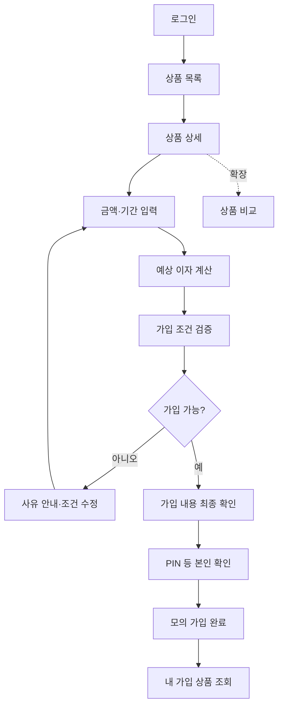

# 🏦 은행 앱 클론코딩 — 예금·적금 상품 기능 기획안

> **버전:** v1.0 · **조사 기준일:** 2026-11-04  
> **참고 서비스:** 토스뱅크(화면·흐름) / 우리은행(상품 데이터 — 더미에서는 **"두린은행"**)  
> **목적:** 모바일 은행 웹앱에서 예금·적금 상품을 탐색하고, 조건을 확인해 모의 가입하며, 자연어와 RAG로 관련 기능을 이용하도록 구현한다.  
> **변경 이력:** 2026-11-04 — 회원·계좌 통합 기획서(`docs/회원_계좌기능_기획서.md`)와 맞췄다. 기능 번호 `P-xx`→`PROD-Fxx`, 상품 유형 코드 `DEPOSIT/SAVINGS`→`TIME_DEPOSIT/INSTALLMENT_SAVINGS`(계좌 유형 `SAVINGS`=저축예금과 겹치지 않게), 기존 `accounts` 필드명을 계좌 기획서 이름으로, 잔액 차감을 거래 파트의 출금 거래로, 가입 검증에 출금 계좌 상태·유형 확인, 만기 처리 범위를 명시했다.  
> **변경 이력(2):** 2026-11-04 — 거래·카드 기획서(`docs/거래_카드기능_기획서.md`)와 맞췄다. 본인 확인은 회원·인증 파트 `step_up_challenges`(`action = 'SUBSCRIPTION'`), 가입 출금 거래 유형은 `SUBSCRIPTION_PAYMENT`. API 경로에서 `/api` 앞부분을 빼고 다른 파트와 같은 모양(`/products`, `/users/me/subscriptions`)으로 맞춤. 공통 이름 규칙은 그 문서 C-5.  
> **변경 이력(4):** 2026-11-04 — 다른 파트가 부르는 내부 점검 API(`subscription-blockers`) 추가(1차부터 필요: 계좌 해지·회원 탈퇴 점검), 가입 검증에 회원 상태 확인 추가. 1차에는 사용자가 가입·해지를 못 하므로 더미 계약의 출금 계좌는 2차(PROD-F10·F11)부터 풀린다.  
> **변경 이력(3):** 2026-11-04 — 더미 상품을 두린은행(원본 우리은행) 30개로 바꾼 결정(`docs/domain-rules.md` 5-1)을 문서 전체에 반영. 가입 계약이 끝날 수 있게 **중도 해지(`PROD-F10`)·만기 처리(`PROD-F11`)를 2차에 추가**(이전에는 끝낼 방법이 없어 탈퇴·계좌 해지가 영원히 막혔음), 돌려주는 돈은 거래 유형 `SUBSCRIPTION_PAYOUT`. 상품·계약 상태 값 목록, `product_rates.term_unit`, `subscriptions.closed_at` 추가.  
> **주의:** 교육용 클론코딩으로 실제 금융거래, 실명확인, 은행 API 연동을 구현하지 않는다. 표기 금리와 조건은 조사 시점의 참고값이며, **은행별 상품 데이터와 프로젝트 내 기능 설계는 별개**이다.

## 1. 프로젝트 범위와 설계 원칙

- **기준 UI:** 토스뱅크의 단순한 상품 탐색·가입 흐름, 우리은행의 상세 상품 정보·비교 항목을 벤치마킹한다.
- **상품 범위:** 두린은행(원본: 우리은행) **정기예금 11개 + 적금 19개, 총 30개**를 더미 데이터(`data/dummy/products/products.json`)로 쓴다. 상품별 출처는 `docs/domain-rules.md` 5-1. 토스뱅크 상품은 아래 2절의 조사 기록으로만 남기고 더미에는 넣지 않는다(사용자 결정, 2026-11-04).
- **핵심 구현:** 상품 목록/상세, 검색·필터, 금리·가입 조건 안내, 예상 이자, 가입 조건 검증, 모의 가입, 가입 상품 조회.
- **AI 요구:** 구현한 모든 기능에 대해 자연어로 직접 처리하거나 해당 화면 링크를 안내한다. 대화 맥락을 이어가며 정보 부족 시 질문한다. 이전 미니 프로젝트 RAG를 통합한다.
- **모듈 구분:** 회원·인증은 회원 기능, 결제 원천 계좌와 잔액 및 거래 이력은 계좌 기능, 상품 메타데이터·상품 가입 계약은 본 모듈이 담당한다.
- **안전:** 실제 은행 계정·돈·API에 연결하지 않는다. 가입 확정 및 잔액 변경은 서버 검증 후 **모의 거래**로 처리한다.

## 2. 벤치마크 대상 상품 (공식 안내 기반)

> 아래 4개는 처음 조사한 **참고 기록**이다. 실제 더미는 우리은행 상품 30개를 "두린은행" 이름으로 옮긴 것이고(위 1절), 금리·조건은 `products.json`과 `docs/domain-rules.md` 5-1이 기준이다.

| 은행 | 참고 상품 | 확인 가능한 주요 조건 | 확인 근거 / 주의 |
|---|---|---|---|
| 토스뱅크 | **원하는 날 만기되는 정기예금** | 1~36개월, 100만~10억 원(만 원 단위), 기간별 연 **1.8~3.8%**(세전) | 공식 상품 안내의 금리 기준일 **2026-10-20**. 12개월 이상 24개월 미만은 연 3.8%; 모든 기간에 3.8%가 적용되는 것은 아님. |
| 토스뱅크 | **자유적금** | 3~36개월, 월 납입 한도 300만 원(자동이체 포함), **12~23개월 기본금리 연 3.25%**(세전) | 공식 공지상 **2026-10-27 신규·재예치분부터** 적용. 우대금리 별도이며 기본금리 3.25%를 전 기간에 적용하지 말 것. |
| 우리은행 | **WON플러스 예금** | 12개월 기본금리 **연 3.60%**(세전) | 우리은행 공식 상품목록의 **2026-11-04 조회 기준**. 가입 가능 금액·기간별 금리는 상세 조건 재확인 후 시드 데이터 반영. 흐름도 그림의 "1~36개월 · 1만원 이상"은 **이 문서에서 확인하지 않은 값**이므로 시드에 넣기 전에 재확인. |
| 우리은행 | **WON 적금** | 12개월, 월 최대 50만 원, 실명의 개인·1인 1계좌 | 공식 상품 상세에서 가입 조건 확인. **기본 3.20% / 최고 3.40%는 2026-09-11 상품목록에서 확인된 참고 금리**이므로 개발 직전 재조회 필요. |

**벤치마크 확인 링크**

1. [토스뱅크 원하는 날 만기되는 정기예금](https://www.tossbank.com/product-service/savings/dday-deposit)
2. [토스뱅크 자유적금](https://www.tossbank.com/product-service/savings/savings-freedom)
3. [토스뱅크 자유적금 금리 변경 공지 (2026-10-26)](https://www.tossbank.com/notice/867)
4. [우리은행 예금·적금 상품목록](https://spot.wooribank.com/pot/Dream?withyou=PODEP0001)
5. [우리은행 WON 적금 상품 상세](https://spot.wooribank.com/pot/Dream?PRD_CD=P010002353&PRD_YN=Y&cc=c011240%3Ac009166%3Bc012263%3Ac012399&withyou=PODEP0001)

> **데이터 운영 규칙:** 실제 금리는 수시로 바뀐다. 상품별로 `source_url`, `verified_at`(확인일), `effective_from`(적용 시작일)를 저장하고, 미확인 값은 추정해 채우지 않는다. 화면에는 세전/세후 및 기본/우대/최고금리를 구분한다. 과제에서는 확인 날짜가 명시된 **고정 시드 데이터**로 구현하면 충분하다.

## 3. 단계별 기능 범위

### 1차 — 상품 탐색 및 안내 (필수)

| ID | 기능 | 동작 / 완료 기준 |
|---|---|---|
| PROD-F01 | 상품 목록 | 판매 중(`ON_SALE`)인 예금·적금 30개 표시; 은행·유형·상품명 표시 |
| PROD-F02 | 상품 상세 | 설명, 기본/우대금리, 기간, 납입 한도, 가입 대상, 유의사항 표시 |
| PROD-F03 | 검색·필터·정렬 | 상품명 검색, 예금/적금·은행 필터, 비교 가능한 기준에 따른 금리 정렬 |
| PROD-F04 | 가입 조건 안내 | 필요한 계좌, 가입 대상, 최소·최대 금액, 가입 기간 및 1인당 제한 안내 |

### 2차 — 계산 및 모의 가입 (필수)

| ID | 기능 | 동작 / 완료 기준 |
|---|---|---|
| PROD-F05 | 금액·기간 선택 | 예금: 예치금/만기일; 적금: 월 납입액/개월 수 입력 |
| PROD-F06 | 예상 이자 계산 | 상품 유형·기간별 금리 규칙 적용; 계산 가정과 세전 결과 표시 |
| PROD-F07 | 가입 조건 검증 | 로그인, 회원 상태 `ACTIVE`만(회원·계좌 기획 Part 1 7.3), 가입 자격, 연결 계좌(**본인 소유 · `ACTIVE` · `CHECKING`**), 잔액, 금액·기간 범위, 중복 제한 확인 |
| PROD-F08 | 모의 가입 | 최종 요약·사용자 확인 → 본인 확인(회원·인증 `step_up_challenges`, `action = 'SUBSCRIPTION'` — PIN 연동 전에는 로그인 재확인) → 계약 생성 + 거래 파트 출금 거래 기록(`type = 'SUBSCRIPTION_PAYMENT'`) |
| PROD-F09 | 가입 상품 조회 | 본인 가입 상품, 계약 금리, 원금, 만기일, 상태 표시 |
| PROD-F10 | 중도 해지 | 본인 확인(`action = 'SUBSCRIPTION'`) → 원금을 출금 계좌로 돌려줌(**모의 규칙: 중도 해지 이자는 0원**, 실제 중도해지 이율은 3차) → 거래 파트 입금 기록(`type = 'SUBSCRIPTION_PAYOUT'`) + 계약 `TERMINATED`, `closed_at`. 둘은 함께 성공하거나 함께 실패 |
| PROD-F11 | 만기 처리 | 하루 1회 배치: `maturity_date`가 오늘 이전인 `ACTIVE` 계약 → 원금 + 이자(가입 금리 `applied_rate`, PROD-F06과 같은 계산) 입금(`SUBSCRIPTION_PAYOUT`) + 계약 `MATURED`, `closed_at` + 알림(`MATURITY`) |

### 3차 — 확장 (선택)

- **상품 비교:** 최대 2~3개 상품의 기간·기본/우대금리·한도·가입 조건을 비교.
- **조건 기반 추천:** 저축 목적·기간·납입 가능 금액으로 조건에 맞는 상품을 우선 보여주기.
- **적금 납입 내역:** 계좌 파트와 협의 후 구현. (만기 알림은 2차 PROD-F11에 포함)
- **우대금리 충족 판정 및 실제 중도해지 이율:** 실제 상품 규정을 충분히 구조화한 뒤에만 구현(2차 중도 해지는 이자 0원).

**초기 제외:** 만기 수령 계좌를 따로 지정하기(만기·해지 금액은 늘 출금 계좌로 돌려줌), 자동 재예치, 실제 금융거래, 외부 은행 계좌 개설, 실시간 금리 연동, 정교한 세금/비과세 판정, 대출 심사 및 복잡한 중도해지 정산.

## 4. 화면과 사용자 이용 흐름

### 화면 구성

| 화면 | 주요 UI 요소 | 예시 경로 (제안) |
|---|---|---|
| 상품 목록 | 예금/적금 탭, 검색창, 은행 필터, 상품 카드 | `/products` |
| 상품 상세 | 금리표, 가입 조건, 설명·유의사항, 가입 버튼 | `/products/{productId}` |
| 예상 이자 | 금액/기간 입력, 금리, 이자, 예상 만기 수령액 | `/products/{productId}/estimate` |
| 가입 확인 | 검증 결과, 최종 요약, 사용자 확정 | `/products/{productId}/subscribe` |
| 내 가입 상품 | 가입 목록·상태·만기일·상세, [중도 해지] | `/my/savings` |
| 상품 비교(확장) | 선택 상품 나란히 비교 | `/products/compare` |

### 주요 흐름: 일반 UI

- **예금:** 연결 입출금 계좌에서 예치금만큼 **거래 파트가 출금 거래를 기록**하고, 상품 가입 계약을 생성한다. 계좌 파트는 잔액을 직접 바꾸지 않는다(회원·계좌 기획서 ACCT-F01·9.2).
- **적금:** 초기 납입액이 있다면 해당 금액만 차감; 이후 월 납입·자동이체는 별도 구현 범위로 명시. 구현하지 않은 미래 납입액을 미리 차감하지 않는다.
- 동일한 가입 요청의 중복 제출을 방지하고, 출금 거래 기록과 계약 생성은 **함께 성공하거나 함께 실패**한다(같은 DB라면 하나의 트랜잭션).
- **중도 해지·만기:** 돌려줄 돈은 가입 때의 출금 계좌(`source_account_id`)로 보낸다. 그 계좌가 일시정지(`SUSPENDED`)면 입금이 막히므로 중도 해지는 거절하고 "출금 계좌 정지를 해제해 주세요"라고 안내한다. 만기 배치는 그 계약을 건너뛰고 알림만 보낸 뒤 정지가 풀리면 다음 배치에서 처리한다. 출금 계좌는 진행 중인 계약이 있으면 해지할 수 없으므로(회원·계좌 기획 ACCT-F05) `CLOSED`가 될 일은 없다.
- PIN(회원·인증 `AUTH-F11`~`AUTH-F13`, 3차 예정)은 가입 확인 단계의 **선택적 연결 지점**으로 둔다. PIN이 생기기 전에는 로그인 재확인(비밀번호 또는 Google 재인증)으로 대신한다.

## 5. AI 자연어 입력과 RAG

| 사용자 발화 | 의도 | 처리 담당 | 부족한 정보 / 후속 처리 |
|---|---|---|---|
| "적금 상품 보여줘" | 상품 목록 | DB 조회 Tool | 적금 필터 결과 또는 화면 링크 |
| "금리 높은 순으로 정렬해줘" | 정렬 | DB 조회 Tool | 기본/최고금리 중 어느 기준인지 필요하면 확인 |
| "이 상품 가입 조건이 뭐야?" | 상세 질의 | 구조화된 DB + RAG | 직전 상품 참조, 문서 근거 표시 |
| "매달 20만 원씩 1년 넣으면?" | 예상 이자 | 계산 Tool | 상품 미지정 시 상품 선택 질문 |
| "그걸로 가입해줘" | 가입 요청 | 조건 검증 + 확인 단계 + 가입 Tool | 연결 계좌·금액·기간 누락 시 추가 질문; 확정 전 실행 금지 |
| "내 가입한 적금 보여줘" | 가입 내역 | 본인 데이터 조회 Tool | 인증된 사용자 범위 내 결과 |

### 추천 처리 구조

1. **LLM / LangGraph:** 요청 의도 분류, 상품명·금액·기간 추출, 이전 대화의 상품 유지, 부족한 값 추가 질문.
2. **DB Tool:** 상품 목록, 기간별 금리, 가입 조건, 가입 이력 조회.
3. **계산·검증 Tool:** 이자 계산, 가입 가능 여부, 잔액·본인 소유 계좌 검증.
4. **RAG Retriever:** 상품설명서·약관·FAQ 등 비정형 문서를 찾아 근거와 함께 설명.
5. **확인 / 실행:** 가입은 사용자에게 요약하고 명시적 확인을 받은 뒤 백엔드에서 처리.
6. **링크 안내:** 직접 실행하지 않는 기능이라도 구현된 화면 주소를 반환하여 이동 가능하게 한다.

**중요:** LLM/RAG 출력은 금리나 자격 판정의 최종 근거가 아니다. 정확한 수치·가입 자격·잔액 변경은 **구조화된 DB와 서버 로직**으로 판단한다. 문서 근거가 없으면 '확인할 수 없음'으로 응답한다.

## 6. DB 설계 초안

> 테이블명과 필드는 논의용 초안이다. 회원·계좌 기능 팀의 실제 스키마가 확정되면 그 규격을 따른다.

| 테이블 | 핵심 컬럼(예시) | 관계 / 역할 |
|---|---|---|
| `users` (기존) | `id`, `email` | 인증된 사용자. 회원 기능에서 관리 |
| `accounts` (기존) | `id`, `user_id`, `account_type`, `lifecycle_status` (잔액은 `account_balance_view.resAccountBalance`, 읽기 전용) | 가입 시 돈이 나갈 **모의 입출금 계좌**(`CHECKING` · `ACTIVE` 만). 계좌 파트 소유 |
| `products` | `id`, `bank`, `name`, `type`, `description`, `status`, `source_url`, `verified_at` | 상품 마스터. `bank`: 더미는 `두린은행`. `type`: `TIME_DEPOSIT`(정기예금) / `INSTALLMENT_SAVINGS`(적금). `status`: `ON_SALE`(판매 중) / `STOPPED`(판매 중지 — 목록에서 빼고 새 가입 막음, 기존 계약은 그대로) |
| `product_rates` | `id`, `product_id`, `term_min`, `term_max`, `term_unit`, `base_rate`, `bonus_rate`, `effective_from` | 기간·조건별 금리. `term_unit`: `MONTH` / `DAY`. `term_min`·`term_max`는 양 끝 포함(더미 `meta.term_rule`) |
| `product_rules` | `id`, `product_id`, `min_amount`, `max_amount`, `min_months`, `max_months`, `max_per_user`, `rules_json` | 가입 대상·기간·금액·중복 제한 |
| `subscriptions` | `id`, `user_id`, `product_id`, `source_account_id`, `principal`, `monthly_amount`, `applied_rate`, `start_date`, `maturity_date`, `status`, `closed_at` | 모의 가입 계약 및 **가입 시 확정된 적용 금리** 스냅샷. `status`: `ACTIVE`(진행 중) / `MATURED`(만기 지급 완료) / `TERMINATED`(중도 해지). `closed_at`: 만기·해지일(`YYYYMMDD`, 진행 중이면 빈 값). 날짜 칸은 더미와 같이 `YYYYMMDD` |
| `subscription_payments` (확장) | `id`, `subscription_id`, `paid_amount`, `paid_at` | 적금 회차별 납입 기록. 납입 기능 미구현 시 생략 가능 |
| `product_documents` (선택) | `id`, `product_id`, `title`, `source_url`, `version_date` | RAG 문서 메타데이터(벡터 저장소 별도 가능) |

**관계:** `users` 1:N `subscriptions`, `products` 1:N `product_rates` / `product_rules` / `subscriptions`, `accounts` 1:N `subscriptions`(원천 계좌 참조).

**데이터 정확성:** 금리는 시기에 따라 바뀌므로 기존 가입 계약은 가입 당시 적용 금리(`applied_rate`)를 유지한다. 상품 금리를 나중에 수정해도 이미 가입한 계약 금리가 소급 변경되면 안 된다.

## 7. API 초안 (서버와 AI Tool 공통 활용)

| 방식 / 경로 | 목적 | 인증 |
|---|---|---|
| `GET /products` | 상품 목록·검색·필터·정렬 | 선택 |
| `GET /products/{productId}` | 상품 상세·조건·금리 조회 | 선택 |
| `POST /products/{productId}/estimate` | 입력값 기준 예상 이자 계산 | 선택 |
| `POST /products/{productId}/validate` | 가입 조건·계좌 소유권·잔액 검증 | 필요 |
| `POST /subscriptions` | 사용자 확인 후 모의 가입 확정 | 필요 |
| `POST /subscriptions/{subscriptionId}/terminate` | 중도 해지(본인 확인 필요) | 필요 |
| `GET /users/me/subscriptions` | 본인의 가입 계약 조회 | 필요 |
| `POST /agent/chat` | 자연어 요청·문맥 처리·화면 링크 안내 | 기능에 따라 필요 |
| `GET /internal/users/{userId}/subscription-blockers` | 회원 탈퇴 전 점검: 진행 중(`ACTIVE`) 계약 목록 — 회원·인증 파트만 호출, **1차** | 내부 |
| `GET /internal/accounts/{accountId}/subscription-blockers` | 계좌 해지 전 점검: 이 계좌를 출금 계좌로 쓰는 진행 중 계약 — 계좌 파트만 호출, **1차** | 내부 |

1차에는 사용자가 가입·중도 해지를 할 수 없어서(가입은 2차) 더미 계약 10건의 출금 계좌는 1차 동안 해지할 수 없다. 2차의 중도 해지·만기 처리(PROD-F10·F11)가 생기면 풀린다.

API 응답은 공통적으로 `success`, `data`, `error_code`, `message` 등의 형식을 팀에서 합의한다. 특히 실패 사유는 AI가 지어내지 않고 백엔드 오류코드로 전달한다.

## 8. 검증 및 실패 시나리오

| 테스트 | 기대 결과 |
|---|---|
| 정상 상품 조회 | 판매 중인 30개 상품과 기준일 표시 |
| 기간별 금리 경계(예: 12개월) | 정확한 구간의 금리 적용 |
| 최소 가입금액 미만 입력 | 가입 거절 및 유효 범위 안내 |
| 적금 월 한도 초과 | 가입 거절 및 한도 안내 |
| 로그인하지 않고 가입 시도 | 로그인 요구; 계약 생성 안 됨 |
| 타인의 계좌를 연결해 가입 시도 | 서버에서 거부 |
| 잔액 부족 / 중복 가입 | 이유 표시, DB 변화 없음 |
| 가입 버튼 연속 클릭 | 같은 요청으로 중복 계약·중복 차감 방지 |
| "그 상품 가입" 후 상품 미지정 | 임의 상품 선택 금지, 추가 질문 |
| RAG 근거 문서 없음 | 추정 답변 대신 자료 부족 안내 |
| 가입 성공 | 계약·잔액·거래 기록 정합성 확인 |
| 일시정지·해지 계좌나 저축예금(`SAVINGS`)을 출금 계좌로 가입 시도 | 가입 거절 및 사용 가능한 입출금 계좌 안내 |
| 가입 중인 상품이 있는 회원의 탈퇴 / 연결 계좌 해지 | 탈퇴·해지 차단(회원·계좌 기획서 AUTH-F09·ACCT-F05) |
| 중도 해지 | 원금만 출금 계좌로 입금, 계약 `TERMINATED` — 그 뒤 탈퇴·계좌 해지 점검을 통과 |
| 출금 계좌가 일시정지인 계약의 중도 해지(더미 `sub_005`, 계좌 `acc_011`) | 해지 거절 + 정지 해제 안내, DB 변화 없음 |
| 만기일이 지난 계약 | 배치가 원금+이자 입금, `MATURED` + 만기 알림 |

## 9. 구현 순서 및 협업 시 결정 사항

**개발 권장 순서**

1. 상품 시드 데이터 확정 — **완료**: 두린은행 30개(`products.json`, 출처 `docs/domain-rules.md` 5-1).
2. 기존 `users` / `accounts`와 연동할 필드·인증 방식을 합의.
3. 상품 목록·상세·필터 UI + 조회 API 완성.
4. 이자 계산·가입 조건 검증 로직과 단위 테스트 작성.
5. 모의 가입·조회·중도 해지·만기 처리 구현(데이터 트랜잭션·오류처리 포함).
6. 자연어 Tool / 화면 링크 / 대화 맥락 및 RAG 연결.
7. 실패 시나리오 기록, README와 회고 작성.

**회의에서 반드시 정할 것**

- ~~토스뱅크와 우리은행을 한 앱 안에 비교형으로 넣을지~~ → **결정**: 상품은 두린은행(원본 우리은행) 한 은행, 화면·흐름은 토스 방식(2026-11-04).
- 공통 DB 구조와 API 응답 형식, `user_id` / `account_id` 연결 방식.
- 적금 월 납입까지 실제로 시뮬레이션할지, **가입과 첫 납입만** 구현할지.
- 예상 이자 계산의 기준(일수 계산, 단리·복리, 세금 적용 여부, 우대금리 가정).
- ~~가입 확인과 PIN 인증의 담당~~ → **결정**: 본인 확인은 회원·인증 파트 `step_up_challenges`(1차 로그인 재확인, 3차 PIN). 계약 상태 전이는 `ACTIVE → MATURED / TERMINATED`.
- RAG에 넣을 상품설명서/약관/FAQ의 범위와 버전 관리 방식.

## 10. 제출물 체크

- [ ] 기획 자료: 기능 목록, 화면 흐름, DB 구조, API·AI 처리 범위
- [ ] 실행 코드: UI, 서버, DB, AI/RAG 기능
- [ ] README: 실행 방법, 구현 기능, 자연어 요청 예시, 정상·실패 시나리오 결과
- [ ] 회고: 배운 점, 어려움과 해결, 남은 한계 및 개선 계획

---

### 최종 결론

**필수 목표(1·2차)는 두린은행 예금·적금 30개를 대상으로 `상품 조회 → 상세 확인 → 이자 계산 → 조건 검증 → 모의 가입 → 내 상품 조회 → 중도 해지·만기`를 완성하는 것.** (1차는 조회·안내까지, 가입부터는 2차) AI 에이전트는 이 흐름을 자연어로 지원하고, RAG는 상품 설명·약관·FAQ를 근거 있게 답변하는 데 사용한다. 상품 비교 및 추천은 3차 확장 기능으로 둔다.

> 이 문서는 실제 서비스의 금융상품 공시자료가 아니라 **교육용 개발 기획안**이다. 상품 조건은 구현 직전 각 은행 공식 페이지에서 재검증하고, 확인하지 못한 상세 조건은 임의로 단정하지 않는다.
