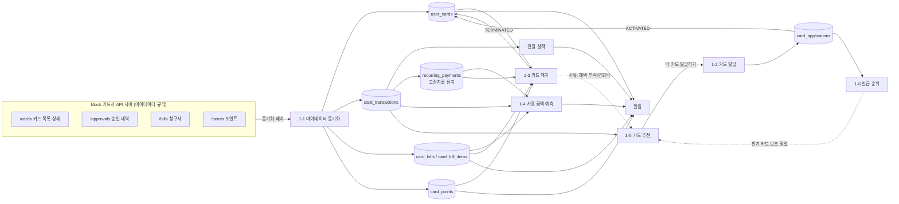

# 계좌·카드 관리 서비스 통합 기획서

2026-11-04 통합 · 원본: `docs/FEATURES.md`(카드 기능별 데이터 설계), `doc/거래_입출금_기획서.md`(거래 기획서)

두 기획서를 내용 변경 없이 하나로 합쳤습니다. 앞 두 파트는 원문 그대로이고, 파트 C가 두 파트를 잇는 연결 지점과 공통 확인 사항을 모았습니다.

| 파트 | 내용 | 원본 |
| --- | --- | --- |
| [파트 A. 카드](#파트-a-카드-기능별-데이터-설계와-기능-간-연결) | 마이데이터 카드 목록·발급·해지·사용 금액 예측·추천·발급 순위 | `docs/FEATURES.md` |
| [파트 B. 거래](#파트-b-거래입출금-기획) | 이체·송금·예약 송금·입출금 내역·CODEF 연동 | `doc/거래_입출금_기획서.md` |
| [파트 C. 파트 간 연결](#파트-c-카드거래-파트-간-연결과-공통-확인-사항) | 카드↔거래 연결 지점, 공통 미결정 사항 | 신규 정리 |

**읽는 방법**

- 각 파트 안의 "N장", "1-N" 같은 번호 표기는 **그 파트 안의 번호**입니다. 예: 파트 B의 "9장"은 파트 B의 9장(이체 상태와 실패 사유)입니다.
- 파트 A의 🆕는 스키마에 새로 추가한 컬럼·테이블 표시이고, 기준 스키마는 [schema.sql](schema.sql) / [ERD.md](ERD.md)입니다.
- 파트 A의 `R`은 읽기, `W`는 쓰기(INSERT/UPDATE)입니다.
- 파트 B의 `- [ ]`는 팀 협의로 확정할 항목입니다.
- 근거 자료: `계좌기능_기획서.md`, `codef_api_transaction.xlsx`, `docs/dummy/codef_transfer_results.json`

---

# 파트 A. 카드 기능별 데이터 설계와 기능 간 연결

## 0. 전체 흐름 한눈에 보기



**핵심 연결 고리 4개**

| 연결 | 무엇이 흐르나 | 연결 컬럼 |
|---|---|---|
| 발급 → 보유 | 발급 완료된 카드가 내 카드 목록에 들어감 | `user_cards.application_id` |
| 보유 → 이용/청구 | 모든 거래·청구서는 보유 카드에 매달림 | `card_transactions.user_card_id`, `card_bills.user_card_id` |
| 이용 → 예측·추천·실적 | 거래 + 가맹점 카테고리가 계산의 원재료 | `card_transactions.merchant_id → merchants.category_id` |
| 추천 → 발급 → 순위 | 추천받은 카드를 발급하면 발급 건수가 순위에 반영 | 🆕 `card_applications.recommendation_id`, `card_applications.product_id` |

---

## 공통 기반 테이블

모든 기능이 공유하는 마스터 데이터입니다. 먼저 시드 데이터를 넣어야 나머지 기능이 동작합니다.

| 테이블 | 핵심 컬럼 | 쓰는 기능 |
|---|---|---|
| `users` | `user_id`, `name`, `birth_date`, `gender`, `ci`, `mydata_agreed_at`, 🆕 `payday` | 전체. `ci`는 본인 확인(발급·해지), `birth_date`/`gender`는 순위 세그먼트, `payday`는 예측 |
| `accounts` | `account_id`, `user_id`, `bank_name`, `balance`, `is_primary` | 체크카드 연결, 결제 계좌 잔액 부족 알림, 포인트 현금화 입금 |
| `card_companies` | `company_id`, `code`, `name`, `logo_url` | 카드 목록 로고, 포인트(카드사 단위), 마이데이터 연동 대상 |
| `card_products` | `product_id`, `company_id`, `name`, `card_type`, `annual_fee_domestic`, `annual_fee_overseas`, `min_age`, `is_active` | 카드 상세, 발급, 추천 필터, 순위 |
| `categories` | `category_id`, `parent_id`, `code`, `name` | 이용 내역 분류, 혜택 대상, 추천 필터(교통·통신·쇼핑·해외) |
| `merchants` | `merchant_id`, `category_id`, `name`, `business_no` | 이용 내역, 고정지출 탐지, 추천의 카테고리별 지출 집계 |
| `card_benefits` | `product_id`, `tier_id`, `category_id`, `value_type`, `benefit_value`, `monthly_limit_amount` … | 카드 상세 혜택, 실적 진행률, 추천 계산 |
| `card_performance_tiers` | `product_id`, `tier_level`, `min_spend`, `max_spend` | 전월 실적 현황, 추천 시 달성 가능 구간 판단 |

---

## 1-1. 카드 목록 조회 (마이데이터 API)

### 1-1-0. 마이데이터 연동·동기화

```
[내 백엔드] ── 토큰 발급/갱신 ──> [Mock 카드사 API]
     │ ── GET /cards, /approvals, /bills, /points ──>
     ▼
 upsert: user_cards / card_transactions / card_bills / card_points
```

| 테이블 | 컬럼 | R/W | 용도 |
|---|---|---|---|
| 🆕 `mydata_consents` | `consent_id`, `user_id`, `company_id`, `access_token_enc`, `refresh_token_enc`, `scope`, `consented_at`, `expires_at`, `status`, `last_synced_at` | W | 카드사별 연동 동의와 토큰. 토큰은 암호화 저장 |
| 🆕 `mydata_sync_logs` (선택) | `sync_id`, `consent_id`, `api_type`, `started_at`, `finished_at`, `result`, `fetched_count`, `error_message` | W | 어떤 API를 언제 받아 왔는지, 실패 원인 추적 |
| `user_cards` | `source = 'MYDATA'`, 🆕 `org_card_id` | W | 카드사 쪽 카드 식별자로 upsert 키 |

**Mock 서버 응답 → 내 DB 매핑 (예시, 필드명은 마이데이터 표준 API 규격서로 최종 확인)**

| Mock API | 응답 필드 예시 | 내 DB 컬럼 |
|---|---|---|
| 카드 목록 | `card_id`, `card_num`(마스킹), `card_name`, `card_type` | `user_cards.org_card_id`, `card_number_masked`, `product_id`(이름으로 매칭), `card_products.card_type` |
| 카드 상세 | `annual_fee`, `issue_date`, `linked_bank_code`, `account_num` | 🆕 `user_cards.annual_fee_amount`, `issued_at`, `linked_account_id` |
| 승인 내역 | `approved_num`, `approved_dtime`, `status`, `merchant_name`, `merchant_regno`, `approved_amt`, `modified_amt`, `total_install_cnt` | `card_transactions.approval_no`, `transacted_at`, `status`, `merchant_id`(사업자번호로 매칭), `amount`, `canceled_amount`, `installment_months` |
| 청구 | `charge_month`, `charge_day`, `charge_amt`, `paid_out_date` | `card_bills.billing_ym`, `payment_date`, `total_amount`, `paid_at` |
| 포인트 | `point_name`, `remain_point_amt`, `expiring_point_amt` | 🆕 `card_points.point_name`, `balance`, `expiring_amount` |

> 중복 방지: `card_transactions`는 `UNIQUE(user_card_id, approval_no)`, `card_bills`는 `UNIQUE(user_card_id, billing_ym)`이 이미 있으므로 `INSERT ... ON DUPLICATE KEY UPDATE`로 upsert 하면 됩니다.

### 1-1-1. 내 카드 모아보기

| 테이블 | 컬럼 | 화면 요소 |
|---|---|---|
| `user_cards` | `user_card_id`, `nickname`, `last4`, `status`, `source` | 카드 리스트, 상태 배지(정지/분실) |
| `card_products` | `name`, `image_url`, `card_type` | 카드 이미지·이름·신용/체크 |
| `card_companies` | `name`, `logo_url` | 카드사 로고 |
| `card_bills` | `total_amount` (이번 결제월, `SCHEDULED`/`CONFIRMED`) | 카드별 "이번 달 낼 돈" |
| `card_transactions` | `amount`, `canceled_amount` (이용 기간 내 합계) | 실적 진행률 바 (1-1-6 쿼리 재사용) |

- 조건: `user_cards.status <> 'TERMINATED'`
- 연결: 여기서 카드를 누르면 1-1-2 상세, 상단에는 1-4 예측 합계, 하단에는 1-5 추천 배너

### 1-1-2. 카드 상세

| 테이블 | 컬럼 | 화면 요소 |
|---|---|---|
| `user_cards` | `card_number_masked`, `expires_at`, `payment_day`, `linked_account_id`, `issued_at`, 🆕 `annual_fee_amount`, 🆕 `next_annual_fee_date` | 카드 정보 |
| `accounts` | `bank_name`, `account_number_masked` | 결제/출금 계좌 |
| `card_benefits` + `categories` | `category_id`, `benefit_type`, `value_type`, `benefit_value`, `monthly_limit_amount`, `tier_id` | 혜택 목록 |
| `card_transactions` | `applied_benefit_id`, `benefit_amount` (이번 이용 기간) | 혜택별 "이번 달 받은 금액 / 한도" |
| `user_card_settings` | `overseas_payment_blocked`, `online_payment_blocked`, `daily_limit`, `monthly_limit` | 카드 관리 메뉴 (1-2 카드 관리로 이동) |

### 1-1-3. 이용 내역

| 테이블 | 컬럼 | 용도 |
|---|---|---|
| `card_transactions` | `transacted_at`, `amount`, `installment_months`, `is_overseas`, `currency`, `foreign_amount`, `status`, `canceled_amount`, `benefit_amount`, `is_performance_counted` | 리스트 본문, 취소/부분취소 표시, 실적 제외 표시 |
| `merchants` | `name` | 가맹점명 |
| `categories` | `name`, `parent_id` | 카테고리 아이콘, 카테고리 필터 |

- 필터: 기간(`transacted_at`), 카드(`user_card_id`), 카테고리, 일시불/할부(`installment_months`)
- 인덱스: `idx_transactions_card_time (user_card_id, transacted_at)` 사용
- 연결: 이 데이터가 실적(1-1-6), 고정지출 탐지, 예측(1-4), 추천(1-5)의 원재료

### 1-1-4. 청구 예정 금액 + 결제일 알림

| 테이블 | 컬럼 | 용도 |
|---|---|---|
| `card_bills` | `billing_ym`, `usage_start`, `usage_end`, `payment_date`, `total_amount`, `paid_amount`, `status` | 결제 예정 금액과 결제일 |
| `card_bill_items` | `transaction_id`, `installment_seq`, `principal_amount`, `fee_amount` | 청구서 상세 (할부 n회차 표시) |
| `accounts` | `balance` | 결제 계좌 잔액 < 청구액이면 잔액 부족 경고 |
| `user_card_settings` | `payment_alert_enabled` | 알림 수신 여부 |
| `notifications` | `type = 'PAYMENT_DUE'`, 🆕 `'LOW_BALANCE'`, `title`, `body`, `sent_at` | 결제일 D-3, D-day 알림 |

- 알림 배치: `card_bills.status IN ('SCHEDULED','CONFIRMED') AND payment_date = CURDATE() + INTERVAL 3 DAY`
- 연결: 아직 이용 기간이 끝나지 않은 청구서(`SCHEDULED`)는 1-4 예측값을 함께 보여 줌 ("현재 32만 원, 예상 41만 원")

### 1-1-5. (같은 기능) 결제 예정 금액과 결제일 알림

1-1-4와 같은 데이터를 씁니다. 화면은 "카드 전체 합산 결제 캘린더"로, `card_bills`를 `payment_date`로 묶어 보여 주면 됩니다.

### 1-1-6. 전월 실적 충족 현황

| 테이블 | 컬럼 | 용도 |
|---|---|---|
| `card_bills` | `usage_start`, `usage_end` | **실적 집계 기간** (결제월이 아니라 이용 기간 기준) |
| `card_transactions` | `amount`, `canceled_amount`, `status`, `is_performance_counted` | 실적 합계 (세금·상품권 등 제외) |
| `card_performance_tiers` | `tier_level`, `min_spend`, `max_spend` | 현재 구간, 다음 구간까지 남은 금액 |
| `card_benefits` | `tier_id` | 다음 구간 달성 시 열리는 혜택 |
| `notifications` | `type = 'PERFORMANCE'` | "5만 원만 더 쓰면 2구간" 알림 |

- 쿼리: [ERD.md 6장 실적 진행률](ERD.md#6-주요-쿼리-예시)
- 연결: 1-4 예측의 `predicted_total`과 비교하면 "이대로면 이번 달 실적 미달 예상" 알림을 미리 보낼 수 있음

### 1-1-7. 숨은 카드 포인트 조회와 현금화

| 테이블 | 컬럼 | 용도 |
|---|---|---|
| `card_points` | `user_id`, `company_id`, 🆕 `point_name`, `balance`, `expiring_amount`, `expiring_date`, `synced_at` | 카드사별 포인트 합계, 소멸 예정 |
| `point_cashouts` | `card_point_id`, `account_id`, `amount`, `status`, `requested_at`, `completed_at` | 현금화 신청과 결과 |
| `accounts` | `account_id`, `is_primary` | 입금 계좌 선택 |
| `notifications` | `type = 'POINT_EXPIRING'` | 소멸 예정 알림 |

- 흐름: 조회(마이데이터 `/points`) → 현금화 요청(Mock 서버 호출) → `point_cashouts` `REQUESTED` → 응답 후 `COMPLETED` + `card_points.balance` 차감 + `accounts.balance` 증가 (한 트랜잭션)
- 연결: 1-3 해지 시 `card_terminations.forfeited_points` 계산에 사용

### 1-1-8. 연회비 청구 알림, 안 쓰는 카드 안내

| 테이블 | 컬럼 | 용도 |
|---|---|---|
| `user_cards` | 🆕 `annual_fee_amount`, 🆕 `next_annual_fee_date`, 🆕 `last_used_at` | 연회비 금액·청구 예정일, 마지막 사용일 |
| `card_transactions` | `MAX(transacted_at)` | `last_used_at` 갱신 원천 (동기화 시 같이 업데이트) |
| `notifications` | `type = 'ANNUAL_FEE'`, 🆕 `'UNUSED_CARD'` | 연회비 D-30 알림, N개월 미사용 안내 |

- 연회비 청구일: 보통 발급월 기준으로 매년 청구 → `next_annual_fee_date = issued_at + n년`
- 안 쓰는 카드: `last_used_at < NOW() - INTERVAL 6 MONTH AND annual_fee_amount > 0`
- 연결: 안내 화면에서 **[해지하기]** → 1-3, **[대신 쓸 카드 보기]** → 1-5 추천

---

## 1-2. 카드 발급

### 단계별 데이터 변화

| 단계 | 테이블 · 컬럼 | 상태 (`card_applications.status`) |
|---|---|---|
| ① 카드 선택 | `card_products` (`is_active = TRUE`, `min_age` ≤ 사용자 나이), `promotions` | — |
| ② 본인 인증 (마이데이터) | 🆕 `identity_verifications` (`user_id`, `purpose='APPLICATION'`, `ci`, `verified_at`, `result`) → `users.ci`와 일치 확인 | — |
| ③ 약관 동의 | `terms` (`product_id` 또는 공통, `is_required`) → `application_term_agreements` (`agreed`, `agreed_at`) | — |
| ④ 신청 정보 입력 | `card_applications` (`job_type`, `annual_income`, `linked_account_id`, `payment_day`, `delivery_address`, `promotion_id`, 🆕 `recommendation_id`, 🆕 `verification_id`) | `APPLIED` |
| ⑤ 카드사 심사 | Mock 카드사 API 호출 → `decided_at`, `reject_reason` | `REVIEWING` → `APPROVED` / `REJECTED` |
| ⑥ 배송 | `tracking_no` | `SHIPPING` → `DELIVERED` |
| ⑦ 수령 후 활성화 | `user_cards` INSERT (`source='TOSS_ISSUED'`, `application_id`, `activated_at`) + `user_card_settings` 기본값 INSERT | `ACTIVATED` |

- 모든 상태 변경은 `application_status_histories`(`from_status`, `to_status`, `changed_at`)에 기록 → 배송 조회 화면의 타임라인
- 각 단계마다 `notifications.type = 'APPLICATION'` 발송

### 00뱅크 체크카드 (앱에서 바로 발급 + 배송 조회)

- 신용 심사 없음 → `job_type`, `annual_income`은 NULL, `payment_day` NULL
- `linked_account_id`가 필수 (출금 계좌)
- `APPLIED → APPROVED`를 즉시 처리하고 배송 단계로 넘어감
- 배송 조회: `card_applications.status`, `tracking_no` + `application_status_histories`

### 카드 관리

| 기능 | 테이블 · 컬럼 | 비고 |
|---|---|---|
| 분실 신고 | `user_cards.status → 'LOST'`, `user_card_status_histories` | 즉시 거래 차단 |
| 재발급 | 새 `user_cards` INSERT, `reissued_from_id` = 분실 카드 | 고정지출(`recurring_payments.user_card_id`)을 새 카드로 옮길지 안내 |
| 일시 정지 / 해제 | `user_cards.status ACTIVE ↔ SUSPENDED`, `user_card_status_histories.reason` | |
| 해외 / 온라인 결제 차단 | `user_card_settings.overseas_payment_blocked`, `online_payment_blocked` | |
| 비밀번호 변경 | **내 DB에 저장하지 않음.** Mock 카드사 API로 전달만 하고 결과는 🆕 `card_management_logs`에 기록 | PIN은 카드사 서버(Mock)에서 해시로 관리 |
| 이용 한도 설정 | `user_card_settings.daily_limit`, `monthly_limit` | 한도 초과 승인 거절은 Mock 서버 쪽 로직 |

- 상태(`status`)가 아닌 설정 변경(차단, 한도, 비밀번호)도 이력이 필요하면 🆕 `card_management_logs`(`action_type`, `before_value`, `after_value`, `result`, `requested_at`)를 둡니다.

### 다른 기능과의 연결

- **입력**: 1-5 추천 결과에서 "발급하기" → `recommendation_id`를 들고 들어옴 (추천 → 발급 전환율 측정 가능)
- **출력**: `user_cards`가 생기면 1-1 목록·이용 내역·예측 대상이 됨 / 승인된 신청 건수가 1-6 순위 집계 대상이 됨

---

## 1-3. 카드 해지

### 해지 전 확인 항목과 데이터 출처

| 확인 항목 | 계산 출처 | 저장 (`card_terminations`) |
|---|---|---|
| 본인 확인 (신청인 = 해지 요청자) | 🆕 `identity_verifications.ci`(`purpose='TERMINATION'`) = `users.ci` (카드 소유자 `user_cards.user_id`) | 🆕 `verification_id` |
| 미결제 금액 | `card_bills` 중 `status IN ('CONFIRMED','OVERDUE')`의 `total_amount - paid_amount` + 진행 중 `SCHEDULED` 금액 | `unpaid_amount` |
| 남은 할부 금액 | `card_bill_items` 중 아직 결제 안 된 청구서(`card_bills.status <> 'PAID'`)에 속한 `principal_amount` 합 | `remaining_installment_amount` |
| 자동 결제 연결 | `recurring_payments` (`user_card_id`, `is_active = TRUE`) 건수와 가맹점 목록 | `linked_recurring_count` |
| 소멸 포인트 | `card_points` (같은 `company_id`의 남은 카드가 없으면 전체 소멸) | `forfeited_points` |
| 연회비 환급액 | 🆕 `user_cards.annual_fee_amount` × (남은 일수 / 365) | `refunded_annual_fee` |

### 처리 흐름

```
해지 신청 → 본인 확인 → 확인 항목 계산·화면 안내 → 사유 선택 → 최종 확인
   │
   ▼
card_terminations INSERT (status=REQUESTED, 위 스냅샷 값, reason_code, reason_detail)
   │  Mock 카드사 해지 API 호출
   ▼
성공: card_terminations.status=COMPLETED, completed_at
      user_cards.status=TERMINATED, terminated_at
      user_card_status_histories INSERT
      recurring_payments.is_active=FALSE (해당 카드)
      notifications INSERT
실패/미결제 존재: status=REJECTED / 사용자가 취소: WITHDRAWN
```

### 다른 기능과의 연결

- **입력**: 1-1-8 안 쓰는 카드 안내에서 진입
- **읽는 데이터**: 1-1의 청구서·할부·포인트, 고정지출
- **출력**: `reason_code IN ('LOW_BENEFIT','HIGH_FEE')`면 해지 완료 화면에서 1-5 추천으로 연결 / 해지된 카드는 예측·실적 배치 대상에서 제외

---

## 1-4. 카드 사용 금액 예측

### 이용 기간과 결제일이 다를 때

**결제일(`payment_day`)이 정해지면 이용 기간이 결정됩니다.** 카드사마다 규칙이 다르므로 코드에 하드코딩하지 말고 규칙 테이블로 둡니다.

| 결제일 | 이용 기간 (예시) | 청구 결제월 |
|---|---|---|
| 1일 | 전전월 18일 ~ 전월 17일 | 당월 |
| 14일 | 전월 1일 ~ 전월 말일 | 당월 |
| 25일 | 전월 12일 ~ 당월 11일 | 당월 |

🆕 `billing_cycle_rules`

| 컬럼 | 설명 |
|---|---|
| `company_id`, `payment_day` | PK. 카드사 + 결제일 |
| `start_month_offset`, `start_day` | 이용 시작: 결제월 기준 몇 달 전(-2, -1) 며칠 |
| `end_month_offset`, `end_day` | 이용 끝 (`end_day = 99`면 말일) |

- 카드를 연동/발급하면 이 규칙으로 `card_bills`(`SCHEDULED`)를 미리 만들어 `usage_start`, `usage_end`, `payment_date`를 채웁니다.
- **예측과 실적은 항상 `usage_start ~ usage_end`로 거래를 자르고**, 결과는 `billing_ym`(결제월)에 붙입니다.

### 예측 방법별 필요 데이터

| 방법 | 필요한 컬럼 | 결과 저장 (`spending_forecasts`) |
|---|---|---|
| 지금까지 사용액 | `card_transactions.amount - canceled_amount` (이용 시작 ~ 기준일, 일시불) | `spent_to_date` |
| 확정 할부 | `card_bill_items.principal_amount + fee_amount` 중 `installment_seq > 1` 이고 해당 `bill_id` | `confirmed_installment` |
| 고정 지출 (확정값 더하기) | `recurring_payments.expected_amount`, `expected_day` (남은 기간에 결제일이 있는 것만, `last_paid_at`으로 이미 나간 건 제외) | `fixed_expected` |
| 나머지 추정 – 이동 평균 | 최근 3~6개 `card_bills`의 같은 이용 기간 변동지출 평균 | `variable_expected`, `model_type='MOVING_AVG'` |
| 나머지 추정 – 선형 | 이번 기간 변동지출 일평균 × 남은 일수 | `model_type='LINEAR'` |
| 요일·월급일 패턴 (시계열) | 일별 사용액 + 요일 + 🆕 `users.payday` 기준 경과일 + 공휴일 여부 | `model_type='ML'` |

**고정지출 탐지** (`recurring_payments` 채우기): 같은 `merchant_id`에서 3개월 이상 연속, 금액 편차 ±10% 이내, 결제일 편차 ±3일 이내면 `detected_by='AUTO'`로 등록. 사용자가 직접 추가/해제하면 `'USER'`.

**시계열 모델용 집계 테이블 (선택)**: 🆕 `daily_card_spending` (`user_card_id`, `spend_date`, `total_amount`, `fixed_amount`, `tx_count`, `weekday`, `days_from_payday`, `is_holiday`). 매일 거래를 한 번 집계해 두면 학습·예측 때 원본 거래를 다시 훑지 않아도 됩니다.

**예측 정확도 확인**: 청구서가 `CONFIRMED`되면 `card_bills.total_amount`와 같은 `billing_ym`의 `spending_forecasts.predicted_total`을 `model_type`별로 비교 → 어떤 모델이 잘 맞는지 화면/리포트로 보여 줄 수 있음.

### 다른 기능과의 연결

- **입력**: 1-1 거래·청구서·할부, 고정지출
- **출력**: 1-1-1 "이번 달 예상", 1-1-4 결제 예정 금액 옆 예상치, 1-1-6 "이대로면 실적 미달" 알림

---

## 1-5. 카드 추천

### 계산 순서와 필요 컬럼

| 단계 | 사용 데이터 | 설명 |
|---|---|---|
| ① 소비 패턴 | `card_transactions` + `merchants.category_id` (최근 3개월, `status <> 'CANCELED'`) | 카테고리별 월평균 지출. 해외 결제(`is_overseas = TRUE`)는 `OVERSEAS` 카테고리로 따로 집계 |
| ② 달성 가능 실적 구간 | 월평균 총지출 vs `card_performance_tiers.min_spend` | 총지출이 그 카드로 옮겨 온다고 가정하고 도달 가능한 최고 `tier_id` 결정 |
| ③ 혜택 적용 | `card_benefits` (`category_id`, `tier_id`가 NULL이거나 ② 이하, `value_type`, `benefit_value`, `min_payment_amount`) | 카테고리 지출 × 할인율 (또는 건당 정액 × 건수) |
| ④ 한도 적용 | `monthly_limit_amount`, `monthly_limit_count` | `MIN(계산값, 월 한도)` |
| ⑤ 순혜택 | `card_products.annual_fee_domestic` / `annual_fee_overseas` | `월 혜택 × 12 - 연회비` = `net_annual_benefit` |
| ⑥ 저장 | `card_recommendations` (`expected_monthly_benefit`, `annual_fee`, `net_annual_benefit`, `rank_no`, `reason`) + `card_recommendation_details` (`category_id`, `spend_amount`, `benefit_amount`) | 하루 1회 배치 스냅샷 |

### 필터

| 필터 | 컬럼 |
|---|---|
| 신용 / 체크 | `card_products.card_type` |
| 연회비 범위 | `card_products.annual_fee_domestic` (또는 저장된 `card_recommendations.annual_fee`) |
| 혜택 카테고리 (교통·통신·쇼핑·해외) | `card_benefits.category_id` → `categories.parent_id`로 상위 카테고리 묶기 |
| 발급 가능 여부 | `card_products.is_active = TRUE`, `min_age` ≤ 사용자 나이 |
| 이미 보유한 카드 제외 | `user_cards.product_id` (`status <> 'TERMINATED'`) |

> 필터별로 다시 계산하지 말고, 배치에서 **발급 가능한 전체 상품**에 대해 점수를 계산해 저장한 뒤 조회 시 `WHERE`로 거르면 됩니다.

### 다른 기능과의 연결

- **입력**: 1-1 이용 내역(카테고리 지출), 1-6 발급 순위(동점일 때 인기순 보조 정렬)
- **진입점**: 1-1-1 하단 배너, 1-1-8 안 쓰는 카드 안내, 1-3 해지 완료 화면
- **출력**: "발급하기" → 1-2로 `recommendation_id` 전달

---

## 1-6. 발급 순위

| 테이블 | 컬럼 | 용도 |
|---|---|---|
| `card_applications` | `product_id`, `status`, `applied_at`, `user_id` | 집계 원천. `status IN ('APPROVED','SHIPPING','DELIVERED','ACTIVATED')`만 카운트 |
| `users` | `birth_date`, `gender` | 연령대·성별 세그먼트 |
| `card_products` | `card_type`, `is_active` | 신용/체크 탭, 단종 상품 제외 |
| `card_issuance_rankings` | `period_type`, `period_start`, `segment_age`, `segment_gender`, `card_type`, `product_id`, `rank_no`, `issue_count`, `prev_rank_no` | 결과 스냅샷 |

- 집계 쿼리: [ERD.md 6장 주간 발급 순위](ERD.md#6-주요-쿼리-예시)
- `prev_rank_no`: 직전 기간 같은 세그먼트의 순위를 조인해서 채움 → "▲3" 표시
- 마이데이터로 연동된 타사 카드(`source='MYDATA'`)는 내 서비스 발급이 아니므로 집계에서 제외
- 인덱스 `idx_applications_product_applied (product_id, applied_at)` 사용

### 다른 기능과의 연결

- **입력**: 1-2 발급 신청
- **출력**: 순위 화면에서 "발급하기" → 1-2, 추천 동점 보조 정렬 → 1-5

---

## 7. 기능 × 테이블 사용표

| 테이블 | 1-1 목록·내역·청구 | 1-1 포인트·알림 | 1-2 발급·관리 | 1-3 해지 | 1-4 예측 | 1-5 추천 | 1-6 순위 |
|---|:-:|:-:|:-:|:-:|:-:|:-:|:-:|
| `users` | R | R | R | R | R | R | R |
| `accounts` | R | R/W | R | | | | |
| `card_products` / `card_companies` | R | R | R | R | | R | R |
| `card_benefits` / `card_performance_tiers` | R | | R | | | R | |
| `categories` / `merchants` | R | | | R | R | R | |
| `card_applications` (+ 이력·약관) | | | W | | | | R |
| `user_cards` | W(동기화) | R | W | W | R | R | |
| `user_card_settings` / 상태 이력 | R | R | W | W | | | |
| `card_transactions` | W(동기화) | R | | | R | R | |
| `card_bills` / `card_bill_items` | W(동기화) | R | | R | R | | |
| `recurring_payments` | | | R | W | R/W | | |
| `spending_forecasts` | R | R | | | W | | |
| `card_recommendations` (+ details) | R | | R | R | | W | |
| `card_issuance_rankings` | | | | | | R | W |
| `card_points` / `point_cashouts` | | R/W | | R | | | |
| `card_terminations` | | | | W | | | |
| `notifications` | W | W | W | W | W | | |
| 🆕 `mydata_consents` / `mydata_sync_logs` | W | W | | | | | |
| 🆕 `identity_verifications` | | | W | W | | | |
| 🆕 `billing_cycle_rules` | R | | R | | R | | |

### 배치 실행 순서 (하루 1회)

같은 데이터를 앞 단계가 만들고 뒤 단계가 읽으므로 순서가 중요합니다.

```
1. 마이데이터 동기화          → user_cards, card_transactions, card_bills, card_points
2. user_cards.last_used_at 갱신
3. 고정지출 탐지              → recurring_payments
4. 사용 금액 예측             → spending_forecasts
5. 카드 추천 계산             → card_recommendations
6. 발급 순위 집계             → card_issuance_rankings
7. 알림 생성                  → notifications (결제일, 실적, 연회비, 미사용, 포인트 소멸)
```

---

## 8. 스키마 보완 내역

위 기능을 만들기 위해 [schema.sql](schema.sql)에 추가한 항목입니다. (28개 → 34개 테이블)

| # | 대상 | 변경 | 필요한 기능 |
|---|---|---|---|
| 1 | 🆕 `mydata_consents` | 카드사별 연동 동의·토큰 | 1-1 동기화 |
| 2 | 🆕 `mydata_sync_logs` (선택) | 동기화 이력 | 1-1 동기화 디버깅 |
| 3 | 🆕 `identity_verifications` | 본인인증 결과 | 1-2 발급, 1-3 해지 본인 확인 |
| 4 | 🆕 `billing_cycle_rules` | 결제일 → 이용 기간 규칙 | 1-1 청구, 1-4 예측, 실적 |
| 5 | 🆕 `card_management_logs` (선택) | 차단·한도·비밀번호 변경 이력 | 1-2 카드 관리 |
| 6 | 🆕 `daily_card_spending` (선택) | 일별 사용액 집계 | 1-4 시계열 예측 |
| 7 | `users` | `payday` 추가 | 1-4 월급일 패턴 |
| 8 | `user_cards` | `org_card_id`, `annual_fee_amount`, `next_annual_fee_date`, `last_used_at` 추가 | 1-1 동기화, 연회비 알림, 미사용 안내, 1-3 환급액 |
| 9 | `card_applications` | `recommendation_id`, `verification_id` 추가 | 추천 → 발급 전환, 본인 확인 |
| 10 | `card_terminations` | `verification_id` 추가 | 1-3 본인 확인 |
| 11 | `card_points` | `point_name` 추가 | 1-1-7 포인트 이름 표시 |
| 12 | `notifications.type` | `UNUSED_CARD`, `LOW_BALANCE`, `CARD_STATUS` 추가 | 1-1-4, 1-1-8, 1-2 카드 관리 |


- 신규 테이블 위치: `identity_verifications`(1장 회원), `card_management_logs`(3장 카드), `billing_cycle_rules`(4장 청구), `daily_card_spending`(5장 예측), `mydata_consents`·`mydata_sync_logs`(8장 마이데이터)
- `card_applications.recommendation_id`의 FK는 `card_recommendations`가 뒤에 생성되므로 6장 끝에서 `ALTER TABLE`로 추가합니다.


---

# 파트 B. 거래(입/출금) 기획

> 원문 제목: 은행 앱 클론 — 거래(입/출금) 기획서 · 2026-11-03 작성, 2026-11-04 수정(송금·예약 송금·카드 연동 추가, CODEF 명세·더미 데이터 반영)
>
> 근거 자료: `codef_api_transaction.xlsx`(CODEF 예적금거래내역·이체결과 명세), `docs/dummy/codef_transfer_results.json`(이체결과 더미 30건). 더미 데이터에서 읽은 내용과 그에 따른 기획 결정은 파트 B 18장에 모았고, 각 장에서 "(18장)"으로 표시합니다.

## 1. 개요와 범위

거래 파트는 이체·송금·예약 송금, 입출금 내역 조회를 담당합니다. 모든 거래는 정상 상태의 본인 계좌가 있어야 가능하고, 이체는 비밀번호 인증을 거칩니다.

**이번 범위에 포함**

- 같은 서비스 내 계좌 간 이체(타인 계좌, 내 다른 계좌)
- 타행 이체(가상 타행: 받는 은행을 고를 수 있고 처리 결과는 시뮬레이션, 11장)
- 간편 송금(최근 보낸 계좌, 자주 쓰는 계좌, 내 계좌로 옮기기)
- 예약 송금(지정한 날짜·시각에 1회 실행)
- 입출금 내역 조회, 이체 결과 조회

**이번 범위에서 제외**

- 실제 타 은행과의 연동(타행 이체는 시뮬레이션만)
- 실제 은행 계좌 실명 조회(예금주는 시드 데이터로 대체)

**단계별 범위**

| 단계 | 기능 | 비고 |
| --- | --- | --- |
| 1차 | 계좌이체, 받는 계좌 확인, 재확인, 비밀번호 인증, 이체 처리·결과, 금액 오입력 방지, 이체 상태 4종, 입출금 내역 조회 | 필수 |
| 2차 | 최근 보낸 계좌, 자주 쓰는 계좌, 내 계좌로 옮기기, 이체확인증, 한도 확인, 타행 이체, 다른 은행 이체내역(CODEF) 탭 | 편의 |
| 3차 | 예약 송금 → 자동이체 → 카드 결제일 잔액 채우기 제안, 한도 변경, 다른 은행 예적금 내역(CODEF) | 확장 |

예약 송금이 이번 범위의 목표입니다. 예약 테이블을 처음부터 반복 주기를 담을 수 있게 만들어 두면, 자동이체는 같은 테이블의 주기 컬럼만 채워서 추가할 수 있습니다(8장).

## 2. 용어 정의

같은 기능을 파트마다 다르게 부르지 않도록 아래 이름으로 통일합니다.

| 용어 | 정의 | 처리 |
| --- | --- | --- |
| 이체 | 받는 은행·계좌번호를 직접 입력해서 보냄 | `POST /transfers` |
| 송금 | 최근 보낸 계좌, 자주 쓰는 계좌, 내 계좌 목록에서 골라 간편하게 보냄 | `POST /transfers` (들어오는 화면만 다름) |
| 내 계좌로 옮기기 | 본인 명의 다른 계좌로 보냄. CODEF 데이터의 `오픈뱅킹` 거래가 여기에 해당 | `POST /transfers` (수수료 0원) |
| 예약 송금 | 지정한 날짜·시각에 1회 실행 | `scheduled_transfers` + 실행 배치 |
| 자동이체 | 매월 지정한 날에 반복 실행 | `scheduled_transfers` 주기 확장 |
| 원장 | 잔액이 실제로 바뀐 기록. 거래내역 화면의 데이터 | `transactions` |
| 이체 결과 | 이체 요청 1건과 그 결과(성공·실패·처리중·취소) | `transfers` |

## 3. 거래 유형

이체 1건은 보내는 계좌의 출금 기록과 받는 계좌의 입금 기록, 두 건으로 남습니다. 그래서 기본 거래 유형을 두 가지로 구분하고, 카드 파트와 연결되는 유형 두 가지를 후보로 둡니다.

| 유형 | 설명 | 내역 표시 | 비밀번호 |
| --- | --- | --- | --- |
| 이체 출금 | 내가 상대방 계좌로 보냄 | − | 필수 |
| 이체 입금 | 상대방이 내 계좌로 보냄 | + | 해당 없음(보낸 사람이 인증) |
| 카드 출금(후보) | 체크카드 결제, 신용카드 대금 출금 | − | 해당 없음 |
| 포인트 입금(후보) | 카드 포인트 현금화 금액 입금 | + | 해당 없음 |

예약 송금과 자동이체로 실행된 이체도 유형은 이체 출금·이체 입금이고, 어떤 경로로 실행됐는지는 `channel`(9장)로 구분합니다.

- [ ] 카드 출금·포인트 입금을 원장에 기록할지 카드 파트와 결정(12장)

## 4. 공통 규칙

모든 거래는 1원 이상이어야 하고, 정상 상태인 계좌끼리만 가능합니다.

**금액**

- 모든 거래 금액은 1원 이상, 정수(원 단위)만 허용합니다. 0원, 음수, 소수는 입력 단계에서 막습니다.
- 이체는 `잔액 >= 거래금액 + 수수료`일 때만 가능합니다. 잔액과 금액이 같으면 거래 후 잔액은 0원이 됩니다.
- 1회 한도와 1일 한도를 둡니다. 예: 1회 500만 원, 1일 1,000만 원(금액은 팀 협의 후 확정).
- 1일 한도에는 그날 실행된 예약 송금·자동이체도 포함합니다.

**금액 오입력 방지**

금액을 잘못 입력해 실패하거나 잘못 보내는 일을 줄이기 위해 입력·재확인 단계에서 다음을 보여줍니다.

- 금액 아래에 한글 금액을 함께 표시합니다. 예: `350,000원 (삼십오만 원)`
- 아래 조건이면 재확인 화면에서 금액을 강조하고 "금액을 한 번 더 확인해 주세요"를 표시합니다.
    - 같은 받는 분에게 보낸 이전 금액 평균의 10배 이상
    - 처음 보내는 받는 분에게 100만 원 이상
- 같은 받는 분에게 같은 금액을 10분 안에 다시 보내면 "방금 같은 이체가 있었어요"라고 알려 줍니다. 버튼 두 번 누름은 멱등성 키(14장)가 막고, 이 안내는 사용자가 새로 다시 시도한 경우를 잡습니다.
- 같은 받는 분에게 보낸 이체가 아직 처리중이면, 같은 금액을 다시 보낼 때 "아직 처리중인 이체가 있어요"라고 알려 줍니다(9장).

기준 배수와 금액은 예시이며 팀 협의 후 확정합니다. 더미 데이터에는 (주)대한상사에 3,500,000원 이체가 실패하고 1시간 뒤 350,000원을 다시 보낸 기록이 있습니다. 0을 하나 더 입력한 전형적인 사례로, "이전 금액의 10배" 기준이면 재확인 화면에서 잡을 수 있습니다(18장).

**수수료**

- 같은 서비스 안의 이체, 내 계좌로 옮기기는 0원입니다.
- 타행 이체 수수료는 0원(간편 송금 앱 방식) 또는 500원 중에서 정합니다. 어느 쪽이든 `fee` 컬럼에 저장해 이체확인증과 내역에 표시합니다.
    - 더미 데이터에서는 수수료 500원이 인터넷뱅킹 타행 이체 2건에만 붙고, 스마트뱅킹은 타행이어도 0원입니다(18장). 우리 서비스는 앱 이체이므로 **타행도 0원**을 기본안으로 제안합니다.
- 수수료는 이체 금액과 별도로 출금 계좌에서 차감합니다.

**계좌 상태**

- 내 계좌와 상대 계좌 모두 정상 상태일 때만 거래할 수 있습니다.
- 정지·해지 등 정상이 아닌 계좌는 거래 메뉴를 비활성화하거나 안내 문구를 보여줍니다.

**인증**

- 이체 시 계좌 비밀번호 입력은 필수입니다. 내 계좌로 옮기기도 비밀번호를 받습니다.
- 예약 송금은 등록할 때 비밀번호를 받고, 실행 시점에는 다시 받지 않습니다.
- 비밀번호 오류 허용 횟수와 잠금 정책은 회원/계좌 파트 정책을 따릅니다. 예: 5회 오류 시 거래 잠금.

**이체 대상**

- 상대 계좌번호 입력은 필수입니다.
- 출금 계좌와 입금 계좌가 같으면 이체할 수 없다고 안내합니다.
- 내 다른 계좌로의 이체는 허용합니다.

- [ ] 타행 이체 수수료(0원 / 500원)
- [ ] 금액 오입력 경고 기준(배수, 첫 송금 금액)

## 5. 이체 화면 흐름

이체는 6단계로 진행하며, 화면에서 미리 검증하고 서버에서 처리 시점에 한 번 더 검증합니다.

1. **출금 계좌 선택**: 정상 상태인 내 계좌만 선택 목록에 보여주고, 현재 잔액을 함께 표시합니다.
2. **받는 계좌 입력**: 받는 은행을 고르고 계좌번호를 입력하면 계좌 상태를 조회합니다.
    - 은행별 계좌번호 자릿수가 맞지 않으면 바로 안내합니다(11장).
    - 존재하지 않는 계좌, 정상이 아닌 계좌, 출금 계좌와 같은 계좌면 다음 단계로 넘어가지 않고 안내합니다.
    - 조회에 성공하면 받는 분 예금주 이름을 보여줍니다.
3. **금액 입력**: 1원 미만, 잔액 초과, 한도 초과를 입력 즉시 안내하고, 한글 금액을 함께 표시합니다.
4. **표시 이름 입력(선택)**: 내 통장 표시 이름, 받는 분 통장 표시 이름을 입력합니다.
5. **재확인 화면**: 받는 분 예금주 이름, 은행·계좌번호, 금액, 수수료, 표시 이름을 한 화면에 보여주고 확인을 받습니다. 금액 오입력 경고 조건이면 금액을 강조합니다.
    - 이 화면에서 "지금 보내기"와 "예약하기"를 고를 수 있습니다(8장).
6. **비밀번호 입력 후 처리**: 서버가 잔액·계좌 상태·한도를 다시 검증한 뒤 이체를 처리하고 완료 화면을 보여줍니다.

완료 화면에는 받는 분, 금액, 수수료, 거래 후 내 잔액, 거래일시를 표시하고, "자주 쓰는 계좌에 추가"와 "이체확인증 보기" 버튼을 둡니다.

## 6. 간편 송금

간편 송금은 받는 계좌를 목록에서 고르는 방식으로, 이체 흐름의 2단계(받는 계좌 입력)를 건너뜁니다. 고른 계좌도 서버에서 상태를 다시 조회합니다.

| 목록 | 내용 | 규칙 |
| --- | --- | --- |
| 최근 보낸 계좌 | 성공한 이체의 받는 계좌를 최근 순으로 | 같은 계좌는 한 번만, 최대 10개, 목록에서 숨기기 가능 |
| 자주 쓰는 계좌 | 사용자가 등록한 계좌 | 별칭 지정, 최대 20개, 순서 변경·삭제 |
| 내 계좌 | 본인 명의의 정상 계좌 | 출금 계좌는 목록에서 제외, 수수료 0원 |

- 최근 보낸 계좌는 별도 테이블 없이 `transfers`에서 조회합니다. 숨기기만 따로 저장합니다.
- 실패한 이체의 "다시 보내기"도 같은 방식으로, 받는 계좌와 금액을 채운 상태로 3단계부터 시작합니다. 금액은 수정할 수 있습니다.

## 7. 표시 이름 규칙

이체할 때 양쪽 통장에 표시되는 이름을 각각 바꿀 수 있고, 입력하지 않으면 실명이 기본값입니다.

| 항목 | 표시 위치 | 기본값 | 제한 |
| --- | --- | --- | --- |
| 받는 분 이름 | 내 통장(거래내역) | 받는 분 예금주 실명 | 최대 10자 |
| 보내는 분 이름 | 상대 통장(거래내역) | 내 실명 | 최대 10자 |

더미 데이터에서 내 통장 표시는 대부분 "받는 분 이름 + 메모" 형태(예: `최유진 회식`, `강다은 택시`)이고, 기관·회사에 보낸 건은 주로 용도(예: `건강보험료`, `휴대폰요금`, `헬스장 1월`)로 적혀 있습니다. 받는 분 통장 표시는 30건 중 22건이 실명 그대로이고, 바꾼 8건은 `새해용돈`, `1월월세`, `오빠가`처럼 받는 사람에게 남기는 말입니다. 가장 긴 표시가 9자라 10자 제한으로 충분합니다(18장).

- 받는 분 이름 입력란에는 예금주 이름을 미리 채우고, 뒤에 메모만 덧붙일 수 있게 합니다. 예: `최유진` + 입력 `회식` → `최유진 회식`
- 받는 분 예금주가 회사·기관(이름에 `(주)`, `공단`, `공사` 포함)이면 이름 대신 용도를 적도록 안내 문구를 바꿉니다. 예: "무엇을 보냈는지 적어 두면 나중에 찾기 쉬워요"

글자 수 제한은 예시이며, 특수문자 허용 여부와 함께 팀 협의 후 확정합니다. 예약 송금·자동이체는 등록할 때 정한 표시 이름을 실행할 때마다 그대로 씁니다. 예: 자동이체 "월세", 받는 분 통장 "1월월세".

## 8. 예약 송금과 자동이체

예약 송금은 등록할 때 비밀번호로 인증하고, 지정한 시각에 배치가 이체를 실행합니다. 잔액은 실행 시점에 확인합니다.

**예약 송금 등록**

- 이체 흐름 5단계 재확인 화면에서 "예약하기"를 누르고 실행 날짜와 시각을 고릅니다.
- 실행 시각은 10분 단위이며, 지금부터 10분 이후 ~ 1년 이내만 고를 수 있습니다.
- 등록할 때 검증: 내 계좌·받는 계좌 상태, 1원 이상, 1회 한도. 잔액은 부족해도 등록할 수 있고 "실행 시점에 잔액이 부족하면 실패합니다"라고 안내합니다.
- 등록이 끝나면 예약 목록에 "예약됨" 상태로 보입니다.

**예약 송금 실행**

- 배치가 1분마다 실행 시각이 된 예약을 찾아 이체를 실행합니다.
- 실행할 때 잔액, 계좌 상태, 1일 한도를 다시 검증합니다. 이체 처리는 일반 이체와 같은 트랜잭션·락 규칙(14장)을 따릅니다.
- 성공·실패 모두 알림을 보냅니다(`notifications.type = 'TRANSACTION'`). 실패하면 사유를 함께 보냅니다.
- 1차에서는 실패한 예약을 자동으로 다시 시도하지 않습니다. 사용자는 알림에서 "다시 보내기"로 바로 이체할 수 있습니다.

**예약 변경·취소**

- 실행 10분 전까지 금액·날짜·시각·표시 이름을 바꾸거나 취소할 수 있습니다. 변경은 비밀번호를 다시 받습니다.
- 받는 계좌를 바꾸려면 취소 후 새로 등록합니다.

**예약 상태**

```text
SCHEDULED(예약됨) ──실행 시각──▶ PROCESSING(처리중) ──▶ SUCCESS(완료) / FAILED(실패)
     │
     └──사용자 취소──▶ CANCELED(취소)
```

**자동이체(3차)**

- 매월 지정일(1~28일 또는 말일)에 실행합니다. 29~31일은 달마다 없는 날이 생기므로 "말일"로 고르게 합니다.
- 실행 시각은 지정일 06:00으로 고정합니다.
- 시작월과 종료월(또는 해지할 때까지)을 정합니다.
- 매월 실행할 때마다 `transfers`에 한 건씩 남고, 다음 실행일(`next_run_at`)을 갱신합니다.
- 서비스 안의 가상 은행이므로 주말·공휴일에도 지정일에 실행합니다.

**자동이체 등록 제안**

최근 3개월 동안 매월 같은 받는 계좌로 비슷한 날(±3일)에 비슷한 금액(±10%)을 보냈다면 "매달 보내는 이체를 자동이체로 등록할까요?"를 제안합니다. 예: 월세, 부모님 용돈. 카드 파트의 고정지출 탐지(`recurring_payments`)와 같은 방식입니다.

더미 데이터의 자동이체 3건(월세, 전기요금, 휴대폰요금)은 지정일 00:01~00:03에, 예약이체 2건(적금, 부모님 정기 송금)은 06:00에 실행됐습니다. 우리는 자동이체를 06:00 고정으로 두되, 00시대로 맞출지는 아래에서 정합니다.

- [ ] 자동이체 실행 시각(06:00 유지 / CODEF 데이터처럼 00시대)
- [ ] 자동이체 잔액 부족 시 같은 날 1회 재시도(예: 18:00) 여부
- [ ] 자동이체 연속 실패 시 일시정지 기준(예: 3회)

## 9. 이체 상태와 실패 사유

이체 요청 1건은 `transfers`에 상태와 함께 남고, 잔액이 실제로 바뀐 경우에만 `transactions`(원장)에 출금·입금 기록이 생깁니다.

| 상태 | 의미 | 원장 기록 | 사용자 표시 |
| --- | --- | --- | --- |
| PENDING | 처리중(타행 시뮬레이션 응답 대기, 예약 실행 중) | 없음 | 처리중 · "결과가 나오면 알려드릴게요" |
| SUCCESS | 완료 | 출금·입금 각 1건 | 완료 |
| FAILED | 실패 | 없음 | 실패 · 사유 + "다시 보내기" |
| CANCELED | 예약 취소 | 없음 | 취소 |

**실패 사유 코드**

| 코드 | 상황 | 사용자 안내 |
| --- | --- | --- |
| INSUFFICIENT_BALANCE | 잔액 부족 | 잔액이 부족해 보내지 못했어요. |
| LIMIT_EXCEEDED | 1회·1일 한도 초과 | 이체 한도를 초과했어요. |
| INVALID_ACCOUNT | 존재하지 않는 계좌 | 받는 계좌를 찾을 수 없어요. |
| ACCOUNT_NOT_ACTIVE | 정상이 아닌 계좌 | 거래할 수 없는 계좌예요. |
| PASSWORD_LOCKED | 비밀번호 잠금 | 비밀번호 오류로 거래가 잠겼어요. |
| SYSTEM_ERROR | 서버·네트워크 오류 | 이체가 완료되지 않았어요. 잠시 후 다시 시도해 주세요. |

**처리중 이체 다시 보내기 막기**

더미 데이터에는 이정희에게 보낸 150,000원이 처리중으로 남은 채, 다음 날 같은 계좌로 150,000원을 다시 보낸 기록이 있습니다. 처리중 건이 나중에 성공하면 두 번 보낸 셈이 됩니다(18장).

- "다시 보내기" 버튼은 FAILED에만 둡니다. PENDING에는 "결과 확인 중" 표시만 하고 다시 보내기를 제공하지 않습니다.
- 같은 받는 계좌에 PENDING 이체가 있는 상태에서 새 이체를 하면 재확인 화면에서 처리중 건의 금액·시각을 보여 주고 한 번 더 확인받습니다.
- 우리 서비스의 PENDING은 타행 시뮬레이션·예약 실행 중에만 생기므로 짧게 끝나야 합니다. 일정 시간(예: 10분)이 지나도 PENDING이면 배치가 결과를 확정합니다.

실패 후 바로 다시 보내 성공한 기록도 있습니다(정우성 1,200,000원, 6분 뒤 성공). 실패 화면에서 받는 계좌·금액을 채운 "다시 보내기"를 두는 근거입니다.

**채널(channel)**: 어떤 경로로 실행됐는지 구분합니다. `APP`(직접 이체·송금), `SCHEDULED`(예약 송금), `AUTO`(자동이체). 내역 목록에서 예약·자동이체 아이콘으로 보여줍니다.

## 10. 입출금 내역 조회

거래내역 화면은 탭 세 개로 나눕니다. 잔액 흐름은 원장으로, 실패·처리중을 포함한 이체 결과는 `transfers`로 보여줍니다.

| 탭 | 데이터 | 내용 |
| --- | --- | --- |
| 거래내역 | `transactions` | 이 계좌의 입금·출금(잔액이 바뀐 건만), 거래 후 잔액 |
| 이체 결과 | `transfers` | 내가 보낸 이체의 성공·실패·처리중·취소, 예약 목록 |
| 다른 은행 이체내역(2차) | CODEF 이체결과 API | 다른 은행 계좌의 이체 결과, 읽기 전용 |
| 다른 은행 예적금 내역(3차) | CODEF 예적금거래내역 API | 다른 은행 예금·적금 계좌의 납입 내역, 읽기 전용 |

**거래내역 목록 한 줄에 표시할 정보**

- 거래일시
- 표시 이름(상대방 이름, 카드 출금이면 카드 이름)
- 금액(+/− 부호, 입금과 출금을 색으로 구분)
- 거래 후 잔액
- 예약·자동이체로 실행된 건은 아이콘 표시

**조회 조건**

- 기간: 1개월(기본), 3개월, 6개월, 직접 지정
- 유형: 전체, 입금만, 출금만
- 목록은 20건씩 불러오는 무한스크롤

**상세 화면**: 거래 유형, 상대 은행·계좌번호와 예금주, 금액, 수수료, 거래 후 잔액, 거래일시, 처리 상태, 채널을 보여줍니다. 성공한 이체는 이체확인증을 볼 수 있습니다.

**이체확인증(2차)**: 이체 일시, 보낸 분·받는 분(예금주), 출금·입금 계좌(일부 가림), 금액, 수수료, 처리 결과, 이체 ID를 한 장으로 보여줍니다. 성공한 이체만 발급합니다.

**다른 은행 이체내역(2차)**: CODEF 이체결과 API(`withdrawAccountNo` 필수로 사용)로 받은 내역을 그대로 보여줍니다. 우리 원장과 섞지 않고, 잔액 계산에도 쓰지 않습니다. 개발 중에는 `docs/dummy/codef_transfer_results.json` 더미 데이터를 씁니다.

- 명세상 `withdrawAccountNo`는 선택(일부 은행은 미입력 시 전체 조회)이지만, 은행마다 동작이 달라 우리는 항상 계좌를 지정해 조회합니다.
- 조회 가능 기간이 은행마다 다릅니다. 예: 국민·신한 제한 없음, 우리 2011-01-01 이후, SC 최근 2년, 우체국 최근 6개월. 기간 선택 화면에 해당 은행의 조회 가능 시작일을 보여 줍니다.
- 요청한 시작일이 조회 가능 기간을 벗어나면 CODEF가 가능한 시작일로 자동 조정합니다. 응답의 `commStartDate`가 요청한 시작일과 다르면 "2011.01.01부터 조회됐어요"처럼 안내합니다.
- 종료일까지 조회 가능 기간을 벗어나면 `CF-13001` 오류가 옵니다. "이 은행은 해당 기간을 조회할 수 없어요"로 안내합니다.
- 기간이 길면 CODEF가 나눠 조회한 뒤 합쳐서 주므로 화면에서 따로 나누지 않습니다. 정렬은 `orderBy` "0"(최신순)을 기본으로 합니다.
- CODEF 결과에는 실패 사유가 없습니다. 상태는 정상·실패·처리중만 표시하고 사유 칸은 비웁니다.
- 거래구분(`resTransType`)으로 아이콘을 붙입니다: 자동이체·예약이체는 우리 내역과 같은 아이콘, 오픈뱅킹은 "내 계좌로 옮기기" 아이콘.

**다른 은행 예적금 내역(3차)**

CODEF 예적금거래내역 API로 다른 은행 예금·적금 계좌의 정보와 거래내역을 받아 보여줍니다. 거래 항목에 입금금액(`resAccountIn`)만 있어, 적금 납입 내역을 보는 화면으로 기획합니다.

- 상단 요약: 계좌명(`resAccountName`), 이율(`resRate`), 신규일~만기일(`resAccountStartDate`~`resAccountEndDate`), 현재잔액(`resAccountBalance`), 월부금(`resMonthlyPayment`), 납입 회차(`resFinalRoundNo` / 계약기간 `resValidPeriod` 개월)
- 만기일이 있으면 "만기까지 D-OO"를 표시합니다.
- 목록 한 줄: 회차(`resRoundNo`), 월분(`resMonth`), 거래일자·시각, 입금금액, 거래 후 잔액, 비고(입금인·적요)
- 조회 요청에는 `inquiryType` "1"(계좌 상세 포함)을 보내 요약 정보를 함께 받습니다.
- 우리 계좌에서 적금 계좌로 매월 보내는 이체가 있으면 자동이체 등록을 제안합니다(8장). 더미 데이터의 예약이체 `카뱅 적금` 300,000원이 이런 경우입니다.
- 이 API의 더미 데이터는 아직 없습니다. `docs/dummy/codef_deposit_transactions.json`으로 만들어야 합니다(17장).

- [ ] 거래내역 조회를 거래 파트와 계좌 파트 중 어디서 담당할지 확정

## 11. 타행 이체(가상 타행)

실제 타 은행과 연동하지 않으므로, 받는 은행을 고를 수 있게 하고 처리 결과는 서비스 안에서 시뮬레이션합니다.

- 받는 은행 목록: 우리, KB국민, 신한, 하나, NH농협, IBK기업, 카카오뱅크, 토스뱅크, 케이뱅크, 새마을금고 (더미 데이터에 나온 10개 은행과 같음)
- 은행별 계좌번호 자릿수를 검증합니다. 아래 표는 더미 데이터의 계좌번호에서 뽑은 형식이며, 시드 데이터의 가상 타행 계좌도 이 형식으로 만듭니다.

| 은행 | 자릿수 | 더미 데이터 앞자리 |
| --- | --- | --- |
| 신한은행 | 12 | 110 |
| 토스뱅크 | 12 | 1000 |
| 케이뱅크 | 12 | 1001 |
| 우리은행 | 13 | 1002 |
| 카카오뱅크 | 13 | 3333 |
| NH농협은행 | 13 | 302 |
| 새마을금고 | 13 | 9002 |
| KB국민은행 | 14 | 940 |
| 하나은행 | 14 | 248 |
| IBK기업은행 | 14 | 010 |

실제 은행은 상품마다 자릿수가 다를 수 있지만, 이번 범위에서는 은행당 한 가지 자릿수만 허용합니다.

- 예금주 조회는 시드 데이터의 가상 타행 계좌(`external_accounts`)로 대신합니다.
- 내 계좌에서 출금(금액 + 수수료)만 원장에 기록합니다. 받는 쪽은 서비스 밖이므로 입금 기록이 없습니다.
- 처리 결과는 즉시 SUCCESS로 하되, 테스트용으로 특정 계좌번호는 PENDING 후 SUCCESS, 또는 FAILED가 나오게 해서 처리중·실패 화면을 확인합니다.

- [ ] 타행 이체를 1차에 넣을지 2차로 미룰지

## 12. 카드 파트 연동

카드 파트 데이터와 연결하면 이체 기능만으로는 만들 수 없는 기획이 생깁니다. 모두 카드 파트와 협의가 필요합니다.

**① 카드 결제일 잔액 부족 → 채우기 예약 송금 제안(3차)**

- 근거 데이터: `card_bills.payment_date`, `card_bills.total_amount`, `user_cards.linked_account_id`, `accounts.balance`, 카드 파트의 `LOW_BALANCE` 알림
- 결제일 D-3에 결제 계좌 잔액이 청구 예정 금액보다 적으면 알림을 보냅니다. 예: "11/14 결제 예정 41만 원, 결제 계좌 잔액 30만 원"
- 알림을 누르면 송금 화면이 채워진 상태로 열립니다.
    - 출금 계좌: 잔액이 가장 많은 내 다른 계좌
    - 받는 계좌: 카드 결제 계좌
    - 금액: 부족한 금액
    - 실행: 결제일 전날 18:00 예약(바로 보내기도 가능)

**② 체크카드 결제·카드대금 출금을 거래내역에 표시**

- `user_cards.linked_account_id`가 우리 계좌인 카드의 결제·대금 출금을 원장에 "카드 출금"으로 기록할지 정합니다.
- 기록한다면 카드 파트가 잔액을 바꿀 때 거래 파트의 원장 기록 API를 호출하도록 맞춥니다.

**③ 포인트 현금화 입금**

- 카드 파트의 포인트 현금화는 `point_cashouts.account_id` 계좌의 잔액을 늘립니다. 거래내역에 보이려면 같은 트랜잭션에서 원장에 "포인트 입금" 기록이 있어야 합니다.

**④ 자동이체 등록 제안**: 8장의 제안 로직은 카드 고정지출 탐지와 같은 방식이라, 탐지 기준(기간, 날짜·금액 허용 범위)을 카드 파트와 맞춥니다.

## 13. 예외 처리와 에러 메시지

입력 단계에서 막을 수 있는 오류는 화면에서 바로 안내하고, 처리 단계의 오류는 안내 페이지로 보냅니다.

| 상황 | 감지 시점 | 사용자 안내 |
| --- | --- | --- |
| 1원 미만 입력 | 금액 입력 | 1원 이상 입력해 주세요. |
| 잔액 부족 | 금액 입력 + 서버 처리 | 잔액이 부족합니다. (처리 시점 발생 시 안내 페이지) |
| 한도 초과 | 금액 입력 + 서버 처리 | 1회/1일 이체 한도를 초과했습니다. |
| 평소보다 큰 금액 | 재확인 화면 | 금액을 한 번 더 확인해 주세요. |
| 10분 안 같은 이체 | 재확인 화면 | 방금 같은 이체가 있었어요. 다시 보낼까요? |
| 계좌번호 자릿수 오류 | 받는 계좌 입력 | 계좌번호 자릿수를 확인해 주세요. |
| 존재하지 않는 계좌 | 받는 계좌 입력 | 계좌번호를 다시 확인해 주세요. |
| 정상이 아닌 계좌 | 받는 계좌 입력 + 서버 처리 | 거래할 수 없는 계좌입니다. |
| 출금·입금 계좌가 같음 | 받는 계좌 입력 | 같은 계좌로는 이체할 수 없습니다. |
| 비밀번호 오류 | 비밀번호 입력 | 비밀번호가 일치하지 않습니다. (남은 횟수 표시) |
| 비밀번호 오류 횟수 초과 | 비밀번호 입력 | 거래가 잠겼습니다. 잠금 해제 안내 |
| 예약 시각이 10분 이내·1년 초과 | 예약 시각 선택 | 10분 이후부터 1년 이내로 골라 주세요. |
| 실행 10분 전 이후 예약 변경 | 예약 변경 | 곧 실행되는 예약은 바꿀 수 없어요. |
| 예약 실행 시 잔액 부족 | 예약 실행(배치) | 알림: 잔액이 부족해 예약 송금을 보내지 못했어요. |
| 처리 중 서버·네트워크 오류 | 서버 처리 | 이체가 완료되지 않았습니다. 거래내역에서 결과를 확인해 주세요. |

## 14. 데이터 정합성

이체는 트랜잭션으로 묶고, 잔액 변경에는 비관적 락을 걸어 동시 요청에도 잔액이 틀어지지 않게 합니다.

**트랜잭션(원자성)**

- 이체 시 보내는 계좌의 출금 기록·잔액 차감과 받는 계좌의 입금 기록·잔액 증가, `transfers` 상태 변경을 하나의 트랜잭션으로 처리합니다.
- 어느 하나라도 실패하면 전체를 원복하고, `transfers`는 별도 트랜잭션으로 FAILED와 사유를 남깁니다.

**동시성**

- 트랜잭션만으로는 같은 계좌에 동시 출금 요청이 들어올 때 잔액이 틀어지는 문제(갱신 손실)를 막지 못합니다.
- 잔액을 조회할 때 비관적 락(`SELECT ... FOR UPDATE`)을 걸고, 락을 잡은 상태에서 `잔액 >= 거래금액 + 수수료`를 확인한 뒤 차감합니다.
- 대안: 조건부 UPDATE(`UPDATE account SET balance = balance - ? WHERE id = ? AND balance >= ?`) 후 영향받은 행이 0이면 잔액 부족 처리. 팀에서 둘 중 하나로 확정합니다.
- 예약 송금 실행과 사용자의 직접 이체가 같은 계좌에서 동시에 일어나도 같은 락 규칙을 따르므로 따로 처리할 것이 없습니다.

**데드락 방지**

- A→B 이체와 B→A 이체가 동시에 일어나면 서로의 락을 기다리며 멈출 수 있습니다.
- 두 계좌에 락을 걸 때 항상 계좌 ID가 작은 쪽부터 겁니다.

**중복 요청 방지**

- 송금 버튼을 두 번 누르는 것은 락으로 막히지 않습니다.
- 화면에서는 처리 중 버튼을 비활성화하고, 서버에서는 요청마다 고유 키(멱등성 키)를 받아 같은 키의 요청은 한 번만 처리합니다.

**예약 중복 실행 방지**

- 배치가 같은 예약을 두 번 실행하지 않도록, 실행할 때 `UPDATE scheduled_transfers SET status = 'PROCESSING' WHERE id = ? AND status = 'SCHEDULED'`로 먼저 상태를 바꾸고, 영향받은 행이 1일 때만 이체를 실행합니다.
- 자동이체는 회차마다 멱등성 키를 `SCH-{예약ID}-{실행일 yyyyMMdd}`로 만들어 같은 날 두 번 실행되지 않게 합니다.

## 15. 데이터 설계 초안

이체 요청은 `transfers`에, 잔액이 바뀐 기록은 `transactions`에 저장합니다. 이체로 생긴 출금·입금 두 행은 이체 ID로 묶습니다.

**거래(transactions) 테이블 — 원장**

| 컬럼 | 타입 | 설명 |
| --- | --- | --- |
| id | BIGINT | 거래 ID (PK) |
| account_id | BIGINT | 이 거래가 기록된 계좌 (FK, 계좌 파트) |
| type | ENUM | TRANSFER_OUT, TRANSFER_IN (후보: CARD_PAYMENT, POINT_CASHOUT) |
| amount | BIGINT | 거래 금액(원, 항상 양수) |
| fee | BIGINT | 수수료(원, 기본 0) |
| balance_after | BIGINT | 거래 후 잔액 |
| transfer_id | VARCHAR | 이체 묶음 ID (이체가 아닌 거래는 NULL) |
| counterpart_bank | VARCHAR | 상대 은행 (이체가 아닌 거래는 NULL) |
| counterpart_account_no | VARCHAR | 상대 계좌번호 (이체가 아닌 거래는 NULL) |
| display_name | VARCHAR | 이 통장에 표시되는 이름 |
| created_at | DATETIME | 거래일시 |

금액은 부호 없이 저장하고 +/− 표시는 type으로 결정합니다. 원장에는 성공한 건만 남기므로 상태 컬럼은 `transfers`에 둡니다. 잔액 자체는 계좌 테이블에 있으므로 계좌 파트와 컬럼 이름·타입을 맞춰야 합니다.

**이체(transfers) 테이블 — 이체 요청과 결과**

| 컬럼 | 타입 | 설명 |
| --- | --- | --- |
| transfer_id | VARCHAR | 이체 ID (PK), 예: TRF-20261103-0001 |
| user_id | BIGINT | 요청한 사용자 |
| from_account_id | BIGINT | 출금 계좌 (FK) |
| to_bank | VARCHAR | 받는 은행 |
| to_account_no | VARCHAR | 받는 계좌번호 |
| to_holder_name | VARCHAR | 받는 분 예금주 |
| amount | BIGINT | 이체 금액 |
| fee | BIGINT | 수수료 |
| my_display_name | VARCHAR | 내 통장 표시 이름 |
| their_display_name | VARCHAR | 받는 분 통장 표시 이름 |
| status | ENUM | PENDING, SUCCESS, FAILED, CANCELED |
| failure_reason | VARCHAR | 실패 사유 코드 (9장) |
| channel | ENUM | APP, SCHEDULED, AUTO |
| scheduled_transfer_id | BIGINT | 예약·자동이체로 실행된 경우 (FK, 아니면 NULL) |
| idempotency_key | VARCHAR | 중복 요청 방지 키 (UNIQUE) |
| requested_at | DATETIME | 요청 일시 |
| completed_at | DATETIME | 완료·실패 일시 |

**예약(scheduled_transfers) 테이블 — 예약 송금·자동이체 공통**

| 컬럼 | 타입 | 설명 |
| --- | --- | --- |
| id | BIGINT | 예약 ID (PK) |
| user_id | BIGINT | 등록한 사용자 |
| from_account_id | BIGINT | 출금 계좌 (FK) |
| to_bank, to_account_no, to_holder_name | VARCHAR | 받는 계좌 |
| amount | BIGINT | 이체 금액 |
| my_display_name, their_display_name | VARCHAR | 표시 이름 |
| type | ENUM | ONCE(예약 송금), MONTHLY(자동이체) |
| execute_at | DATETIME | 예약 송금 실행 일시 (ONCE) |
| day_of_month | TINYINT | 자동이체 지정일 1~28, 99 = 말일 (MONTHLY) |
| start_ym, end_ym | CHAR(6) | 자동이체 시작·종료 연월 (종료 NULL = 해지할 때까지) |
| next_run_at | DATETIME | 다음 실행 일시 (배치 조회 기준, 인덱스) |
| status | ENUM | SCHEDULED, PROCESSING, SUCCESS, FAILED, CANCELED (자동이체는 ACTIVE, PAUSED, CANCELED) |
| created_at, updated_at | DATETIME | 등록·변경 일시 |

**자주 쓰는 계좌(favorite_accounts) 테이블**

| 컬럼 | 타입 | 설명 |
| --- | --- | --- |
| id | BIGINT | PK |
| user_id | BIGINT | 사용자 |
| bank, account_no, holder_name | VARCHAR | 계좌 정보 (user_id + bank + account_no UNIQUE) |
| nickname | VARCHAR | 별칭 |
| sort_order | INT | 표시 순서 |

**이체 한도(transfer_limits) 테이블**

| 컬럼 | 타입 | 설명 |
| --- | --- | --- |
| account_id | BIGINT | 계좌 (PK, FK) |
| per_transfer_limit | BIGINT | 1회 한도 |
| daily_limit | BIGINT | 1일 한도 |
| updated_at | DATETIME | 변경 일시 (변경 이력은 3차 한도 변경 때 별도 테이블) |

**CODEF 이체결과 필드와의 대응**

다른 은행 이체내역 탭과 더미 데이터를 우리 화면에 맞출 때 아래처럼 대응합니다.

| CODEF 필드 | 우리 컬럼 | 비고 |
| --- | --- | --- |
| `resTransferDate` + `resTransferTime` | `requested_at` | YYYYMMDD + hhmmss |
| `resStatus` | `status` | 정상 → SUCCESS, 실패 → FAILED, 처리중 → PENDING (CODEF에는 취소 없음) |
| `resTransType` | `channel` | 스마트뱅킹·인터넷뱅킹·오픈뱅킹 → APP, 예약이체 → SCHEDULED, 자동이체 → AUTO. 오픈뱅킹은 내 계좌로 옮기기로 표시 |
| `commWithdrawAccountNo` | `from_account_id` | 다른 은행 계좌라 우리 계좌 ID가 없음. 계좌번호 문자열로 보관 |
| `resDepositBankName` | `to_bank` | |
| `commDepositAccountNo` | `to_account_no` | |
| `resAccountHolder` | `to_holder_name` | |
| `commTransferAmount` | `amount` | 문자열 → 숫자 |
| `resFee` | `fee` | 문자열 → 숫자 |
| `commWithdrawAccountDisplay` | `my_display_name` | |
| `commDepositAccountDisplay` | `their_display_name` | |
| `commStartDate`, `commEndDate` | (저장 안 함) | 실제로 조회된 기간. 화면 안내에만 사용(10장) |

CODEF 금액·날짜는 모두 문자열이므로 받을 때 숫자·날짜로 바꾸고, 빈 문자열인 옵션 필드(△)는 수수료면 0, 나머지는 NULL로 저장합니다.

**CODEF 예적금거래내역 필드와의 대응**

예적금 내역은 우리 원장에 넣지 않고 화면용 응답으로만 바꿉니다(10장).

| CODEF 필드 | 화면 항목 | 비고 |
| --- | --- | --- |
| `resAccount`, `resAccountName`, `resAccountNickName` | 계좌번호, 상품명, 별칭 | 별칭이 있으면 별칭 우선 |
| `resAccountStartDate`, `resAccountEndDate` | 신규일, 만기일 | YYYYMMDD, 만기일 없으면 "만기 없음" |
| `resAccountBalance` | 현재잔액 | 문자열 → 숫자 |
| `resMonthlyPayment`, `resFinalRoundNo`, `resValidPeriod` | 월부금, 납입 회차 / 계약기간(개월) | 적금에만 있음 |
| `resRate` | 이율 | 적용이율 |
| `resTrHistoryList[].resRoundNo`, `resMonth` | 회차, 월분 | |
| `resTrHistoryList[].resAccountTrDate` + `resAccountTrTime` | 거래일시 | 시각이 없으면 날짜만 표시 |
| `resTrHistoryList[].resAccountIn` | 입금금액 | 출금 필드 없음 |
| `resTrHistoryList[].resAfterTranBalance` | 거래 후 잔액 | |
| `resTrHistoryList[].resAccountDesc1`~`4` | 입금인, 거래구분, 적요, 거래점 | 비어 있는 항목은 숨김 |

## 16. API 초안

모든 API는 로그인한 사용자만 호출할 수 있고, 본인 계좌가 아니면 거부합니다.

| 메서드 | 경로 | 설명 | 단계 |
| --- | --- | --- | --- |
| GET | /accounts/{accountNo}/verify | 이체 대상 계좌 확인(존재 여부, 상태, 예금주 이름), `bank` 쿼리 | 1차 |
| POST | /transfers | 이체 실행 | 1차 |
| GET | /transfers | 이체 결과 목록(상태, 기간) | 1차 |
| GET | /transfers/{transferId} | 이체 결과 상세 | 1차 |
| GET | /accounts/{id}/transactions | 거래내역 목록(기간, 유형, 페이지) | 1차 |
| GET | /transactions/{id} | 거래 상세 | 1차 |
| GET | /transfers/recent-accounts | 최근 보낸 계좌 | 2차 |
| GET/POST/PATCH/DELETE | /favorite-accounts | 자주 쓰는 계좌 조회·등록·수정·삭제 | 2차 |
| GET | /transfers/{transferId}/receipt | 이체확인증 | 2차 |
| GET | /accounts/{id}/transfer-limits | 이체 한도와 오늘 남은 한도 | 2차 |
| GET | /external-transfers | 다른 은행 이체내역(CODEF, `organization`·`withdrawAccountNo`·`startDate`·`endDate` 필수, `orderBy`) | 2차 |
| GET | /external-deposit-accounts/{accountNo}/transactions | 다른 은행 예적금 내역(CODEF, `organization`·`startDate`·`endDate`, `orderBy`) | 3차 |
| POST | /scheduled-transfers | 예약 송금·자동이체 등록 | 3차 |
| GET | /scheduled-transfers | 예약 목록 | 3차 |
| PATCH | /scheduled-transfers/{id} | 예약 변경(비밀번호 필요) | 3차 |
| DELETE | /scheduled-transfers/{id} | 예약 취소 | 3차 |
| PATCH | /accounts/{id}/transfer-limits | 한도 변경(비밀번호 재인증) | 3차 |

**이체 요청 예시** (`POST /transfers`, 헤더 `Idempotency-Key` 포함)

```json
{
  "fromAccountId": 1,
  "toBank": "신한은행",
  "toAccountNo": "110123456789",
  "amount": 50000,
  "password": "****",
  "myDisplayName": "홍길동",
  "theirDisplayName": "김철수"
}
```

**이체 응답 예시**

```json
{
  "transferId": "TRF-20261103-0001",
  "status": "SUCCESS",
  "amount": 50000,
  "fee": 0,
  "balanceAfter": 150000,
  "createdAt": "2026-11-03T13:24:00"
}
```

**이체 실패 응답 예시**

```json
{
  "transferId": "TRF-20261103-0002",
  "status": "FAILED",
  "failureReason": "INSUFFICIENT_BALANCE",
  "message": "잔액이 부족해 보내지 못했어요."
}
```

**예약 송금 등록 요청 예시** (`POST /scheduled-transfers`)

```json
{
  "fromAccountId": 1,
  "toBank": "카카오뱅크",
  "toAccountNo": "3333012345678",
  "amount": 300000,
  "password": "****",
  "type": "ONCE",
  "executeAt": "2026-11-13T18:00:00",
  "myDisplayName": "카드값",
  "theirDisplayName": "김민준"
}
```

## 17. 다른 파트와 확인할 사항

아래는 거래 파트가 가정한 내용이며, 통합 회의에서 확정해야 합니다.

**회원 파트**

- [ ] 로그인 사용자 식별 방식(토큰에서 사용자 ID를 꺼내는 방법)
- [ ] 비밀번호 오류 횟수 제한과 잠금 정책

**계좌 파트**

- [ ] 계좌 비밀번호를 어느 파트에서 저장·검증하는지
- [ ] 잔액을 거래 파트가 직접 수정할지, 계좌 파트 API를 호출할지
- [ ] 계좌 상태 종류(정상, 정지, 해지 등)와 값 이름
- [ ] 계좌번호 형식과 대상 계좌 조회(예금주 이름 포함) 기능 제공 여부
- [ ] 계좌 테이블의 잔액 컬럼 이름·타입
- [ ] 거래내역 조회 담당 파트
- [ ] 현재 `docs/schema.sql`의 `accounts`에는 `account_number_masked`만 있음 → 이체에 필요한 전체 계좌번호, 계좌 상태, 비밀번호 해시 컬럼 추가
- [ ] 이체 한도를 계좌 파트 설정으로 둘지, 거래 파트 `transfer_limits`로 둘지
- [ ] 거래 확정 이벤트(`TransactionConfirmed`)에 예약·자동이체 실행 결과도 싣는지

**카드 파트**

- [ ] 카드 결제가 계좌 출금으로 기록되는지, 거래내역에 어떻게 표시되는지(12장 ②)
- [ ] 포인트 현금화 입금을 원장에 기록하는 방식(12장 ③)
- [ ] 결제일 잔액 부족 알림(`LOW_BALANCE`)에서 채우기 송금 화면으로 넘길 값(12장 ①)
- [ ] 고정지출 탐지 기준을 자동이체 제안과 맞출지(12장 ④)

**팀 공통**

- [ ] 1회/1일 한도 금액
- [ ] 동시성 처리 방식(비관적 락 vs 조건부 UPDATE)
- [ ] 타행 이체 수수료와 1차 포함 여부
- [ ] 원장(`transactions`)과 이체 결과(`transfers`)를 나누는 설계 확정
- [ ] CODEF 예적금거래내역 더미 데이터(`docs/dummy/codef_deposit_transactions.json`) 작성 담당
- [ ] 자동이체 실행 시각(06:00 / 00시대)

## 18. 근거 데이터: CODEF 이체결과 더미 데이터 분석

`docs/dummy/codef_transfer_results.json`은 우리은행(`organization` 0020) 계좌 `1002440000000`(예금주 김민준)의 2025-01-01~01-02 이체결과 30건입니다. 한 사람의 이틀치 이체에서 읽은 패턴과, 그에 따라 이 기획서에 반영한 내용을 정리합니다.

**한눈에 보기**

| 항목 | 값 |
| --- | --- |
| 건수 | 30건 (1/1 14건, 1/2 16건), 최신순 정렬 |
| 상태 | 정상 27, 실패 2, 처리중 1 |
| 거래구분 | 스마트뱅킹 19, 인터넷뱅킹 4, 자동이체 3, 오픈뱅킹 2, 예약이체 2 |
| 금액 | 9,500원 ~ 3,500,000원, 중앙값 100,000원. 10만 원 이하 16건, 100만 원 이상 3건 |
| 수수료 | 0원 28건, 500원 2건(인터넷뱅킹 → KB국민은행) |
| 받는 은행 | 10곳 (신한·토스뱅크·카카오뱅크 각 4건으로 최다) |
| 받는 계좌 | 23개, 이 중 2번 이상 보낸 계좌 7개 |
| 본인에게 보냄 | 3건 (오픈뱅킹 토스뱅크 2건, 예약이체 카카오뱅크 적금 1건) |
| 회사·기관에 보냄 | 7건 (건강보험료, 전기요금, 휴대폰요금, 월세, 헬스장, 거래처 2건) |
| 받는 분 통장 표시를 바꾼 건 | 8건 |

**패턴과 반영 내용**

| 데이터에서 본 것 | 기획 반영 | 장 |
| --- | --- | --- |
| 3,500,000원 실패 → 1시간 뒤 같은 곳에 350,000원 성공 | 이전 금액 10배 이상이면 재확인 화면에서 금액 강조, 한글 금액 표시 | 4장 |
| 처리중 150,000원을 다음 날 같은 계좌·금액으로 다시 보냄 | PENDING에는 다시 보내기 없음, 처리중 건이 있으면 새 이체 때 경고, PENDING 시간 제한 | 4·9장 |
| 1,200,000원 실패 → 6분 뒤 같은 금액 성공 | 실패 화면에 계좌·금액을 채운 "다시 보내기" | 6·9장 |
| 30건 중 7개 계좌에 2번 이상, 본인 계좌 이동 3건 | 최근 보낸 계좌·자주 쓰는 계좌·내 계좌로 옮기기를 2차에 포함 | 6장 |
| 월세·공과금·통신비가 자동이체, 적금·부모님 송금이 예약이체 | 예약 송금 → 자동이체 순서로 확장, 적금 납입 자동이체 제안 | 8·10장 |
| 수수료는 인터넷뱅킹 타행만 500원, 스마트뱅킹은 타행도 0원 | 앱 이체는 타행도 0원을 기본안으로 제안 | 4장 |
| 내 통장 표시는 "이름 + 메모", 받는 분 통장 표시는 대부분 실명, 최대 9자 | 받는 분 이름 + 메모 입력 방식, 10자 제한 유지 | 7장 |
| 10개 은행, 은행별로 계좌번호 자릿수가 일정 | 받는 은행 목록과 자릿수 검증 표 | 11장 |
| CODEF 결과에 실패 사유 없음, 취소 상태 없음 | 다른 은행 이체내역 탭은 상태만 표시, 대응표에 명시 | 10·15장 |

**더미 데이터의 한계**

- 출금 계좌가 1개, 기간이 이틀뿐이라 월 단위 패턴(자동이체 제안의 "3개월 연속")은 확인할 수 없습니다. 자동이체 제안을 시연하려면 3개월치 더미가 더 필요합니다.
- 입금(받은 돈) 데이터가 없습니다. CODEF 이체결과는 내가 보낸 이체만 주므로, 우리 거래내역 화면의 입금 표시는 시드 데이터(`docs/seed.sql`)로 확인합니다.
- 예적금거래내역 API는 명세만 있고 더미 데이터가 없습니다(17장).


---

# 파트 C. 카드·거래 파트 간 연결과 공통 확인 사항

파트 B 12장은 거래 쪽에서 본 카드 연동이고, 아래 표는 두 파트의 해당 위치를 맞춘 것입니다.

## C-1. 연결 지점

| # | 연결 | 파트 A (카드) | 파트 B (거래) | 확정할 것 |
| --- | --- | --- | --- | --- |
| 1 | 결제일 잔액 부족 → 채우기 예약 송금 | 1-1-4 `LOW_BALANCE` 알림, `card_bills`, `accounts.balance` | 12장 ①, 8장 예약 송금 | 알림에서 송금 화면으로 넘길 값(출금 계좌·금액·예약 시각) |
| 2 | 체크카드 결제·카드대금 출금을 거래내역에 표시 | 1-1 `user_cards.linked_account_id` | 3장 카드 출금(후보), 12장 ② | 원장(`transactions`)에 기록할지, 카드 파트가 원장 기록 API를 호출할지 |
| 3 | 포인트 현금화 입금 | 1-1-7 `point_cashouts.account_id`, `accounts.balance` 증가 | 3장 포인트 입금(후보), 12장 ③ | 같은 트랜잭션에서 원장에 "포인트 입금" 기록 |
| 4 | 자동이체 등록 제안 ↔ 고정지출 탐지 | 1-4 `recurring_payments`(3개월 연속, ±10%, ±3일) | 8장 자동이체 등록 제안, 12장 ④ | 탐지 기준을 한 곳에서 관리할지 |
| 5 | 계좌 잔액·상태 | `accounts` (`balance`, `is_primary`) | 4·14장 잔액 검증·비관적 락, 15장 `transactions` | 잔액을 누가 수정하는지, 컬럼 이름·타입, 상태 값 이름 |
| 6 | 알림 | `notifications` 타입(`PAYMENT_DUE`, `LOW_BALANCE` 등) | 8·13장 `notifications.type = 'TRANSACTION'` | `TRANSACTION` 타입을 `notifications.type`에 추가 |

## C-2. 공통 기반 데이터

- 파트 A의 `accounts`는 현재 `account_number_masked`만 있습니다. 이체에 필요한 전체 계좌번호, 계좌 상태, 비밀번호 해시 컬럼을 추가해야 합니다(파트 B 17장).
- 파트 B의 `transactions`(원장)·`transfers`·`scheduled_transfers`·`favorite_accounts`·`transfer_limits`는 파트 A 스키마(34개 테이블)에 아직 없는 신규 테이블이므로 [schema.sql](schema.sql) 반영이 필요합니다.
- 두 파트 모두 같은 마이데이터·CODEF 샌드박스 환경에서 가짜 데이터로만 시험합니다.

## C-3. 하루 1회 배치와 분 단위 배치

| 배치 | 주기 | 파트 | 비고 |
| --- | --- | --- | --- |
| 마이데이터 동기화 → 고정지출 → 예측 → 추천 → 순위 → 알림 | 하루 1회, 순서 고정 | A (7장) | 알림 단계에서 결제일 잔액 부족을 판단 |
| 예약 송금·자동이체 실행 | 1분마다 | B (8·14장) | 실행 시 잔액·상태·한도 재검증 |
| PENDING 이체 결과 확정 | 일정 시간(예: 10분) 경과 시 | B (9장) | |

하루 1회 배치가 만든 `LOW_BALANCE` 알림이 결제일 D-3에 나가고, 사용자가 만든 채우기 예약 송금은 분 단위 배치가 실행합니다.

## C-4. 공통으로 남은 결정 사항

파트 A에는 별도 체크리스트가 없으므로, 파트 B 17장의 "카드 파트"·"팀 공통" 항목이 통합 회의 안건입니다.

- [ ] 카드 결제의 원장 기록 방식(C-1 #2)
- [ ] 포인트 현금화 입금의 원장 기록 방식(C-1 #3)
- [ ] 결제일 잔액 부족 알림에서 채우기 송금 화면으로 넘길 값(C-1 #1)
- [ ] 고정지출 탐지 기준과 자동이체 제안 기준 통일(C-1 #4)
- [ ] 1회/1일 한도 금액, 동시성 처리 방식, 타행 이체 수수료와 1차 포함 여부(파트 B 17장 팀 공통)
