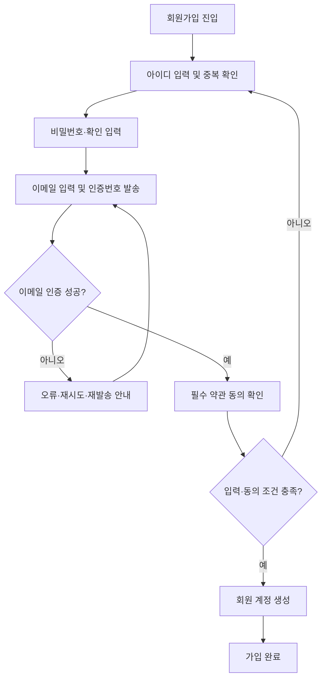
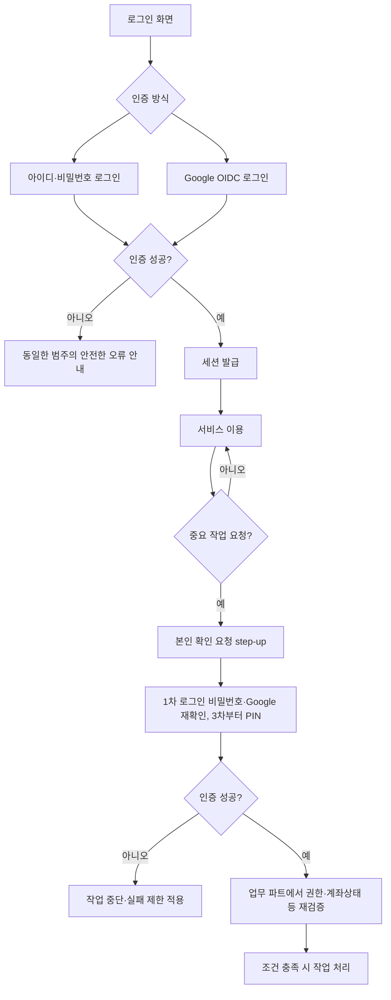
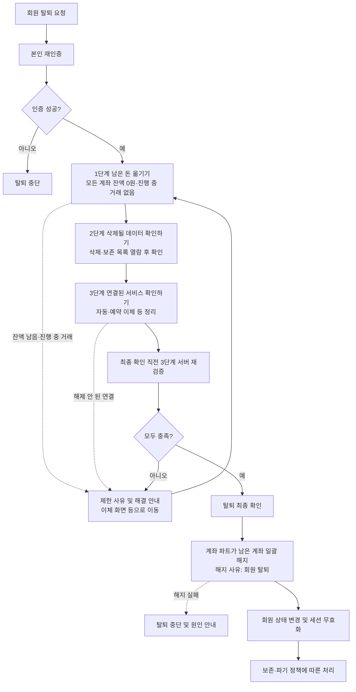
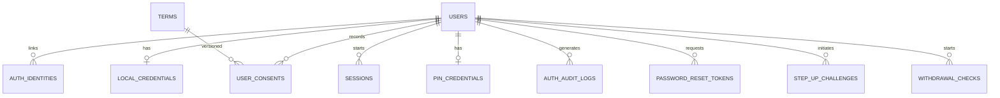
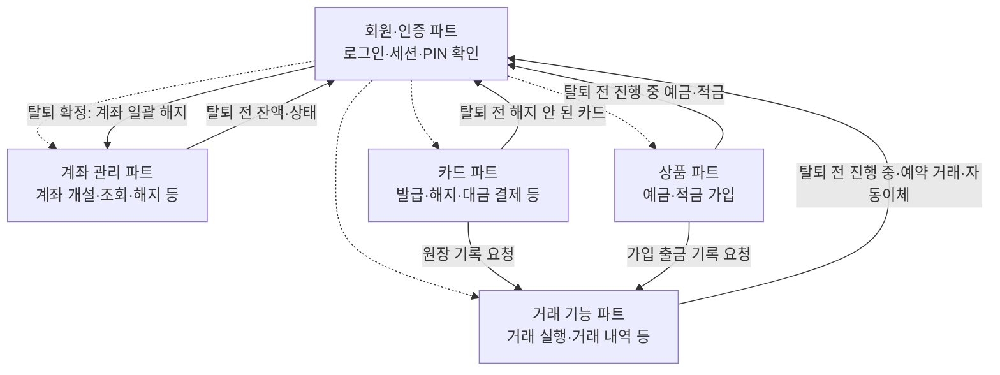
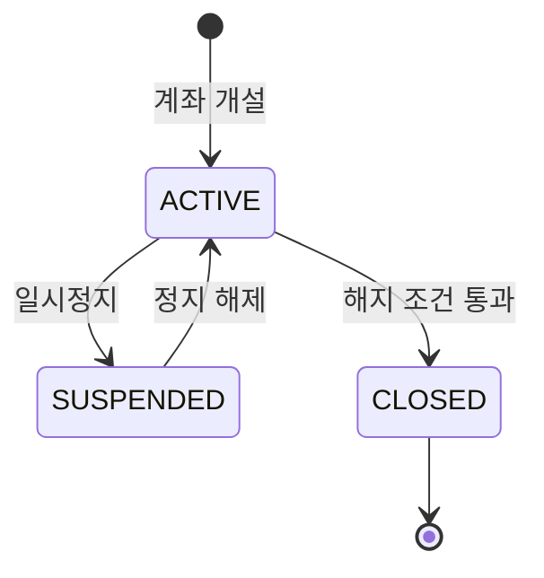
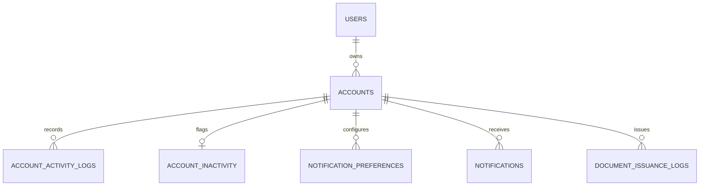
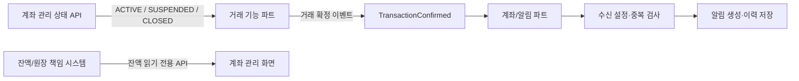

# 은행 모바일 웹서비스 통합 기획서

> **구성:** 회원·인증 + 계좌 관리 (카드·거래 명세는 `docs/거래_카드기능_기획서.md`)  
> **합친 날짜:** 2026-11-03  
> **합친 방법:** 두 기획서를 **내용 수정 없이** 한 파일로 이었다. 바꾼 것은 ① 제목 단계를 한 단계씩 낮춤 ② 겹치는 기능 번호(둘 다 F01~F13)를 `AUTH-F01`~`AUTH-F13`(회원·인증), `ACCT-F01`~`ACCT-F13`(계좌 관리)으로 구분 ③ "이 문서"를 "이 파트"로 고침, 이 세 가지뿐이다.  
> **원본:** `docs/_원본/` (회원가입_로그인_인증_기획서.md v1.0 · 계좌기능_기획서.md v3.0)  
> **변경 이력:** 2026-11-03 — 회원 탈퇴(`AUTH-F09`)에 **탈퇴 전 필수 3단계**(① 남은 돈 옮기기 ② 삭제될 데이터 확인하기 ③ 연결된 서비스 확인하기)를 추가했다. 고친 곳: Part 1 의 3.3 · AUTH-F09 · 5(UI07) · 6 · 7 · 9 · 11 · 12 · 13, Part 2 의 9 · 10.3 · 14.  
> **변경 이력(2):** 2026-11-03 — 실제 서비스·법령 조사(`docs/domain-rules.md`)를 반영해 ① 해지 안 된 카드는 탈퇴를 **차단** ② 회원 기본 정보는 **유예 기간 뒤 파기**, 보존은 법령 근거가 있는 기록으로 한정 ③ 잔액 0원으로 남은 계좌는 탈퇴 확정 때 **일괄 해지**를 기본안으로 바꿨다.  
> **변경 이력(3):** 2026-11-03 — 클론 대상이 토스이므로 탈퇴 규칙을 토스 기준으로 맞췄다(`docs/domain-rules.md` 4절): 자동이체·카드 **차단 확정**, 탈퇴 후 **유예 1개월**, 일시정지 계좌는 **잔액 0원이면 탈퇴 때 정지 해제 없이 해지**, 잔액이 있으면 정지 해제 후 이체.  
> **변경 이력(4):** 2026-11-03 — 탈퇴 관련 "협의 필요" 5개 중 4개를 기본안으로 확정했다(외부 계좌 이체는 거래 파트 몫, 보존 5년 고정, 탈퇴 철회 없음·재가입 가능, 점검~확정 사이 잠금 없음). 남은 것은 계좌 파트의 예외 해지 수용 1개.  
> **변경 이력(5):** 2026-11-04 — 계좌 필드를 더미 데이터(CODEF 응답 이름)에 맞췄다. `account_number`→`resAccount`, `opened_at`→`resAccountStartDate`, `nickname`→`resAccountNickName`, `currency`→`resAccountCurrency`, `balance`→`resAccountBalance`, `as_of`→`balance_as_of`. 또 ① `account_preferences` 테이블을 없애고 별명·즐겨찾기를 `accounts` 로 합쳤으며(더미가 그렇게 돼 있음) ② 더미에만 있던 `resAccountDisplay`·`resAccountName`·`resAccountStatus`·`resAccountEndDate` 를 `accounts` 에 넣고 ③ 날짜를 더미 형식(`YYYYMMDD`)으로 맞췄다(고친 곳: Part 2 의 4(ACCT-F04)·계좌 개설 규칙·8·9·12).  
> **변경 이력(6):** 2026-11-04 — 컬럼마다 뜻·값을 적은 **컬럼 사전**을 추가했다(Part 1 의 6.3, Part 2 의 8.4). 값 목록이 기획서에 없는 컬럼은 "값 목록 미정"으로 표시했다.  
> **변경 이력(7):** 2026-11-04 — 상품 기획안(`docs/은행_상품_기획안.md`)과 맞췄다. ① 예금·적금 가입은 새 계좌가 아니라 상품 파트의 가입 계약(`subscriptions`)으로 관리하고, `SAVINGS` 는 **저축예금(입출금이 자유로운 저축 통장)** 으로 뜻을 좁혔다 ② 탈퇴 ①단계에 진행 중인 예금·적금을 차단 조건으로 넣었다 ③ 진행 중인 가입 상품에 연결된 계좌는 해지를 막는다 ④ 상품 파트 연동 항목을 추가했다(고친 곳: Part 1 의 AUTH-F09, Part 2 의 ACCT-F01·ACCT-F05·ACCT-F13·8.4·10.3).  
> **변경 이력(8):** 2026-11-04 — 거래·카드 기획서(`docs/거래_카드기능_기획서.md`)와 맞췄다. ① 카드 해지·탈퇴 차단은 `CARD-F09`, 거래 쪽 점검은 거래 파트의 `transfer-blockers` API로 연결 ② 별도 파트 데이터 이름을 `transactions`·`transfers`·`scheduled_transfers`로 ③ 거래 확정 이벤트의 `transaction_type`은 거래 기획 3장의 값(`TRANSFER_IN` 등) ④ `notifications`에 `title`·`body` 추가, 계좌·거래·카드가 같이 씀 ⑤ `terms`에 카드 상품 약관용 `card_product_id` 추가 ⑥ `step_up_challenges.action` 값 목록 ⑦ 연동 그림에 카드 파트 추가. 공통 이름 규칙은 거래·카드 기획서 C-5.  
> **변경 이력(9):** 2026-11-04 — ① 카드 결제·출금 계좌로 연결된 계좌는 **카드의 결제 계좌를 다른 계좌로 바꾸거나 카드를 해지한 뒤에만 해지**(`ACCT-F05`) ② 탈퇴 때 거래·카드 데이터도 같은 보존 규칙(금융거래 기록 5년 보존, 나머지 즉시 삭제)으로 분류 ③ 상품 API 경로를 `/users/me/subscriptions`로.  
> **변경 이력(14):** 2026-11-04 — 계좌 표에서 `resAccountStatus`(`lifecycle_status`와 같은 내용이라 저장하지 않고 응답 때 만듦)와 `resAccountEndDate`(예금·적금이 상품 파트로 가서 계좌에는 만기가 없음)를 뺐다. 더미에서도 같은 칸과 겹치던 칸을 지웠다.  
> **변경 이력(13):** 2026-11-04 — 두 번째 대조 반영: 본인 확인(`POST /auth/step-up`)을 **1차**에 넣고 흐름도·9.3을 PIN 전용에서 바꿈, 상품 파트 내부 점검 API(`subscription-blockers`) 연결, 정지 계좌 입출금 차단을 확정 문구로, 7.3 정리 동작에 중도 해지·정지 해제·카드 결제 계좌 바꾸기·밀린 카드 대금 결제·자동이체/예약 취소 추가, `step_up_challenges.action`에 `ACCOUNT_STATUS_CHANGE`, 알림에 `user_card_id`, 우리가 만든 빈 날짜 칸은 `null`.  
> **변경 이력(12):** 2026-11-04 — 상품 기획안에 예금·적금 중도 해지(`PROD-F10`)·만기 처리(`PROD-F11`)가 2차로 들어가, 탈퇴·계좌 해지 막힘을 풀 방법이 생겼다. 거래 유형 목록에 `SUBSCRIPTION_PAYOUT` 추가.  
> **변경 이력(11):** 2026-11-04 — 세 기획서 대조 후 정리: 본인 확인(`step_up_challenges`)을 필수로 바꾸고 발급 API(`POST /auth/step-up`)와 "3차 PIN 전에는 로그인 재확인" 확정, 회원 상태별 허용 동작 표(7.3) 추가, 정지 계좌는 입출금 모두 막음으로 확정, 카드 점검 내부 API 연결, 탈퇴 점검 계좌 API를 `/internal/...`로, 연동 그림·계약표에 상품 파트 추가, 알림 타입 2개·`event_id` 뜻 넓힘, 이벤트 시각 +09:00.  
> **변경 이력(10):** 2026-11-04 — 회원 정보에 생년월일(`birth_date`)·성별(`gender`)·월급일(`payday`)을 추가했다. 생년월일·성별은 가입 때 필수(카드 발급 나이 검사·발급 순위 통계), 월급일은 선택(카드 사용 금액 예측). 거래·카드 기획서의 요청을 받아들인 것이다.  
> **아직 안 한 것:** 두 파트 사이의 중복·충돌 정리(예: 절 번호 `0`~`13` 이 파트마다 따로 있음, 데이터 모델·연동 절이 파트마다 따로 있음). 내용 합의는 별도 작업이다.

## 목차

| 파트 | 내용 | 기능 ID |
|---|---|---|
| Part 1 | 회원가입 · 로그인 · 간편 인증 (PIN) | `AUTH-F01` ~ `AUTH-F13` |
| Part 2 | 계좌 관리 (개설·조회·잔액·상태·알림·증명서·휴면) | `ACCT-F01` ~ `ACCT-F13` |
| Part 3 | 카드 — 명세는 `docs/거래_카드기능_기획서.md` 파트 A | `CARD-F01` ~ `CARD-F16` |
| (별도) | 거래 기능 파트 (이체·거래내역) — `docs/거래_카드기능_기획서.md` 파트 B | `TRX-F01` ~ `TRX-F14` |
| (별도) | 은행 상품(예금·적금 탐색·가입) — `docs/은행_상품_기획안.md` | `PROD-F01` ~ `PROD-F11` |

---

## Part 1. 회원가입 · 로그인 · 간편 인증 서비스 상세 기획서

> **문서 버전:** v1.0  
> **작성일:** 2026-11-03  
> **담당 영역:** 회원·인증(Auth / Identity) 파트  
> **기능 범위:** 확정된 **13개 기능 항목** — 1차 6개 / 2차 4개 / 3차 3개  
> **서비스 가정:** 모의 금융 서비스를 위한 웹·앱 회원·인증 시스템  
> **상태:** **기능 범위 확정**, 세부 수치·인증 방식·운영 정책은 개발 전 최종 합의 필요

---

### 0. 문서 읽는 법

- **[확정]** 사용자가 확정한 기능 범위 또는 기능 간 책임 분리.
- **[설계 권고]** 안전하고 일관된 구현을 위한 권장 동작. 개발 단계에서 팀이 구체화할 수 있음.
- **[협의 필요]** 아직 확정되지 않은 값이나 정책. 문서에 제시된 예시는 확정 스펙이 아님.
- API 주소·DB 테이블·상태값·에러코드·시도 횟수 등은 **기술 설계 초안**이며 실제 구현 명세와 구분한다.
- **중요:** 이 파트는 금융기관이 요구하는 실서비스 인증·신원확인·규제 준수를 충족한다고 주장하지 않는다. **모의 금융 서비스**의 교육·개발용 설계다.

### 1. 프로젝트 개요

#### 1.1 목적
회원이 계정을 만들고 안전하게 로그인한 뒤, 개인정보를 관리하고, 모의 금융 서비스 내 중요 작업을 수행하기 전에 필요한 재인증(PIN 포함)을 받을 수 있도록 공통 인증 기능을 제공한다.

#### 1.2 범위와 책임

| 구분 | 회원·인증 파트 책임 | 타 파트 책임 |
|---|---|---|
| 회원 계정 | 생성·식별·프로필 수정·탈퇴 요청 및 계정 상태 관리 | 계좌/거래 등 도메인 데이터 소유 |
| 로그인 | 비밀번호 인증, Google OIDC 로그인, 세션 발급·만료·폐기 | 발급된 인증 컨텍스트를 검증하고 권한 적용 |
| 이메일 인증 | 인증번호 발급·검증·만료/재발송 관리 | 메일 발송 인프라와의 연동(공통 인프라) |
| PIN | 등록·인증·변경·재설정, 실패 제어, 인증 결과 제공 | 중요 작업의 수행 여부 결정·자체 권한 검사 |
| 회원 탈퇴 | 탈퇴 절차 시작·전 3단계 점검 진행·최종 상태 반영 | 계좌 잔액·해지 여부·처리 중 거래·자동/예약 이체 등 제한 조건 반환 |
| 약관 | 동의 항목·버전·시각 기록 | 실제 서비스/상품별 추가 약관 내용 제공(해당 시) |

**범위 제외:** 계좌 개설·상태·잔액, 거래 실행·내역, 실제 계좌 이체, 금융상품/이자 처리, 실제 금융기관 실명확인(KYC), 공인 전자서명·실제 은행 수준의 거래 승인.

#### 1.3 핵심 원칙
1. **로그인 인증과 작업별 인증을 구분**한다. PIN은 일반 로그인 비밀번호를 대체하지 않는다.
2. **인증 성공과 업무 실행을 구분**한다. PIN 확인이 성공해도 계좌·거래 파트의 소유권/상태/한도 검증을 생략할 수 없다.
3. **사용자 식별의 기준은 내부 `user_id`**이다. 아이디·이메일·Google 계정 정보는 인증 수단 또는 연락처다.
4. 인증 자격 증명(비밀번호·PIN·인증번호·토큰)은 **평문으로 저장하거나 로그에 남기지 않는다**.
5. 계정 삭제 요청과 각종 데이터의 즉시 삭제는 같은 개념이 아니다. 보존/파기 규칙을 별도로 적용한다.

---

### 2. 최종 기능 목록 — 총 13개

| 단계 | ID | 기능 | 주요 동작 | 포함 여부 |
|---|---|---|---|---|
| **1차 회원가입·로그인** | AUTH-F01 | 회원가입 | 아이디·비밀번호·비밀번호 확인·이메일 입력 | 확정 |
| | AUTH-F02 | 아이디 중복 확인 | 가입 전 아이디 사용 가능 여부 확인 | 확정 |
| | AUTH-F03 | 이메일 인증 | 인증번호 발송·확인 | 확정 |
| | AUTH-F04 | 구글 소셜 로그인 | Google OAuth 2.0 + OIDC 기반 로그인 | 확정 |
| | AUTH-F05 | 로그인 / 로그아웃 | 일반 로그인, 세션 발급·만료·폐기 | 확정 |
| | AUTH-F06 | 아이디 찾기 / 비밀번호 재설정 | 이메일 기반 계정 복구 | 확정 |
| **2차 회원 정보 관리** | AUTH-F07 | 내 정보 조회 및 수정 | 기본 프로필 조회·수정 | 확정 |
| | AUTH-F08 | 비밀번호 변경 | 로그인된 회원의 비밀번호 변경 | 확정 |
| | AUTH-F09 | 회원 탈퇴 | 탈퇴 요청·재인증·**탈퇴 전 3단계 점검(남은 돈 옮기기 · 삭제될 데이터 확인 · 연결된 서비스 확인)**·처리 | 확정 |
| | AUTH-F10 | 약관 동의 및 관리 | 필수/선택 약관, 동의 기록·변경 | 확정 |
| **3차 간편 인증** | AUTH-F11 | PIN 등록 | 6자리 간편 비밀번호 설정 | 확정 |
| | AUTH-F12 | PIN 인증 | 중요 작업 전 6자리 PIN 확인 | 확정 |
| | AUTH-F13 | PIN 변경 및 재설정 | 기존 PIN 변경, 분실 시 별도 인증 후 재설정 | 확정 |

> **정책 구분:** 기능 항목 13개는 변경하지 않는다. 세션 관리, 실패 횟수 제한, 계정 잠금, 감사 로그 등은 새로운 사용자 기능을 추가하는 것이 아니라 관련 기능의 **필수/권고 처리 규칙**으로 포함한다.

---

### 3. 주요 사용자 흐름

#### 3.1 일반 회원가입



#### 3.2 로그인 및 중요 작업



#### 3.3 회원 탈퇴



---

### 4. 기능별 상세 명세

#### AUTH-F01. 회원가입

**목적:** 로컬 계정(아이디+비밀번호)을 생성하고 서비스 이용 자격을 준비한다.

**화면/입력**
- 아이디: 필수, 중복 여부 확인 가능.
- 비밀번호: 필수, 입력값 숨김 기본, 표시 토글 선택.
- 비밀번호 확인: 필수, 비밀번호와 일치 여부 확인.
- 이메일: 필수, 인증 완료 필요.
- 생년월일: 필수, 날짜 선택. 미래 날짜는 막는다.
- 성별: 필수, `남성`/`여성` 중 선택.
- 월급일: 선택, 1~31일 중 선택. 비워 두고 나중에 내 정보(AUTH-F07)에서 넣을 수 있다.
- 약관: 필수/선택 구분, 필수 항목 동의 필요.
- 가입 완료 버튼: 유효성 조건을 충족했을 때만 제출 가능하도록 안내.

**정상 처리 흐름**
1. 아이디 입력 → AUTH-F02 중복 확인.
2. 비밀번호 및 확인값 검증.
3. 이메일 입력 → AUTH-F03 인증 완료.
4. 최신 필수 약관 동의 여부 확인.
5. 서버에서 모든 값을 **다시 검증**하고 계정 생성.
6. 내부 `user_id` 발급, 인증수단 `LOCAL_PASSWORD` 연결, 회원 상태 활성화.
7. 가입 완료 화면 표시. 자동 로그인 여부는 **[협의 필요]**.

**주요 규칙**
- [설계 권고] 아이디 허용 문자·길이·대소문자 처리 기준은 서버와 화면에서 동일하게 적용한다.
- [설계 권고] 비밀번호는 긴 암호구를 허용하고, 취약/유출 비밀번호 사용을 제한할 수 있다. 비밀번호를 평문 저장·이메일 발송하지 않는다.
- [설계 권고] 가입 직전 중복 검사를 다시 수행하며, DB 고유 제약으로 경합 상황의 중복 생성까지 방지한다.
- [설계 권고] 회원가입 요청에도 속도 제한 및 중복 요청 방지를 적용한다.
- [협의 필요] 이메일의 계정 간 중복 허용 여부, 미인증 가입 초안의 만료/삭제 시간.
- [기본안] 생년월일·성별은 카드 발급 나이 검사와 발급 순위 통계(거래·카드 기획서 1-6·1-7), 월급일은 카드 사용 금액 예측(1-4)에만 쓴다. 이 목적을 가입 화면에 적는다(필요한 만큼만 수집).

**예외/오류**
- 이미 사용 중인 아이디, 인증되지 않은 이메일, 비밀번호 불일치, 필수 약관 미동의.
- 인증번호 만료 또는 시도 제한, 이메일 중복 정책 위반.
- 같은 가입 요청의 중복 제출, 서버·메일 서비스 장애.

**완료 기준(AC)**
- [ ] 모든 필수 입력·인증·동의를 완료한 회원만 가입 성공.
- [ ] 중복 아이디가 동시 요청에도 생성되지 않음.
- [ ] 비밀번호 원문이 DB/로그/응답에 노출되지 않음.
- [ ] 가입된 회원은 내부 `user_id`로 고유 식별됨.

#### AUTH-F02. 아이디 중복 확인

**목적:** 가입 희망 아이디의 사용 가능 여부를 즉시 안내한다.

**정상 흐름:** 아이디 입력 → 형식 검증 → 중복 확인 요청 → 사용 가능/불가 결과 표시.

**규칙·예외**
- [설계 권고] 입력값 수정 시 기존 중복 확인 결과를 무효화한다.
- [설계 권고] 클라이언트의 '사용 가능' 표시는 확정 예약이 아니다. **최종 가입 시 DB 고유 제약으로 재검증**한다.
- [설계 권고] 대량 조회/무차별 탐색 방지를 위한 속도 제한을 적용한다.
- 오류 시 '확인 실패, 다시 시도'를 안내하고 가입을 진행하지 않는다.

**완료 기준(AC)**
- [ ] 사용 가능/중복/형식 오류가 구분됨.
- [ ] 확인 후 아이디 변경 시 재확인 필요.
- [ ] 중복 검사 성공 직후 다른 사용자가 가입해도 중복 계정 생성 없음.

#### AUTH-F03. 이메일 인증

**목적:** 회원이 제출한 이메일 주소의 수신 가능성과 소유 통제 여부를 확인한다.

**정상 흐름**
1. 이메일 입력 → 인증번호 발송 요청.
2. 서버가 짧은 만료 시간을 가진 일회용 인증번호 생성·보관(원문 비노출) 후 발송.
3. 사용자 인증번호 입력 → 서버가 유효기간·시도 횟수·일치 여부 검증.
4. 성공 시 **해당 이메일·가입 흐름에 한정된 인증 완료 상태**로 변경.
5. 인증 완료 후 이메일이 변경되면 다시 인증.

**필수 처리 규칙**
- [설계 권고] 인증번호 만료, 재발송 간격, 일/시간 단위 발송 제한, 검증 시도 제한을 함께 둔다.
- [설계 권고] 새 인증번호 발송 시 직전 코드 무효화 및 코드 1회 사용을 기본으로 한다.
- [설계 권고] 인증번호를 로그에 남기지 않고 저장 시에도 안전하게 보호한다.
- [협의 필요] 예시 정책: 5분 만료 / 60초 재발송 대기 / 연속 오류 제한. **확정 수치가 아님**.

**예외/오류:** 이메일 형식 오류, 발송 장애, 코드 불일치·만료·재사용, 재발송 제한, 인증 대상 이메일 변경.

**완료 기준(AC)**
- [ ] 올바른 코드와 유효한 시간/대상에서만 인증 성공.
- [ ] 만료·재사용 코드는 실패.
- [ ] 발송·검증 제한이 서버에서도 적용.

#### AUTH-F04. 구글 소셜 로그인 (Google OIDC)

**목적:** Google 계정을 이용해 로그인 또는 신규 소셜 계정을 생성한다.

**기술 범위**
- [확정] Google 소셜 로그인 지원.
- [설계 권고] **OAuth 2.0 Authorization Code Flow + OpenID Connect(OIDC)** 기반으로 사용자 인증을 구현하고, 클라이언트 유형에 맞게 **PKCE**를 적용한다.
- [설계 권고] 서버는 발급자(`iss`), 대상(`aud`), 만료(`exp`), 요청 연계 값(`state`, 필요 시 `nonce`) 등 관련 검증을 수행한다. 계정 식별에는 Google의 안정적인 `sub` 식별자를 사용한다.

**정상 흐름**
1. 'Google로 계속하기' 버튼 선택.
2. Google 인증 및 사용자 동의 후 콜백 처리.
3. 인증 응답/토큰 검증.
4. `(provider, provider_subject)`로 기존 인증수단 조회.
5. 기존 연결 계정이면 로그인, 신규라면 필요한 약관 확인과 **추가 정보 입력(생년월일·성별 필수, 월급일 선택 — AUTH-F01과 같은 규칙)** 후 내부 회원 생성/연결.
6. 서비스 세션 발급.

**계정 연결 정책**
- [설계 권고] Google 이메일이 로컬 계정 이메일과 같더라도 **이메일 문자열 일치만으로 자동 병합하지 않는다**.
- [설계 권고] 기존 계정에 Google 로그인을 연결하려면 해당 **기존 계정으로 먼저 인증**하고 연결 의사를 재확인한다.
- [협의 필요] 신규 소셜 가입 시 별도 아이디 부여 방식, 필수 약관 동의 화면, 로컬 비밀번호 추가 기능(초기 범위 밖).
- Google로만 가입한 사용자에게 '기존 비밀번호 변경'을 그대로 제공하지 않는다.

**예외/오류:** Google 인증 취소, 토큰 검증 실패, 이미 다른 회원에 연결된 Google 계정, 동의 미완료, 세션 생성 실패.

**완료 기준(AC)**
- [ ] 유효한 Google 인증 결과만 로그인 성공.
- [ ] 동일 Google 계정으로 중복 회원 생성되지 않음.
- [ ] 같은 이메일의 별도 계정을 임의로 자동 병합하지 않음.

#### AUTH-F05. 로그인 / 로그아웃

**목적:** 로컬 회원의 인증 및 서비스 세션 유지·종료를 제공한다.

**로그인 정상 흐름**
1. 아이디·비밀번호 입력.
2. 사용자 상태 확인 및 저장된 비밀번호 해시 검증.
3. 실패 횟수·위험 신호 등 정책 확인.
4. 성공 시 세션 생성, 클라이언트에 필요한 세션 식별자/토큰 전달.
5. 회원 전용 페이지로 이동.

**로그아웃 정상 흐름:** 로그아웃 요청 → 서버 세션/갱신 수단 무효화 → 클라이언트 인증 상태 제거 → 로그인 화면 이동.

**세션 및 보안 규칙**
- [설계 권고] 웹에서는 `HttpOnly`, `Secure`, 적절한 `SameSite` 쿠키와 CSRF 방어 등 세션 형태에 맞는 보호 적용.
- [설계 권고] 세션 만료(유휴/최대), 재인증이 필요한 중요 작업, 비밀번호 변경 시 세션 처리 정책을 명확히 정의.
- [설계 권고] 로그인 실패에 속도 제한과 점진적 보호 조치를 적용한다. 과도한 영구 잠금으로 정상 사용자가 피해를 보지 않도록 설계.
- [설계 권고] 계정 존재 여부가 무분별하게 드러나지 않도록 오류 메시지를 설계한다.
- [협의 필요] '로그인 유지' 기능, 다중 기기 로그인, 모든 기기 로그아웃(향후 확장 후보).

**예외/오류:** 자격 증명 불일치, 휴면/탈퇴/차단 계정, 시도 제한, 서버/세션 저장소 장애, 만료된 세션.

**완료 기준(AC)**
- [ ] 잘못된 비밀번호로 세션 생성되지 않음.
- [ ] 로그아웃 후 기존 세션으로 보호 API 접근 불가.
- [ ] 세션 만료 후 보호 기능 접근 시 재로그인 안내.

#### AUTH-F06. 아이디 찾기 / 비밀번호 재설정

**목적:** 로그인 정보를 잊은 회원이 이메일 등 등록 수단으로 계정을 복구하도록 지원한다.

**아이디 찾기 흐름**
1. 등록 이메일 입력 및 이메일 확인 절차 진행.
2. 인증 성공 시 아이디 일부 마스킹 또는 안전한 복구 안내 제공.
3. 정보가 일치하지 않아도 계정 존재를 쉽게 열거할 수 없도록 초기 안내를 설계.

**비밀번호 재설정 흐름**
1. 등록 이메일 입력 → 일회용 재설정 링크/토큰 발송.
2. 유효기간·사용 여부 검증 후 새 비밀번호 입력.
3. 서버에서 비밀번호 정책 확인 → 새 해시 저장 → 토큰 폐기.
4. 재설정 사실 알림, 기존 세션/갱신 토큰 처리(권고: 관련 기존 인증 세션 무효화).

**규칙·예외**
- 비밀번호 원문 조회·전송 기능은 제공하지 않는다.
- 일회용 토큰 재사용·만료·무작위 대입을 방지한다.
- 재설정 요청 속도 제한 및 계정 존재 여부 노출 방지 필요.
- [설계 권고] Google 전용 계정은 비밀번호가 없을 수 있으므로 Google 로그인 안내 또는 별도 '로컬 비밀번호 설정' 정책을 적용한다. 로컬 비밀번호 설정 자체는 **초기 범위에 미포함**.

**완료 기준(AC)**
- [ ] 유효한 일회용 수단을 통해서만 비밀번호 변경 성공.
- [ ] 이전 비밀번호로 로그인 불가.
- [ ] 만료·기사용 토큰 재사용 불가.

#### AUTH-F07. 내 정보 조회 및 수정

**목적:** 로그인한 회원이 자신의 기본 정보를 조회하고 허용된 항목을 수정한다.

**화면 항목 예시**
- 내부 회원 ID(일반 사용자에게 숨김), 로그인 아이디, 이메일 및 인증 상태, 가입일, 연결된 로그인 방식.
- 수정 가능: 이메일 등 허용된 프로필 필드, 월급일(언제든), 생년월일·성별(본인 재확인 후). 수정 불가 항목과 사유는 UI에서 구분.

**정상 흐름:** 마이페이지 → 정보 조회 → 수정 항목 편집 → 서버 검증 → 저장 → 변경 완료 표시.

**규칙·예외**
- 이메일 변경 시 **새 이메일 재인증**, 필요하면 현재 로그인 수단 재인증을 요구한다.
- [설계 권고] 수정 전후 변경 기록과 통지(특히 이메일 변경)를 남긴다.
- 민감정보 변경은 유효한 세션과 본인 재확인을 요구한다.
- [협의 필요] 표시 이름, 휴대전화, 프로필 사진 등은 현재 13개 확정 범위의 **필수 필드가 아님**.

**완료 기준(AC)**
- [ ] 본인 프로필만 조회·변경 가능.
- [ ] 이메일을 인증하지 않고 변경 완료 상태로 처리하지 않음.

#### AUTH-F08. 비밀번호 변경

**목적:** 로컬 로그인 사용자가 인증된 상태에서 자신의 비밀번호를 안전하게 변경한다.

**화면/입력:** 현재 비밀번호, 새 비밀번호, 새 비밀번호 확인.

**정상 흐름:** 회원 설정 → 현재 비밀번호 검증 → 새 비밀번호 정책 확인 → 해시 교체 → 변경 결과 안내 및 세션 갱신 정책 적용.

**규칙·예외**
- [설계 권고] 현재 비밀번호를 검증하고, 중요 재인증 요구 상황에서는 추가 검증을 적용한다.
- 새 비밀번호 확인 일치, 허용 문자/길이, 유출/취약 비밀번호 제한 등 정책 적용.
- 안전한 비밀번호 해시(예: 적절히 설정한 Argon2id 또는 운영 환경의 검증된 대안) 사용.
- Google 전용 계정에 로컬 비밀번호가 없다면 변경 대상이 아니며 별도 안내한다.
- 변경 완료 후 중요 세션 무효화/재로그인 방침은 명시적으로 결정한다.

**완료 기준(AC)**
- [ ] 현재 비밀번호가 틀리면 변경 불가.
- [ ] 기존 비밀번호로는 로그인 불가.
- [ ] 서버·로그에 평문 비밀번호가 남지 않음.

#### AUTH-F09. 회원 탈퇴

**목적:** 회원이 서비스 이용을 종료할 수 있도록 하되, 계좌·거래 파트의 무결성을 훼손하지 않는다.

**탈퇴 가능 조건 — 필수 3단계 (세 단계를 모두 완료해야만 탈퇴할 수 있다)**

| 단계 | 사용자가 하는 일 | 완료 조건 (서버가 판단) | 정보를 주는 파트 |
|---|---|---|---|
| ① 남은 돈 옮기기 | 잔액이 남은 계좌를 확인하고, 거래 파트의 이체 기능으로 다른 곳에 옮긴다 | 내 **모든 계좌의 확정 잔액이 0원**이고 **진행 중·예약된 거래가 없고** **진행 중인 예금·적금 가입이 없다** | 계좌 관리(계좌별 잔액·상태) · 거래(진행 중·예약 거래) · 상품(가입 계약) |
| ② 삭제될 데이터 확인하기 | 탈퇴하면 삭제·유예 후 파기·보존될 데이터 목록을 읽고 "확인했습니다"를 선택한다 | 목록이 사용자에게 표시되었고, **확인 시각과 목록 버전이 기록**되었다 | 회원·인증이 각 파트의 데이터 분류를 모아 표시 |
| ③ 연결된 서비스 확인하기 | 탈퇴하면 끊어질 연결(로그인 연결·알림·자동/예약 이체·카드 등)을 보고, 막는 항목은 먼저 정리한다 | **차단 항목(활성·일시정지 자동이체, 실행 대기 예약이체, 해지 안 된 카드)이 0개**이고, 나머지 안내 항목을 사용자가 확인했다 | 회원·인증(로그인 연결) · 계좌(알림) · 거래(자동/예약 이체 — 거래 기획 `transfer-blockers`) · 카드(해지 안 된 카드 — `CARD-F09`) |

**정상 흐름**
1. 마이페이지 → 회원 탈퇴 선택 → 본인 재인증 및 영향 안내 확인.
2. 점검 화면에 ①②③의 상태(미완료/완료)를 표시한다. 순서대로 안내하되 이전 단계로 돌아갈 수 있다.
3. **① 남은 돈 옮기기:** 잔액이 남은 계좌의 목록과 잔액을 보여 주고 거래 파트의 이체 화면으로 이동시킨다. 돌아오면 서버가 잔액을 다시 조회한다.
4. **② 삭제될 데이터 확인하기:** 아래 분류 목록을 보여 주고 사용자의 확인을 받는다.
5. **③ 연결된 서비스 확인하기:** 아래 연결 목록을 보여 주고, 차단 항목은 해당 화면으로 이동시켜 정리하게 한다.
6. 세 단계가 모두 완료되면 "탈퇴 최종 확인"을 열어 준다.
7. 최종 확인 요청이 오면 서버가 ①②③을 **다시 검증**한다. 화면의 "완료" 표시를 믿지 않는다. 하나라도 미충족이면 탈퇴를 중단하고 해당 단계로 안내한다.
8. 모두 충족하면 계좌 파트가 잔액 0원인 **남은 계좌를 모두 해지(`CLOSED`)** 한다(해지 사유: 회원 탈퇴). 하나라도 해지에 실패하면 탈퇴를 중단하고 회원 상태는 바꾸지 않는다.
9. 계정 상태를 `WITHDRAWN` 으로 바꾸고 로그인 세션을 무효화한다.
10. 연동된 인증정보·개인정보에 보존/파기 정책을 적용하고 결과를 안내한다.

**① 남은 돈 옮기기 — 규칙**
- 잔액 조회는 계좌 파트의 읽기 전용 잔액 조회(`ACCT-F03`)를 재사용한다. 통화가 다르면 합산하지 않고 통화별로 보여 준다.
- **이체는 이 파트도 계좌 파트도 실행하지 않는다.** 거래 파트 기능으로 이동시키기만 한다(계좌 파트의 범위 제외 항목과 같은 원칙).
- 완료 여부는 서버 조회 결과로만 정한다. 사용자가 "옮겼다"고 눌러도 완료가 되지 않는다.
- 해지(`CLOSED`) 계좌는 잔액 0원일 때만 해지되므로 점검 대상에 포함하되 항상 충족으로 본다.
- **[기본안·토스 기준]** 일시정지(`SUSPENDED`) 계좌에 **잔액이 있으면** 정지를 먼저 해제한 뒤 이체한다(정지 중에는 출금이 막히므로). 점검 화면에서 정지 해제 화면으로 이동시킨다.
- **[기본안·토스 기준]** 옮길 곳은 사용자가 고르는 **본인 명의 계좌**다(토스의 휴면계좌 화면도 "잔액을 옮길 계좌"를 고르게 한다). 점검 화면은 토스처럼 "옮길 계좌 선택 → 이체"를 한 화면에서 끝낼 수 있게 한다.
- **[기본안]** 이체 대상 범위와 외부 계좌 이체의 시뮬레이션 방식은 **거래 파트가 정한다**. 탈퇴 점검은 거래 파트의 이체 기능으로 이동시키기만 한다.
- **[기본안]** 만기·해지 전인 **예금·적금 가입(`subscriptions`)이 하나라도 있으면 ①은 미완료**다. 예금·적금에 든 돈도 "남은 돈"이기 때문이다. 점검 화면은 가입 상품 목록(상품 파트 `GET /internal/users/{userId}/subscription-blockers`)을 보여 주고 "만기 후 또는 중도 해지 후 탈퇴할 수 있다"고 안내한다. 중도 해지(`PROD-F10`)와 만기 처리(`PROD-F11`)는 상품 파트 2차 기능이다. 중도 해지하면 원금이 출금 계좌로 돌아오므로 그 돈도 ①에서 옮겨야 한다.

**② 삭제될 데이터 확인하기 — 분류 목록 (초안)**

| 분류 | 해당 데이터 예시 | 소유 파트 |
|---|---|---|
| 즉시 삭제 | 로그인 세션, 이메일 인증번호 기록, 비밀번호 재설정 토큰, PIN 정보, 추가 인증 상태, 로컬 비밀번호 해시, 계좌 별명·즐겨찾기, 알림 설정, 알림 이력 · 자주 쓰는 계좌, 최근 보낸 계좌 숨김 설정 · 카드 설정(해외·온라인 차단, 이용 한도), 카드 별명, 카드 추천·사용 금액 예측·고정지출 탐지 결과, 카드 포인트 잔액, 마이데이터 연동 토큰·동기화 기록 | 회원·인증 / 계좌 / 거래 / 카드 |
| 유예 기간 뒤 파기 | 회원 기본 정보(아이디·이메일·생년월일·성별·월급일 등), 로그인 수단 연결 정보 — 부정 재가입 방지·결제취소 확인처럼 정당한 목적이 있을 때만 짧게 둔다 | 회원·인증 |
| 보존 (법령 근거가 있는 것만, 다른 정보와 분리해 보관) | 인증 감사 기록(로그인 등 접속기록), 계좌·거래 기록, 계좌 활동 기록, 문서 발급 기록 · 이체 요청·결과, 예약 송금·자동이체 신청 기록 · 카드 발급 신청·심사·해지 기록, 카드 이용(승인) 내역, 청구서·납부 기록, 카드 상태·설정 변경 이력, 포인트 현금화 기록 · 예금·적금 가입 계약·납입 기록 | 회원·인증 / 계좌 / 거래 / 카드 / 상품 |
| 보존 여부 확인 필요 | 약관 동의 이력 | 회원·인증 |

- 위 분류는 **[설계 권고] 초안**이다. 근거는 `docs/domain-rules.md` 에 있다: 개인정보 보호법 제21조(필요 없어지면 지체 없이 파기, 다른 법령상 보존 의무가 있으면 예외이며 분리 보관), 전자금융거래법과 시행령 제12조(전자금융거래기록은 최대 5년 안에서 종류별로 5년/1년 보존), 토스의 탈퇴 후 1개월 유예 사례.
- **보존은 법령 근거가 있는 기록으로만** 하고, 보존하는 기록은 다른 개인정보와 분리해 저장한다. 회원 기본 정보를 근거 없이 오래 두지 않는다.
- **[기본안·토스 기준]** 유예 기간은 **탈퇴 후 1개월**이다(토스 개인정보처리방침: 탈퇴 후 1개월 동안 부정거래·자금세탁 방지, 결제취소 환급 확인 목적으로 이용). 금융거래 기록 보존은 **5년**을 기본으로 한다.
- **[기본안]** 거래·카드·상품 데이터도 같은 기준이다. 돈이 오갔거나 거래 조건을 바꾼 기록(전자금융거래법 시행령 제12조의 "거래 신청·조건 변경", "거래 기록")은 보존, 편의 설정과 계산 결과는 즉시 삭제다. 카드 기록에만 적용되는 법령(신용정보법·여신전문금융업법)은 아직 확인하지 않았다(`docs/domain-rules.md`).
- **[기본안]** 모의 서비스의 보존 기간은 **5년으로 고정**한다. 실서비스로 가려면 전자금융거래법 시행령 현행본 등 관련 규정을 확인해야 한다(조문은 2015년 개정 표시까지만 확인함).
- 확인 방식: 사용자가 목록을 펼쳐 본 뒤 "삭제·보존 내용을 확인했습니다"를 선택한다. 서버는 확인 시각과 목록 버전을 저장한다. 목록 버전이 바뀌면 이전 확인은 무효가 된다.
- 목록은 데이터의 **종류**를 알리는 것이며, 거래 내용 같은 개인 정보 자체를 이 화면에 펼쳐 보이지 않는다.
- **[기본안·토스 기준]** 목록 화면에 "탈퇴하면 기존 거래기록은 삭제되고 다시 가입해도 확인할 수 없다. 다만 금융거래정보는 관련 법에 따라 일정 기간(토스는 5년) 보관한다"는 안내를 함께 보여 준다. 탈퇴하면 필수 동의를 포함한 모든 동의가 자동으로 철회된다는 점도 안내한다.
- **[기본안]** 탈퇴 철회(복구)는 지원하지 않는다. 재가입은 가능하다.

**③ 연결된 서비스 확인하기 — 연결 목록 (초안)**

| 연결된 서비스 | 탈퇴하면 | 처리 |
|---|---|---|
| Google 로그인 연결 | 연결이 해제된다 | 안내 후 확인 |
| 입출금 알림 | 알림 설정이 삭제되고 발송이 중단된다 | 안내 후 확인 |
| 자동이체 · 예약이체 | 탈퇴 뒤에 실행될 수 있어 위험하다 | **차단** — 해제/취소 후에만 진행 |
| 체크카드 · 신용카드 | 연결 계좌가 사라져 쓸 수 없게 된다 | **차단** — 카드를 해지한 뒤에만 진행(토스·카카오페이도 카드 해지가 먼저). 카드 해지는 `CARD-F09`(거래·카드 기획서 1-3). 마이데이터로 연동만 한 타사 카드는 막지 않고 연동 해제만 안내 |

- 차단 항목이 하나라도 있으면 ③은 미완료이고, 해당 서비스 화면으로 이동하는 안내를 보여 준다.
- 안내 항목은 사용자가 목록을 확인하면 완료로 본다.
- **[확정·토스 기준]** 자동·예약 이체는 **차단**한다. 토스는 "등록된 자동이체를 모두 삭제"해야 탈퇴할 수 있다. 카카오페이처럼 탈퇴 때 자동으로 취소하는 방식도 있지만 토스를 따른다. 자동이체 해지는 토스처럼 앱 안의 해당 화면에서 직접 하게 이동시킨다.

**핵심 원칙**
- **회원 탈퇴 ≠ 계좌 해지 ≠ 모든 DB 행 즉시 삭제**. 탈퇴 확정 때 계좌 파트가 해지를 수행하더라도 해지 조건 검증과 실행은 계좌 파트의 책임이다.
- **[설계 권고]** 계좌 소유권/미완료 거래 등 도메인 검증을 **인증 파트가 임의로 추측하지 않고** 담당 파트에 조회한다.
- **[설계 권고]** 점검 결과는 짧게만 유지하고 **최종 확인 직전에 반드시 다시 검증**한다. 화면에서 확인 메시지를 띄우는 것만으로는 안전하지 않다(계좌 파트 7.3 의 "시점/동시성 보장" 원칙과 같다).
- **[설계 권고]** 연동 파트가 응답하지 못하면 "충족"으로 보지 않고 탈퇴를 중단한다.
- **[기본안]** 재가입은 가능하고, 탈퇴한 계정을 되살리는 재활성화는 없다. 탈퇴가 막히는 경우는 위 ①②③과 연동 파트 응답 실패뿐이다. 유예 기간(1개월)과 보존 기간(5년)은 ②의 설명을 따른다.
- **[기본안]** 점검~확정 사이에 입금이나 신규 계좌 개설이 생겨도 따로 잠그지 않는다. 최종 확인 때 서버가 ①②③을 다시 검사하므로 그때 걸러져 탈퇴가 중단된다.
- **[기본안]** 잔액 0원으로 남은 계좌는 최종 확인 뒤 계좌 파트가 **모두 해지**하고, 그다음 회원 상태를 바꾼다. 해지 사유 "회원 탈퇴"를 계좌 활동 기록에 남긴다. 하나라도 실패하면 회원 상태를 바꾸지 않는다. (토스증권은 잔액을 비워야 계좌 해지, 카카오뱅크는 비공식 자료상 모든 계좌 해지 후 탈퇴 — `docs/domain-rules.md`)
- **[기본안·토스 기준]** 일시정지(`SUSPENDED`) 계좌는 계좌 파트 7.1 에서 바로 해지가 안 되지만, **잔액이 0원이면 탈퇴 일괄 해지에서만 예외로 정지 해제 없이 바로 해지**한다. 토스는 압류 등 출금제한 사고신고가 등록된 계좌만 해지를 막고, 거래중지(휴면) 계좌는 앱에서 해지할 수 있다(`docs/domain-rules.md` 4절). 잔액이 있으면 위 ①의 규칙대로 정지를 먼저 해제한다.
- **[설계 권고]** 나중에 관리자 정지·압류처럼 사용자가 풀 수 없는 정지 상태가 생기면, 탈퇴 일괄 해지에서 반드시 **제외하고 탈퇴를 막는다**(토스 약관과 같은 원칙).
- [협의 필요] 계좌 파트가 이 예외(탈퇴 처리에서만 잔액 0원 일시정지 계좌 해지 허용)를 받아들이는지.
- [설계 권고] 서비스 정책상 보존이 필요한 기록과 즉시 삭제 가능한 정보의 처리를 구분한다.

**예외/오류:** 계좌 잔액 남음, 미해지 계좌 존재, 진행 중·예약 거래, 진행 중인 예금·적금, 활성 자동/예약 이체, 단계 확인 누락, 확인 이후 삭제 목록 버전 변경, 점검~확정 사이 잔액 변동, 해지 안 된 카드, 남은 계좌 일괄 해지 실패, 연동 파트 응답 실패, 재인증 실패.

**완료 기준(AC)**
- [ ] ① 잔액이 0원이 아닌 계좌가 하나라도 있으면 탈퇴되지 않고, 계좌별 잔액과 이체 안내가 표시된다.
- [ ] ① 진행 중·예약된 거래가 있으면 탈퇴되지 않는다.
- [ ] ① 만기·해지 전인 예금·적금 가입이 있으면 탈퇴되지 않고 가입 상품 목록이 안내된다.
- [ ] ② 삭제될 데이터 확인(확인 시각·목록 버전 기록) 없이는 최종 확인 단계가 열리지 않는다.
- [ ] ③ 활성 자동/예약 이체가 남아 있으면 탈퇴되지 않고 해당 화면으로 안내된다.
- [ ] ③ 해지되지 않은 카드(우리 서비스에서 발급한 카드)가 있으면 탈퇴되지 않는다(`CARD-F09`).
- [ ] 탈퇴 확정 때 남은 계좌가 모두 해지(`CLOSED`)되고 해지 사유가 기록된다. 하나라도 실패하면 회원 상태는 바뀌지 않는다.
- [ ] 잔액이 있는 일시정지 계좌는 정지를 풀고 옮기기 전에는 탈퇴되지 않고, 잔액 0원 일시정지 계좌는 정지 해제 없이 탈퇴 때 해지된다.
- [ ] 탈퇴 후 1개월 유예 동안만 최소 정보가 남고, 그 뒤 "유예 후 파기" 분류 데이터가 삭제된다.
- [ ] 세 단계가 화면에서 모두 완료로 보여도, 최종 확인 때 서버가 다시 검증하여 하나라도 미충족이면 탈퇴되지 않는다.
- [ ] 연동 파트가 응답하지 못하면 탈퇴가 진행되지 않는다.
- [ ] 제한 조건이 있으면 탈퇴되지 않고 구체적 해결 안내 제공.
- [ ] 탈퇴 처리 후 신규 보호 API 접근 차단.
- [ ] 보존 대상 기록이 무단 삭제되지 않음.

#### AUTH-F10. 약관 동의 및 관리

**목적:** 회원이 필수 약관에 동의하고, 선택 약관에 대한 의사를 관리하도록 한다.

**구성**
- 필수 약관: 이용약관 등 서비스 운영상 필요한 동의 항목.
- 선택 약관: 해당되는 경우 선택 동의 항목. 동의하지 않아도 기본 가입을 막지 않음.
- 각 약관은 `terms_id`, 버전, 제목, 필수 여부, 효력/게시 정보로 관리.

**정상 흐름**
1. 가입·소셜 가입 시 적용 약관 내용 제공.
2. 항목별 동의 입력(전체 동의는 편의 기능일 뿐 필수/선택 구분 유지).
3. 서버가 필수 동의 충족 여부 검증.
4. `user_id`, 약관 버전, 동의/철회 여부, 일시를 기록.
5. 추후 마이페이지에서 열람 및 허용된 선택 동의 변경.

**규칙·예외**
- [설계 권고] '모두 동의' 선택 시에도 개별 상태를 저장한다.
- 선택 동의 철회는 기본 회원 상태를 불필요하게 막지 않는다.
- [협의 필요] 약관 개정 시 재동의 조건/적용 시점은 법률·서비스 정책 검토 대상.

**완료 기준(AC)**
- [ ] 필수 약관 미동의 상태에서는 가입 완료 불가.
- [ ] 어떤 버전에 언제 동의했는지 확인 가능.
- [ ] 선택 동의 변경 이력이 유지됨.

#### AUTH-F11. PIN 등록 (6자리)

**목적:** 로그인 비밀번호와 분리된 **모의 금융 서비스 중요 작업 확인용** 간편 인증 수단을 설정한다.

**화면/입력:** PIN 6자리 입력 → 동일 PIN 재입력 → 등록 완료.

**정상 흐름**
1. 로그인된 회원이 PIN 등록 시작.
2. [설계 권고] 최근 인증 상태 확인 또는 로그인 수단 재인증.
3. 6자리 숫자 PIN 입력 및 재입력 일치 확인.
4. 서버에서 PIN 등록 정책 검사, 안전한 저장 처리.
5. 등록 완료 및 사용자 안내.

**보안 규칙**
- PIN은 로그인 비밀번호와 **별도 인증 수단**으로 취급한다.
- 서버가 직접 PIN을 검증한다면 사용자별 솔트를 활용한 적절한 비밀번호 해시 등 안전한 저장을 적용하고, **엄격한 온라인 시도 제한**을 설정한다. 단순 SHA-256 단독 저장 등은 권장하지 않는다.
- 연속 숫자·반복 숫자 등 지나치게 추측하기 쉬운 PIN 제한은 **[설계 권고]**이며 구체 규칙은 협의한다.
- PIN 평문은 DB/로그에 저장하지 않으며, 입력값 UI 노출 최소화.
- PIN 단독으로 강한 금융거래 인증을 충족한다고 가정하지 않는다.

**예외/오류:** 재입력 불일치, 등록된 PIN 존재, 인증 세션 만료, 위험 PIN 정책 위반.

**완료 기준(AC)**
- [ ] 6자리 형식과 확인 입력이 일치해야 등록.
- [ ] PIN 원문 저장·응답·로그 노출 없음.
- [ ] PIN 없이 중요 작업 접근 시 등록/대체 인증 안내.

#### AUTH-F12. PIN 인증

**목적:** 중요 작업을 요청하는 회원에 대해 추가 확인 절차를 제공한다.

**적용 후보(연동 설계)**
- 계좌 해지, 중요한 계좌 상태 변경, 모의 금융거래 요청 등.
- **중요 작업 지정 및 거래 허용 여부 판단은 각 업무 파트가 소유**한다.

**정상 흐름**
1. 계좌/거래 파트가 해당 작업에서 PIN 확인 필요 여부 판단.
2. 회원·인증 파트가 PIN 입력 화면/검증 API 제공.
3. 서버는 최근 인증·계정 상태·실패 제한·PIN 일치 여부 확인.
4. 성공 시 요청된 사용자·작업에 범위를 제한한 단기 인증 결과를 제공하거나 서버 간 검증 API로 확인.
5. 업무 파트가 **권한·잔액·계좌 상태·정책 등을 별도로 재검증**하고 실제 작업 처리.

**필수 규칙**
- [설계 권고] 온라인 추측 공격에 대비한 시도 횟수 제한·지연·재인증·잠금 정책.
- [설계 권고] 성공 결과의 유효시간을 짧게 하고 사용자, 세션, 작업 종류, 필요 시 특정 요청과 연계.
- 인증 성공 결과를 다른 사용자나 다른 작업에 재사용하지 못하게 처리.
- **PIN 인증 성공은 이체/계좌 변경 성공을 의미하지 않는다.**
- [협의 필요] 5회 실패 제한 등 구체 수치는 서비스 위협 모델/UX를 보고 확정.

**예외/오류:** PIN 오류, 미등록, 시도 제한, 세션 만료, 인증 결과 재사용/변조, 서버 장애.

**완료 기준(AC)**
- [ ] 올바른 PIN과 유효한 세션·정책 하에서만 성공.
- [ ] 반복 오입력에 서버 측 제한 적용.
- [ ] PIN 성공만으로 업무 파트의 권한 검증을 우회하지 못함.

#### AUTH-F13. PIN 변경 및 재설정

**목적:** 사용자가 알고 있는 PIN을 변경하거나 분실한 경우 본인 확인을 거쳐 새 PIN을 설정한다.

**일반 변경 흐름**
1. 로그인 후 'PIN 변경' 진입.
2. 기존 PIN 인증.
3. 새 6자리 PIN 입력 및 재입력.
4. 새 PIN 안전하게 저장, 이전 PIN 무효화.
5. 기존 유효한 PIN 인증 결과를 무효화하고 변경 완료 알림.

**분실 재설정 흐름**
1. 'PIN을 잊으셨나요?' 선택.
2. **PIN 자체가 아닌 다른 신뢰할 수 있는 인증 수단**으로 재인증(예: 최근 비밀번호 로그인 또는 Google 재인증, 추가 정책에 따른 이메일 확인).
3. 계정 상태·시도 제한 확인 후 새 PIN 설정.
4. 기존 PIN·인증 결과 무효화, 재설정 사실 알림.

**규칙·예외**
- 기존 PIN을 모른다는 이유로 인증 없이 새 PIN을 발급하지 않는다.
- 재설정은 민감 작업이므로 별도 속도 제한 및 감사 기록 필요.
- 소셜 전용 회원은 해당 로그인 수단의 재인증 경로를 사용.
- [협의 필요] 재설정 시 이메일 확인 병행 여부, 변경 후 쿨다운 기간.

**완료 기준(AC)**
- [ ] 정상 변경에는 기존 PIN 검증이 필요.
- [ ] PIN 분실 재설정에는 독립적 재인증이 필요.
- [ ] 변경·재설정 후 이전 PIN과 기존 PIN 인증 결과 사용 불가.

---

### 5. 화면 구성 및 UX 명세

| 화면 ID | 화면명 | 핵심 구성 | 연결 기능 |
|---|---|---|---|
| UI01 | 회원가입 | 아이디·중복확인, 비밀번호/확인, 이메일/인증번호, 약관, 가입 버튼 | AUTH-F01~AUTH-F03, AUTH-F10 |
| UI02 | 로그인 | 아이디·비밀번호 입력, Google 로그인, 아이디 찾기·비밀번호 재설정 | AUTH-F04~AUTH-F06 |
| UI03 | 아이디 찾기 | 이메일 입력 및 인증, 결과 안내 | AUTH-F06 |
| UI04 | 비밀번호 재설정 | 인증 링크 결과, 새 비밀번호/확인, 완료 | AUTH-F06 |
| UI05 | 내 정보 | 이메일/아이디/연결 방식 조회, 수정 버튼 | AUTH-F07 |
| UI06 | 비밀번호 변경 | 현재/새/확인 비밀번호 | AUTH-F08 |
| UI07 | 회원 탈퇴 | 본인 재인증, **탈퇴 전 3단계 점검(남은 돈 옮기기 · 삭제될 데이터 확인 · 연결된 서비스 확인)**, 제한 사유, 최종 확인 | AUTH-F09 |
| UI08 | 약관 관리 | 약관 목록·버전·선택 동의 상태 | AUTH-F10 |
| UI09 | PIN 등록 | 6자리 입력·재입력, 등록 결과 | AUTH-F11 |
| UI10 | PIN 인증 | 6자리 입력, 실패/제한 안내 | AUTH-F12 |
| UI11 | PIN 변경·재설정 | 기존 PIN 또는 별도 재인증, 새 PIN 설정 | AUTH-F13 |

#### 5.1 공통 화면 원칙
- 입력 중 상태, 로딩, 완료, 실패를 명확히 구분한다.
- 비밀번호·PIN 입력은 기본 마스킹, 접근성(키보드/스크린리더/오류 안내) 고려.
- 인증번호 재발송 시 남은 대기시간을 표시하되, 서버의 실제 제한이 기준이다.
- 민감한 계정 복구 화면은 계정 존재 여부를 쉽게 추측할 수 없는 문구로 구성한다.
- 회원 탈퇴와 PIN 재설정에는 실수 방지를 위한 재확인 단계를 둔다.

---

### 6. 데이터 모델 초안

> 논리 모델이며 DB의 실제 테이블 구조와 1:1로 고정되지 않는다. `auth_identities`, `local_credentials` 등을 분리하면 Google 전용 계정과 로컬 계정을 모두 관리하기 쉽다.

| 엔터티 | 주요 필드 예시 | 설명 |
|---|---|---|
| `users` | `id`, `username`, `name`, `email`, `email_verified_at`, `birth_date`, `gender`, `payday`, `status`, `created_at`, `withdrawn_at` | 회원 기본 정보 및 상태 |
| `auth_identities` | `id`, `user_id`, `provider`, `provider_subject`, `linked_at` | LOCAL/GOOGLE 로그인 수단 연결 |
| `local_credentials` | `user_id`, `password_hash`, `password_updated_at` | 로컬 비밀번호 해시 |
| `email_verifications` | `id`, `email`, `purpose`, `challenge_digest`, `expires_at`, `attempt_count`, `used_at` | 이메일 인증번호·상태·제한 |
| `password_reset_tokens` | `id`, `user_id`, `token_digest`, `expires_at`, `used_at` | 비밀번호 재설정용 일회용 수단 |
| `sessions` | `id`, `user_id`, `created_at`, `last_seen_at`, `expires_at`, `revoked_at` | 로그인 세션 관리(세션 방식에 따라 다름) |
| `terms` | `id`, `version`, `title`, `required`, `effective_at`, `card_product_id` | 약관 버전 관리 |
| `user_consents` | `id`, `user_id`, `terms_id`, `version`, `agreed`, `recorded_at` | 회원별 약관 동의/철회 이력 |
| `pin_credentials` | `user_id`, `pin_hash`, `enabled_at`, `changed_at`, `failed_attempts`, `locked_until` | PIN 저장·실패 제한 |
| `auth_audit_logs` | `id`, `user_id`, `event_type`, `occurred_at`, `outcome`, `request_id` | 회원·인증 관련 감사 기록 |
| `step_up_challenges` | `id`, `user_id`, `action`, `session_id`, `expires_at`, `consumed_at` | 작업 한정 추가 인증 상태. 이체·카드·상품 가입이 모두 이 결과를 씀 |
| `withdrawal_checks` | `id`, `user_id`, `status`, `started_at`, `balance_verified_at`, `data_review_confirmed_at`, `data_review_version`, `linked_services_confirmed_at`, `completed_at` | 탈퇴 전 3단계 점검 진행 기록. `balance_verified_at` 은 **서버가 잔액 0원을 마지막으로 확인한 시각**이며 사용자의 주장이 아니다. `status` 예: `IN_PROGRESS` / `COMPLETED` / `CANCELED` |

#### 6.1 권고 제약 및 인덱스
- `users.username`에는 서비스 정의에 따른 정규화 및 고유 제약.
- `auth_identities(provider, provider_subject)` 고유 제약.
- `users.email`의 고유성은 이메일 중복·계정 연결 정책을 확정한 뒤 결정.
- 재설정 토큰·인증번호·PIN 등 원문을 DB에 보관하지 않도록 구성.
- 이벤트·변경 기록은 최소한의 데이터만 저장하고, 불필요한 민감정보 저장 금지.

#### 6.2 논리적 관계도



#### 6.3 컬럼 사전

> 기획서에 컬럼별 설명이 따로 없어서 위 표·본문·이름에서 읽은 뜻이다. "값 목록 미정"은 기획서에 값이 정의돼 있지 않다는 뜻이며 개발 전에 정해야 한다.

##### `users` — 회원 기본 정보

| 컬럼 | 뜻 | 비고 |
|---|---|---|
| `id` | 회원 고유 번호 | 더미: `user_001` |
| `username` | 로그인 아이디 | 고유, 정규화 규칙 필요 |
| `name` | 실명 | 더미와 맞추려고 추가 |
| `email` | 이메일 | 고유 여부는 중복 정책 확정 뒤 결정 |
| `email_verified_at` | 이메일 인증을 끝낸 시각 | 비어 있으면 인증 전 |
| `birth_date` | 생년월일 | `YYYY-MM-DD`, 가입 때 필수. 카드 발급 나이 검사·발급 순위 연령대 |
| `gender` | 성별 | `M` / `F`, 가입 때 필수. 카드 발급 순위 통계 |
| `payday` | 월급일 | 1~31, 선택(빈 값 가능). 카드 사용 금액 예측 |
| `status` | 회원 상태 | `ACTIVE` / `PENDING_VERIFICATION` / `RESTRICTED` / `WITHDRAWN` |
| `created_at` | 가입 시각 |  |
| `withdrawn_at` | 탈퇴 시각 | 탈퇴 전에는 비어 있음 |

##### `auth_identities` — 로그인 수단 연결

| 컬럼 | 뜻 | 비고 |
|---|---|---|
| `id` | 연결 고유 번호 |  |
| `user_id` | 어느 회원의 수단인지 | `users.id` |
| `provider` | 로그인 방식 | `LOCAL` / `GOOGLE` |
| `provider_subject` | 그 방식 안에서의 회원 식별값(구글 고유 ID 등) | `(provider, provider_subject)` 고유 |
| `linked_at` | 연결한 시각 |  |

##### `local_credentials` — 로컬 비밀번호

| 컬럼 | 뜻 | 비고 |
|---|---|---|
| `user_id` | 회원 |  |
| `password_hash` | 비밀번호를 해시한 값 | 원문 저장 금지 |
| `password_updated_at` | 마지막 변경 시각 |  |

##### `email_verifications` — 이메일 인증번호

| 컬럼 | 뜻 | 비고 |
|---|---|---|
| `id` | 인증 요청 고유 번호 |  |
| `email` | 인증할 이메일 |  |
| `purpose` | 인증 목적(가입, 비밀번호 재설정 등) | 값 목록 미정 |
| `challenge_digest` | 인증번호의 해시 | 원문 저장 금지 |
| `expires_at` | 만료 시각 |  |
| `attempt_count` | 틀린 횟수 | 횟수 제한용 |
| `used_at` | 사용한 시각 | 일회용 처리 |

##### `password_reset_tokens` — 비밀번호 재설정 토큰

| 컬럼 | 뜻 | 비고 |
|---|---|---|
| `id` | 토큰 고유 번호 |  |
| `user_id` | 회원 |  |
| `token_digest` | 토큰의 해시 | 원문 저장 금지 |
| `expires_at` | 만료 시각 |  |
| `used_at` | 사용한 시각 | 일회용 |

##### `sessions` — 로그인 세션

| 컬럼 | 뜻 | 비고 |
|---|---|---|
| `id` | 세션 고유 번호 |  |
| `user_id` | 회원 |  |
| `created_at` | 로그인한 시각 |  |
| `last_seen_at` | 마지막 활동 시각 | 유휴 만료 판단 |
| `expires_at` | 만료 시각 |  |
| `revoked_at` | 강제로 끊은 시각 | 로그아웃·탈퇴 때 |

##### `terms` — 약관

| 컬럼 | 뜻 | 비고 |
|---|---|---|
| `id` | 약관 고유 번호 |  |
| `version` | 약관 버전 |  |
| `title` | 약관 제목 |  |
| `required` | 필수 약관인지 | 선택 약관은 `false` |
| `effective_at` | 적용 시작 시각 |  |
| `card_product_id` | 카드 상품 약관이면 그 카드 상품 | 공통 약관은 빈 값. 거래·카드 기획서 1-2 |

##### `user_consents` — 회원별 동의 이력

| 컬럼 | 뜻 | 비고 |
|---|---|---|
| `id` | 이력 고유 번호 |  |
| `user_id` | 회원 |  |
| `terms_id` | 어느 약관인지 | `terms.id` |
| `version` | 동의한 약관 버전 |  |
| `agreed` | 동의(`true`) 또는 철회(`false`) |  |
| `recorded_at` | 기록 시각 | 이력으로 쌓음 |

##### `pin_credentials` — 간편 PIN

| 컬럼 | 뜻 | 비고 |
|---|---|---|
| `user_id` | 회원 |  |
| `pin_hash` | PIN의 해시 | 비밀번호와 따로 저장 |
| `enabled_at` | PIN 등록 시각 |  |
| `changed_at` | 마지막 변경 시각 |  |
| `failed_attempts` | 연속 실패 횟수 |  |
| `locked_until` | 이 시각까지 잠김 | 실패가 많을 때 |

##### `auth_audit_logs` — 인증 감사 기록

| 컬럼 | 뜻 | 비고 |
|---|---|---|
| `id` | 기록 고유 번호 |  |
| `user_id` | 회원 |  |
| `event_type` | 무슨 일인지(로그인, 비밀번호 변경, 탈퇴 등) | 값 목록 미정 |
| `occurred_at` | 발생 시각 |  |
| `outcome` | 성공/실패 |  |
| `request_id` | 요청 추적 번호 |  |

##### `step_up_challenges` — 작업별 추가 인증

| 컬럼 | 뜻 | 비고 |
|---|---|---|
| `id` | 고유 번호 |  |
| `user_id` | 회원 |  |
| `action` | 어떤 작업을 위한 인증인지 | `TRANSFER` / `SCHEDULED_TRANSFER` / `CARD_APPLICATION` / `CARD_TERMINATION` / `CARD_MANAGEMENT` / `SUBSCRIPTION` / `ACCOUNT_STATUS_CHANGE` (거래·카드 기획서 C-5) |
| `session_id` | 어느 세션에서 한 인증인지 | `sessions.id` |
| `expires_at` | 인증 유효 만료 시각 |  |
| `consumed_at` | 사용 완료 시각 |  |

##### `withdrawal_checks` — 탈퇴 전 3단계 점검

| 컬럼 | 뜻 | 비고 |
|---|---|---|
| `id` | 점검 고유 번호 |  |
| `user_id` | 회원 |  |
| `status` | 진행 상태 | `IN_PROGRESS` / `COMPLETED` / `CANCELED` |
| `started_at` | 점검 시작 시각 |  |
| `balance_verified_at` | **서버가** 잔액 0원을 마지막으로 확인한 시각 | ① 단계, 사용자 주장이 아님 |
| `data_review_confirmed_at` | 삭제될 데이터를 확인했다고 누른 시각 | ② 단계 |
| `data_review_version` | 그때 보여 준 안내문의 버전 | 안내가 바뀌면 다시 확인 |
| `linked_services_confirmed_at` | 연결된 서비스를 확인한 시각 | ③ 단계 |
| `completed_at` | 탈퇴 완료 시각 |  |

---

### 7. API 설계 초안

> **예시 API** — 인증 방식, CSRF 보호, 요청/응답 스키마, URL 경로 및 권한은 팀 공통 규약을 따른다. 브라우저와 서버 간 토큰 전달/보관 방식이 정해지기 전까지 확정 경로로 간주하지 않는다.

| Method | Endpoint 예시 | 용도 | 관련 기능 |
|---|---|---|---|
| `POST` | `/auth/register` | 로컬 회원가입 | AUTH-F01 |
| `GET` | `/auth/usernames/availability?username=...` | 아이디 중복 확인 | AUTH-F02 |
| `POST` | `/auth/email-verifications` | 인증번호 발송 | AUTH-F03 |
| `POST` | `/auth/email-verifications/confirm` | 인증번호 확인 | AUTH-F03 |
| `GET` | `/auth/google/start` | Google OIDC 시작 | AUTH-F04 |
| `GET` | `/auth/google/callback` | Google OIDC 콜백 처리 | AUTH-F04 |
| `POST` | `/auth/login` | 로컬 로그인 | AUTH-F05 |
| `POST` | `/auth/logout` | 로그아웃 | AUTH-F05 |
| `POST` | `/auth/username-recovery` | 아이디 찾기 시작 | AUTH-F06 |
| `POST` | `/auth/password-resets` | 재설정 요청 | AUTH-F06 |
| `POST` | `/auth/password-resets/confirm` | 재설정 완료 | AUTH-F06 |
| `GET` | `/users/me` | 내 정보 조회 | AUTH-F07 |
| `PATCH` | `/users/me` | 내 정보 수정 | AUTH-F07 |
| `POST` | `/users/me/password/change` | 비밀번호 변경 | AUTH-F08 |
| `GET` | `/users/me/withdrawal-checks` | 탈퇴 전 3단계 점검 상태와 미충족 사유 조회 | AUTH-F09 |
| `POST` | `/users/me/withdrawal-checks/data-review` | 삭제될 데이터 확인 기록(② 단계) | AUTH-F09 |
| `POST` | `/users/me/withdrawal-checks/linked-services` | 연결된 서비스 확인 기록(③ 단계) | AUTH-F09 |
| `POST` | `/users/me/withdraw` | 회원 탈퇴 — 요청 시 ①②③을 서버가 다시 검증하고, 하나라도 미충족이면 거부 | AUTH-F09 |
| `GET` | `/terms` | 적용 약관 목록 조회 | AUTH-F10 |
| `GET` | `/users/me/consents` | 내 동의 이력 조회 | AUTH-F10 |
| `PATCH` | `/users/me/consents` | 선택 동의 변경 | AUTH-F10 |
| `POST` | `/auth/pin/enroll` | PIN 등록 | AUTH-F11 |
| `POST` | `/auth/pin/verify` | PIN 확인 | AUTH-F12 |
| `POST` | `/auth/pin/change` | PIN 변경 | AUTH-F13 |
| `POST` | `/auth/pin/reset/start` | PIN 재설정 시작 | AUTH-F13 |
| `POST` | `/auth/pin/reset/confirm` | 재인증 확인 및 PIN 재설정 | AUTH-F13 |
| `POST` | `/auth/step-up` | 중요 작업 전 본인 확인 — 요청에 `action`, 1차는 로그인 비밀번호(Google 회원은 Google 재인증), 3차부터 PIN. 성공하면 `step_up_challenge_id`(짧게 유효, 한 번만 사용)를 돌려준다 | 1차 (3차부터 PIN도, AUTH-F12) |

#### 7.1 응답 형식 예시

**성공:**

```json
{
  "success": true,
  "data": {
    "user_id": "example-user-id",
    "status": "ACTIVE"
  }
}
```

**오류:**

```json
{
  "success": false,
  "error": {
    "code": "EMAIL_VERIFICATION_EXPIRED",
    "message": "인증 시간이 만료되었습니다. 다시 요청해 주세요."
  }
}
```

> 코드는 예시이며 실제 계정 복구·로그인 API에서는 **보안상 상세 오류 노출을 제한**할 수 있다.

#### 7.2 예상 인증 상태

| 상태 예시 | 뜻 | 사용 예 |
|---|---|---|
| `ACTIVE` | 사용 가능한 회원 | 정상 로그인·서비스 이용 |
| `PENDING_VERIFICATION` | 가입 절차 진행 또는 이메일 확인 전 | 인증 완료 전 가입 흐름 |
| `RESTRICTED` | 정책에 의해 일부 인증·작업 제한 | 이상 시도·보호 조치 |
| `WITHDRAWN` | 탈퇴 처리된 회원 | 로그인 차단·기록 보존 정책 적용 |

상태 목록은 **서버 구현 초안**이며, `PENDING_VERIFICATION`을 실제 계정으로 생성할지 '임시 가입 요청'으로 관리할지는 팀에서 선택한다.

#### 7.3 회원 상태별 허용 동작 **[기본안]**

| 상태 | 로그인·조회 | 새로 시작하는 금융 작업(계좌 개설, 이체, 카드 발급, 예금·적금 가입) | 정리 동작(본인 명의 계좌로 옮기기, 계좌 정지 해제, 카드 결제 계좌 바꾸기, 밀린 카드 대금 결제, 카드 해지, 자동이체·예약 송금 취소, 예금·적금 중도 해지, 계좌 해지, 회원 탈퇴) |
|---|---|---|---|
| `ACTIVE` | 가능 | 가능 | 가능 |
| `PENDING_VERIFICATION` | 가입 마무리 화면만 | 불가 | 가입 취소만 (계좌·카드가 없음) |
| `RESTRICTED` | 가능 | **불가** | **가능** — 돈은 본인 명의 계좌로만 옮길 수 있다 |
| `WITHDRAWN` | 불가 | 불가 | 불가 |

- `RESTRICTED`도 탈퇴할 수 있어야 하므로 정리 동작은 막지 않는다. 각 파트는 위 표대로 회원 상태를 확인한다(거래·카드 기획서 4장·1-2).

---

### 8. 보안 및 비기능 요구사항

#### 8.1 기본 보안 요구사항
1. **비밀번호:** 평문·복호화 가능한 방식으로 저장 금지. 안전한 전용 해시와 운영 환경에 맞는 파라미터 적용.
2. **PIN:** 비밀번호와 독립 저장, 6자리 숫자라는 낮은 조합 수를 고려한 강한 온라인 추측 방지.
3. **이메일 인증:** 만료·일회용·횟수 제한·재발송 제한. 인증번호 원문 로깅 금지.
4. **OIDC:** 검증된 라이브러리 사용, 인증 요청·콜백 연계 및 토큰 검증, 안전한 계정 연결 절차.
5. **세션:** 만료·무효화·탈취 방어, HTTPS, 웹 환경의 적절한 쿠키 및 CSRF 방어.
6. **인가:** 보호 API마다 인증뿐 아니라 **본인 소유 리소스 여부** 검증. `user_id`는 클라이언트 임의 입력보다 인증 컨텍스트에서 추출.
7. **감사:** 로그인 성공/실패, 비밀번호·PIN 변경, 계정 연결, 탈퇴 등 주요 행위의 결과와 시각 기록(자격 증명 원문 제외).
8. **개인정보:** 필요한 최소 정보만 수집, 마스킹·접근 통제·보존/파기 정책 적용.
9. **오남용 방지:** 로그인·가입·인증번호·복구·PIN 검증 API의 속도 제한 및 이상 요청 대응.
10. **실패 분리:** 메일 발송 장애가 회원 정보 무결성에 영향을 주지 않도록 처리.

#### 8.2 PIN에 대한 중요한 한계
- 서버가 숫자 6자리 PIN만 확인하는 설계는 단독으로 충분한 고신뢰 거래 인증을 제공하지 않는다.
- PIN 등록·복구에는 독립적인 재인증이 필요하다.
- 높은 위험의 작업은 로그인 상태, 최근 재인증, 작업 범위 제한, 서버 측 인가·거래 정책 검증을 조합해야 한다.
- 생체인증·패스키·기기 바인딩·FIDO2 등은 **현재 확정된 13개 기능 범위 밖**이다.

#### 8.3 품질·UX
- 서버가 실패/성공 상태를 명료하게 반환하고, 화면은 사용자가 취할 다음 행동을 안내한다.
- 장애 시 사용자 계정·세션·PIN이 부분적으로만 갱신되지 않도록 일관성 보장.
- 유휴 상태 만료, 새로고침, 다른 기기 로그인, 네트워크 재시도 등 경계 상황 처리.
- 접근성: 라벨, 키보드 조작, 오류 위치 안내, 비밀번호 표시 토글의 상태 알림 등.

---

### 9. 계좌 관리·거래 기능과 연동

#### 9.1 공통 인증 관계



점선은 회원·인증 파트가 각 파트에 주는 **인증 결과**(로그인 회원, 본인 확인 `step_up_challenge_id`)다.

#### 9.2 파트 간 합의해야 할 계약

| 주제 | 인증 파트 제공 | 계좌·거래 파트가 해야 할 일 |
|---|---|---|
| 회원 식별 | 신뢰 가능한 내부 `user_id` | 요청 데이터의 소유권 확인 |
| 로그인 상태 | 유효한 세션/토큰 및 인증 정보 | 각 보호 API에서 인증 검증 |
| PIN 추가 인증 | 성공/실패 및 작업 제한된 확인 결과 | 해당 작업 재검증 후 처리 여부 결정 |
| 탈퇴 전 조건 | 3단계 점검 요청(최종 확인 직전 재검증 포함)·결과 처리 | 계좌 파트: 계좌별 잔액·상태 / 거래 파트: 진행 중·예약 거래, 자동/예약 이체 목록(`GET /internal/users/{userId}/transfer-blockers`) / 카드 파트: 해지 안 된 카드 목록(`GET /internal/users/{userId}/card-blockers`) / 상품 파트: 진행 중인 예금·적금(`GET /internal/users/{userId}/subscription-blockers`). 미해결 항목은 **이유 코드와 이동할 화면**을 함께 반환 |
| 삭제될 데이터 | 삭제될 데이터 목록 취합·사용자 확인 기록 | 각 파트가 자기 데이터의 삭제/유예 후 파기/보존 분류를 제공 |
| 탈퇴 완료 | 계정 상태 변경·세션 무효화 이벤트 | 남은 계좌 일괄 해지(해지 사유 "회원 탈퇴", 계좌별 결과 반환), 보존·파기·연결 관계 정리 수행. 일시정지 계좌는 잔액 0원일 때만 탈퇴 처리에서 예외 해지(계좌 파트 합의 필요) |

#### 9.3 인증과 업무 처리의 경계 예시

**모의 금융거래 요청:** 로그인 확인 → 본인 확인(`POST /auth/step-up` — 1차 로그인 재확인, 3차부터 PIN) → **거래 파트**가 잔액·한도·계좌 상태 검증 → 거래 처리 → 결과 반환.  
**계좌 해지 요청:** 로그인 확인 → 본인 확인(`action = 'ACCOUNT_STATUS_CHANGE'`) → **계좌 관리 파트**가 해지 조건 검증 → 해지 처리.  
**회원 탈퇴 요청:** 로그인·재인증 → 탈퇴 전 3단계(① 남은 돈 옮기기: **계좌·거래 파트**가 잔액·진행 중 거래 확인 → ② 삭제될 데이터 확인 → ③ 연결된 서비스 확인) → 최종 확인 직전 3단계 **재검증** → **계좌 파트가 남은 계좌 일괄 해지** → 회원 상태 변경·세션 폐기.

---

### 10. 개발 단계 및 우선순위

| 순서 | 구현 단위 | 핵심 산출물 | 완료 기준 |
|---|---|---|---|
| 0 | 공통 설계 | 회원 식별자·인증 방식·약관·데이터/세션 정책 | 상태·권한·연동 계약 합의 |
| 1 | **1차** AUTH-F01~AUTH-F06 + 본인 확인(`POST /auth/step-up`) | 가입, 아이디 중복, 이메일 인증, Google OIDC, 로그인, 계정 복구, 중요 작업 전 로그인 재확인(`step_up_challenges`) | 정상 가입·로그인·로그아웃·복구 시나리오 통과, 1차 이체·카드 발급·계좌 해지가 본인 확인 번호를 받음 |
| 2 | **2차** AUTH-F07~AUTH-F10 | 프로필, 비밀번호 변경, 탈퇴, 약관 관리 | 변경 권한 및 계좌 연동 검증 통과 |
| 3 | **3차** AUTH-F11~AUTH-F13 | PIN 등록·인증·변경·재설정 (본인 확인 수단에 PIN 추가) | 중요 작업 PIN 연동·실패 제한 테스트 통과 |
| 4 | 통합 검증 | 회원·계좌·거래 E2E 테스트 | 보안·예외·계약 테스트 통과 |

**구현 주의:** 2차의 약관 관리 화면과 별개로 **필수 약관 동의 수집은 1차 가입 기능에서 처음부터 동작**해야 한다. **[확정]** 3차 PIN을 도입하기 전까지 중요 작업의 본인 확인은 로그인 비밀번호 재확인(Google 회원은 Google 재인증)으로 대신한다(`POST /auth/step-up`). 거래·카드·상품 기획서도 이 방식을 쓴다.

---

### 11. QA / 수용 테스트 체크리스트

#### 1차
- [ ] 아이디 중복 확인 후 아이디가 변경되면 재확인이 필요하다.
- [ ] 동시에 동일 아이디로 가입해도 중복 계정이 생성되지 않는다.
- [ ] 이메일 인증번호가 만료되거나 재사용되면 인증 실패한다.
- [ ] 인증번호 발송·검증 횟수 제한이 서버에서 적용된다.
- [ ] 필수 약관에 동의하지 않으면 가입이 완료되지 않는다.
- [ ] 비밀번호 원문이 DB·로그·응답에 포함되지 않는다.
- [ ] Google 로그인 성공 시 해당 Google `sub`와 올바른 내부 회원이 연결된다.
- [ ] 같은 이메일만으로 로컬 계정과 Google 계정이 자동 병합되지 않는다.
- [ ] 로그인 실패 시 세션이 생성되지 않는다.
- [ ] 로그아웃·세션 만료 후 보호 API 접근이 거부된다.
- [ ] 비밀번호 재설정 토큰은 만료·사용 후 재사용되지 않는다.
- [ ] Google 전용 계정의 비밀번호 재설정/변경 경로가 혼란 없이 안내된다.

#### 2차
- [ ] 로그인한 사용자는 다른 회원의 프로필을 조회/수정할 수 없다.
- [ ] 이메일 변경은 새 이메일 인증 이후에만 완료된다.
- [ ] 비밀번호 변경 후 이전 비밀번호 사용이 불가능하다.
- [ ] 탈퇴 제한 조건(계좌/미완료 거래 등)이 있으면 탈퇴가 중단된다.
- [ ] 잔액이 남은 계좌가 있으면 탈퇴가 중단되고, 계좌별 잔액과 이체 안내가 보인다.
- [ ] 삭제될 데이터 확인을 하지 않으면 탈퇴 최종 확인이 열리지 않는다.
- [ ] 활성 자동/예약 이체가 있으면 연결된 서비스 확인 단계가 완료되지 않는다.
- [ ] 세 단계가 모두 완료된 뒤 입금으로 잔액이 생기면, 최종 확인에서 탈퇴가 중단된다.
- [ ] 연동 파트가 응답하지 않으면 탈퇴가 중단된다(충족으로 처리되지 않음).
- [ ] 해지되지 않은 카드(우리 서비스에서 발급한 카드)가 있으면 탈퇴가 중단된다(`CARD-F09`).
- [ ] 탈퇴 확정 때 남은 계좌가 모두 해지되고, 하나라도 실패하면 회원 상태가 바뀌지 않는다.
- [ ] 잔액 0원 일시정지 계좌는 탈퇴 때 정지 해제 없이 해지되고, 잔액 있는 일시정지 계좌는 탈퇴가 중단된다.
- [ ] 탈퇴 후 "즉시 삭제" 분류 데이터가 남아 있지 않고, "보존" 분류 데이터는 다른 개인정보와 분리되어 있다.
- [ ] 탈퇴 완료 후 기존 세션으로 보호 API 접근이 불가능하다.
- [ ] 약관 동의 이력에 버전·시각이 남는다.
- [ ] 선택 약관 동의를 철회해도 불필요하게 기본 계정 이용이 막히지 않는다.

#### 3차
- [ ] PIN은 숫자 6자리와 일치 확인을 거쳐 등록된다.
- [ ] PIN 원문이 저장·응답·로그에 남지 않는다.
- [ ] PIN 여러 차례 실패 시 서버 제한이 적용된다.
- [ ] PIN 인증 성공 결과를 다른 회원·다른 중요 작업에 재사용할 수 없다.
- [ ] PIN 변경에 기존 PIN 확인이 필요하다.
- [ ] PIN 분실 재설정에 독립적인 재인증이 필요하다.
- [ ] 변경/재설정 후 이전 PIN과 기존 인증 결과가 무효화된다.
- [ ] PIN 인증 성공만으로 계좌·거래 파트의 권한/업무 검증을 우회할 수 없다.

#### 통합
- [ ] 계좌 개설/해지, 거래 처리 등 보호 기능에서 올바른 회원만 접근한다.
- [ ] 회원 탈퇴 전 계좌 잔액/해지 및 미처리 거래·자동/예약 이체 상태 조회가 동작한다.
- [ ] 탈퇴·비밀번호 변경·PIN 변경 이벤트가 각 파트의 캐시/세션 정책과 모순되지 않는다.

---

### 12. 개발 착수 전 결정할 정책 (미확정)

| 항목 | 결정할 내용 | 권고 방향 |
|---|---|---|
| 아이디 형식 | 길이·허용 문자·대소문자/정규화 | 한 가지 규칙으로 서버·화면 일치 |
| 이메일 중복 | 이메일 하나당 계정 수·소셜 계정 연결 방법 | 자동 병합 금지, 명시적 연결 |
| 비밀번호 정책 | 길이·약한/유출 비밀번호 검사 | 긴 암호구 허용, 안전한 해시 |
| 이메일 인증 | 유효시간·재발송 간격·시도 제한 | 짧은 만료, 서버 제한 적용 |
| 세션 | 유지 기간·다중 기기·일괄 로그아웃 | 로그아웃 시 확실한 무효화 |
| Google 가입 | 신규 소셜 회원 약관/아이디/이메일 처리 | `sub` 기반 계정 식별 |
| 회원 탈퇴 | 카드 해지 기능(`CARD-F09`, 카드 담당 확정 필요) · 일시정지 계좌 예외 해지의 계좌 파트 수용 | **토스 기준 기본안**: 카드·자동이체 차단, 유예 1개월, 남은 계좌 일괄 해지, 잔액 0원 일시정지 계좌는 예외 해지, 최종 확인 직전 재검증 |
| PIN 범위 | 어떤 중요 작업에 PIN 요구할지 | 작업 소유 파트가 결정 |
| PIN 보호 | 연속 오류 제한·차단 시간·재설정 수단 | 강한 속도 제한, 독립 재인증 |
| PIN 3차 전 | 중요 작업 대체 재인증 | 비밀번호 또는 Google 재인증 등 |
| 기록 보존 | 로그·약관 동의·탈퇴 후 데이터 보존 | 실제 서비스 성격·규정 검토 후 확정 |

---

### 13. 최종 요약

- **확정 기능:** 총 **13개** — 1차 6개 / 2차 4개 / 3차 3개.
- **기능 추가 없이 강화한 요구사항:** 이메일 인증 만료·재발송·시도 제한, Google OIDC 계정 연결, 세션 무효화, 이메일 변경 재인증, 탈퇴 시 계좌·거래 상태 확인과 탈퇴 전 3단계 점검(남은 돈 옮기기·삭제될 데이터 확인·연결된 서비스 확인), PIN 실패 제한과 독립적 재설정.
- **인증 파트의 역할:** 회원 신원 및 로그인 상태 확인, 추가 인증 결과 제공.
- **계좌·거래 파트의 역할:** 계좌·거래 데이터 소유 및 각 업무의 최종 권한·조건 검증.
- **유의:** 이 기획서는 **모의 금융 서비스 범위의 기능 명세**이며, 금융기관 실서비스 수준의 보안·법적 적합성을 보증하지 않는다.

---

## Part 2. 계좌 관리 서비스 상세 기획서

> **버전:** v3.0 · 거래 기능 분리 확정본  
> **작성일:** 2026-11-03  
> **담당 범위:** 계좌 관리(Account Management)  
> **기능 수:** 총 **13개 그룹** — 1차 MVP 6개 / 2차 확장 3개 / 3차 고도화 3개 / 공통 기능 1개  
> **문서 성격:** 기능 명세 + 사용자 시나리오 + 정책 초안 + 데이터/API 설계 + 테스트 기준  
> **중요:** 아래 수치·정책·API는 개발 협의를 위한 **제안 사항**이며, 실제 금융기관의 운영 정책을 의미하지 않는다.

---

### 0. 문서 핵심 요약

#### 0.1 무엇을 만드는가?
사용자가 자신의 계좌를 **개설·조회·설정·일시정지·해지**하고, 계좌 **잔액·알림·증명서·활동 기록·휴면 상태**를 관리하는 서비스다.

#### 0.2 계좌 관리와 거래 기능의 경계

| 구분 | **계좌 관리 파트(이 파트 담당)** | **거래 기능 파트(별도 담당)** |
|---|---|---|
| 계좌 개설/기본 정보 | 생성·목록·상세·유형·별명 | 제외 |
| 계좌 상태 | 정지·해제·해지 상태 변경 | 거래 처리 시 해당 상태를 검증 |
| 잔액 | 다른 시스템의 **확정 잔액을 읽기 전용으로 표시** | 거래 반영 및 잔액/원장 정합성 책임 주체와 연동 |
| 거래 내역 | **조회하지 않음** | 거래 내역 생성·조회·검색·다운로드 |
| 이체 | **실행하지 않음** | 이체·예약이체·자동이체 등 실행 |
| 입출금 알림 | 확정 이벤트 수신 → 알림 조건 확인 → 생성/발송 | 거래 확정 이벤트 제공 |
| 계좌 활동 기록 | 계좌 개설·설정·상태 변경 등 **관리 행위 기록** | 거래 행위 기록은 거래 파트에서 관리 |

**범위에서 완전히 제외하는 기능:** `거래 내역 조회`, `거래 내역 내보내기(CSV/XLSX/PDF)`, `이체 실행`, `예약이체`, `자동이체`, `이체 한도 관리`, `거래 승인/취소`.

> **주의:** “잔액 조회”와 “거래 내역 조회”는 다르다. 계좌 화면에는 현재 잔액 **숫자만** 표시하고, 개별 입출금 명세는 거래 기능 화면으로 이동시키거나 계좌 파트에서 노출하지 않는다.

#### 0.3 전체 기능 지도

| ID | 단계 | 기능 | 핵심 사용자 가치 |
|---|---|---|---|
| ACCT-F01 | 1차 MVP | 계좌 개설 | 새 계좌 만들기 |
| ACCT-F02 | 1차 MVP | 계좌 조회 | 내가 가진 계좌 확인 |
| ACCT-F03 | 1차 MVP | 잔액 조회 | 계좌별 현재 잔액 확인 |
| ACCT-F04 | 1차 MVP | 계좌 설정 | 별명·즐겨찾기로 계좌 정리 |
| ACCT-F05 | 1차 MVP | 계좌 상태 관리 | 일시정지·해제·해지 |
| ACCT-F06 | 1차 MVP | 입출금 알림 | 거래 발생 사실 알림받기 |
| ACCT-F07 | 2차 확장 | 계좌 검색·필터 | 계좌 빠르게 찾기 |
| ACCT-F08 | 2차 확장 | 통합 대시보드 | 전체 계좌 규모·잔액 파악 |
| ACCT-F09 | 2차 확장 | 계좌 증명서 발급 | 계좌 관련 확인 문서 받기 |
| ACCT-F10 | 3차 고도화 | 계좌 활동 기록 | 계좌 설정·상태 변경 추적 |
| ACCT-F11 | 3차 고도화 | 휴면 계좌 관리 | 장기 미사용 계좌 확인·복귀 |
| ACCT-F12 | 3차 고도화 | 알림 고급 설정 | 계좌·거래 유형·금액별 알림 제어 |
| ACCT-F13 | 공통 기능 | 계좌 유형 관리 | 입출금/저축예금을 구분해 관리 (예금·적금은 상품 파트) |

**구현상 주의:** ACCT-F13의 `account_type` 필드와 ACCT-F10의 **기본 감사 로그 기록**은 사용자 화면의 고도화 시점과 달리 **1차 MVP DB 설계 때부터 반영**해야 한다.

---

### 1. 목적·전제·성공 기준

#### 1.1 프로젝트 목표
- 사용자가 계좌의 생성부터 해지까지 **생명주기 전체를 관리**할 수 있다.
- 계좌의 별명·즐겨찾기·상태·유형을 일관된 방식으로 조회/수정할 수 있다.
- 잔액은 거래/원장 책임 시스템에서 읽어와 **다른 파트의 데이터 소유권을 침해하지 않는다**.
- 거래가 확정되면 알림을 제공하되 **거래 자체를 계좌 파트에서 실행하지 않는다**.
- 증명서·활동 이력·휴면 관리 기능으로 운영성과 사용자 편의성을 확장한다.

#### 1.2 서비스 전제
이 기획서는 우선 **학습·프로젝트용 모의 금융 서비스**에서도 구현 가능한 형태로 설계했다. 실제 금융기관 계좌와 연동하는 서비스라면 본인확인, 상품 약관, 금융 규제, 증명서 효력, 데이터 보존 정책을 별도로 검토해야 한다.

#### 1.3 사용자 유형
- **일반 사용자:** 자신에게 소유권이 있는 계좌만 조회/관리.
- **운영 관리자(선택):** 감사 이력 조회, 장애 대응 및 예외 정책 처리. 일반 사용자 API와 권한을 분리.

#### 1.4 완료 판단 기준
1. 계좌 개설 → 목록/상세 표시 → 별명·즐겨찾기 설정 → 일시정지/해제 → 해지 조건 검증의 기본 시나리오가 동작한다.
2. 거래 기능과 연동했을 때 잔액 표시가 실제 확정 잔액과 일치한다.
3. 거래 확정 이벤트를 두 번 받아도 알림이 중복 발송되지 않는다.
4. 해지 계좌는 활성 계좌로 잘못 표시되지 않으며, 필요한 이력은 보존된다.
5. 다른 사용자의 계좌 및 문서에 접근할 수 없다.

---

### 2. 사용자 화면 구성 및 이동 흐름

#### 2.1 메뉴 구조

```text
계좌 홈
├─ 내 계좌 목록
│  ├─ 계좌 상세
│  │  ├─ 잔액 확인
│  │  ├─ 계좌 설정 (별명/즐겨찾기)
│  │  ├─ 계좌 상태 관리 (정지/해제/해지)
│  │  ├─ 계좌 증명서 발급
│  │  └─ 계좌 활동 기록
│  └─ 계좌 검색/필터
├─ 새 계좌 개설
│  └─ 계좌 유형 선택 (CHECKING/SAVINGS)
├─ 통합 대시보드
├─ 장기 미사용 계좌 안내
└─ 알림 센터
   ├─ 입출금 알림 목록
   └─ 알림 기본/고급 설정

[거래 기능] 별도 메뉴 (이 파트의 개발 범위 밖)
```

#### 2.2 대표 사용자 시나리오

**시나리오 A — 계좌 개설 후 정리**  
로그인 → 계좌 홈 → `[계좌 개설]` → 계좌 유형 선택 → 개설 완료 → 목록에서 새 계좌 확인 → 별명 변경 → 즐겨찾기 등록.

**시나리오 B — 계좌 일시정지 및 재개**  
계좌 상세 → `[일시정지]` → 제한 내용 안내 → 확인/필요 인증 → 상태 `SUSPENDED` → 추후 `[정지 해제]` → 상태 `ACTIVE`.

**시나리오 C — 거래 발생 알림 수신**  
거래 파트에서 확정 → 확정 이벤트 발행 → 알림 수신자가 계좌·이벤트·설정 확인 → 앱 알림 생성 → 사용자가 알림 센터에서 확인. 개별 **거래 내역 조회**는 거래 기능이 담당한다.

**시나리오 D — 장기 미사용 계좌 정리**  
계좌 홈에서 미사용 표시 확인 → 마지막 활동일/안내 확인 → 필요 시 본인확인 → 사용 재개 안내 또는 계좌 해지 선택(해지 조건 충족 시).

---

### 3. 1차 MVP 상세 명세 (ACCT-F01~ACCT-F06)

#### ACCT-F01. 계좌 개설

**목적**  
인증된 사용자가 신규 계좌를 생성하고, 발급된 계좌번호를 보유 목록에서 확인하도록 한다.

**화면 구성**
- 제목: `새 계좌 개설`
- 계좌 유형 선택: `입출금 계좌` / `저축예금`
- 예금·적금 상품은 여기서 만들지 않는다. `[예금·적금 상품 보기]` 링크로 상품 화면(`/products`, 상품 기획안)으로 보낸다.
- 필수 안내 및 동의 체크
- 기본 계좌명 안내(유형별)
- `[계좌 개설]`, `[취소]` 버튼
- 결과 화면: 계좌번호, 유형, 개설일, 상태, `[내 계좌로 이동]`

**정상 흐름**
1. 로그인 상태와 계좌 개설 권한을 확인한다.
2. 사용자가 계좌 유형을 선택한다.
3. 필수 동의/입력의 유효성을 검사한다.
4. 서버가 개설 가능 여부를 검증한다.
5. 고유한 계좌 ID와 계좌번호를 발급한다.
6. 계좌 상태를 `ACTIVE`로 초기화한다.
7. 계좌 생성 결과를 저장하고 사용자에게 보여준다.
8. **잔액 초기화는 원장/잔액 책임 시스템과 연계한다.** 계좌 관리 서비스가 별도로 원장 금액을 임의 생성·변경하지 않는다.

**데이터 및 처리 규칙**
- 필수 필드: `id`, `user_id`, `resAccount`, `account_type`, `lifecycle_status`, `resAccountStartDate`.
- `resAccount`(계좌번호)는 고유해야 한다. 계좌 ID와 화면상 계좌번호는 별개 값으로 관리한다.
- 한 요청이 네트워크 문제로 반복되어도 중복 계좌가 생기지 않도록 **멱등 요청 키(idempotency key)**를 고려한다.
- 1차에서 유형은 2종(입출금·저축예금)을 지원한다. 금리·만기·이자 계산이 있는 **예금·적금은 상품 파트의 가입 계약(`subscriptions`)으로 관리**하며 `accounts` 에 계좌로 만들지 않는다(`docs/은행_상품_기획안.md`).

**예외/오류**
- 미로그인/권한 없음 → 개설 거부.
- 필수 동의 누락 또는 잘못된 유형 → 입력 오류 표시.
- 서버 장애/계좌번호 발급 충돌 → 중복 생성 없이 재시도 또는 실패 처리.
- 결과 응답 유실 → 다시 눌러도 같은 개설 결과를 확인할 수 있도록 설계.

**완료 기준(AC)**
- [ ] 계좌번호가 고유하게 발급된다.
- [ ] 생성된 계좌가 본인 목록에서 즉시 확인된다.
- [ ] 중복 요청으로 계좌가 2개 만들어지지 않는다.
- [ ] 다른 사용자의 계좌로 연결되지 않는다.

#### ACCT-F02. 계좌 조회

**목적**  
보유 계좌를 한눈에 확인하고 선택한 계좌의 기본 정보를 조회하도록 한다.

**화면 구성**
- 목록: 계좌명/별명, 계좌번호 일부, 유형, 상태, 잔액 요약, 즐겨찾기 표시.
- 상세: 계좌번호, 유형, 개설일, 상태, 잔액, 설정/상태 관리 버튼.
- `[계좌 개설]` 진입 버튼.
- 계좌가 없으면 빈 상태 안내 및 개설 버튼 표시.

**정상 흐름**
1. 서버에서 현재 로그인한 사용자의 계좌만 조회한다.
2. 기본 목록에 활성 계좌를 보여준다(정지 계좌 포함 여부는 표시 정책에 따라 결정).
3. 사용자가 계좌를 누르면 상세로 이동한다.
4. 사용자가 잔액을 요청하면 별도 잔액 조회 API에서 읽는다.
5. 해지 계좌는 기본 목록에서 분리하여 이력 형태로 제한적으로 조회한다.

**처리 규칙**
- 모든 요청에서 **계좌 소유권을 서버에서 재검증**한다. 프런트엔드에서 숨기기만 해서는 안 된다.
- 계좌번호는 화면 맥락에 따라 마스킹하고, 전체 복사는 재인증 등 정책을 적용할 수 있다.
- 상세 페이지의 상태와 목록 상태가 달라지는 경우 최신 상태로 갱신한다.

**예외/오류**
- 계좌 없음 → `찾을 수 없음` 메시지.
- 계좌 소유권 없음 → 접근 거부. 계좌 존재 여부가 과도하게 노출되지 않도록 응답 정책 통일.
- 서비스 오류 → 재시도 안내, 다른 사용자의 정보는 절대 표시하지 않음.

**완료 기준(AC)**
- [ ] 본인 계좌만 조회 가능하다.
- [ ] 목록과 상세의 계좌번호·유형·상태가 일치한다.
- [ ] 계좌가 없을 때 빈 화면이 자연스럽게 표시된다.

#### ACCT-F03. 잔액 조회

**목적**  
사용자가 각 계좌의 **현재 확정 잔액**을 확인하도록 한다.

**화면 구성**
- 계좌별 현재 잔액, 통화 단위, 기준/갱신 시각(필요 시).
- 로딩 및 오류 상태, 새로고침 동작.

**정상 흐름**
1. 사용자가 계좌 홈 또는 상세에서 잔액을 확인한다.
2. 계좌 관리 서버가 소유권을 확인한다.
3. 잔액/원장 책임 시스템에서 최신 조회 값을 가져온다.
4. 금액·통화·조회 기준 시각을 화면에 반영한다.

**처리 규칙**
- 계좌 관리 파트는 **읽기 전용**이다. 입금/출금 처리, 잔액 증감, 거래 원장 수정 금지.
- 서로 다른 통화는 단위 없이 단순 합산하지 않는다.
- 캐시를 사용한다면 갱신 지연/시각을 명시하고, 오래된 값을 최신 확정 잔액처럼 표시하지 않는다.
- 원장 서비스가 응답하지 않으면 이전 값을 조용히 최신 잔액으로 둔갑시키지 않고 조회 실패 또는 갱신 시각을 표시한다.

**예외/오류**
- 잔액 API 지연/실패 → `현재 잔액을 불러오지 못했어요` 및 재시도.
- 해지 계좌 → 정책이 허용하는 범위에서 보존 값만 표시하거나 제한.

**완료 기준(AC)**
- [ ] 권한 있는 계좌의 잔액만 조회된다.
- [ ] 확정된 거래 후 원장의 최신 값과 일치한다.
- [ ] 원장 오류를 숨긴 채 잘못된 금액을 표시하지 않는다.

#### ACCT-F04. 계좌 설정(별명·즐겨찾기)

**목적**  
사용자가 계좌를 식별하기 쉬운 이름으로 관리하고 자주 쓰는 계좌를 우선 노출한다.

**화면 구성**
- 계좌 상세의 `[별명 수정]`, `[즐겨찾기]` 버튼.
- 별명 입력 모달/폼, 저장·취소 버튼.
- 목록의 즐겨찾기 아이콘 및 정렬 옵션.

**정상 흐름**
1. 사용자가 별명 변경 또는 즐겨찾기 토글을 요청한다.
2. 본인 계좌인지 확인한다.
3. 입력 유효성을 검사한다.
4. `accounts`의 `resAccountNickName`·`is_favorite`을 저장한다.
5. 목록·상세·대시보드의 표시를 일관되게 갱신한다.

**정책 초안**
- 별명 길이: **1~30자**(팀 합의로 변경 가능).
- 공백만 입력 금지, 미입력 시 기본 계좌명으로 복구.
- 즐겨찾기는 계좌별 `true/false`; 여러 계좌 즐겨찾기 허용.
- `CLOSED` 계좌에 대한 설정 변경은 불허.

**예외/오류**
- 별명이 너무 길거나 공백만 존재 → 폼 오류.
- 동시 수정 충돌 → 서버 저장 값을 다시 확인.

**완료 기준(AC)**
- [ ] 수정 결과가 새로고침 후에도 유지된다.
- [ ] 즐겨찾기 등록/해제가 즉시 반영된다.
- [ ] 타인 계좌 설정을 수정할 수 없다.

#### ACCT-F05. 계좌 상태 관리(일시정지·해제·해지)

**목적**  
사용자가 계좌 사용을 일시적으로 제한하거나 정상 상태로 복귀시키고, 사용하지 않을 계좌를 해지하도록 한다.

**상태 정의**

| 상태 | 의미 | 기본 허용 | 금지/주의 |
|---|---|---|---|
| `ACTIVE` | 정상 | 조회·설정·상태 변경 | 해지는 검증 필요 |
| `SUSPENDED` | 사용자/운영 정책에 따른 일시정지 | 계좌 조회, 정지 해제 | **입금·출금 모두 차단**(확정, 10.3) |
| `CLOSED` | 해지 완료 | 정책에 따른 제한적 이력 조회 | 재활성화 및 일반 설정 변경 불가 |

**사용자 흐름 — 일시정지**
1. 계좌 상세에서 `[일시정지]` 클릭.
2. 정지 시 제한되는 기능 안내.
3. 필요 시 본인확인.
4. 서버가 `ACTIVE`인지 확인하고 `SUSPENDED`로 변경.
5. 변경 기록 저장 및 변경 결과 표시.
6. 거래 기능이 새 상태를 검증할 수 있도록 제공.

**사용자 흐름 — 정지 해제**
1. 정지 계좌에서 `[정지 해제]` 클릭.
2. 필요 시 본인확인/해제 가능 여부 확인.
3. `SUSPENDED → ACTIVE` 상태 변경.
4. 변경 기록 저장 및 결과 안내.

**사용자 흐름 — 계좌 해지**
1. 계좌 상세 → `[계좌 해지]`.
2. 해지 불가 사유를 서버에서 검증.
3. 잔액 0, 미처리 거래 없음, 연계 제한 없음 등을 확인(프로젝트 정책 초안). **만기·해지 전인 예금·적금 가입의 출금 계좌(`subscriptions.source_account_id`)로 쓰이는 계좌는 해지할 수 없다.** **해지 안 된 카드(우리 서비스에서 발급한 카드)의 결제·출금 계좌(`user_cards.linked_account_id`)로 쓰이는 계좌도 해지할 수 없다** — 화면은 연결된 카드 목록과 **[카드 결제 계좌 바꾸기]**(카드 파트 `CARD-F08`)·**[카드 해지]**(`CARD-F09`)로 보내고, 바꾼 뒤 다시 해지한다. 마이데이터로 연동만 한 타사 카드는 막지 않고 안내만 한다.
4. 최종 확인 및 필요 시 본인확인.
5. `ACTIVE → CLOSED`로 상태를 변경하고 해지 일시 기록.
6. 활성 목록에서는 제외하되 필요한 기록은 보존.

**핵심 개발 규칙**
- **해지 ≠ DB 삭제.** 필수 기록을 보존한다.
- 상태 변경 요청은 동시성 제어가 필요하다. 거래와 계좌 해지가 동시에 진행될 때 일관성이 깨지지 않도록 거래 파트와 협의한다.
- `SUSPENDED → CLOSED`를 바로 허용할지, 먼저 해제해야 하는지는 **정책 미확정**. 본 기획의 기본안은 해제 후 해지.
- 정지 중에는 **입금·출금 모두 막는다**(거래 파트와 확정, 10.3·거래·카드 기획서 4장).
- 상태 변경 과정은 인증, 소유권 검증, 감사 로그가 필수.

**예외/오류**
- 이미 정지된 계좌를 다시 정지 → 현재 상태 안내 또는 멱등 처리.
- 잔액이 남은 계좌 해지 → 차단 + 이유 안내.
- 미완료 거래가 있는 계좌 해지 → 차단 + 사유 안내.
- 진행 중인 예금·적금에 연결된 계좌 해지 → 차단 + 연결된 상품 안내(만기 `PROD-F11` 또는 중도 해지 `PROD-F10` 후 다시 시도).
- 카드 결제·출금 계좌로 연결된 계좌 해지 → 차단 + 연결된 카드 안내(결제 계좌를 다른 계좌로 바꾸거나 카드 해지 후 다시 시도). 오류 코드 `ACCOUNT_CLOSE_NOT_ALLOWED`, 사유 `LINKED_CARD`.
- 해지 계좌 재해지/재활성화 → 요청 거절.

**완료 기준(AC)**
- [ ] 허용된 상태 전이만 가능하다.
- [ ] 해지 제한 조건을 우회할 수 없다.
- [ ] 카드 결제 계좌로 연결된 계좌는 결제 계좌를 바꾸거나 카드를 해지하기 전에는 해지되지 않는다.
- [ ] 변경 결과가 관련 파트에 일관되게 적용된다.
- [ ] 해지 후에도 요구되는 감사 기록이 남는다.

#### ACCT-F06. 입출금 알림(기본)

**목적**  
거래 파트에서 입금 또는 출금이 **확정되었을 때** 사용자에게 알림을 제공한다.

**화면 구성**
- 알림 ON/OFF 기본 설정.
- 앱 내부 알림 센터(최소 구현).
- 제목, 대상 계좌(별명/마스킹), 거래 유형, 금액, 발생 시각, 읽음 상태.

**정상 흐름**
1. 거래 기능 파트가 정상 확정 후 `TransactionConfirmed` 이벤트를 발행한다.
2. 계좌/알림 파트가 이벤트를 수신한다.
3. 이벤트 ID·대상 계좌·수신자·기본 알림 설정을 확인한다.
4. 동일 이벤트의 중복 처리를 방지한다.
5. 알림 레코드를 생성하고 앱 내부 알림 센터에 표시한다.
6. 실패한 전달은 정해진 재시도 정책으로 처리한다.

**처리 규칙**
- 이벤트가 확정되기 전에는 확정 알림을 보내지 않는다.
- `event_id` 또는 `(거래ID, 대상계좌, 알림유형)`처럼 안정적인 키로 중복을 방지한다.
- 알림 실패가 거래 자체를 취소하거나 금액을 다시 반영하게 만들면 안 된다.
- 개인정보는 최소한으로 포함하고, 계좌번호는 마스킹한다.
- 수신 거부 상태에서는 알림 생성/노출 정책을 명시적으로 정의한다(기본안: 사용자 알림 미발송).

**예외/오류**
- 동일 확정 이벤트 재전송 → 중복 알림 없음.
- 존재하지 않는 계좌/사용자 → 오류 기록 및 안전한 실패 처리.
- 알림 시스템 장애 → 재시도 또는 실패 기록, 거래 원장에 영향 없음.

**완료 기준(AC)**
- [ ] 확정 이벤트로 알림이 생성된다.
- [ ] 알림 OFF 계좌/사용자에게 원치 않는 알림이 발송되지 않는다.
- [ ] 같은 이벤트로 알림이 중복 생성되지 않는다.

---

### 4. 2차 확장 상세 명세 (ACCT-F07~ACCT-F09)

#### ACCT-F07. 계좌 검색·필터

**목적:** 계좌 수가 많아도 원하는 계좌를 빠르게 찾도록 한다.

**화면 구성:** 검색창(계좌번호 일부/별명), 유형 필터, 상태 필터, 정렬 선택, 검색 결과 수.

**세부 처리**
- 검색: 계좌 별명 또는 본인 계좌번호 일부로 검색.
- 필터: `ACTIVE`, `SUSPENDED`, `CLOSED`; `CHECKING`, `SAVINGS`.
- 정렬: 즐겨찾기 우선, 최근 개설순, 별명순(선택).
- 결과 0개일 때 빈 결과 메시지와 필터 초기화 제공.
- 검색 결과는 반드시 **본인 계좌 데이터 내에서만** 반환한다.

**예외:** 특수문자/너무 긴 쿼리, 잘못된 필터 값, 대량 데이터 페이지네이션 처리.

**완료 기준:** 계좌 유형/상태별 필터가 정확하고, 검색 후 타인 계좌가 노출되지 않는다.

#### ACCT-F08. 계좌 통합 대시보드

**목적:** 여러 계좌의 현황을 한 화면에서 이해하도록 한다.

**화면 구성**
- 총 보유 계좌 수, 정상 계좌 수, 일시정지 계좌 수.
- 계좌별 잔액 목록 및 동일 통화의 합산 잔액.
- 계좌별 잔액 비중(막대/도넛 차트 등).
- 즐겨찾기 계좌 바로가기.

**집계 규칙 초안**
- 기본 합산은 **해지되지 않은 계좌** 기준, 정책에 따라 정지 계좌 포함 여부 명시.
- 여러 통화는 별도 합산하거나 환율 기준·시점이 존재할 경우에만 환산.
- 원장/잔액 시스템의 확정 값을 기반으로 집계한다.
- 마이너스 잔액·잔액 0 계좌의 비중 계산 등 예외를 정의한다.
- 데이터 갱신 시각을 표시해 실시간 여부를 오해하지 않게 한다.

**완료 기준:** 대시보드 합계와 대상 계좌의 잔액 합계가 동일하며, 집계 제외 기준이 명확하다.

#### ACCT-F09. 계좌 증명서 발급

**목적:** 사용자가 본인 계좌에 대한 기본 확인 문서를 조회하고 파일로 받을 수 있도록 한다.

**문서 종류(프로젝트 예시)**
- 통장 사본 성격의 `계좌정보 확인서`.
- `계좌개설확인서`.

**화면 및 사용자 흐름**
1. 계좌 상세 → `[증명서 발급]`.
2. 문서 종류 선택.
3. 본인 권한 및 문서 발급 가능 여부 확인.
4. 서버에서 계좌 기본 정보·발급시각을 바탕으로 문서 생성.
5. 미리보기 또는 PDF 다운로드 제공.
6. 발급 이력 기록.

**문서 필드:** 소유자명(정책상 허용 범위), 계좌번호, 유형, 서비스/기관명, 개설일, 발급일, 문서 종류, 필요 시 진위확인용 식별자.

**정책·보안**
- 프로젝트 예시 문서라면 **실제 은행이 발행한 공인 증명서로 오인되지 않도록** 표시한다.
- 문서 다운로드 URL은 인증/권한 통제하고, 영구 공개 링크를 사용하지 않는다.
- 해지 계좌 문서 발급 허용 여부는 정책으로 결정한다.
- 발급 요청/발급 완료/실패 로그를 남긴다.

**완료 기준:** 본인 계좌에서만 지정 문서를 내려받을 수 있고, 파일의 계좌 정보가 실제 DB 정보와 일치한다.

---

### 5. 3차 고도화 상세 명세 (ACCT-F10~ACCT-F12)

#### ACCT-F10. 계좌 활동 기록

**목적:** 사용자가 계좌 관련 설정과 상태가 언제 어떻게 바뀌었는지 확인할 수 있도록 한다.

**거래 기능과 구분**
- 포함: 계좌 개설, 별명 변경, 즐겨찾기 등록/해제, 알림 설정, 일시정지/해제, 해지, 증명서 발급 이벤트 등.
- 제외: 입금·출금·이체 건별 거래 내역(거래 기능 파트 담당).

**활동 기록 예시**

| 시각 | 활동 | 변경 요약 |
|---|---|---|
| 2026-11-03 10:00 | 계좌 개설 | 입출금 계좌 생성 |
| 2026-11-03 10:05 | 별명 변경 | 기본 이름 → 생활비 계좌 |
| 2026-11-03 11:10 | 즐겨찾기 변경 | 즐겨찾기 등록 |
| 2026-11-03 12:00 | 일시정지 | ACTIVE → SUSPENDED |

**처리 규칙**
- `account_activity_logs`에 변경 유형, 계좌 ID, 처리 주체, 시각, 변경 전/후 요약 저장.
- 비밀번호, 인증 토큰, 주민등록번호 등 민감 정보를 활동 로그에 기록하지 않는다.
- **감사 로그 기록 자체는 1차 MVP부터 수행**하고, 사용자 조회 화면을 ACCT-F10에서 공개한다.
- 일반 사용자는 본인 계좌 이력만 열람할 수 있다.
- 로그의 임의 수정·삭제 권한을 제한한다.

**완료 기준:** 상태/설정 변경이 누락 없이 기록되고, 거래 내역과 혼동되지 않는다.

#### ACCT-F11. 휴면 계좌 관리

**목적:** 장기 미사용 상태를 사용자에게 안내하고 관리 행동을 유도한다.

**개념 구분**
- `lifecycle_status`: `ACTIVE`/`SUSPENDED`/`CLOSED` — 실제 계좌 생명주기 상태.
- `inactivity_flag`: `true`/`false` — 장기 미사용 표시.
- **장기 미사용 표시 ≠ 자동으로 일시정지 처리.** 실제 법적 의미의 ‘휴면예금’으로 단정하지 않는다.

**정상 흐름**
1. 정의된 활동 데이터를 기준으로 마지막 활동일을 집계한다.
2. 정책상 기준 기간을 넘으면 `inactivity_flag=true`로 표시한다.
3. 계좌 홈 또는 알림에서 장기 미사용 안내를 표시한다.
4. 사용자가 안내를 확인하고 재사용/해지 등 후속 행동을 선택한다.
5. 재사용 조건 충족 시 플래그를 해제하거나 확인 절차를 진행한다.

**중요한 파트 연동**
- “미사용” 기준이 마지막 **거래 확정일**인지, 마지막 **계좌 로그인/조회일**인지 팀에서 먼저 결정해야 한다.
- 거래 일자를 사용한다면 거래 기능 파트가 `last_transaction_at` 같은 **요약 메타데이터**를 제공하게 하고, 계좌 파트가 거래 내역 목록을 직접 조회·소유하지 않도록 한다.
- 예시 기준 기간(예: 12개월)은 **제안값**일 뿐 확정 정책이 아니다.

**완료 기준:** 장기 미사용 표시가 일시정지/해지와 충돌하지 않고, 기준일 변경 시 일관되게 계산된다.

#### ACCT-F12. 알림 고급 설정

**목적:** 불필요한 알림을 줄이면서 필요한 입출금 알림만 받도록 한다.

**세부 설정**
- 계좌별 ON/OFF.
- 거래 유형별 ON/OFF: 입금 / 출금.
- 최소 금액 기준: 예를 들어 `10,000원 이상`(예시는 정책 확정 전 샘플).
- 알림 수신 이력 및 읽음/안읽음 표시.
- 수신 채널(앱 내 알림 / 이메일 / 푸시): 프로젝트 구현 환경에 맞춰 단계적으로 선택.

**평가 흐름**
1. 확정 이벤트 수신.
2. 수신 대상 사용자/계좌 확인.
3. 계좌 알림 사용 여부 확인.
4. 입금/출금 유형 필터 확인.
5. 금액 기준 충족 확인.
6. 알림 생성 → 중복 제거 → 발송 → 이력 저장.

**예외/운영 정책**
- 금액 기준은 통화별 관리 또는 통화 정책 필요.
- 동일 이벤트의 재전송·재처리로 중복 발송 금지.
- 채널별 전송 실패는 개별 상태로 기록.
- 설정 변경 직후 발생한 이벤트의 적용 시점은 정책으로 정의.

**완료 기준:** 각 계좌의 조건에 맞는 알림만 생성되고, 사용자에게 이력이 일관되게 보인다.

---

### 6. 공통 기능 상세 명세 (ACCT-F13)

#### ACCT-F13. 계좌 유형 관리

**목적:** 계좌 개설 시 유형을 구분하고, 유형에 따라 표시·제약 조건을 확장할 수 있는 구조를 제공한다.

| 내부 코드 | 화면 표기 | 기본 용도 | 1차 구현 범위 |
|---|---|---|---|
| `CHECKING` | 입출금 계좌 | 일상적 자금 관리 | 유형 선택, 목록/상세 표시, 상태 정책 연결 |
| `SAVINGS` | 저축예금 | 입출금이 자유로운 저축 통장(만기 없음) | 유형 선택, 목록/상세 표시, 상태 정책 연결 |

**설계 원칙**
- `accounts.account_type`은 **1차 MVP부터 필수값**으로 저장.
- 개설 후 유형 변경을 기본적으로 제한(필요 시 신규 계좌 개설).
- 계좌 개설 가능 조건, 해지 조건, 거래 가능 조건 등은 나중에 유형별 정책 객체/설정으로 확장 가능하게 설계.
- **예금·적금(만기·이율·이자 계산이 있는 상품)은 계좌 유형이 아니다.** 상품 파트의 가입 계약(`subscriptions`)으로 관리한다(`docs/은행_상품_기획안.md`). 상품 쪽 유형 코드는 `TIME_DEPOSIT`(정기예금) / `INSTALLMENT_SAVINGS`(적금)로, 계좌의 `SAVINGS` 와 이름이 겹치지 않게 한다.
- 저축예금(`SAVINGS`)의 이율 표시·이자 계산은 1차 범위에서 제외.
- `CHECKING/SAVINGS`는 프로젝트 내부 코드이며 실제 상품 분류와 1:1로 일치한다고 가정하지 않는다.

**완료 기준:** 두 유형의 계좌가 정확히 생성되고, 화면·검색·대시보드에서 구분되며, 잘못된 유형값은 거절된다.

---

### 7. 상태 전이 및 정책 설계

#### 7.1 상태 전이 다이어그램



- 기본 정책상 `SUSPENDED → CLOSED`는 바로 허용하지 않는다. **정지 해제 후 해지**하도록 안내(변경 가능).
- `CLOSED → ACTIVE` 재활성화는 지원하지 않는다.
- `inactivity_flag`는 위 상태와 **별도 속성**이다.

#### 7.2 상태별 기능 접근표 (초안)

| 기능 | ACTIVE | SUSPENDED | CLOSED |
|---|---|---|---|
| 계좌 목록/상세 조회 | 허용 | 허용 | 별도 이력에서 제한적 허용 |
| 잔액 조회 | 허용 | 허용 | 보존 정책에 따름 |
| 별명·즐겨찾기 변경 | 허용 | 별도 정책 확정 | 불허 |
| 입출금 알림 설정 | 허용 | 허용 가능 | 불허 |
| 증명서 발급 | 허용 | 정책 확인 | 정책 확인 |
| 일시정지 | 가능 | 불가 | 불가 |
| 정지 해제 | 불가 | 가능 | 불가 |
| 계좌 해지 | 조건부 가능 | 우선 정지 해제 | 불가 |
| 거래 실행 | **거래 파트에서 최종 판단** | **입금·출금 모두 차단**(확정) | 거래 파트에서 금지 |

#### 7.3 계좌 해지 전 체크리스트
- [ ] 사용자 인증 및 계좌 소유권 확인.
- [ ] 해지 대상 상태 확인.
- [ ] 원장/잔액 책임 시스템에서 잔액 0 확인.
- [ ] 거래 기능 파트에서 미완료 거래/예약된 거래 여부 확인(필요한 조건 정의).
- [ ] 상품별 제한·연계 서비스 여부 확인.
- [ ] 사용자 최종 확인.
- [ ] 해지 상태 변경·감사 로그 저장·후속 파트 통보.

> 잔액과 미완료 거래 검증의 **시점/동시성 보장**을 설계해야 한다. 단순히 프런트엔드에서 확인 메시지만 띄우는 것으로는 안전하지 않다.

---

### 8. 데이터 모델(논리 설계)

#### 8.1 엔터티 정의

| 테이블/모델 | 주요 필드(예시) | 소유·용도 |
|---|---|---|
| `accounts` | `id`, `user_id`, `resAccount`, `resAccountDisplay`, `resAccountName`, `account_type`, `lifecycle_status`, `resAccountNickName`, `is_favorite`, `resAccountStartDate`, `closed_at`, `version` | 계좌 기본 정보, 상태, 별명·즐겨찾기. `resAccountDisplay`=하이픈 넣은 표시용 번호, `resAccountName`=상품명. 화면용 상태 글자(정상/일시정지/해지, CODEF 이름 `resAccountStatus`)는 저장하지 않고 API 응답 때 `lifecycle_status`에서 만든다. 만기일 칸은 없다(만기가 있는 예금·적금은 상품 파트 `subscriptions`) |
| `account_balance_view` *(조회 모델)* | `account_id`, `resAccountCurrency`, `resAccountBalance`, `balance_as_of` | 타 시스템 잔액의 읽기 전용 표현. 원본은 거래 파트 `account_balances`(거래·카드 기획서 15장) |
| `account_activity_logs` | `id`, `account_id`, `actor_id`, `action`, `occurred_at`, `metadata` | 계좌 관리 행위 기록 |
| `notification_preferences` | `user_id`, `account_id`, `enabled`, `deposit_enabled`, `withdrawal_enabled`, `minimum_amount`, `channel` | 알림 설정 |
| `notifications` | `id`, `user_id`, `account_id`, `user_card_id`, `event_id`, `type`, `title`, `body`, `status`, `read_at`, `created_at` | 알림 이력·중복 방지 |
| `account_inactivity` | `account_id`, `last_activity_at`, `inactivity_flag`, `flagged_at` | 장기 미사용 표시 |
| `document_issuance_logs` | `id`, `account_id`, `document_type`, `requested_by`, `issued_at`, `status` | 문서 발급 감사 |

**별도 파트 소유 데이터:** `transactions`(원장), `transfers`, `scheduled_transfers`, `favorite_accounts`, `transfer_limits`(거래 파트), 카드 테이블 전부(카드 파트), 거래 원장 항목, 거래 내역 다운로드 파일 등. 계좌 파트의 DB 모델에 넣지 않는다.

#### 8.2 관계 개요



> `USERS`는 인증/회원 파트의 외부 참조 모델로 가정한다. 위 ERD는 이해용이며 실제 FK 구성은 서비스 분리 방식에 따라 달라진다.

#### 8.3 제약·인덱스·개인정보
- `accounts.resAccount`에 유니크 제약.
- `accounts(user_id, lifecycle_status)` 조회 인덱스 검토.
- `notifications(event_id, user_id, account_id, type)` 중복 방지 제약 검토.
- 금액은 부동소수점 `float` 사용을 지양하고 정수 최소화폐단위 또는 정확한 `decimal`을 사용.
- 생성·수정 시각은 표준 타임존 기준으로 저장하고 표시 시 사용자 시간대로 변환.
- **예외(더미 데이터와 맞춤):** `resAccountStartDate`·`closed_at` 은 `YYYYMMDD`, `balance_as_of` 는 `YYYYMMDDHHmmss`(한국 시간) 문자열이다. 시간대 변환이 필요한 실제 서비스라면 시각 타입으로 바꾸고 응답에서 변환한다.
- 계좌번호·소유자 정보·문서 파일·활동 기록은 접근 제어·마스킹·로그 최소화 적용.

#### 8.4 컬럼 사전

> 기획서에 컬럼별 설명이 따로 없어서 위 표·본문·이름에서 읽은 뜻이다. "값 목록 미정"은 기획서에 값이 정의돼 있지 않다는 뜻이며 개발 전에 정해야 한다.

##### `accounts` — 계좌

| 컬럼 | 뜻 | 비고 |
|---|---|---|
| `id` | 계좌 고유 번호 | `acc_005` 는 비어 있음(보류한 대출 자리) |
| `user_id` | 소유 회원 | 본인 것만 접근 |
| `resAccount` | 계좌번호(숫자만) | 고유 |
| `resAccountDisplay` | 하이픈 넣은 표시용 번호 | `110-00-000001` |
| `resAccountName` | 상품명 | `입출금통장` |
| `account_type` | 계좌 유형 | `CHECKING`(입출금) / `SAVINGS`(저축예금). 예금·적금은 여기 없음(상품 파트 `subscriptions`) |
| `lifecycle_status` | 계좌 상태 | `ACTIVE` / `SUSPENDED` / `CLOSED`. 화면 글자(정상/일시정지/해지, 응답 이름 `resAccountStatus`)는 저장하지 않고 응답 때 만든다 |
| `resAccountNickName` | 별명 |  |
| `is_favorite` | 즐겨찾기 여부 |  |
| `resAccountStartDate` | 개설일 | `YYYYMMDD` |
| `closed_at` | 해지일 | 해지 전에는 `null`(CODEF에서 온 `res…` 칸만 빈 문자열) |
| `version` | 동시 수정 방지용 번호 | 더미에는 없음 |

> 더미 `accounts.json`에는 잔액 칸(`resAccountCurrency`·`resAccountBalance`·`balance_as_of`)도 같이 들어 있다. 앱은 이 값을 거래 파트의 `account_balances`로 옮기고 계좌 파트는 `account_balance_view`로 읽는다.

##### `account_balance_view` *(조회 전용)* — 잔액

| 컬럼 | 뜻 | 비고 |
|---|---|---|
| `account_id` | 계좌 |  |
| `resAccountCurrency` | 통화 | `KRW` |
| `resAccountBalance` | 잔액 | 정수 최소 단위나 decimal, 문자열로 응답 |
| `balance_as_of` | 이 잔액의 기준 시각 | `YYYYMMDDHHmmss` |

##### `account_activity_logs` — 계좌 관리 행위 기록

| 컬럼 | 뜻 | 비고 |
|---|---|---|
| `id` | 기록 고유 번호 |  |
| `account_id` | 계좌 |  |
| `actor_id` | 누가 했는지 | 회원 또는 시스템 |
| `action` | 무슨 행위인지(개설, 정지, 해지 등) | 값 목록 미정 |
| `occurred_at` | 발생 시각 |  |
| `metadata` | 부가 정보 | 탈퇴 해지 사유("회원 탈퇴")를 여기에 둘 수 있음 |

##### `notification_preferences` — 알림 설정

| 컬럼 | 뜻 | 비고 |
|---|---|---|
| `user_id` | 회원 |  |
| `account_id` | 계좌 |  |
| `enabled` | 알림 전체 켜기/끄기 |  |
| `deposit_enabled` | 입금 알림 |  |
| `withdrawal_enabled` | 출금 알림 |  |
| `minimum_amount` | 이 금액 이상일 때만 알림 |  |
| `channel` | 알림 전달 방식 | 값 목록 미정 |

##### `notifications` — 알림 이력

| 컬럼 | 뜻 | 비고 |
|---|---|---|
| `id` | 알림 고유 번호 |  |
| `user_id` | 받는 회원 |  |
| `account_id` | 계좌 | 카드 알림이면 빈 값 |
| `user_card_id` | 카드 | 카드 알림일 때만(카드 파트 `user_cards.id`) |
| `event_id` | 알림을 만든 원인 이벤트 번호(거래 확정, 예약 실행 결과, 카드 청구, 만기 등) | 중복 방지. 원인마다 고유 |
| `type` | 알림 종류 | `TRANSACTION` / `PAYMENT_DUE` / `LOW_BALANCE` / `OVERDUE` / `PERFORMANCE` / `POINT_EXPIRING` / `ANNUAL_FEE` / `UNUSED_CARD` / `APPLICATION` / `CARD_STATUS` / `INACTIVE_ACCOUNT` / `MATURITY` (거래·카드 기획서 C-5) |
| `title` | 알림 제목 | 카드 파트 요청으로 추가 |
| `body` | 알림 본문 | 카드 파트 요청으로 추가 |
| `status` | 알림 상태 | 값 목록 미정 |
| `read_at` | 읽은 시각 | 비어 있으면 안 읽음 |
| `created_at` | 생성 시각 |  |

##### `account_inactivity` — 장기 미사용

| 컬럼 | 뜻 | 비고 |
|---|---|---|
| `account_id` | 계좌 |  |
| `last_activity_at` | 마지막으로 쓴 시각 |  |
| `inactivity_flag` | 장기 미사용 표시 | `lifecycle_status` 와 별개 |
| `flagged_at` | 표시한 시각 |  |

##### `document_issuance_logs` — 문서 발급 기록

| 컬럼 | 뜻 | 비고 |
|---|---|---|
| `id` | 기록 고유 번호 |  |
| `account_id` | 계좌 |  |
| `document_type` | 문서 종류(예: 계좌 증명서) | 값 목록 미정 |
| `requested_by` | 요청한 사람 |  |
| `issued_at` | 발급 시각 |  |
| `status` | 발급 결과 | 값 목록 미정 |

---

### 9. API 초안

> REST API는 **협의용 예시**다. 프레임워크/팀 공통 규칙에 맞춰 변경할 수 있다. 모든 개인 계좌 관련 API에는 인증 및 소유권 검증이 필요하다.

| 구분 | Method | 경로 예시 | 목적 |
|---|---|---|---|
| ACCT-F01 | `POST` | `/accounts` | 계좌 개설 |
| ACCT-F02 | `GET` | `/accounts` | 내 계좌 목록 |
| ACCT-F02 | `GET` | `/accounts/{accountId}` | 계좌 상세 |
| ACCT-F03 | `GET` | `/accounts/{accountId}/balance` | 잔액 읽기 전용 조회 |
| ACCT-F04 | `PATCH` | `/accounts/{accountId}/preferences` | 별명·즐겨찾기 변경 |
| ACCT-F05 | `POST` | `/accounts/{accountId}/suspend` | 일시정지 |
| ACCT-F05 | `POST` | `/accounts/{accountId}/resume` | 정지 해제 |
| ACCT-F05 | `POST` | `/accounts/{accountId}/close` | 계좌 해지 |
| ACCT-F06 | `GET` | `/notifications` | 내 알림 목록 |
| ACCT-F06/ACCT-F12 | `GET` | `/accounts/{accountId}/notification-settings` | 알림 설정 조회 |
| ACCT-F06/ACCT-F12 | `PATCH` | `/accounts/{accountId}/notification-settings` | 알림 설정 수정 |
| ACCT-F07 | `GET` | `/accounts?query=&status=&type=` | 계좌 검색·필터 |
| ACCT-F08 | `GET` | `/account-dashboard/summary` | 통합 대시보드 |
| ACCT-F09 | `POST` | `/accounts/{accountId}/documents` | 계좌 문서 발급 |
| ACCT-F10 | `GET` | `/accounts/{accountId}/activities` | 계좌 활동 기록 |
| ACCT-F11 | `GET` | `/accounts/inactive` | 장기 미사용 계좌 |
| AUTH-F09 연동 | `GET` | `/internal/users/{userId}/account-readiness` | 회원 탈퇴 전 점검용: 계좌별 잔액·상태 읽기 전용 조회(회원·인증 파트만 호출, `/accounts/{accountId}`와 경로가 겹치지 않게 `/internal` 아래에 둠) |
| AUTH-F09 연동 | `POST` | `/internal/users/{userId}/accounts/close-for-withdrawal` | 회원 탈퇴 확정 시 남은 계좌 일괄 해지(회원·인증 파트만 호출, 일반 사용자 호출 불가, 계좌별 결과 반환) |

**주의:** `/accounts/inactive`와 `/accounts/{accountId}` 같은 경로를 함께 쓸 때는 라우팅 우선순위나 경로 설계로 충돌 방지. 예를 들어 `/account-dashboard/inactive` 또는 `/accounts?inactive=true`로 통일하는 방법도 있다.

#### 9.1 요청·응답 샘플 — 계좌 개설

```http
POST /accounts
Idempotency-Key: example-unique-request-key
Content-Type: application/json
```

```json
{
  "account_type": "CHECKING",
  "consents": ["required_terms"]
}
```

```json
{
  "account_id": "acc_example_001",
  "resAccountDisplay": "110-00-000001",
  "account_type": "CHECKING",
  "lifecycle_status": "ACTIVE",
  "resAccountStartDate": "20261103"
}
```

*위 ID·계좌번호·날짜는 형식 설명용 가상 값이다.*

#### 9.2 요청·응답 샘플 — 잔액 조회

```json
{
  "account_id": "acc_example_001",
  "resAccountCurrency": "KRW",
  "resAccountBalance": "1250000",
  "balance_as_of": "20261103070500",
  "source": "ledger-service"
}
```

- `resAccountBalance`는 안전한 직렬화를 위해 문자열로 표현한 예시다(팀 API 규격에 따라 결정).
- 계좌 파트의 잔액 수정 API는 만들지 않는다.

#### 9.3 오류 코드 설계 예시

| 오류 코드(안) | 상황 | 사용자 메시지 예시 |
|---|---|---|
| `ACCOUNT_NOT_FOUND` | 계좌 조회 실패 | 계좌를 찾을 수 없어요. |
| `ACCOUNT_ACCESS_DENIED` | 소유권/권한 없음 | 접근 권한이 없어요. |
| `INVALID_ACCOUNT_TYPE` | 잘못된 계좌 유형 | 계좌 유형을 다시 선택해 주세요. |
| `INVALID_STATUS_TRANSITION` | 허용되지 않는 상태 변경 | 현재 상태에서는 변경할 수 없어요. |
| `ACCOUNT_CLOSE_NOT_ALLOWED` | 잔액/미완료 거래 등 해지 제한 | 계좌 해지 조건을 확인해 주세요. |
| `BALANCE_UNAVAILABLE` | 잔액 원본 조회 실패 | 잔액을 불러오지 못했어요. 잠시 후 다시 시도해 주세요. |
| `DOCUMENT_ISSUANCE_FAILED` | 문서 생성 실패 | 증명서를 발급하지 못했어요. 다시 시도해 주세요. |

---

### 10. 거래 기능 파트 연동 계약

#### 10.1 연동 구조



**중요:** 이벤트 수신으로 알림을 생성하는 것과, 잔액을 정확하게 조회하는 것은 **별도의 연동**이다. 거래 확정 이벤트에 잔액을 포함하더라도 최종 잔액 원본은 책임 시스템에서 정해야 한다.

#### 10.2 이벤트 구조 예시

```json
{
  "event_id": "evt_example_001",
  "event_type": "TransactionConfirmed",
  "transaction_id": "txn_example_001",
  "account_id": "acc_example_001",
  "transaction_type": "TRANSFER_IN",
  "amount": "50000",
  "currency": "KRW",
  "confirmed_at": "2026-11-03T16:10:00+09:00"
}
```

- `transaction_type` 값은 거래 기획 3장의 `type`(`TRANSFER_OUT`·`TRANSFER_IN`·`CARD_PAYMENT`·`POINT_CASHOUT`·`SUBSCRIPTION_PAYMENT`·`SUBSCRIPTION_PAYOUT`)을 그대로 쓴다.
- 필수 협의 항목: **이벤트 발행 시점, 거래 유형 코드, 계좌 ID 식별 방식, 재시도 방식, 중복 처리 키, 이벤트 순서 보장 범위, 실패 처리**.
- 하나의 이체에서 출금 계좌와 입금 계좌가 각각 영향을 받으면 각 계좌에 알림을 어떤 이벤트 단위로 보낼지 협의한다.
- 이벤트에는 알림 생성에 불필요한 개인식별정보를 넣지 않는다.

#### 10.3 파트별 책임 체크리스트

**계좌 관리 파트 제공**
- [ ] 계좌 ID 및 상태 조회 계약.
- [ ] 계좌 상태 변경 결과/이벤트 제공 방식.
- [ ] 본인 계좌 조회 및 잔액 읽기 전용 화면.
- [ ] 알림 설정·생성·조회 기능.
- [ ] 회원 탈퇴 전 점검용 계좌별 잔액·상태 조회(`AUTH-F09` 의 ① 단계).
- [ ] 회원 탈퇴 확정 시 남은 계좌 일괄 해지(해지 사유 기록, 계좌별 결과 반환).
- [ ] 상품 가입 검증용 계좌 조회: 출금 계좌가 본인 것이고 `ACTIVE` 이며 `CHECKING` 인지(상품 파트 `PROD-F07`).

**상품 파트 제공** (`docs/은행_상품_기획안.md`)
- [ ] 사용자별 진행 중인 가입 계약 조회(`AUTH-F09` ① 단계, `GET /internal/users/{userId}/subscription-blockers`).
- [ ] 이 계좌를 출금 계좌로 쓰는 진행 중 계약 목록(계좌 해지 차단 판단, `GET /internal/accounts/{accountId}/subscription-blockers`).

**거래/원장 책임 파트 제공**
- [ ] 거래 확정 이벤트 규격.
- [ ] 계좌별 확정 잔액 조회 계약.
- [ ] 해지 전 미완료 거래 확인 계약(`GET /internal/accounts/{accountId}/transfer-blockers`).
- [ ] 거래 실행 시 계좌 상태 검증 및 동시성 처리 정책.
- [ ] 회원 탈퇴 전 점검용 진행 중·예약 거래, 자동/예약 이체 목록(`AUTH-F09` 의 ①③ 단계, `GET /internal/users/{userId}/transfer-blockers`).
- [ ] 상품 가입 출금을 **거래로 기록**(계좌 파트는 잔액을 직접 바꾸지 않는다). 가입 계약 생성과 출금 거래는 함께 성공하거나 함께 실패한다.

**카드 파트 제공** (`docs/거래_카드기능_기획서.md` 파트 A)
- [ ] 회원별 해지 안 된 카드 목록(`AUTH-F09` ③, `GET /internal/users/{userId}/card-blockers`).
- [ ] 계좌별 연결된 카드 목록(`GET /internal/accounts/{accountId}/linked-cards`) — 계좌 해지 전 점검(`ACCT-F05`).
- [ ] 카드 결제·출금 계좌 바꾸기(`CARD-F08`).
- [ ] 카드 대금·체크카드 결제·포인트 입금은 거래 파트 원장으로만 기록(잔액을 직접 바꾸지 않는다).

**공동 합의 필요**
- [x] 정지 중 입금/출금 허용 범위 — **입금·출금 모두 막는다**(거래는 `ACTIVE` 계좌끼리만, 거래·카드 기획서 4장). 탈퇴 때 잔액이 있으면 정지 해제 후 옮긴다(AUTH-F09 ①).
- [ ] 해지 직전 거래 발생 경쟁 상태 처리.
- [ ] 이벤트 재전달·중복·역순 처리.
- [ ] 잔액 정합성 보장 수준과 재조회 방식.
- [ ] 탈퇴 때 일괄 해지에서 잔액 0원 일시정지 계좌를 예외로 해지하는 것(기본안). 점검~확정 사이의 변동은 잠금 없이 최종 재검증으로 처리한다.

---

### 11. 비기능 요구사항 및 보안

| 영역 | 요구사항 | 검증 예시 |
|---|---|---|
| 인증·인가 | 모든 계좌 API에 로그인/소유권 검증 | 다른 사용자 계좌 ID 요청 차단 |
| 데이터 무결성 | 계좌번호 고유, 상태 전이 검증, 중복 요청 대응 | 같은 개설 요청 재전송 테스트 |
| 잔액 정확성 | 원본 시스템 기반 읽기 전용 | 확정 후 조회 값 비교 |
| 알림 신뢰성 | 중복 알림 방지, 전송 실패 재시도 | 동일 이벤트 2회 전달 |
| 감사 가능성 | 중요 상태 변경·발급 행위 기록 | 변경 주체·시각 조회 |
| 개인정보 | 계좌번호 마스킹, 민감정보 로그 차단 | 로그·응답 점검 |
| UX | 로딩/오류/빈 상태 명시, 상태 명칭 표기 | 네트워크 오류·빈 계좌 테스트 |
| 접근성 | 색상만으로 상태 구별하지 않음 | 상태 배지의 텍스트 검증 |

**실제 금융 서비스 적용 시 추가 검토:** 본인확인, 접근 통제, 금융거래 기록 보존, 개인정보 처리, 실효성 있는 증명서 발급, 금융상품별 제한 정책 등. 이 파트만으로 실제 금융기관 수준의 보안·규정 준수가 충족되는 것은 아니다.

---

### 12. 개발 우선순위·의존성

#### 12.1 단계별 구축 계획

| 단계 | 구현 항목 | 사전 의존성 | 완료 산출물 |
|---|---|---|---|
| **공통 설계** | 계좌 유형·상태, 권한, DB, 파트 간 API/이벤트 계약 | 회원/인증 파트와 사용자 ID 합의 | 데이터·API 명세 초안 |
| **1차 MVP** | ACCT-F01~ACCT-F06 | 인증, 계좌 저장소, 잔액 조회 계약, 확정 이벤트 | 기본 계좌 관리 흐름 |
| **2차 확장** | ACCT-F07~ACCT-F09 | 계좌 데이터 조회·문서 파일 생성 | 편의 화면·증명서 |
| **3차 고도화** | ACCT-F10~ACCT-F12 | 감사 로그, 활동 요약 데이터, 알림 설정 | 사용자 이력·휴면·고급 알림 |
| **유형별 검증** | ACCT-F13의 정책 및 테스트 보강 | 개설부터 유형값 저장 | CHECKING/SAVINGS 분기 검증 |

#### 12.2 추천 개발 작업 단위
1. `accounts` 테이블/계좌 생성·조회 API.
2. 별명·즐겨찾기(`accounts`) 및 상태 변경 API.
3. 계좌 목록·상세·설정 UI.
4. 잔액/원장 서비스의 조회 API 연결.
5. 거래 확정 이벤트 수신 및 기본 알림.
6. 검색·필터·통합 집계.
7. 문서 생성·다운로드 및 발급 기록.
8. 사용자 활동 이력 화면(감사 로그는 초기부터 기록).
9. 장기 미사용 계산·표시.
10. 고급 알림 규칙과 유형별 테스트.

> 구현 순서는 의존성 중심의 제안이다. 화면 개발과 백엔드 작업은 팀 상황에 따라 병렬 진행할 수 있다.

---

### 13. 테스트 시나리오 (QA 체크리스트)

#### 13.1 계좌 개설/조회/잔액
- [ ] 계좌 유형을 지정하여 신규 계좌를 생성할 수 있다.
- [ ] 동일 개설 요청 재시도 시 중복 계좌가 생기지 않는다.
- [ ] 로그인한 사용자에게 자기 계좌만 보인다.
- [ ] 다른 사용자의 계좌 ID로 조회/수정이 거부된다.
- [ ] 계좌 목록·상세에 유형·상태·별명이 일관되게 노출된다.
- [ ] 잔액 원본 오류 시 잘못된 숫자를 최신 잔액처럼 표시하지 않는다.

#### 13.2 계좌 설정·상태·해지
- [ ] 별명 등록·변경·초기화가 정상 동작한다.
- [ ] 즐겨찾기 등록·해제 후 순서/표시가 갱신된다.
- [ ] `ACTIVE → SUSPENDED → ACTIVE`가 정상 동작한다.
- [ ] `CLOSED → ACTIVE` 등 금지된 상태 전이는 실패한다.
- [ ] 잔액이 남거나 미완료 거래가 있으면 해지할 수 없다.
- [ ] 해지 완료 후 DB 행 삭제 없이 상태와 감사 기록이 보존된다.
- [ ] 거래 기능은 정지·해지 상태를 거래 전에 확인한다(통합 테스트).

#### 13.3 알림·확장·휴면
- [ ] 확정 이벤트 수신 시 조건에 맞는 알림이 생성된다.
- [ ] 동일 이벤트 재수신 시 알림이 중복되지 않는다.
- [ ] 기본 알림 OFF 설정이 적용된다.
- [ ] 계좌별/금액별 알림 기준이 정확하게 적용된다.
- [ ] 검색·필터 결과에 타인 계좌가 섞이지 않는다.
- [ ] 대시보드 합계가 동일 통화의 대상 계좌 잔액 합계와 일치한다.
- [ ] 증명서 파일과 발급 로그가 올바르게 생성된다.
- [ ] 계좌 활동 기록에 거래 내역이 섞이지 않는다.
- [ ] 장기 미사용 플래그가 일시정지·해지 상태와 혼동되지 않는다.
- [ ] CHECKING/SAVINGS 유형에 따라 화면·정책이 올바르게 구분된다.

---

### 14. 개발 착수 전 의사결정 목록

| 결정 항목 | 선택지/질문 | 권장 기본안(미확정) |
|---|---|---|
| 서비스 성격 | 모의 금융 서비스 / 실서비스 연동 | 모의 서비스 가정으로 먼저 구현 |
| 사용자 식별 | 회원 파트의 `user_id` 규격은? | 인증 파트 발급 ID 사용 |
| 계좌 개설 수량 | 사용자별 최대 계좌 수 제한? | 초기에는 별도 제한 없이 정책 정의만 |
| 계좌 유형 | CHECKING/SAVINGS 이외 확장? | 우선 2종 |
| 정지 상태의 거래 | 입금·출금 각각 허용? | **확정**: 입금·출금 모두 차단(10.3) |
| 해지 조건 | 잔액·미완료 거래·연계 상품 처리? | 잔액 0/미완료 없음 기본안 |
| 회원 탈퇴 연동 | 탈퇴 확정 때 잔액 0원 계좌를 일괄 해지(기본안)할 때, 일시정지 계좌의 해지 경로와 남은 잔액은? | 탈퇴 확정 때 계좌 파트가 일괄 해지(기본안). 일시정지 계좌는 잔액 0원일 때만 예외 해지, 잔액이 있으면 정지 해제 후 이체(토스 기준) |
| 잔액 원본 | 어느 서비스가 최종 원본인가? | 원장/잔액 책임 서비스 명시 필요 |
| 활동 기록 범위 | 사용자에게 어떤 항목 노출? | 설정·상태 변경 중심 |
| 장기 미사용 기준 | 거래일/로그인일 등 무엇을 기준으로? | 마지막 확정 거래일 활용 제안, 미확정 |
| 휴면 기간 | 몇 개월 미사용 시 표시? | 팀에서 정해야 함 |
| 알림 채널 | 앱 내부/푸시/이메일 | 앱 내부 우선 |
| 증명서 효력 | 프로젝트 예시/실제 기관 문서 | 프로젝트 예시 문서 |
| 보존·삭제 정책 | 해지 후 얼마 동안 어떤 기록 보존? | 실서비스 적용 시 별도 확정 |

---

### 15. 최종 범위 선언

**계좌 관리 파트의 13개 기능 그룹을 다음과 같이 확정한다.**

- **1차 MVP(6):** 계좌 개설 / 계좌 조회 / 잔액 조회 / 계좌 설정 / 계좌 상태 관리 / 입출금 알림.
- **2차 확장(3):** 계좌 검색·필터 / 계좌 통합 대시보드 / 계좌 증명서 발급.
- **3차 고도화(3):** 계좌 활동 기록 / 휴면 계좌 관리 / 알림 고급 설정.
- **공통 기능(1):** 계좌 유형 관리.

**계좌 관리 파트에서 하지 않는 작업**은 거래 내역 조회·내보내기, 이체 실행 및 거래 원장 수정이다. 다만 거래 기능 파트와 **계좌 상태, 잔액 조회, 거래 확정 이벤트, 해지 전 검증**은 반드시 연동한다.

---

#### 부록 A. 기능별 빠른 검토 표

| ID | 사용자 화면 | 핵심 DB/외부 연동 | 우선 확인할 예외 |
|---|---|---|---|
| ACCT-F01 | 계좌 개설 | `accounts`, 인증/원장 초기화 | 중복 요청 |
| ACCT-F02 | 목록·상세 | `accounts` | 타인 계좌 접근 |
| ACCT-F03 | 잔액 카드 | 잔액 원본 조회 API | 응답 실패/지연 |
| ACCT-F04 | 계좌 설정 | `accounts` | 잘못된 별명 |
| ACCT-F05 | 상태 관리 | `accounts`, 감사 로그, 거래 파트 | 잔액/미완료 거래 |
| ACCT-F06 | 알림 센터 | 확정 이벤트, `notifications` | 중복 이벤트 |
| ACCT-F07 | 검색 화면 | `accounts` 검색 | 잘못된 필터/권한 |
| ACCT-F08 | 계좌 홈 대시보드 | 잔액 원본/집계 | 다중 통화 |
| ACCT-F09 | 증명서 발급 | PDF 생성, 발급 로그 | 무권한 다운로드 |
| ACCT-F10 | 활동 기록 | `account_activity_logs` | 민감정보 노출 |
| ACCT-F11 | 휴면 안내 | `account_inactivity`, 마지막 활동 요약 | 정지와 혼동 |
| ACCT-F12 | 알림 고급 설정 | `notification_preferences` | 기준 금액/중복 발송 |
| ACCT-F13 | 유형 선택 | `accounts.account_type` | 미지원 유형 입력 |

#### 부록 B. 문서/흐름도 연결 시 주의
- 흐름도 화살표 `계좌 개설 → 조회 → 잔액 → 설정 → 상태 관리 → 알림`은 **기능을 훑는 표시 순서**이지, 모든 사용자가 그 순서를 반드시 거쳐야 한다는 뜻은 아니다.
- 2차/3차 확장 기능은 1차 MVP 위에서 발전하지만, 개별 사용 시나리오에 따라 독립 실행된다.
- 계좌 유형은 13번으로 표기되더라도 **개설 화면과 DB 모델에서는 처음부터 적용**한다.

*끝. 이 파트는 팀 협의를 위한 상세 기획서이며 실제 금융서비스의 업무 규정·보안·규제 적합성을 보증하지 않는다.*

---

## Part 3. 카드

> 카드 명세는 `docs/거래_카드기능_기획서.md` 파트 A(카드 담당 팀원 작성, 신용카드는 1-7)에 있다. 함께 볼 자료:
> - 더미 데이터: `data/dummy/cards/` 의 `cards.json` · `card_approvals.json` · `card_billing.json` (보유카드 · 승인내역 · 청구내역)
> - CODEF 카드 상품 목록: `data/codef/codef_products.csv`
> - 이 문서와 맞물리는 곳: **카드 해지(회원 탈퇴 전 필수 — `AUTH-F09` ③, `CARD-F09`)**, 체크카드·신용카드 결제 계좌는 본인의 `ACTIVE` `CHECKING` 계좌, 카드 상태 값 `ACTIVE`/`SUSPENDED`/`LOST`/`EXPIRED`/`TERMINATED`
> - 카드 결제·출금 계좌로 연결된 계좌는 결제 계좌를 바꾸거나 카드를 해지한 뒤에만 해지한다(`ACCT-F05`, `CARD-F08`)
